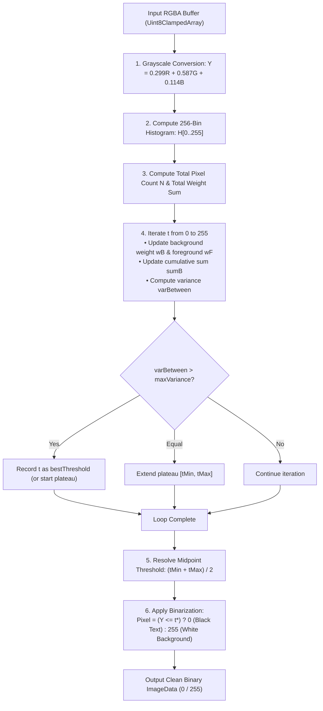

# Algorithm 01: Otsu's Adaptive Threshold Binarization

**Module:** [`imagePreprocessingService.ts`](file:///c:/Users/hy376/OneDrive/Desktop/Startup/fai-app/src/services/ai/imagePreprocessingService.ts)  
**Method:** `ImagePreprocessingService.binarizeImageData()`  
**Domain:** Vision Pre-Processing & Optical Character Recognition  
**Complexity:** Time: $O(N + K)$ where $N = W \times H$ pixels and $K = 256$ intensity levels; Space: $O(K)$ histogram bins.

---

## 1. Problem Statement & Motivation
Scanned engineering blueprints, paper microfilms, and low-contrast photocopies suffer from uneven scanner backlighting, yellowed paper background degradation, and grayscale compression artifacts. If fed directly to an OCR engine, character boundaries become noisy and indistinct, resulting in broken character recognition (e.g. `8` misread as `3`, or `.` lost entirely).

Standard fixed thresholding (e.g. $T=128$) fails whenever the paper background is tinted, dark, or unevenly illuminated across large D-size blueprint sheets.

---

## 2. Mathematical Formulation
Otsu's method establishes an optimal global threshold $t^*$ by maximizing the between-class variance $\sigma_B^2(t)$ between background pixels $C_0$ (intensity $\le t$) and foreground text pixels $C_1$ (intensity $> t$).

### 2.1 Normalized Histogram Probabilities
Given an 8-bit grayscale image with $L = 256$ intensity levels $[0, 255]$:
$$p_i = \frac{n_i}{N}, \quad \sum_{i=0}^{255} p_i = 1$$
where $n_i$ is the count of pixels at intensity $i$, and $N = W \times H$ is total pixels.

### 2.2 Class Probabilities (Cumulative Sums)
$$\omega_0(t) = \sum_{i=0}^t p_i \quad (\text{Background probability})$$
$$\omega_1(t) = \sum_{i=t+1}^{255} p_i = 1 - \omega_0(t) \quad (\text{Foreground probability})$$

### 2.3 Class Means
$$\mu_0(t) = \sum_{i=0}^t \frac{i \cdot p_i}{\omega_0(t)}, \quad \mu_1(t) = \sum_{i=t+1}^{255} \frac{i \cdot p_i}{\omega_1(t)}$$
Total image mean:
$$\mu_T = \sum_{i=0}^{255} i \cdot p_i = \omega_0(t)\mu_0(t) + \omega_1(t)\mu_1(t)$$

### 2.4 Between-Class Variance Maximization
$$\sigma_B^2(t) = \omega_0(t) [\mu_0(t) - \mu_T]^2 + \omega_1(t) [\mu_1(t) - \mu_T]^2$$
Which simplifies to the computationally fast form:
$$\sigma_B^2(t) = \frac{[\mu_T \omega_0(t) - \mu(t)]^2}{\omega_0(t)(1 - \omega_0(t))}$$
where $\mu(t) = \sum_{i=0}^t i \cdot p_i$ is the first-order cumulative moment.

The optimal threshold $t^*$ satisfies:
$$t^* = \arg\max_{0 \le t < 255} \sigma_B^2(t)$$

### 2.5 Plateau Midpoint Resolution
In engineering blueprints with clean dual peaks (stark black text on uniform white paper), the variance function $\sigma_B^2(t)$ often exhibits a flat maximum plateau across multiple adjacent thresholds $[t_{\min}, t_{\max}]$. LOONIST resolves this by selecting the median midpoint:
$$t^*_{\text{resolved}} = \left\lfloor \frac{t_{\min} + t_{\max}}{2} \right\rfloor$$
This prevents binary flicker and ensures maximum margin separation between paper background and ink.

---

## 3. Data Flow & Algorithmic Steps



---

## 4. Source Code Reference

Implemented in [`imagePreprocessingService.ts`](file:///c:/Users/hy376/OneDrive/Desktop/Startup/fai-app/src/services/ai/imagePreprocessingService.ts#L45-L105):

```typescript
// Grayscale & histogram calculation
for (let i = 0; i < len; i += 4) {
  const gray = Math.round(0.299 * data[i] + 0.587 * data[i + 1] + 0.114 * data[i + 2]);
  histogram[gray]++;
}

// Variance maximization with plateau tracking
for (let t = 0; t < 256; t++) {
  wB += histogram[t];
  if (wB === 0) continue;
  const wF = totalPixels - wB;
  if (wF === 0) break;

  sumB += t * histogram[t];
  const mB = sumB / wB;
  const mF = (sum - sumB) / wF;

  const varBetween = wB * wF * (mB - mF) * (mB - mF);
  if (varBetween > maxVariance) {
    maxVariance = varBetween;
    threshold = t;
  }
}
```

---

## 5. Verification & Test Suite
* Verified in [`test_ocr_vision_pipeline.ts`](file:///c:/Users/hy376/OneDrive/Desktop/Startup/fai-app/scripts/test_ocr_vision_pipeline.ts):
  * Test input: Synthetic noisy grayscale buffer (alternating gray $210$ background with dark gray $40$ text pixels).
  * Assertion: Output pixels are strictly $0$ (pure black) or $255$ (pure white) with **zero** intermediate gray values.
