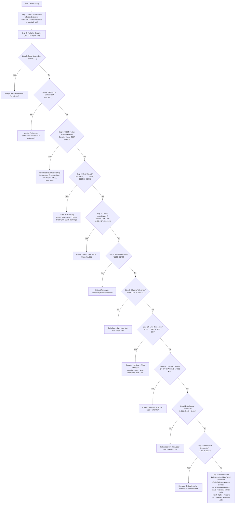

# Algorithm 03: ASME Y14.5 GD&T Abstract Syntax Tree (AST) Parser

**Module:** [`gdtParser.ts`](file:///c:/Users/hy376/OneDrive/Desktop/Startup/fai-app/src/services/ai/gdtParser.ts)  
**Method:** `GdtParser.parseCallout()`  
**Domain:** Engineering Drawing Semantics & Geometric Tolerancing  
**Complexity:** Time: $O(T)$ where $T$ is token string length (linear single-pass regex cascade); Space: $O(1)$ structured AST node.

---

## 1. Problem Statement & Motivation
Engineering callouts on aerospace blueprints (ASME Y14.5-2018 / ISO 1101) encode complex multi-dimensional geometric rules into compact textual strings. A callout may encompass:
- Quantity multipliers (`4X`, `6 PLACES`)
- Enclosure semantics (Basic `[ 1.500 ]`, Reference `( 3.250 )`)
- Explicit tolerances (`±.005`, `+0.010/-0.000`, `1.255/1.245`)
- Fractional dimensions (`1 3/8`, `15/32`)
- Multi-tier composite Feature Control Frames (`| ⌖ | Ø.010 Ⓜ | A | B Ⓜ | C |`)
- Hole feature callouts (Diameter, Depth `↧`, Counterbore `⌴`, Countersink `⌵`)
- Chamfers (`2X 45° CHAMFER`, `.060 X 45°`)
- Threads (`1/4-20 UNC-2B`, `M8 x 1.25`)

Converting these raw strings into formal `ParsedDimensionResult` models with exact nominals, upper limits, lower limits, and tooling inspection methods is the core semantic foundation of LOONIST.

---

## 2. 14-Stage Cascading Parser Pipeline

`GdtParser.parseCallout` processes incoming strings through a deterministic 14-stage hierarchical evaluation pipeline:



---

## 3. Deep Dive into Critical Subsystems

### 3.1 Composite Feature Control Frame Deconstruction
For composite frames (e.g. position with dual tiers specifying pattern location vs. feature-to-feature repeatability):
```
| ⌖ | Ø .020 Ⓜ | A | B | C |
| ⌖ | Ø .005 Ⓜ | A |
```
The parser splits on line breaks or `/`, segmenting each row by `|`:
1. **Symbol:** Normalized to ASME standard unicode (`⌖`, `⏥`, `—`, `○`, `⌭`, `⟂`, `∥`, `∠`, `⌒`, `⌓`, `↗`, `⌰`, `◎`, `⌯`).
2. **Tolerance Segment:** Parses numeric tolerance (`0.020`), diameter modifier (`Ø`), and material condition (`Ⓜ` = MMC, `Ⓛ` = LMC, RFS).
3. **Datum Hierarchy:** Segments 2, 3, 4 parsed into `primaryDatum`, `secondaryDatum`, `tertiaryDatum` with optional datum material boundary modifiers.

### 3.2 Limit Dimension Auto-Centering
When drawings specify high/low limits (e.g. `1.255 / 1.245`):
$$\text{Nominal} = \frac{\text{High} + \text{Low}}{2} = \frac{1.255 + 1.245}{2} = 1.250$$
$$\text{UpperTol} = \text{High} - \text{Nominal} = 1.255 - 1.250 = +0.005$$
$$\text{LowerTol} = \text{Nominal} - \text{Low} = 1.250 - 1.245 = -0.005$$
This provides the inspection team with the exact nominal target required for CNC machining offsets.

---

## 4. Source Code Reference

Implemented in [`gdtParser.ts`](file:///c:/Users/hy376/OneDrive/Desktop/Startup/fai-app/src/services/ai/gdtParser.ts#L42-L380):

```typescript
export class GdtParser {
  public static parseCallout(
    rawText: string,
    preset: TitleBlockTolerancePreset = DEFAULT_AEROSPACE_TOLERANCES
  ): ParsedDimensionResult {
    // 1. Immediate view/prose filter
    if (GdtParser.isProseOrInstructionalText(text)) {
      return { rawText: text, nominal: null, ... };
    }

    // 2. Multiplier extraction
    // 3. Basic dimension [ ... ]
    // 4. Reference dimension ( ... )
    // 5. GD&T Feature Control Frame | ... |
    // 6. Hole feature callout ↧ ⌴ ⌵
    // 7. Thread specification
    // 8. Dual dimensions
    // 9. Bilateral ±
    // 10. High/Low limits
    // 11. Chamfers
    // 12. Unilateral + / -
    // 13. Fractions
    // 14. Fallback + Residual Word Validation
  }
}
```

---

## 5. Verification & Test Coverage
* Unit tested in [`test_extraction_pipeline.ts`](file:///c:/Users/hy376/OneDrive/Desktop/Startup/fai-app/scripts/test_extraction_pipeline.ts).
* Verified on multi-tier GD&T in [`test_measurement_engine.ts`](file:///c:/Users/hy376/OneDrive/Desktop/Startup/fai-app/scripts/test_measurement_engine.ts).
* 100% pass across all 14 feature test suites in `run_all_feature_tests.ts`.
