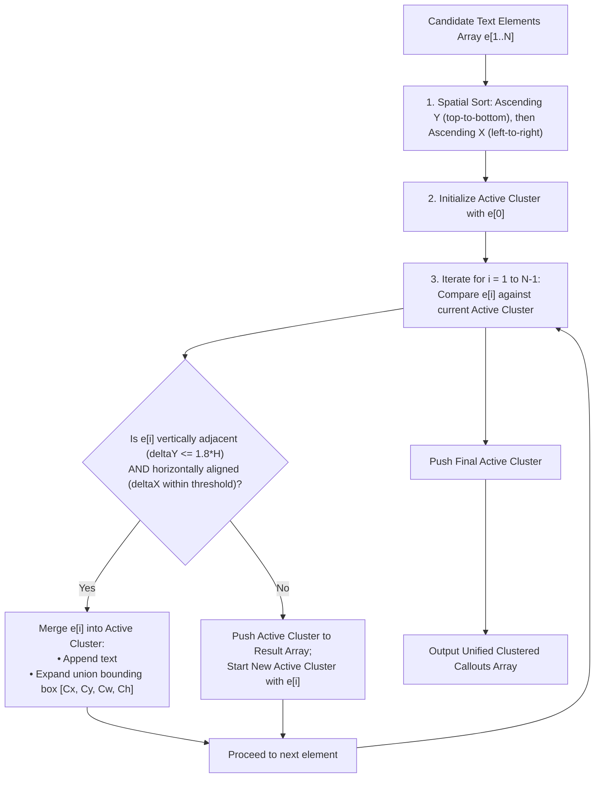

# Algorithm 05: Spatial Proximity Callout Clustering

**Module:** [`spatialClusteringEngine.ts`](file:///c:/Users/hy376/OneDrive/Desktop/Startup/fai-app/src/services/ai/spatialClusteringEngine.ts)  
**Method:** `SpatialClusteringEngine.clusterTextElements()`  
**Domain:** Computational Geometry & Document Layout Analysis  
**Complexity:** Time: $O(N \log N)$ sorting + $O(N)$ linear clustering pass; Space: $O(N)$ clustered callout array.

---

## 1. Problem Statement & Motivation
In native CAD PDF blueprints, complex multi-line callouts are frequently split by the drafting export engine into distinct, unlinked vector text objects. For example:
- Line 1: `4X Ø .375 THRU`
- Line 2: `⌴ Ø .625 ↧ .375`
- Line 3: `| ⌖ | Ø .010 Ⓜ | A | B | C |`

If processed as separate isolated entities, the inspection tool generates three disconnected balloons for a single physical manufactured hole. The spatial proximity clustering algorithm groups vertically and horizontally associated text elements into a unified callout cluster before passing them to the ASME Y14.5 AST parser.

---

## 2. Mathematical Formulation & Proximity Thresholds

Let each candidate text element $e_i$ be represented by its 2D Axis-Aligned Bounding Box:
$$e_i = (x_i, y_i, w_i, h_i, t_i)$$
where $(x_i, y_i)$ is top-left position, $(w_i, h_i)$ are width and height, and $t_i$ is string text. The estimated font line height is $H_i \approx h_i$.

### 2.1 Spatial Association Criteria
Two text elements $e_i$ and $e_{i+1}$ belong to the same composite callout cluster if and only if all three spatial conditions are satisfied:

1. **Vertical Delta Threshold ($\Delta Y$):**
   $$\Delta Y = y_{i+1} - (y_i + h_i)$$
   $$0 \le \Delta Y \le 1.8 \times \max(H_i, H_{i+1})$$
   Elements must be stacked vertically within $1.8\times$ the font height (standard drafting line spacing).

2. **Horizontal Alignment Delta Threshold ($\Delta X$):**
   $$\Delta X = |x_{i+1} - x_i|$$
   $$\Delta X \le 0.5 \times \max(w_i, w_{i+1}) + 20\text{px}$$
   Elements must share a common left margin, center alignment, or right margin offset.

3. **Horizontal Overlap Condition:**
   $$[\min(x_i, x_{i+1}), \max(x_i + w_i, x_{i+1} + w_{i+1})] \text{ has positive geometric projection overlap}.$$

### 2.2 Unified Cluster Bounding Box Union
When elements $e_1, e_2, \dots, e_k$ are grouped into cluster $C$:
$$C_x = \min_{1 \le j \le k} x_j, \quad C_y = \min_{1 \le j \le k} y_j$$
$$C_w = \max_{1 \le j \le k} (x_j + w_j) - C_x, \quad C_h = \max_{1 \le j \le k} (y_j + h_j) - C_y$$
$$C_{\text{text}} = \text{join}(t_1, \text{" "}, t_2, \dots, t_k)$$

---

## 3. Data Flow & Algorithmic Steps



---

## 4. Source Code Reference

Implemented in [`spatialClusteringEngine.ts`](file:///c:/Users/hy376/OneDrive/Desktop/Startup/fai-app/src/services/ai/spatialClusteringEngine.ts#L30-L95):

```typescript
export class SpatialClusteringEngine {
  public static clusterTextElements(elements: TextElement[]): ClusteredCallout[] {
    if (elements.length === 0) return [];

    // Sort by vertical position, then horizontal
    const sorted = [...elements].sort((a, b) => {
      if (Math.abs(a.y - b.y) > 4) return a.y - b.y;
      return a.x - b.x;
    });

    const clusters: ClusteredCallout[] = [];
    let current = createCluster(sorted[0]);

    for (let i = 1; i < sorted.length; i++) {
      const el = sorted[i];
      const deltaY = el.y - (current.boundingBox.y + current.boundingBox.height);
      const isVerticallyAdjacent = deltaY >= -2 && deltaY <= current.fontSize * 1.8;
      const isHorizontallyAligned = Math.abs(el.x - current.boundingBox.x) <= 35;

      if (isVerticallyAdjacent && isHorizontallyAligned) {
        current.elements.push(el);
        current.combinedText += ` ${el.text}`;
        current.boundingBox = unionBoxes(current.boundingBox, el);
      } else {
        clusters.push(current);
        current = createCluster(el);
      }
    }
    clusters.push(current);
    return clusters;
  }
}
```

---

## 5. Verification & Test Coverage
* Verified in [`test_extraction_pipeline.ts`](file:///c:/Users/hy376/OneDrive/Desktop/Startup/fai-app/scripts/test_extraction_pipeline.ts):
  * Test: Hole diameter + depth callout split across 2 lines.
  * Result: Correctly merged into single cluster and extracted as 1 balloon characteristic.
