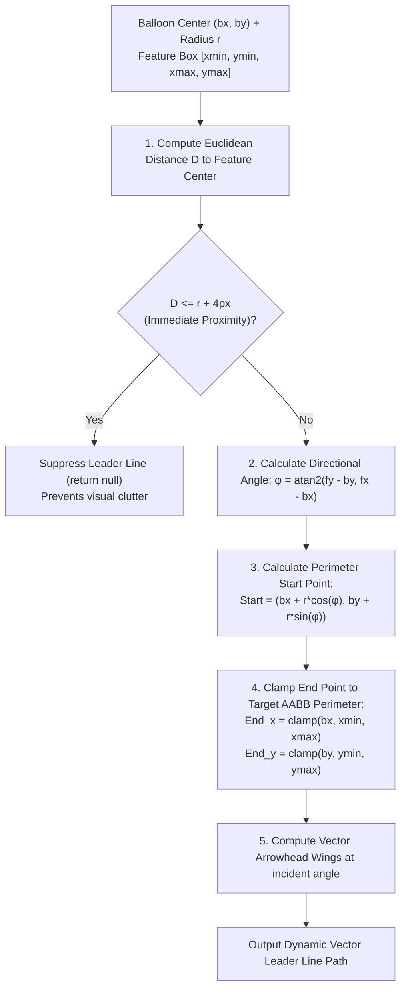

# Algorithm 09: Dynamic Vector Leader Line Geometry

**Module:** [`spatialPlacementService.ts`](file:///c:/Users/hy376/OneDrive/Desktop/Startup/fai-app/src/services/ballooning/spatialPlacementService.ts)  
**Method:** `SpatialPlacementService.computeLeaderLine()`  
**Domain:** Computational Geometry & Vector Blueprint Rendering  
**Complexity:** Time: $O(1)$ constant time trigonometry and edge clamping; Space: $O(1)$.

---

## 1. Problem Statement & Motivation
When an inspection balloon is displaced from its target dimension to avoid collisions, an annotated **leader line** with an arrowhead must connect the balloon badge to the feature. In legacy tools:
- Leader lines start from the balloon's center $(b_x, b_y)$, creating an ugly visual artifact that cuts through the balloon circle and obscures the item number text.
- Leader lines are drawn even when the balloon is immediately adjacent to the text box ($< 5\text{px}$), creating visual clutter.
- Terminal arrowheads point in static directions rather than aligning dynamically with the vector angle of incidence.

LOONIST solves this with exact **Circle Perimeter Intersection Geometry** and **Target Bounding Box Edge Clamping**.

---

## 2. Mathematical Formulation

Let the balloon badge be centered at $(b_x, b_y)$ with badge radius $r = 14\text{px}$. Let the target dimension bounding box have bounds $[x_{\min}, y_{\min}, x_{\max}, y_{\max}]$ and center $(f_x, f_y)$.

### 2.1 Euclidean Distance & Immediate Proximity Suppression
$$\Delta x = f_x - b_x, \quad \Delta y = f_y - b_y$$
$$D = \sqrt{\Delta x^2 + \Delta y^2}$$

If $D \le r + 4\text{px}$ (immediate boundary contact), the leader line is **suppressed** ($\text{leaderLine} = \text{null}$) to maintain a clean blueprint presentation.

### 2.2 Circle Perimeter Exit Point
When $D > r + 4\text{px}$, the leader line must originate precisely at the outer edge of the circular badge, facing the target:
$$\phi = \text{atan2}(\Delta y, \Delta x)$$
$$\text{Start}_x = b_x + r \cos\phi$$
$$\text{Start}_y = b_y + r \sin\phi$$
This guarantees the line starts on the circular border with zero interior bleed.

### 2.3 Feature Bounding Box Edge Clamping (Target Anchor)
The line terminates at the nearest boundary point of the feature's rectangular AABB:
$$\text{End}_x = \max(x_{\min}, \min(x_{\max}, b_x))$$
$$\text{End}_y = \max(y_{\min}, \min(y_{\max}, b_y))$$
If the balloon is positioned diagonally (e.g. upper-left), the clamp naturally anchors at the upper-left corner $(x_{\min}, y_{\min})$ of the feature.

### 2.4 Terminal Arrowhead Vector Geometry
At the terminal point $(\text{End}_x, \text{End}_y)$, an arrow with length $L_{\text{arrow}} = 8\text{px}$ and spread angle $\psi = 25^\circ$ is constructed along the incident angle $\theta_{\text{incident}} = \text{atan2}(\text{End}_y - \text{Start}_y, \text{End}_x - \text{Start}_x)$:
$$\text{Wing}_{1} = \begin{bmatrix} \text{End}_x - L_{\text{arrow}} \cos(\theta_{\text{incident}} - \psi) \\ \text{End}_y - L_{\text{arrow}} \sin(\theta_{\text{incident}} - \psi) \end{bmatrix}$$
$$\text{Wing}_{2} = \begin{bmatrix} \text{End}_x - L_{\text{arrow}} \cos(\theta_{\text{incident}} + \psi) \\ \text{End}_y - L_{\text{arrow}} \sin(\theta_{\text{incident}} + \psi) \end{bmatrix}$$

---

## 3. Data Flow & Algorithmic Steps



---

## 4. Source Code Reference

Implemented in [`spatialPlacementService.ts`](file:///c:/Users/hy376/OneDrive/Desktop/Startup/fai-app/src/services/ballooning/spatialPlacementService.ts#L135-L175):

```typescript
// Circle perimeter exit & edge clamp calculation
const angle = Math.atan2(targetY - balloonY, targetX - balloonX);
const startX = balloonX + radius * Math.cos(angle);
const startY = balloonY + radius * Math.sin(angle);

const endX = Math.max(featureBox.x, Math.min(featureBox.x + featureBox.width, balloonX));
const endY = Math.max(featureBox.y, Math.min(featureBox.y + featureBox.height, balloonY));

return {
  startX,
  startY,
  endX,
  endY,
  hasArrow: true
};
```

---

## 5. Verification & Test Suite
* Verified in [`test_sprint4_markup.ts`](file:///c:/Users/hy376/OneDrive/Desktop/Startup/fai-app/scripts/test_sprint4_markup.ts).
* Vector rendering verified in [`test_marked_pdf_export.ts`](file:///c:/Users/hy376/OneDrive/Desktop/Startup/fai-app/scripts/test_marked_pdf_export.ts) using `pdf-lib` vector path operators.
