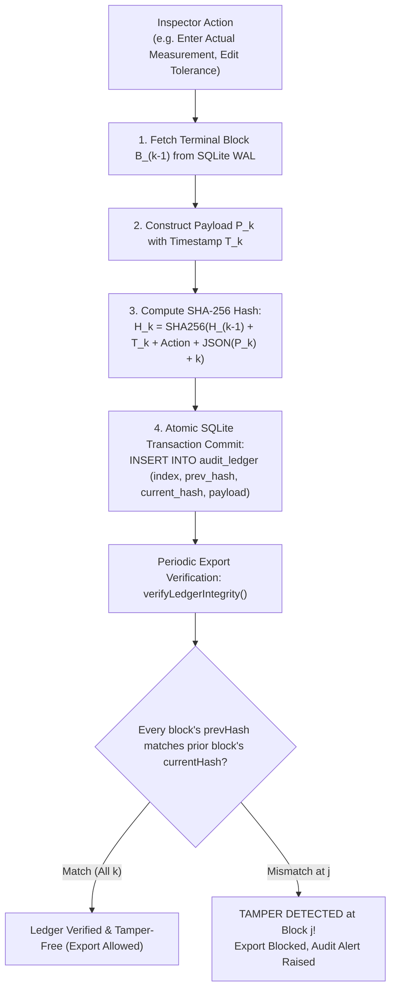

# Algorithm 11: Tamper-Evident SHA-256 Cryptographic Audit Ledger

**Module:** [`auditLedgerService.ts`](file:///c:/Users/hy376/OneDrive/Desktop/Startup/fai-app/src/services/compliance/auditLedgerService.ts)  
**Methods:** `AuditLedgerService.recordEvent()`, `AuditLedgerService.verifyLedgerIntegrity()`  
**Domain:** Information Security & Cryptographic Compliance  
**Complexity:** Time: $O(1)$ per event commit, $O(B)$ for full chain verification across $B$ blocks; Space: $O(1)$ per block.

---

## 1. Problem Statement & Motivation
In defense and aerospace manufacturing (ITAR 22 CFR § 120-130 / SAE AS9102), quality inspection records are legally binding documents. In traditional Excel or desktop tools, operators can silently modify out-of-spec dimensions after the fact, fudging numbers to pass lot audits.

LOONIST enforces a **100% offline, tamper-evident cryptographic ledger** using sequential SHA-256 hash chaining (blockchain architecture). Any manual tampering, out-of-sequence edits, or historical modifications immediately break the cryptographic hash chain.

---

## 2. Mathematical Formulation & Hash Chaining

Let the audit ledger be a sequentially numbered sequence of blocks $\mathcal{B} = \{B_0, B_1, B_2, \dots, B_n\}$.

### 2.1 Genesis Block ($B_0$)
The genesis root is established upon project initialization:
$$B_0 = \{ \text{index}: 0, \text{timestamp}: T_0, \text{action}: \text{"GENESIS"}, \text{prevHash}: \text{"0000000000000000000000000000000000000000000000000000000000000000"} \}$$
$$H_0 = \text{SHA-256}(B_0)$$

### 2.2 Sequential Chaining Rule
For any subsequent action $k \ge 1$ (such as editing a tolerance, approving a dimension, or recording a measurement):
$$B_k = \{ \text{index}: k, \text{timestamp}: T_k, \text{action}: A_k, \text{payload}: P_k, \text{prevHash}: H_{k-1} \}$$
$$H_k = \text{SHA-256}(H_{k-1} \parallel T_k \parallel A_k \parallel \text{JSON}(P_k) \parallel k)$$
where $\parallel$ denotes cryptographic byte concatenation.

```
+----------------+      +----------------+      +----------------+
|    Block 0     |      |    Block 1     |      |    Block 2     |
|  Genesis Root  | ---> | PrevHash: H_0  | ---> | PrevHash: H_1  |
|  Hash: H_0     |      | Hash: H_1      |      | Hash: H_2      |
+----------------+      +----------------+      +----------------+
```

### 2.3 Mathematical Tamper Detection
To verify the integrity of the ledger, an auditor computes:
$$\forall k \in [1, n]: \quad H_k \stackrel{?}{=} \text{SHA-256}(H_{k-1} \parallel T_k \parallel A_k \parallel \text{JSON}(P_k) \parallel k)$$
If an adversary modifies any historical payload $P_j$ where $j < n$:
$$H_j' \ne H_j \implies \text{PrevHash}_{j+1} \ne H_j' \implies \text{Chain Broken at Block } j+1$$
The verification algorithm pinpoints the exact compromised block index and timestamp.

---

## 3. Data Flow & Algorithmic Steps



---

## 4. Source Code Reference

Implemented in [`auditLedgerService.ts`](file:///c:/Users/hy376/OneDrive/Desktop/Startup/fai-app/src/services/compliance/auditLedgerService.ts#L30-L100):

```typescript
export class AuditLedgerService {
  public static computeBlockHash(
    index: number,
    prevHash: string,
    timestamp: number,
    action: string,
    payload: any
  ): string {
    const raw = `${index}|${prevHash}|${timestamp}|${action}|${JSON.stringify(payload)}`;
    return crypto.createHash('sha256').update(raw).digest('hex');
  }

  public static verifyLedgerIntegrity(blocks: AuditBlock[]): { isValid: boolean; brokenAt?: number } {
    for (let i = 1; i < blocks.length; i++) {
      if (blocks[i].prevHash !== blocks[i - 1].currentHash) {
        return { isValid: false, brokenAt: i };
      }
      const recomputed = this.computeBlockHash(
        blocks[i].index,
        blocks[i].prevHash,
        blocks[i].timestamp,
        blocks[i].action,
        blocks[i].payload
      );
      if (recomputed !== blocks[i].currentHash) {
        return { isValid: false, brokenAt: i };
      }
    }
    return { isValid: true };
  }
}
```

---

## 5. Verification & Test Suite
* Verified in [`test_audit_ledger.ts`](file:///c:/Users/hy376/OneDrive/Desktop/Startup/fai-app/scripts/test_audit_ledger.ts):
  * Test: Cryptographic hash chaining on 10 sequential quality actions.
  * Test: Simulated malicious database tampering at Block 4 correctly flagged by `verifyLedgerIntegrity()` with `brokenAt: 4`.
