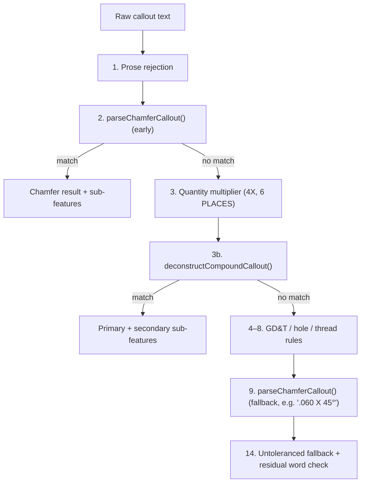

# Algorithm 13: Chamfer & Compound Callout Deconstruction

**Module:** [`gdtParser.ts`](../fai-app/src/services/ai/gdtParser.ts)  
**Methods:** `GdtParser.parseChamferCallout()`, `GdtParser.deconstructCompoundCallout()`, `GdtParser.isPrimaryNumberAngular()`  
**Domain:** ASME Y14.5-2018 § 1.8.16 (Chamfers), SAE AS9102 Form 3 characteristic accountability  
**Complexity:** Time: $O(L)$ regex passes over callout length $L$; Space: $O(k)$ for $k \le 4$ sub-features.  
**Introduced:** Sprint 7

---

## 1. Problem Statement & Motivation

Two classes of callout were being turned into wrong Form 3 rows:

1. **Chamfers read as multipliers.** `3 X 45° CHAMFER` matched the generic quantity rule `(\d+)\s*X`, producing *multiplier = 3, nominal = 45*. The correct reading is *leg depth = 3, angle = 45°, quantity = 1*.
2. **Compound hole callouts collapsed into one row.** `Ø12 ↧ 55.73 / ⌵ Ø25 X 90°` contains four inspectable features (drill Ø, drill depth, countersink Ø, countersink angle). Treating it as one characteristic loses three of them, and the trailing `90°` could flip the primary diameter into an angular dimension.

AS9102 Form 3 requires every design characteristic to be individually accounted for, so both errors are compliance defects, not cosmetic ones.

---

## 2. Evaluation Order

The order inside `parseCallout()` is the core of the fix:

Chamfers are evaluated **before** multipliers so that the `X` inside `3 X 45°` is never consumed as a quantity marker.

---

## 3. Chamfer Parsing

### 3.1 Multiplier isolation
Given cleaned text $T$:
1. Trailing places: `/^(.*?)\s*\(?(\d+)\s*PLACES\)?$/i` → multiplier $m$, strip suffix.
2. Leading `nX` is accepted as a multiplier **only if** the remainder is itself a full chamfer expression:
   $$T = \texttt{"}n\texttt{X "} R \;\wedge\; \text{isChamfer}(R) \implies m = n,\; T \leftarrow R$$
   So `4X 3 X 45°` → $m = 4$, but `3 X 45°` keeps $m = 1$.

### 3.2 Chamfer recognition — `isChamferExpression(S)`
$S$ must contain `x`, `X` or `×`, and at least one of:
- an explicit `CHAMFER` / `CHAM` keyword;
- a degree marker (`°`, `c`, `deg`) adjacent to the `X`;
- a common chamfer angle without a degree sign (30, 45, 60) next to the `X`, e.g. `3 x 45`.

### 3.3 Patterns
After stripping `ALL CHAMFERS =` / `CHAMFER` and any explicit `± t` on the leg:

| Pattern | Form | Example | Nominal | Angle |
| :-: | :--- | :--- | :-: | :-: |
| **A** | depth × angle | `3 X 45°`, `.060 X 45°`, `3 X 45c` | depth | yes |
| **B** | angle × depth | `45° X 3` | depth | yes |
| **C** | depth × depth + keyword | `3 X 3 CHAMFER` | first depth | no |

### 3.4 Tolerances
- **Leg:** explicit `± t` if present; otherwise inherited from the title block by decimal precision (see [Algorithm 06](./06_Title_Block_Tolerance_Matrix.md)).
- **Angle:** preset angular tolerance $\pm\theta_{tb}$.
- Form 3 lower tolerance is emitted as a **positive magnitude** ($\text{lowerTol} = t$, limits $= [n - t, n + t]$).

**Worked example** (imperial preset, `.X = ±0.03`): `3 X 45° CHAMFER` → nominal $3$, $m = 1$, type `chamfer`, limits $[2.97, 3.03]$; secondary angle $45^\circ \pm 0.5^\circ$.

### 3.5 Output
| Sub | Requirement | Type | Class | Render balloon |
| :-: | :--- | :--- | :-: | :-: |
| `.1` | `{depth} Chamfer Leg` | `chamfer` | Major | ✅ |
| `.2` | `{angle}° Chamfer Angle` | `angle` (`deg`) | Minor | ❌ (`isSecondarySub`) |

---

## 4. Compound Callout Deconstruction

| Case | Trigger | Example | Sub-features |
| :-: | :--- | :--- | :--- |
| **1** | Drill + depth + countersink | `Ø12 ↧ 55.73 / ⌵ Ø25 X 90°` | Drill Ø · Drill depth · CSK Ø · CSK angle |
| **2** | Counterbore hole | `Ø50 THRU / ⌴ Ø70 ↧ 12` | Hole Ø · CBORE Ø · CBORE depth |
| **3** | Thread + spotface + places | `1/2-13 UNC - 2B / ⌴ Ø22 ↧ 5 / 3 PLCS` | Thread · Spotface Ø · Spotface depth |

- Linear sub-features take the drawing's linear units; angular ones are forced to `deg` (**angular isolation**).
- Only the primary sub-feature renders a balloon on the canvas (`skipBalloonRender = isSecondary`); all rows remain in the Form 3 table and exports (**Clean Canvas / single balloon per leader**).

### 4.1 Primary-number angularity guard — `isPrimaryNumberAngular(T, n)`
Returns `false` whenever $T$ starts with or clearly indicates a diameter (`Ø`), radius (`R`) or thread, even if a `°` appears later in the string. Returns `true` only if $n$ itself carries a degree marker, or $T$ is a bare angle (`120°`, `45 deg`, `120c`).

---

## 5. Verification
- [`test_chamfer_asme_as9102.ts`](../fai-app/scripts/test_chamfer_asme_as9102.ts) — depth vs angle, angle-first, multiplier decoupling, positive-magnitude tolerances.
- [`test_industrial_inspection_standards.ts`](../fai-app/scripts/test_industrial_inspection_standards.ts) — compound deconstruction, angular isolation, `ALL CHAMFERS = 0.5 X 45°`, single balloon per leader.
