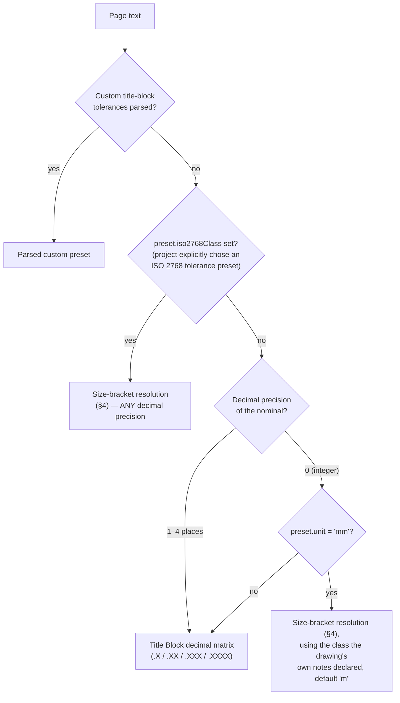

# Algorithm 14: Drawing Unit Detection & ISO 2768 Size-Bracket Tolerancing

**Modules:** [`toleranceEngine.ts`](../fai-app/src/services/ai/toleranceEngine.ts), [`drawingExtractionService.ts`](../fai-app/src/services/ai/drawingExtractionService.ts)  
**Methods:** `ToleranceEngine.detectDrawingUnits()`, `ToleranceEngine.resolveMetricIso2768Tolerance()`, `ToleranceEngine.resolveTitleBlockTolerance()`  
**Domain:** ASME Y14.5 / ISO 2768-1 general tolerances  
**Complexity:** Time: $O(P)$ over page text length $P$ for detection; $O(1)$ tolerance lookup.  
**Introduced:** Sprint 7. **Rewritten (§4) Sprint 9** — size-bracket resolution now applies regardless of decimal precision, across all four ISO 2768 classes (f/m/c/v), with bands through 4000mm. `aiExtractionService.ts` was renamed `drawingExtractionService.ts` in Sprint 9 (deterministic parsing with OCR as a raster fallback, not an AI/LLM call).

---

## 1. Problem Statement & Motivation

Before Sprint 7, `detectDrawingUnits()` returned `'in'` whenever it found no metric marker, so a metric drawing without a recognised note, or a project explicitly set to `mm`, still received imperial title-block tolerances ($\pm 0.030$ in on a 185 mm dimension). Integer millimetre dimensions — the most common metric callout — also had no size-dependent tolerance.

---

## 2. Unit Resolution Precedence

$$\text{unit} = \text{notes}(T) \;\text{??}\; \text{project.units} \;\text{??}\; \text{settings.units} \;\text{??}\; \texttt{'in'}$$

where `notes(T)` returns `'mm'`, `'in'` or `null`:

1. Normalise whitespace and upper-case the concatenated page text $T$.
2. **Metric markers** (checked first): `DIMENSIONS IN MILLIMETERS`, `ALL DIMENSIONS ARE IN MILLIMETERS`, `UNITS: MM`, `MILLIMETERS`, `MILLIMETER`, … → `'mm'`.
3. **Imperial markers**: `ALL DIMENSIONS ARE IN INCHES`, `UNLESS OTHERWISE SPECIFIED: IN`, `UNITS: IN`, `INCHES`, … → `'in'`.
4. Otherwise → `null` (defer to project / settings instead of forcing inches).

> **Known limitation:** dual-dimensioned drawings (`INCHES [MILLIMETERS]`) resolve to `mm` because metric markers are checked first.

---

## 3. Tolerance Preset Selection

Metric decimal defaults: `.X = ±0.10`, `.XX = ±0.05`, `.XXX = ±0.01`, `.XXXX = ±0.002` mm, angles $\pm 0.5^\circ$.

> **(Sprint 9)** Previously, size-bracket resolution only ever triggered for an integer-mm nominal with no decimal places (the right branch above). It's now also the primary path whenever a project's tolerance preset explicitly declares an ISO 2768 class — the decimal-place matrix is a shop/inch-convention idiom and was never the correct ISO 2768-1 rule in the first place.

---

## 4. ISO 2768 Size Brackets (f / m / c / v, all sizes)

`ToleranceEngine.resolveMetricIso2768Tolerance(nominal, tolClass)` looks up the nominal's absolute value against `ISO_2768_TABLE[tolClass]`, an array of `[bracketUpperBoundMm, toleranceMm]` pairs (upper-inclusive; the last bracket catches anything larger):

| Bracket upper bound (mm) | f (fine) | m (medium, default) | c (coarse) | v (very coarse) |
| :--- | :-: | :-: | :-: | :-: |
| 3 | ±0.05 | ±0.1 | ±0.2 | — |
| 6 | ±0.05 | ±0.1 | ±0.3 | ±0.5 |
| 30 | ±0.1 | ±0.2 | ±0.5 | ±1 |
| 120 | ±0.15 | ±0.3 | ±0.8 | ±1.5 |
| 400 | ±0.2 | ±0.5 | ±1.2 | ±2.5 |
| 1000 | ±0.3 | ±0.8 | ±2 | ±4 |
| 2000 | ±0.5 | ±1.2 | ±3 | ±6 |
| 4000 | ±0.8 | ±2 | ±4 | ±8 |

Source label: `ISO 2768-<class> (±t mm, size bracket)`. **(Sprint 9)** Both the 1000–2000mm and 2000–4000mm brackets are now implemented across all four classes — previously only bands up to 1000mm existed, and only for class `m`.

**Worked example:** metric drawing, callout `185`, class `m` → bracket $\le 400$ → $185 \pm 0.5$, limits $[184.5, 185.5]$ (unchanged from before — the correction affects larger nominals and the `f`/`c`/`v` classes, not this example).

---

## 5. Verification
- [`test_industrial_inspection_standards.ts`](../fai-app/scripts/test_industrial_inspection_standards.ts) — note priority over imperial defaults, ISO 2768-m on integer mm, angular unit isolation.
- [`test_settings_subsystem.ts`](../fai-app/scripts/test_settings_subsystem.ts) — units toggle and tolerance matrix.
