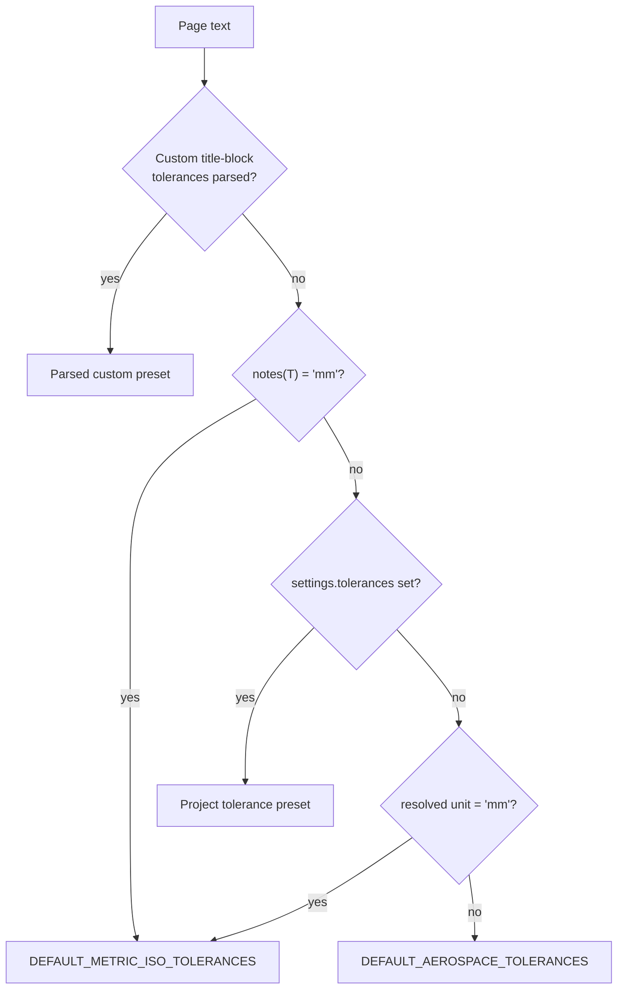

# Algorithm 14: Drawing Unit Detection & ISO 2768-m Size-Band Tolerancing

**Modules:** [`toleranceEngine.ts`](../fai-app/src/services/ai/toleranceEngine.ts), [`aiExtractionService.ts`](../fai-app/src/services/ai/aiExtractionService.ts)  
**Methods:** `ToleranceEngine.detectDrawingUnits()`, `ToleranceEngine.resolveMetricIso2768Tolerance()`, `ToleranceEngine.resolveTitleBlockTolerance()`  
**Domain:** ASME Y14.5 / ISO 2768-1 general tolerances  
**Complexity:** Time: $O(P)$ over page text length $P$ for detection; $O(1)$ tolerance lookup.  
**Introduced:** Sprint 7

---

## 1. Problem Statement & Motivation

Before Sprint 7, `detectDrawingUnits()` returned `'in'` whenever it found no metric marker, so a metric drawing without a recognised note, or a project explicitly set to `mm`, still received imperial title-block tolerances ($\pm 0.030$ in on a 185 mm dimension). Integer millimetre dimensions — the most common metric callout — also had no size-dependent tolerance.

---

## 2. Unit Resolution Precedence

$$\text{unit} = \text{notes}(T) \;\text{??}\; \text{project.units} \;\text{??}\; \text{settings.units} \;\text{??}\; \texttt{'in'}$$

where `notes(T)` returns `'mm'`, `'in'` or `null`:

1. Normalise whitespace and upper-case the concatenated page text $T$.
2. **Metric markers** (checked first): `DIMENSIONS IN MILLIMETERS`, `ALL DIMENSIONS ARE IN MILLIMETERS`, `UNITS: MM`, `MILLIMETERS`, `MILLIMETER`, … → `'mm'`.
3. **Imperial markers**: `ALL DIMENSIONS ARE IN INCHES`, `UNLESS OTHERWISE SPECIFIED: IN`, `UNITS: IN`, `INCHES`, … → `'in'`.
4. Otherwise → `null` (defer to project / settings instead of forcing inches).

> **Known limitation:** dual-dimensioned drawings (`INCHES [MILLIMETERS]`) resolve to `mm` because metric markers are checked first.

---

## 3. Tolerance Preset Selection

Metric decimal defaults: `.X = ±0.10`, `.XX = ±0.05`, `.XXX = ±0.01`, `.XXXX = ±0.002` mm, angles $\pm 0.5^\circ$.

---

## 4. ISO 2768-m Size Bands (integer mm dimensions)

When the preset unit is `mm` and the nominal has **no decimal places**, the tolerance comes from the nominal size band instead of decimal precision:

| Nominal $|n|$ (mm) | Implemented | ISO 2768-m |
| :--- | :-: | :-: |
| $\le 3$ | $\pm 0.1$ | $\pm 0.1$ (0.5–3) |
| $(3, 6]$ | $\pm 0.1$ | $\pm 0.1$ |
| $(6, 30]$ | $\pm 0.2$ | $\pm 0.2$ |
| $(30, 120]$ | $\pm 0.3$ | $\pm 0.3$ |
| $(120, 400]$ | $\pm 0.5$ | $\pm 0.5$ |
| $(400, 1000]$ | $\pm 0.8$ | $\pm 0.8$ |
| $(1000, 2000]$ | $\pm 0.8$ ⚠️ | $\pm 1.2$ |
| $(2000, 4000]$ | $\pm 0.8$ ⚠️ | $\pm 2.0$ |

Source label: `ISO 2768-m (±t mm)`. ⚠️ The two largest bands are not yet implemented (tracked for Sprint 8).

**Worked example:** metric drawing, callout `185` → band $(120, 400]$ → $185 \pm 0.5$, limits $[184.5, 185.5]$.

---

## 5. Verification
- [`test_industrial_inspection_standards.ts`](../fai-app/scripts/test_industrial_inspection_standards.ts) — note priority over imperial defaults, ISO 2768-m on integer mm, angular unit isolation.
- [`test_settings_subsystem.ts`](../fai-app/scripts/test_settings_subsystem.ts) — units toggle and tolerance matrix.
