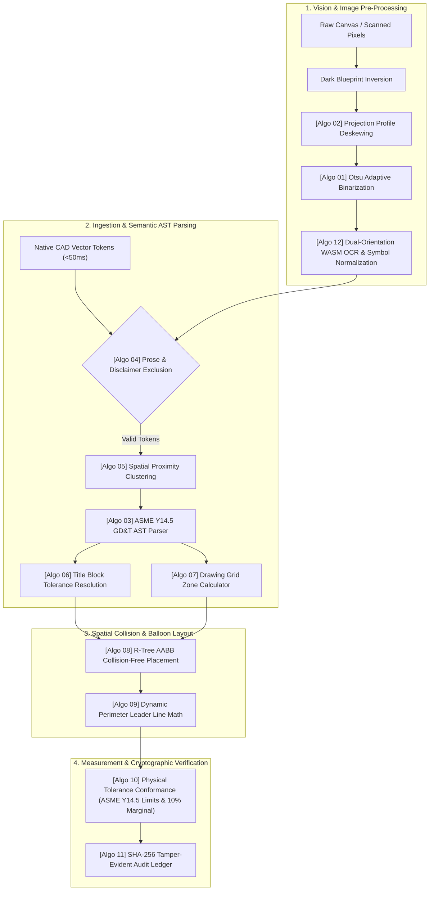

# LOONIST Master Algorithms Catalog

This directory contains the formal mathematical formulations, algorithmic specifications, flowcharts, and source code mappings for all algorithms powering the **LOONIST** First Article Inspection (FAI) platform.

---

## 📑 Algorithms Index & System Matrix

| # | Algorithm Name | Domain / Category | Primary Complexity | Source Code Mapping | Specification Document |
| :-: | :--- | :--- | :---: | :--- | :--- |
| **01** | **Otsu Adaptive Binarization** | Vision & Image Processing | $O(N + K)$ where $K=256$ | [`imagePreprocessingService.ts`](file:///c:/Users/hy376/OneDrive/Desktop/Startup/fai-app/src/services/ai/imagePreprocessingService.ts) | [`01_Otsu_Adaptive_Binarization.md`](./01_Otsu_Adaptive_Binarization.md) |
| **02** | **Projection Profile Variance Deskewing** | Vision & Image Processing | $O(A \times W \times H)$ | [`imagePreprocessingService.ts`](file:///c:/Users/hy376/OneDrive/Desktop/Startup/fai-app/src/services/ai/imagePreprocessingService.ts) | [`02_Projection_Profile_Deskewing.md`](./02_Projection_Profile_Deskewing.md) |
| **03** | **ASME Y14.5 GD&T AST Semantic Parser** | Semantic Parsing & CAD | $O(T)$ token stream | [`gdtParser.ts`](file:///c:/Users/hy376/OneDrive/Desktop/Startup/fai-app/src/services/ai/gdtParser.ts) | [`03_ASME_Y14_5_GDT_AST_Parser.md`](./03_ASME_Y14_5_GDT_AST_Parser.md) |
| **04** | **Prose & Sentence Exclusion Engine** | Natural Language & Filtering | $O(W)$ words | [`gdtParser.ts`](file:///c:/Users/hy376/OneDrive/Desktop/Startup/fai-app/src/services/ai/gdtParser.ts) & [`aiExtractionService.ts`](file:///c:/Users/hy376/OneDrive/Desktop/Startup/fai-app/src/services/ai/aiExtractionService.ts) | [`04_Prose_And_Sentence_Exclusion.md`](./04_Prose_And_Sentence_Exclusion.md) |
| **05** | **Spatial Proximity Callout Clustering** | Computational Geometry | $O(N \log N)$ spatial | [`spatialClusteringEngine.ts`](file:///c:/Users/hy376/OneDrive/Desktop/Startup/fai-app/src/services/ai/spatialClusteringEngine.ts) | [`05_Spatial_Proximity_Clustering.md`](./05_Spatial_Proximity_Clustering.md) |
| **06** | **Title Block Tolerance Precision Matrix** | Engineering Tolerancing | $O(1)$ lookup | [`toleranceEngine.ts`](file:///c:/Users/hy376/OneDrive/Desktop/Startup/fai-app/src/services/ai/toleranceEngine.ts) | [`06_Title_Block_Tolerance_Matrix.md`](./06_Title_Block_Tolerance_Matrix.md) |
| **07** | **Blueprint Border Grid Zone Mapping** | Drawing Grid Coordinate | $O(L \log L)$ border | [`gridZoneCalculator.ts`](file:///c:/Users/hy376/OneDrive/Desktop/Startup/fai-app/src/services/ai/gridZoneCalculator.ts) & [`aiExtractionService.ts`](file:///c:/Users/hy376/OneDrive/Desktop/Startup/fai-app/src/services/ai/aiExtractionService.ts) | [`07_Drawing_Grid_Zone_Mapping.md`](./07_Drawing_Grid_Zone_Mapping.md) |
| **08** | **Spatial R-Tree AABB Collision Avoidance** | Spatial Indexing & Placement | $O(\log M + K)$ | [`spatialPlacementService.ts`](file:///c:/Users/hy376/OneDrive/Desktop/Startup/fai-app/src/services/ballooning/spatialPlacementService.ts) | [`08_RTree_AABB_Collision_Avoidance.md`](./08_RTree_AABB_Collision_Avoidance.md) |
| **09** | **Dynamic Vector Leader Line Geometry** | Computational Geometry | $O(1)$ per balloon | [`spatialPlacementService.ts`](file:///c:/Users/hy376/OneDrive/Desktop/Startup/fai-app/src/services/ballooning/spatialPlacementService.ts) | [`09_Dynamic_Vector_Leader_Line_Geometry.md`](./09_Dynamic_Vector_Leader_Line_Geometry.md) |
| **10** | **Physical Measurement Tolerance Conformance** | Quality Compliance | $O(1)$ per actual | [`measurementEngine.ts`](file:///c:/Users/hy376/OneDrive/Desktop/Startup/fai-app/src/services/compliance/measurementEngine.ts) | [`10_Physical_Measurement_Tolerance_Evaluation.md`](./10_Physical_Measurement_Tolerance_Evaluation.md) |
| **11** | **Tamper-Evident SHA-256 Audit Ledger** | Cryptography & Security | $O(B)$ hash chain | [`auditLedgerService.ts`](file:///c:/Users/hy376/OneDrive/Desktop/Startup/fai-app/src/services/compliance/auditLedgerService.ts) | [`11_SHA256_Cryptographic_Audit_Ledger.md`](./11_SHA256_Cryptographic_Audit_Ledger.md) |
| **12** | **CAD Symbol OCR Normalization & Alignment** | OCR & Pattern Recognition | $O(S)$ regex stream | [`ocrEngineService.ts`](file:///c:/Users/hy376/OneDrive/Desktop/Startup/fai-app/src/services/ai/ocrEngineService.ts) | [`12_CAD_Symbol_Normalization_And_Orientation.md`](./12_CAD_Symbol_Normalization_And_Orientation.md) |

---

## 🏛️ Algorithmic Pipeline Architecture

---

## 🔬 Algorithm Categories

### 1. Vision & Image Processing
- **Otsu Adaptive Binarization ([`01_Otsu_Adaptive_Binarization.md`](./01_Otsu_Adaptive_Binarization.md)):** Converts degraded gray blueprint scans and yellowed paper into pure high-contrast binary text ($0/255$).
- **Projection Profile Deskewing ([`02_Projection_Profile_Deskewing.md`](./02_Projection_Profile_Deskewing.md)):** Corrects physical scanner rotation angles ($-4^\circ$ to $+4^\circ$) by maximizing projection variance across horizontal slice lines.
- **CAD Symbol Normalization ([`12_CAD_Symbol_Normalization_And_Orientation.md`](./12_CAD_Symbol_Normalization_And_Orientation.md)):** Reconstructs distorted drafting symbols (`Ø`, `±`, `°`, `↧`, `⌴`, `⌵`) and evaluates dual orientations ($0^\circ$ and $90^\circ$).

### 2. Natural Language & Semantic Parsing
- **ASME Y14.5 GD&T AST Parser ([`03_ASME_Y14_5_GDT_AST_Parser.md`](./03_ASME_Y14_5_GDT_AST_Parser.md)):** Deconstructs complex engineering callouts into structured abstract syntax trees (14 GD&T symbols, composite frames, hole callouts, limit dimensions).
- **Prose & Sentence Exclusion ([`04_Prose_And_Sentence_Exclusion.md`](./04_Prose_And_Sentence_Exclusion.md)):** Prevents narrative cover sheet sentences (e.g. Autodesk Inventor tutorial text) from ballooning as fake dimensions using natural language syntax and residual token validation.

### 3. Computational Geometry & Spatial Indexing
- **Spatial Proximity Clustering ([`05_Spatial_Proximity_Clustering.md`](./05_Spatial_Proximity_Clustering.md)):** Merges companion multi-line blueprint callouts into unified characteristics using font-relative spatial bounding boxes.
- **Blueprint Border Grid Zone Mapping ([`07_Drawing_Grid_Zone_Mapping.md`](./07_Drawing_Grid_Zone_Mapping.md)):** Maps blueprint Cartesian coordinates to standard aerospace margin zones (e.g. `Zone C-4`).
- **R-Tree AABB Collision Avoidance ([`08_RTree_AABB_Collision_Avoidance.md`](./08_RTree_AABB_Collision_Avoidance.md)):** Places balloon badges without overlapping dense drawing geometry using an 8-ray radial search.
- **Dynamic Leader Line Geometry ([`09_Dynamic_Vector_Leader_Line_Geometry.md`](./09_Dynamic_Vector_Leader_Line_Geometry.md)):** Calculates circle-perimeter exit points and terminal arrow vectors.

### 4. Tolerancing, Quality & Cryptography
- **Title Block Tolerance Precision Matrix ([`06_Title_Block_Tolerance_Matrix.md`](./06_Title_Block_Tolerance_Matrix.md)):** Resolves implicit tolerances based on decimal place count (`.X` to `.XXXX`) and ISO 2768-m.
- **Physical Measurement Conformance ([`10_Physical_Measurement_Tolerance_Evaluation.md`](./10_Physical_Measurement_Tolerance_Evaluation.md)):** Evaluates measured physical dimensions against bilateral/unilateral tolerance bands with a 10% marginal boundary warning.
- **Tamper-Evident SHA-256 Ledger ([`11_SHA256_Cryptographic_Audit_Ledger.md`](./11_SHA256_Cryptographic_Audit_Ledger.md)):** Blockchain-style cryptographic hash chaining for all quality actions.
