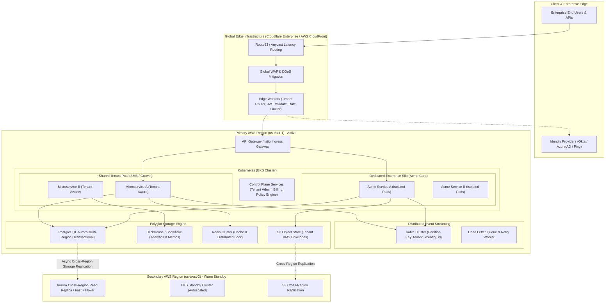
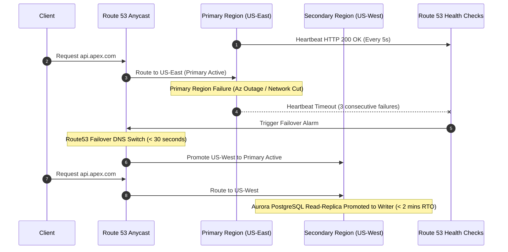
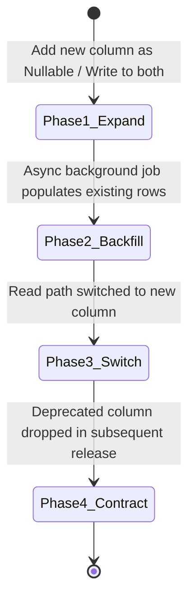

# Enterprise B2B SaaS Architecture Blueprint (APEX-SaaS)
**Role:** Senior Production Engineer / Staff SRE Architectural Specification  
**System Target:** Global, High-Availability, Multi-Tenant B2B Platform  
**Target Availability:** 99.99% (Five Nines for Enterprise Tier)  
**Target Latency:** P95 < 50ms, P99 < 150ms  
**Capacity:** 10,000+ Enterprise Tenants | 100,000 RPS Peak | Petabyte-Scale Storage  

---

## 1. System Requirements & Production Constraints

### 1.1 Non-Functional Requirements (NFRs) & Production SLAs
| Dimension | Requirement / SLA Target | Failure Metric / SLA Threshold |
| :--- | :--- | :--- |
| **Availability** | 99.99% Uptime (Standard Pool) <br> 99.999% Uptime (Dedicated Enterprise Silo) | Max downtime: 52.5 mins/year (Pool) <br> 5.25 mins/year (Dedicated) |
| **Latency** | Edge-to-Ack P95 < 50ms, P99 < 150ms <br> Async processing lag < 500ms | P99 > 300ms triggers SLA breach alert |
| **Data Protection** | RPO = 0 (Transactional), RPO < 1 min (Analytics) <br> RTO < 15 mins (Region Failover) | Automated PITR up to 35 days |
| **Isolation** | Strict Tenant Data & Compute Isolation | Zero cross-tenant leaks (SOC2 Type II / ISO27001) |
| **Scalability** | Horizontal Autoscaling 10x burst capacity in < 3 mins | Zero manual intervention on scale-up |
| **Compliance** | GDPR, HIPAA, SOC2 Type II, PCI-DSS Level 1 | Immutable Audit Logging with KMS Envelope Encryption |

---

## 2. High-Level Architecture Topology



---

## 3. Multi-Tenancy Strategy: Hybrid Silo/Pool Model

To balance **cost efficiency** for self-serve tenants and **strict compliance/performance guarantees** for Fortune 500 clients, we implement a **Dynamic Tiered Hybrid Multi-Tenancy Architecture**.

### 3.1 Tenant Isolation Matrix

```
                          COMPUTE ISOLATION
                 Shared Pods            Dedicated Pods / Cluster
             +------------------------+------------------------+
             |                        |                        |
   Shared    |  TIER 1: STANDARD      |  TIER 2: PREMIUM       |
   Database  |  - Pool Model          |  - Hybrid Model        |
             |  - Row-Level Security  |  - Shared DB (RLS)     |
DATA         |  - Shared Pods         |  - Dedicated Pods      |
ISOLATION    +------------------------+------------------------+
             |                        |                        |
   Dedicated |  TIER 3: COMPLIANCE    |  TIER 4: ENTERPRISE    |
   Database  |  - Dedicated DB Schemas|  - Silo Model          |
             |  - Shared Pods         |  - Dedicated VPC/DB    |
             |  - KMS Tenant Key      |  - Dedicated KMS Key   |
             +------------------------+------------------------+
```

### 3.2 Database Data Isolation Mechanics (PostgreSQL Row-Level Security)

For shared databases (Tier 1 & 2), tenant isolation is enforced at the database kernel level using **PostgreSQL Row-Level Security (RLS)**. Application connection pools set the session variable per request, ensuring no query can leak cross-tenant data even if application code contains a missing `WHERE` clause.

```sql
-- 1. Create Tenant Table & Enforce Row Level Security
CREATE TABLE enterprise_documents (
    id UUID PRIMARY KEY DEFAULT gen_random_uuid(),
    tenant_id UUID NOT NULL REFERENCES tenants(id),
    title VARCHAR(255) NOT NULL,
    content TEXT,
    created_at TIMESTAMPTZ DEFAULT clock_timestamp()
);

-- Enable RLS on the table
ALTER TABLE enterprise_documents ENABLE ROW LEVEL SECURITY;

-- 2. Create Policy restricting access based on session tenant ID
CREATE POLICY tenant_isolation_policy ON enterprise_documents
    FOR ALL
    USING (tenant_id = NULLIF(current_setting('app.current_tenant_id', true), '')::uuid);

-- 3. Application Connection Wrapper (Executed at beginning of DB transaction)
-- Example Execution via Middleware:
SET LOCAL app.current_tenant_id = 'a1b2c3d4-e5f6-7890-abcd-1234567890ab';
SELECT * FROM enterprise_documents; -- Returns ONLY records matching tenant_id
```

### 3.3 Noisy Neighbor Protection & Rate Limiting

We employ a 2-Layer Adaptive Token Bucket Rate Limiter:
1. **Edge Tier (Cloudflare/Envoy):** Limits IP burst attacks and unauthenticated requests.
2. **Application Tier (Redis Cluster + Envoy Rate Limit Service):** Implements **Fair Queueing & Dynamic Tenant Quotas**.

#### Envoy Rate Limit Configuration Snippet (Tenant Aware)
```yaml
domain: apex_tenant_rate_limits
descriptors:
  - key: tenant_tier
    value: standard
    rate_limit:
      unit: minute
      requests_per_unit: 1000
  - key: tenant_tier
    value: enterprise
    rate_limit:
      unit: minute
      requests_per_unit: 50000
  - key: tenant_id
    rate_limit:
      unit: second
      requests_per_unit: 500 # Dynamic bursting per specific tenant ID
```

---

## 4. Resilience Engineering & Disaster Recovery

### 4.1 High Availability Topology & RTO/RPO Targets



### 4.2 Circuit Breaker & Bulkhead Design

Services integrate Envoy sidecars configured with strict **Circuit Breakers** and **Outlier Detection** to prevent cascading failures across microservices.

#### Envoy Circuit Breaker Configuration
```yaml
clusters:
  - name: document_processing_service
    connect_timeout: 0.25s
    type: STRICT_DNS
    lb_policy: ROUND_ROBIN
    circuit_breakers:
      thresholds:
        - priority: DEFAULT
          max_connections: 1024
          max_pending_requests: 100
          max_requests: 2000
          max_retries: 3
    outlier_detection:
      consecutive_5xx: 3
      interval: 10s
      base_ejection_time: 30s
      max_ejection_percent: 50
```

---

## 5. Security & Zero Trust Architecture

### 5.1 Mutual TLS (mTLS) & Workload Identity with SPIFFE/SPIRE
Inside the Kubernetes mesh, every service call requires mTLS cryptographic authentication using short-lived X.509 certificates generated by SPIRE.

```mermaid
flowchart LR
    subgraph K8s_Node ["Kubernetes Node"]
        SPIREAgent["SPIRE Agent"]
        
        subgraph PodA ["Service A Pod"]
            ServiceA["Service A"]
            EnvoyA["Envoy Sidecar"]
        end

        subgraph PodB ["Service B Pod"]
            ServiceB["Service B"]
            EnvoyB["Envoy Sidecar"]
        end
    end

    SPIREAgent -->|Attest & Issue SVID| EnvoyA
    SPIREAgent -->|Attest & Issue SVID| EnvoyB
    EnvoyA <-->|mTLS (X.509 SVID Validation)| EnvoyB
```

### 5.2 Fine-Grained Authorization (ReBAC / OpenFGA)

Access to resources is evaluated via a relationship-based authorization engine (ReBAC).

```json
// Example OpenFGA Schema for Enterprise Workspace Access
{
  "type": "workspace",
  "relations": {
    "owner": { "this": "user" },
    "admin": { "union": { "child": ["owner", "user"] } },
    "member": { "union": { "child": ["admin", "user"] } },
    "viewer": { "union": { "child": ["member", "user"] } }
  }
}
```

---

## 6. Observability, SLI/SLO Framework & SRE Metrics

### 6.1 Service Level Objectives (SLOs) & Error Budget Engine

We define strict SLOs backed by OpenTelemetry tracing and Prometheus alerting.

#### Core Production SLO Specification
$$\text{Availability SLI} = \frac{\sum \text{Successful HTTP Requests (Status} < 500 \text{)}}{\sum \text{Total Valid HTTP Requests}} \ge 99.99\% \quad (\text{Window: 30 days})$$

$$\text{Latency SLI} = \frac{\sum \text{Requests completed in} \le 150\text{ms}}{\sum \text{Total Requests}} \ge 99.0\% \quad (\text{Window: 30 days})$$

### 6.2 Multi-Window Multi-Burn-Rate Alerting (Prometheus Alert Rules)

```yaml
groups:
  - name: apex_slo_alerts
    rules:
      - alert: HighErrorBudgetBurnRate
        expr: |
          (
            sum(rate(http_requests_total{status=~"5.."}[1h])) 
            / 
            sum(rate(http_requests_total[1h]))
          ) > (14.4 * (1 - 0.9999))
        for: 2m
        labels:
          severity: critical
          pager: opsgenie
        annotations:
          summary: "1-hour Error Budget Burn Rate is 14.4x normal (2% budget consumed in 1 hour)"
          description: "Tenant impact imminent in region {{ $labels.region }}. Immediate engineering response required."

      - alert: SlowErrorBudgetBurnRate
        expr: |
          (
            sum(rate(http_requests_total{status=~"5.."}[6h])) 
            / 
            sum(rate(http_requests_total[6h]))
          ) > (6.0 * (1 - 0.9999))
        for: 15m
        labels:
          severity: warning
          pager: slack
        annotations:
          summary: "6-hour Error Budget Burn Rate is 6x normal (5% budget consumed in 6 hours)"
```

---

## 7. Zero-Downtime Database Migration Framework

Production schema updates follow the **Expand-Contract (Parallel Run) Pattern** to ensure zero lock contention or broken active transactions.



### Example 4-Step Zero-Downtime Script Pattern
1. **Step 1 (Expand):** Add `new_email` column alongside `email`.
2. **Step 2 (Dual Write):** Application writes to both `email` and `new_email`.
3. **Step 3 (Backfill):** Run batch job in background (`WHERE new_email IS NULL`).
4. **Step 4 (Contract):** Drop legacy `email` column once 100% of read traffic consumes `new_email`.

---

## 8. Continuous Deployment & Progressive Delivery (GitOps)

We utilize **ArgoCD** and **Argo Rollouts** for Canary Deployments with automated metric analysis and instant rollback capability.

```yaml
apiVersion: argoproj.io/v1alpha1
kind: Rollout
metadata:
  name: core-api-service
  namespace: tenant-shared-pool
spec:
  replicas: 20
  strategy:
    canary:
      canaryService: core-api-canary
      stableService: core-api-stable
      trafficRouting:
        istio:
          virtualService:
            name: core-api-vservice
      steps:
        - setWeight: 5
        - pause: { duration: 10m }
        - analysis:
            templates:
              - templateName: prometheus-success-rate
            args:
              - name: service-name
                value: core-api-canary
        - setWeight: 20
        - pause: { duration: 30m }
        - setWeight: 50
        - pause: { duration: 1h }
```

---

## 9. FinOps & Tenant Cost Allocation Engine

To measure profitability per tenant, we implement real-time **Resource Cost Allocation**.

### Tenant Attribution Formula
$$\text{Cost}_{\text{Tenant}} = \sum \left( \text{CPU}_{\text{cores}} \times C_{\text{cpu}} + \text{Mem}_{\text{GB}} \times C_{\text{mem}} + \text{DB}_{\text{IOPS}} \times C_{\text{iops}} + \text{Egress}_{\text{GB}} \times C_{\text{net}} \right)$$

Prometheus metric collectors parse tenant context via cgroup labels and SQL query tags (`/* tenant_id: 1234 */`), feeding ClickHouse for real-time COGS (Cost of Goods Sold) dashboarding per customer segment.

---

## Summary Architecture Checklist for Production Readiness

- [x] **Multi-Tenancy:** PostgreSQL RLS + Envoy Rate Limiting per Tenant
- [x] **High Availability:** Active-Active Edge + Multi-Region Aurora Replication
- [x] **Zero Trust Security:** mTLS with SPIRE + ReBAC (OpenFGA) + KMS Envelope Encryption
- [x] **Observability:** OpenTelemetry + Multi-Window 14.4x Burn Rate Alerting
- [x] **Deployments:** ArgoCD Canary with automated rollback on SLO degradation
- [x] **Disaster Recovery:** Automated RTO < 15 mins, RPO = 0 for transactional data
