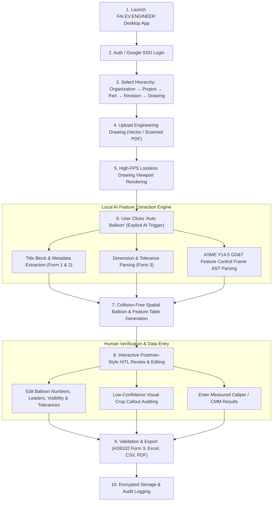

# MASTER PRODUCT REQUIREMENTS DOCUMENT (PRD)
**Product Name:** FAI.EV.ENGINEER  
**Document ID:** `PRD-FAI-EV-ENGINEER-V1.0`  
**Product Owner (POC):** Harsh Yadav  
**Target Market:** Aerospace, Automotive, Medical Devices, Precision Manufacturing, Machine Shops  
**Competitive Targets:** Balloonist.io | 1Factory  
**Author:** Enterprise Product Engineering Organization  
**Status:** Approved — Single Source of Truth (SSOT)  

---

## 1. Document Metadata & Revisions

| Attribute | Value |
| :--- | :--- |
| **Product Name** | `FAI.EV.ENGINEER` |
| **Product Owner (POC)** | Harsh Yadav |
| **Version / Status** | v1.0 — Approved Baseline (SSOT) |
| **Target Standards** | SAE AS9102 (Rev B / Rev C), ASME Y14.5-2018, ISO 1101, CMMC Level 2 / ITAR |
| **Form Factor** | Desktop-First B2B SaaS Application (Electron + React + Native C++ AI Engine) |
| **Deployment Model** | Hybrid Desktop-SaaS (Local Execution with Enterprise Cloud Sync & White-Label Support) |
| **Target OS** | Windows 11 Enterprise (Primary), macOS Apple Silicon (Secondary) |

---

## 2. Executive Summary & Objectives

### 2.1 Business & User Objectives (Harsh Yadav PRD Baseline)
* **Primary Differentiation:** Affordable B2B SaaS alternative to existing high-cost FAI ballooning solutions (Balloonist.io, 1Factory).
* **Core Goal:** Reduce manual FAI ballooning time by at least **85%**.
* **Human-in-the-Loop Workflow:** AI feature extraction is user-triggered (via an explicit **"Auto Balloon"** button action) to give quality engineers complete control.
* **Accuracy Target:** AI feature extraction accuracy $\ge 95\%$ on supported vector and scanned engineering drawings.
* **Processing Speed:** Average drawing processing time $< 30$ seconds; interaction UI latency $< 2$ seconds.
* **Reliability & Availability:** System uptime $\ge 99.9\%$, PDF processing failure rate $< 1\%$, zero data loss during processing or export.

---

## 3. Product Flow & Customer Journey



---

## 4. Organizational Data Hierarchy & Entity Model

`FAI.EV.ENGINEER` structures all inspection assets around an enterprise manufacturing hierarchy:

```
Organization (Tenant)
 └── Project (e.g. Turbine Assembly)
      └── Part (e.g. Blade Component Part #7728-A)
           └── Revision (e.g. Rev C)
                └── Drawing (e.g. PDF Blueprint Sheet 1-5)
                     ├── Feature Characteristics (Dimensions, Tolerances, GD&T)
                     ├── Inspection Balloons (Coordinates, Leader Lines, Sequence)
                     └── AS9102 Forms (Form 1, Form 2, Form 3 Reports)
```

---

## 5. Functional Requirements (Epics & Acceptance Criteria)

### EPIC 1: Auth, Organization & Workspace Hierarchy
* **`REQ-AUTH-01` Authentication & SSO:** Support Google OAuth 2.0 SSO and Enterprise SAML/OIDC authentication.
* **`REQ-AUTH-02` RBAC & Tenant Isolation:** Support Roles (Admin, Quality Manager, QA Engineer, Metrologist, Auditor) with strict tenant isolation.
* **`REQ-AUTH-03` White-Label Support:** Configurable branding (custom logo, corporate color palettes, export header templates) for enterprise deployments.

### EPIC 2: Document Ingestion & Viewport Engine
* **`REQ-ING-01` Vector & Raster Support:** Process both native vector PDFs and scanned raster PDFs up to 300 DPI. Maximum file size: 200MB, up to 50 pages per drawing package.
* **`REQ-ING-02` High-Performance Rendering:** Continuous 60 FPS viewport pan/zoom/rotate ($10\% \to 3200\%$) handling over 1,000 active balloon overlays without DOM lag.

### EPIC 3: AI Feature Extraction & "Auto Balloon" Engine
* **`REQ-AI-01` Explicit User Trigger:** AI processing begins **only after the user clicks "Auto Balloon"**.
* **`REQ-AI-02` Extraction Scope:** Automatically detect and parse:
  * Linear, Radial, Angular, Limit ($1.245-1.255$), and Bilateral ($+0.010/-0.000$) Dimensions.
  * ASME Y14.5 GD&T Feature Control Frames (Position, Flatness, Datums A-Z, Modifiers).
  * Notes, Thread Callouts, and Title Block Metadata (Form 1 & 2).
* **`REQ-AI-03` Accuracy Target:** $\ge 95\%$ extraction accuracy across standard engineering fonts and blueprint layouts.

### EPIC 4: Ballooning & Collision-Free Layout Engine
* **`REQ-BAL-01` Collision Avoidance:** Spatial R-Tree positioning preventing balloon overlaps with drawing geometry or text.
* **`REQ-BAL-02` Flexible Editing:** Full manual control to renumber balloons, modify leader lines, toggle balloon visibility, and override extracted values.

### EPIC 5: Postman-Style HITL Verification Grid
* **`REQ-HITL-01` UI Layout:** Postman-like split canvas view: Left Navigation Tree (`Org -> Project -> Part -> Rev -> Drawing`), Center Viewport, Right Feature Inspector & Dockable Feature Table Grid.
* **`REQ-HITL-02` Confidence Scoring:** Flag items with $<95\%$ AI confidence in warning yellow. Clicking an item centers and zooms the canvas to the exact crop callout zone.

### EPIC 6: SAE AS9102 & Multi-Format Export Generator
* **`REQ-EXP-01` Export Formats:** Export directly to AS9102 Form 3, native Excel (`.xlsx`), CSV, and ballooned PDF drawings.
* **`REQ-EXP-02` Custom Export Templates:** Configurable Excel output templates supporting customer-specific title headers and white-label branding.

---

## 6. Non-Functional Requirements (NFRs)

| Metric | Target Specification | Validation Method |
| :--- | :--- | :--- |
| **FAI Time Savings** | $\ge 85\%$ reduction in manual ballooning time | Measured against baseline manual workflow |
| **AI Extraction Accuracy** | $\ge 95\%$ on supported vector/scanned drawings | Automated test suite on 50 sample drawing packages |
| **Drawing Processing Time** | $< 30$ seconds per sheet average | Automated benchmark execution |
| **UI Interaction Latency** | $< 2$ seconds for normal user interactions | Chrome DevTools Performance audit |
| **Availability / Uptime** | $\ge 99.9\%$ system uptime | SRE Uptime monitoring |
| **PDF Failure Rate** | $< 1\%$ processing failure rate | Synthetic PDF error regression tests |
| **Security & ITAR** | AES-256 encrypted local database; zero unauthorized cross-tenant data access | Security penetration & Wireshark audit |

---

## 7. Next Steps & Engineering Sign-Off

The baseline PRD provided by **Harsh Yadav** (`FAI.EV.ENGINEER v1.0`) is now fully incorporated into the Single Source of Truth engineering specification.

📄 Master PRD File: [`MASTER_PRODUCT_REQUIREMENTS_DOCUMENT.md`](file:///c:/Users/hy376/OneDrive/Desktop/System%20Design/MASTER_PRODUCT_REQUIREMENTS_DOCUMENT.md)
