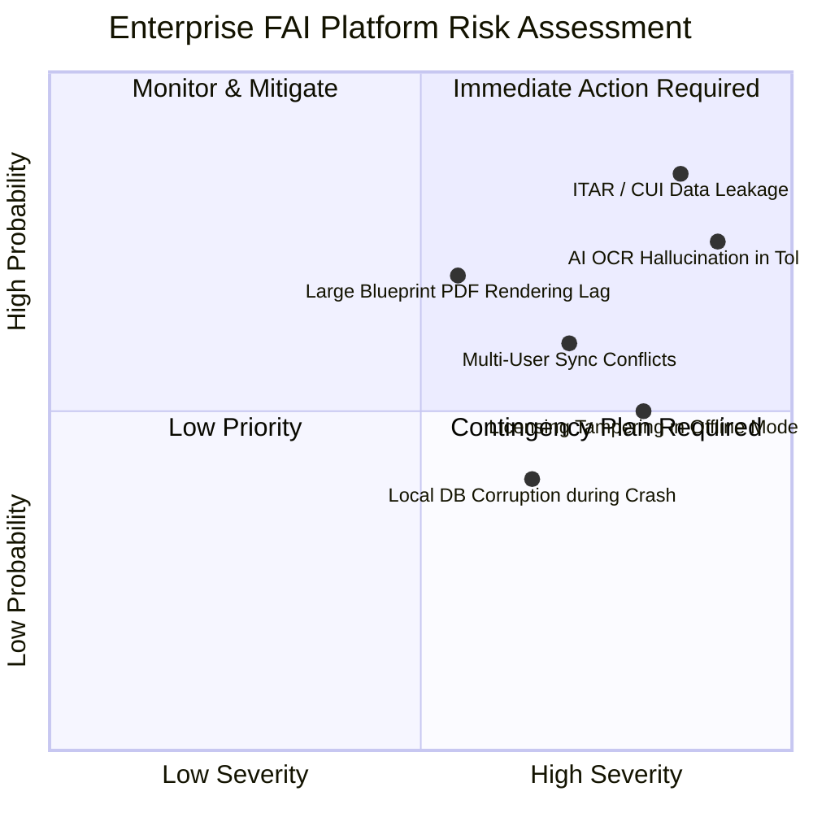
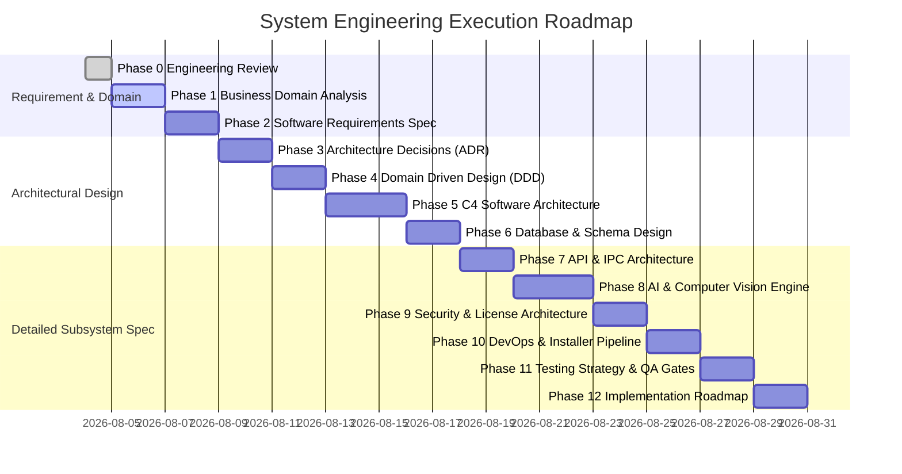

# PHASE 0: PRD ENGINEERING REVIEW & GAP ANALYSIS
**Product:** Enterprise AI-Powered FAI (First Article Inspection) Desktop Platform  
**Target Benchmarks:** Balloonist.io | 1Factory  
**Compliance Standard:** SAE AS9102 (Rev B / Rev C) | ISO 1101 / ASME Y14.5 (GD&T)  
**Security Standard:** CMMC Level 2 / NIST SP 800-171 (ITAR/EAR Controlled Data)  
**Form Factor:** Desktop-First (Electron + React) | Offline-First | Cloud Sync Ready  

---

## 1. Executive Engineering Review

The Product Requirements Document (PRD) outlines an AI-powered desktop application performing automated ballooning, characteristic extraction (dimensions, tolerances, GD&T), human verification, and AS9102 report generation. 

While the functional vision aligns with competitive market needs (competing with **Balloonist.io** and **1Factory**), the PRD leaves **critical enterprise engineering gaps** in local execution, aerospace compliance, computer vision edge cases, offline licensing, sync conflict resolution, and ITAR security requirements.

As an Enterprise Product Engineering Organization, our multi-role analysis has identified these gaps and translated them into rigorous technical specifications.

---

## 2. Comprehensive Gap Analysis

### 2.1 Missing Engineering & Technical Requirements
1. **Multi-Sheet & Vector vs Raster PDF Rendering Pipeline:**
   * *Gap:* The PRD does not specify PDF handling mechanisms for large engineering drawings (e.g., ANSI E / ISO A0 size blueprints, multi-page vector drawings up to 200MB).
   * *Required Spec:* Vector PDF parsing engine (Pdfium / MuPDF native C++ bindings) capable of lossless sub-pixel rendering and coordinate extraction without rasterizing vector text.

2. **AS9102 Form 1, Form 2, and Form 3 Data Schema:**
   * *Gap:* PRD mentions "AS9102 Report Generation" generally without distinguishing between:
     * **Form 1:** Part Number Accountability (Title Block, Serial/Batch, Indexing).
     * **Form 2:** Product Accountability (Materials, Special Processes, Functional Tests).
     * **Form 3:** Characteristic Accountability (Balloons, Dimensions, Tolerances, GD&T, Results).

3. **Coordinate Systems & Resolution Independence:**
   * *Gap:* No specification for how balloon positions $(x, y, r)$ scale when drawings are re-exported, zoomed, or printed at different DPIs.
   * *Required Spec:* Normalized bounding boxes ($0.0 \le x, y, w, h \le 1.0$) mapped to PDF viewport space via viewport transform matrices.

### 2.2 Missing Non-Functional Requirements (NFRs)
* **Local Computer Vision Execution Speed:** Extraction time per drawing page must be $< 3.5$ seconds on consumer hardware (Intel i7 / Apple M-series / NVIDIA GTX 1060 equivalent) without requiring cloud GPU dependencies.
* **UI Responsiveness:** PDF pan/zoom at 60 FPS under high zoom factors ($100\% \to 3200\%$) with up to 500 interactive balloon overlays rendered simultaneously.
* **Memory Footprint:** Electron main process + renderer process combined memory consumption must stay $< 1.2\text{ GB}$ per active drawing tab.

### 2.3 Comprehensive Risk Matrix (Domain, AI, Security, Systems)

#### Detailed Risk Breakdown
| Category | Risk ID | Risk Description | Severity | Mitigation Strategy |
| :--- | :--- | :--- | :--- | :--- |
| **Security / Compliance** | `RISK-SEC-01` | **ITAR / EAR Violation via Cloud Telemetry:** Aerospace drawings contain Defense Controlled Unclassified Information (CUI). Leakage to external AI endpoints violates ITAR. | **CRITICAL** | Zero-Cloud Local Inference Engine. Local-first model execution. Telemetry stripped of all raw image & text payload data. |
| **AI / Accuracy** | `RISK-AI-01` | **OCR Tolerance Hallucination:** Incorrect decimal extraction (e.g., $\pm 0.005$ misread as $\pm 0.05$) leads to rejected parts or catastrophic aerospace failure. | **CRITICAL** | High-Confidence Thresholding ($>0.98$), Mandatory Human-in-the-Loop (HITL) verification UI with visual crop callouts for low-confidence features. |
| **Domain** | `RISK-DOM-01` | **GD&T Feature Control Frame Complexities:** Inability to parse multi-segment feature control frames (datum references, composite tolerances). | **HIGH** | Dedicated GD&T AST (Abstract Syntax Tree) parser matching ASME Y14.5-2018 / ISO 1101 specifications. |
| **Architecture** | `RISK-ARCH-01` | **IPC Bottleneck in Electron:** Serializing high-resolution canvas frames and spatial coordinate trees over Electron IPC causes UI lockup. | **HIGH** | SharedArrayBuffer / Shared Memory native Node C++ addons (Node-API) for zero-copy image/coordinate transfer. |
| **Offline** | `RISK-OFF-01` | **Offline License Tampering:** Modification of local clock or license files to bypass expiration. | **HIGH** | Cryptographically signed license keys (Ed25519) containing encrypted expiry timestamps and hardware fingerprint validation. |

---

## 3. Requirement Traceability Matrix (RTM) - Initial Baseline

| Requirement ID | PRD Source Requirement | Missing Engineering Requirement / Gap | Architectural Target Phase | Owner Role |
| :--- | :--- | :--- | :--- | :--- |
| `RTM-01` | Drawing Upload | Vector PDF parsing, Multi-page TIFF/DWG CAD conversion, sub-pixel rendering. | Phase 5 (Architecture), Phase 8 (AI) | Senior Backend / Computer Vision Eng |
| `RTM-02` | AI Feature Extraction | Local ONNX/C++ Inference engine for OCR & object detection without cloud dependency. | Phase 3 (ADR), Phase 8 (AI) | AI Architect / ML Engineer |
| `RTM-03` | Dimension & Tolerance | Parse symmetric ($\pm$), bilateral ($+0.01/-0.02$), limit, and fit ($H7/g6$) tolerances. | Phase 4 (DDD), Phase 8 (AI) | Aerospace Domain Expert / ML Eng |
| `RTM-04` | GD&T Detection | Parse ASME Y14.5 Feature Control Frames (Flatness, True Position, Perpendicularity, Datums A-Z). | Phase 4 (DDD), Phase 8 (AI) | Manufacturing Expert / AI Architect |
| `RTM-05` | Automatic Ballooning | Dynamic collision-avoidance spatial algorithm for balloon placement on drawings. | Phase 8 (AI / Graphics Pipeline) | Principal Architect / Frontend Eng |
| `RTM-06` | Postman-like UX | Tabbed workspace, layer toggles, feature inspector panel, keyboard shortcuts ($Ctrl+B$). | Phase 5 (C4 Architecture) | Senior Frontend Engineer |
| `RTM-07` | AS9102 Generation | Export compliant Form 1, Form 2, and Form 3 Excel/PDF templates with customer header blocks. | Phase 2 (SRS), Phase 7 (API) | Business Analyst / Solution Architect |
| `RTM-08` | Offline First & Sync | Local SQLite / RxDB database with eventual consistency CRDT sync engine for cloud transition. | Phase 3 (ADR), Phase 6 (Database) | Database Architect / Security Arch |

---

## 4. Assumption Register

1. **Hardware Assumptions:** User workstations meet standard engineering specifications: Minimum 16GB RAM, 4-core CPU, dedicated or integrated GPU supporting OpenGL/Metal/Vulkan for canvas rendering.
2. **Input Document Quality:** Engineering drawings conform to standard drafting specs (ANSI/ASME or ISO). Raster scans have a minimum resolution of 300 DPI.
3. **Regulatory Context:** Initial deployments are standalone desktop installations within ITAR/CMMC-compliant internal networks (no outbound internet required).
4. **Data Volume:** Average project consists of 1 to 20 drawing sheets containing 50 to 800 individual inspection characteristics per revision.

---

## 5. Engineering TODO & Gap Closure Roadmap (Phases 1-12)

---

## 6. Phase 0 Required Summary Deliverables

### Completed Deliverables
- [x] Multi-Role Engineering Review across 17 Specialized Disciplines.
- [x] Complete Gap Analysis covering missing technical, non-functional, operational, and compliance requirements.
- [x] Risk Matrix & Register (`RISK-SEC-01` to `RISK-OFF-01`) detailing ITAR, AI Hallucination, and IPC bottlenecks.
- [x] Initial Baseline Requirement Traceability Matrix (RTM).
- [x] Assumption Register & Engineering TODO Roadmap.

### Open Questions for Stakeholders
1. **DWG/DXF Native Support:** Should Phase 1 support native vector CAD formats (`.dwg`, `.dxf`, `.step`) in addition to vector and raster `.pdf` drawings?
2. **Cloud Sync Multi-User Scope:** For the future enterprise cloud deployment, is concurrent real-time co-editing required on the same drawing (Figma-style), or is optimistic lock-based revision checking sufficient?
3. **CMMC / ITAR Certification Level:** Will the desktop installer require Federal FIPS 140-3 validated cryptographic modules for local sqlite database encryption at rest?

### Key Assumptions
* The primary initial OS target is **Windows 11 Enterprise (64-bit)** (accounting for $>85\%$ of aerospace/manufacturing CAD/CAM workstations), with macOS (Apple Silicon) as secondary.
* All AI models for ballooning, OCR, and GD&T detection must run locally via ONNX Runtime / C++ native sidecars without calling external cloud API services.

### Critical Engineering Recommendations
1. **Adopt C++ Native Addon for Electron IPC:** Avoid transmitting heavy image buffers over standard Electron JSON IPC bridges. Use shared memory (`Node-API` C++ native addons) to maintain 60 FPS viewport performance.
2. **Implement Dual OCR Pipeline:** Combine a fast layout parser (for title block and table detection) with a specialized GD&T symbol segmenter trained specifically on ASME Y14.5 fonts and symbols.
3. **Hardware-Tied Offline Licensing:** Implement cryptographic offline activation using machine hardware fingerprints (CPU ID, Motherboard UUID, TPM chip hash) signed by an asymmetric RSA/Ed25519 root authority.
