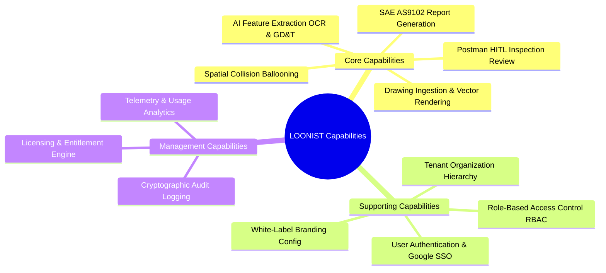
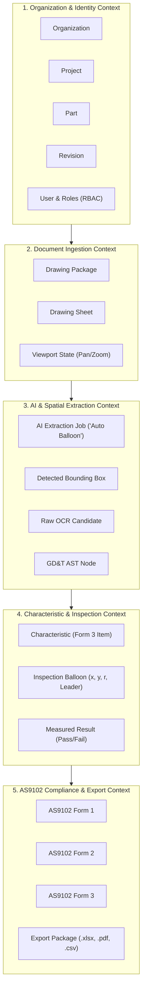
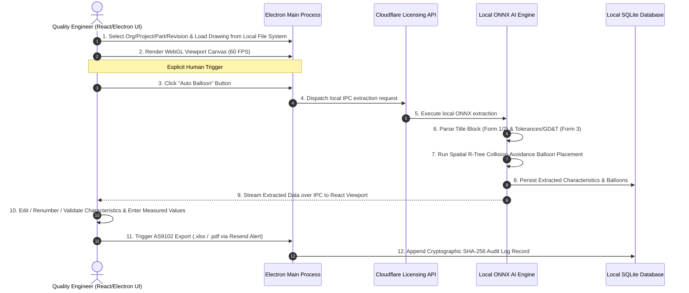
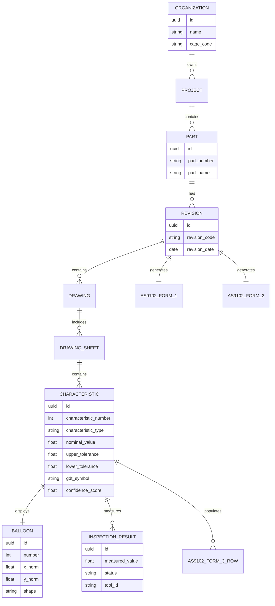
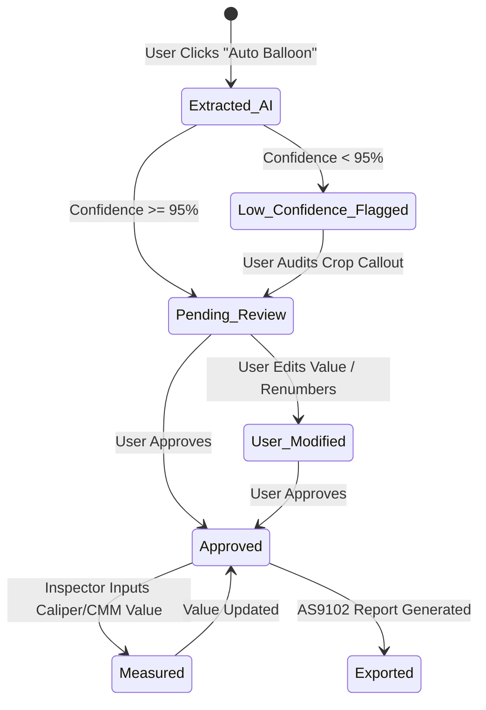
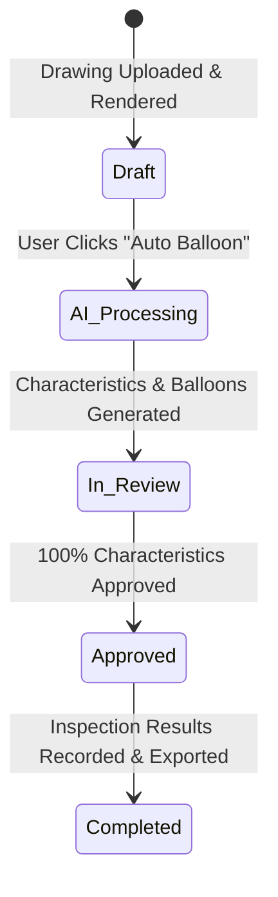
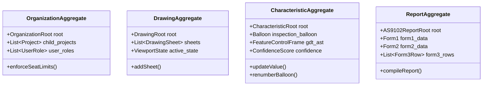

# PHASE 1: BUSINESS DOMAIN ANALYSIS
**Product Name:** `LOONIST`  
**Product Owner (POC):** Harsh Yadav  
**Domain:** Aerospace & High-Precision Manufacturing FAI (SAE AS9102 Rev B/C)  
**Author:** Enterprise Product Engineering Organization  
**Status:** Complete — Pending Phase 1 Sign-Off  

---

## 1. Business Capability Map

The business capabilities of `LOONIST` are structured into core, supporting, and management domains:



### Detailed Capability Matrix
| Capability Group | Business Capability | Description | Business Value |
| :--- | :--- | :--- | :--- |
| **Core** | **Drawing Ingestion** | Vector & scanned PDF blueprint processing (up to 200MB, 50 pages). | High-precision blueprint rendering without raster degradation. |
| **Core** | **AI Feature Extraction** | Automated OCR parsing of linear/angular dimensions, symmetric/bilateral tolerances, and ASME Y14.5 GD&T frames upon clicking "Auto Balloon". | Cuts manual feature extraction time by $>85\%$. |
| **Core** | **Spatial Ballooning** | Automated placement of numbered inspection balloons with spatial R-Tree collision avoidance. | Prevents balloons from obscuring blueprint dimensions or lines. |
| **Core** | **AS9102 Compliance** | Automated generation of Form 1 (Part Accountability), Form 2 (Product Accountability), and Form 3 (Characteristic Accountability). | Ensures 100% compliance for Boeing, Lockheed, and Airbus supplier audits. |
| **Supporting** | **Tenant Hierarchy** | 5-tier organizational tree (`Org -> Project -> Part -> Revision -> Drawing`). | Enables multi-project enterprise asset management. |
| **Security** | **Data Isolation** | Absolute Local Isolation (SQLite) & Cryptographic Cloudflare Licensing. | Natively meets ITAR/CMMC data residency requirements. |

---

## 2. Domain Model & Bounded Contexts

Using **Domain-Driven Design (DDD)** principles, `LOONIST` is partitioned into 5 explicit Bounded Contexts:



### Context Map Relationships
* **Organization Context $\rightarrow$ Document Context:** *Upstream/Downstream (Customer-Supplier)*. The Document Context consumes Organization/Part/Revision identifiers to maintain asset ownership.
* **Document Context $\rightarrow$ AI Extraction Context:** *Shared Kernel*. Viewport coordinates and sheet dimensions are shared between PDF rendering and computer vision models.
* **AI Extraction Context $\rightarrow$ Inspection Context:** *Conformist / Translator*. The Inspection Context transforms raw OCR bounding boxes into domain-validated `Characteristic` Entities and `Balloon` Value Objects.
* **Inspection Context $\rightarrow$ Reporting Context:** *Customer-Supplier*. The Reporting Context reads approved characteristics to construct SAE AS9102 Form 1, 2, and 3 reports.

---

## 3. Event Storming Summary



---

## 4. Ubiquitous Language Glossary

| Term | Domain Context | Definition |
| :--- | :--- | :--- |
| **First Article Inspection (FAI)** | Aerospace Domain | A formal inspection process validating that manufacturing processes produce parts conforming to engineering drawings under SAE AS9102. |
| **Form 1 (Part Accountability)** | AS9102 Standard | Identifies the part number, revision, drawing reference, serial/batch number, and manufacturing routing. |
| **Form 2 (Product Accountability)** | AS9102 Standard | Tracks raw materials (e.g. Al 7075-T6), special processes (e.g. Anodize Type II), and functional testing specs. |
| **Form 3 (Characteristic Accountability)** | AS9102 Standard | Records characteristic number, sheet/zone location, nominal dimension, upper/lower tolerances, GD&T symbols, measured results, and Pass/Fail status. |
| **Auto Balloon** | Application Feature | The explicit, user-triggered action button that executes local AI feature extraction and spatial balloon placement. |
| **Characteristic** | Domain Entity | An individual measurable engineering requirement (dimension, tolerance, GD&T, note, thread callout). |
| **Balloon (Bubble)** | Graphic Element | A numbered circular/pill graphic stamped on the drawing adjacent to a characteristic, linked by a leader arrow. |
| **Feature Control Frame** | GD&T Standard (ASME Y14.5) | A rectangular block containing geometric tolerance symbols, tolerance value, and datum references (e.g., $\bigoplus | 0.002 | A | B$). |
| **R-Tree Collision Avoidance** | AI / Spatial Algorithm | Spatial coordinate indexing used to orbit balloons clear of blueprint geometry, dimension lines, and text. |

---

## 5. Core Business Rules

```
+------------------+-----------------------------------------------------------------------------------+
| Rule ID          | Rule Definition                                                                   |
+------------------+-----------------------------------------------------------------------------------+
| BR-AUTO-BAL-01   | AI extraction MUST NOT execute upon file upload. It MUST execute ONLY when the    |
|                  | user explicitly clicks the "Auto Balloon" button.                                 |
| BR-AS9102-NUM-01 | Balloon numbers within a Drawing Package MUST be unique, sequential positive      |
|                  | integers starting at 1 (1, 2, 3...).                                              |
| BR-AS9102-SEQ-01 | Multi-page drawings MUST maintain continuous balloon numbering across pages       |
|                  | (e.g. Page 1 ends at Balloon 45; Page 2 starts at Balloon 46).                    |
| BR-CONF-WARN-01  | Any AI characteristic extraction with confidence score < 0.95 MUST be highlighted  |
|                  | in warning yellow in the inspector grid for mandatory human verification.         |
| BR-TOL-LIMIT-01  | Upper Limit MUST satisfy: Limit_Upper = Nominal + Tol_Upper.                      |
|                  | Lower Limit MUST satisfy: Limit_Lower = Nominal + Tol_Lower.                      |
| BR-PASS-FAIL-01  | A characteristic Status is PASS iff: Limit_Lower <= Measured_Value <= Limit_Upper.|
| BR-ITAR-ISOL-01  | Drawings and extracted characteristics MUST NOT be transmitted to any third-party |
|                  | cloud API service. All AI inference MUST execute 100% locally.                    |
+------------------+-----------------------------------------------------------------------------------+
```

---

## 6. Entity Relationship Diagram (Domain Level)



---

## 7. State Machines

### 7.1 Characteristic Life Cycle State Machine


### 7.2 Drawing Life Cycle State Machine


---

## 8. Domain Events

Domain events represent business-significant state changes occurring across the `LOONIST` system lifecycle.

| Domain Event | Description | Trigger | Publisher | Consumer(s) | Context Owner |
| :--- | :--- | :--- | :--- | :--- | :--- |
| `RevisionCreated` | A new engineering part revision is registered in the organizational hierarchy. | User registers new revision in project navigation tree. | `Organization Aggregate` | `Document Ingestion Context`, `Reporting Context` | Organization Context |
| `DrawingUploaded` | A vector or scanned PDF drawing file is ingested into local memory. | User selects and uploads PDF file. | `Drawing Aggregate` | `Document Ingestion Context`, `UI Viewport` | Document Context |
| `DrawingRendered` | High-FPS WebGL/Canvas viewport completes rendering blueprint tiles. | Viewport engine finishes canvas initialization. | `Drawing Sheet Entity` | `UI Viewport`, `AI Extraction Context` | Document Context |
| `AutoBalloonRequested` | User triggers the explicit AI extraction and ballooning pipeline. | User clicks the "Auto Balloon" button. | `Viewport UI Controller` | `AI Extraction Context`, `Spatial Sidecar` | AI Extraction Context |
| `AutoBalloonStarted` | Local AI engine spawns OCR and computer vision inference worker threads. | Reception of `AutoBalloonRequested` event. | `Extraction Job Aggregate` | `UI Progress Indicator`, `Audit Logger` | AI Extraction Context |
| `OCRCompleted` | Local OCR engine finishes extracting raw text and bounding boxes from PDF. | Neural network inference job completes. | `OCRExtractionService` | `FeatureClassificationService`, `GDTParsingService` | AI Extraction Context |
| `FeatureDetected` | Linear, radial, or limit dimension candidate extracted with confidence score. | Classification model identifies feature candidate. | `FeatureClassificationService` | `Characteristic Aggregate`, `Inspection Context` | AI Extraction Context |
| `GDTDetected` | ASME Y14.5 GD&T Feature Control Frame parsed into AST structure. | GD&T parser completes AST node generation. | `GDTParsingService` | `Characteristic Aggregate`, `Inspection Context` | AI Extraction Context |
| `BalloonPlaced` | Spatial R-Tree collision-avoidance places balloon coordinates adjacent to feature. | `BalloonPlacementService` calculates orbit coordinates. | `BalloonPlacementService` | `Drawing Viewport UI`, `Characteristic Aggregate` | Inspection Context |
| `BalloonRenumbered` | User renumbers balloon or reordering shifts sequence numbers. | Manual override or balloon insertion/deletion. | `RenumberingService` | `Characteristic Aggregate`, `Drawing Viewport UI` | Inspection Context |
| `BalloonEdited` | User modifies balloon leader line, position, or visibility flag. | Manual UI drag or leader arrow edit. | `Characteristic Aggregate` | `Drawing Viewport UI`, `Audit Log` | Inspection Context |
| `CharacteristicModified` | Nominal value, tolerance, or GD&T symbol overridden by quality engineer. | User edits feature inspector grid row. | `Characteristic Aggregate` | `Inspection Context`, `Audit Logger` | Inspection Context |
| `CharacteristicApproved` | Quality engineer confirms and approves extracted characteristic accuracy. | User checks approval box or hits hotkey. | `Characteristic Aggregate` | `Reporting Context`, `Validation Service` | Inspection Context |
| `ValidationCompleted` | Automated validation engine verifies 100% characteristics are approved and pass. | User triggers validation audit before export. | `ValidationService` | `Reporting Context`, `UI Export Button` | Reporting Context |
| `ReportGenerated` | SAE AS9102 Form 1, Form 2, and Form 3 report objects compiled. | System constructs report payload. | `Report Generation Service` | `Export Context`, `Local Storage` | Reporting Context |
| `ProjectExported` | Final AS9102 package, Excel, CSV, or marked-up PDF exported to filesystem. | User clicks Export to File. | `Export Service` | `Audit Logger`, `FileSystem Component` | Reporting Context |

---

## 9. Value Objects

In accordance with Domain-Driven Design, Value Objects are immutable domain abstractions defined strictly by their attributes, carrying no unique identity.

### 9.1 BoundingBox
* **Purpose:** Defines the rectangular spatial region of a detected feature or text on a drawing sheet.
* **Fields:** `x_min: float`, `y_min: float`, `x_max: float`, `y_max: float`, `width: float`, `height: float`, `page_number: int`.
* **Why Value Object:** A bounding box has no identity beyond its coordinates. Replacing coordinates creates a completely new spatial box.

### 9.2 Coordinate
* **Purpose:** Encapsulates normalized $(x, y)$ point coordinates on a 2D drawing viewport canvas.
* **Fields:** `x_norm: float` $[0.0, 1.0]$, `y_norm: float` $[0.0, 1.0]$, `scale_dpi: int`.
* **Why Value Object:** Two coordinates with identical normalized values are functionally interchangeable.

### 9.3 Tolerance
* **Purpose:** Represents engineering dimensional limits (Symmetric, Bilateral, Limit, Nominal).
* **Fields:** `nominal_value: float`, `upper_offset: float`, `lower_offset: float`, `tolerance_type: Enum (BILATERAL, SYMMETRIC, LIMIT, MAX, MIN)`, `unit: Enum (INCH, MM)`.
* **Why Value Object:** Tolerances define mathematical boundary constraints and contain no mutable state.

### 9.4 GD&T Symbol
* **Purpose:** Encapsulates ASME Y14.5 geometric characteristic symbols.
* **Fields:** `symbol_type: Enum (POSITION, FLATNESS, PERPENDICULARITY, PROFILE_SURFACE, RUNOUT, CONCENTRICITY)`, `unicode_char: string`, `asme_standard_code: string`.
* **Why Value Object:** Geometric symbols are immutable standards defined by drafting specifications.

### 9.5 Feature Control Frame
* **Purpose:** Abstract Syntax Tree (AST) representation of a complete GD&T tolerance block.
* **Fields:** `gdt_symbol: GDT Symbol`, `tolerance_value: float`, `material_condition_modifier: Enum (MMC, LMC, RFS)`, `primary_datum: string`, `secondary_datum: string`, `tertiary_datum: string`, `is_composite: boolean`.
* **Why Value Object:** A feature control frame represents a complete, immutable engineering rule. Any change in datums or modifiers produces a different specification object.

### 9.6 LeaderLine
* **Purpose:** Defines the vector path connecting an inspection balloon to its characteristic dimension.
* **Fields:** `start_point: Coordinate`, `end_point: Coordinate`, `arrow_head_type: Enum (FILLED_TRIANGLE, OPEN_CIRCLE, DOT)`, `path_waypoints: List[Coordinate]`.
* **Why Value Object:** A leader line is purely visual and spatial geometry determined entirely by its end coordinates.

### 9.7 DrawingScale
* **Purpose:** Defines the ratio between canvas viewport pixel coordinates and real-world engineering units.
* **Fields:** `numerator: float`, `denominator: float`, `measurement_unit: Enum (INCH, MM)`, `dpi_resolution: int`.
* **Why Value Object:** Scale ratios are mathematical conversion constants.

### 9.8 ViewportState
* **Purpose:** Represents the interactive canvas state (zoom level, pan offset, active layers).
* **Fields:** `zoom_percentage: float`, `pan_offset_x: float`, `pan_offset_y: float`, `rotation_angle: int`, `visible_layers: Bitmask`.
* **Why Value Object:** Viewport state is transient, immutable UI snapshot state.

### 9.9 ConfidenceScore
* **Purpose:** Encapsulates AI model extraction probability score and human warning flag status.
* **Fields:** `score_value: float` $[0.0, 1.0]$, `confidence_tier: Enum (HIGH, MEDIUM, LOW)`, `requires_human_warning: boolean`.
* **Why Value Object:** Probability scores are mathematical evaluation metrics without identity.

### 9.10 BalloonNumber
* **Purpose:** Value Object enforcing sequential positive integer rules for inspection balloons.
* **Fields:** `sequence_value: int`, `display_prefix: string`, `display_suffix: string`.
* **Why Value Object:** Number `14` is intrinsically identical everywhere; changing `14` to `15` replaces the value object.

### 9.11 RevisionNumber
* **Purpose:** Standardizes part revision codes across aerospace engineering standards.
* **Fields:** `revision_code: string` (e.g. "Rev C"), `major_version: int`, `minor_version: int`, `release_timestamp: Timestamp`.
* **Why Value Object:** Revision strings represent immutable version snapshots.

---

## 10. Aggregates & Transaction Boundaries

Aggregates define consistency boundaries within which domain invariants are strictly enforced during ACID transactions.



### 10.1 Organization Aggregate
* **Aggregate Root:** `Organization`
* **Child Entities:** `Project`, `UserRoleAssignment`, `SubscriptionEntitlement`
* **Transaction Boundary:** Manages multi-tenant organization boundary, seat licenses, and CAGE code unique identification.
* **Business Consistency Rules:** Active user count cannot exceed licensed seat count; CAGE code must be unique across tenant registry.

### 10.2 Project Aggregate
* **Aggregate Root:** `Project`
* **Child Entities:** `Part`, `PartRevision`
* **Transaction Boundary:** Manages part hierarchy and revision history.
* **Business Consistency Rules:** Part numbers must be unique within a project; revision codes must strictly increment without duplication.

### 10.3 Drawing Aggregate
* **Aggregate Root:** `DrawingPackage`
* **Child Entities:** `DrawingSheet`, `SheetLayer`
* **Transaction Boundary:** Enforces multi-page drawing ingestion integrity and high-FPS rendering viewport state.
* **Business Consistency Rules:** Sheet numbers must be 1-indexed contiguous integers; sheet DPI scaling must match vector canvas resolution.

### 10.4 Characteristic Aggregate
* **Aggregate Root:** `Characteristic`
* **Child Entities:** `InspectionBalloon`, `CharacteristicOverrideLog`
* **Transaction Boundary:** Binds extracted nominal/tolerance values, GD&T AST nodes, and spatial balloon coordinates into an atomic unit.
* **Business Consistency Rules:** Every characteristic MUST own exactly one `InspectionBalloon`; confidence scores $<0.95$ MUST set `requires_human_warning = true`.

### 10.5 Inspection Aggregate
* **Aggregate Root:** `InspectionSession`
* **Child Entities:** `CharacteristicMeasurement`, `CMMDataFeed`
* **Transaction Boundary:** Manages shop floor measurement inputs and automated PASS/FAIL validation.
* **Business Consistency Rules:** A measurement evaluates to PASS iff $\text{Lower Limit} \le \text{Measured Value} \le \text{Upper Limit}$; approved inspection sessions are cryptographically immutable.

### 10.6 Report Aggregate
* **Aggregate Root:** `AS9102Report`
* **Child Entities:** `Form1Record`, `Form2Record`, `Form3Row`
* **Transaction Boundary:** Compiles approved characteristics and inspection results into certified AS9102 export packages.
* **Business Consistency Rules:** Reports can only be generated when 100% of Form 3 rows are in `Approved` or `Measured` state.

---

## 11. Domain Services

Domain Services encapsulate stateless business logic and algorithms that do not naturally belong to a single Entity or Aggregate.

### 11.1 BalloonPlacementService
* **Responsibilities:** Calculates optimal, collision-free balloon coordinates adjacent to extracted dimensions using a spatial R-Tree index.
* **Inputs:** `DrawingSheet`, `List[Characteristic]`, `List[BoundingBox]`.
* **Outputs:** `List[Balloon]`, `List[LeaderLine]`.
* **Collaborating Aggregates:** `Drawing Aggregate`, `Characteristic Aggregate`.

### 11.2 OCRExtractionService
* **Responsibilities:** Executes local neural network OCR inference to extract raw text, numbers, and bounding boxes from vector or scanned PDF layers.
* **Inputs:** `DrawingSheet (PDF Raster/Vector Stream)`.
* **Outputs:** `List[OCRResult]`, `List[BoundingBox]`.
* **Collaborating Aggregates:** `Drawing Aggregate`, `AI Extraction Context`.

### 11.3 GDTParsingService
* **Responsibilities:** Parses extracted GD&T text lines into ASME Y14.5 compliant Feature Control Frame AST structures.
* **Inputs:** `RawTextString`, `BoundingBox`.
* **Outputs:** `FeatureControlFrame (AST Node)`.
* **Collaborating Aggregates:** `Characteristic Aggregate`.

### 11.4 FeatureClassificationService
* **Responsibilities:** Classifies extracted text candidates into specific engineering characteristic types (Linear, Radial, Angular, Bilateral, Limit, Note).
* **Inputs:** `List[OCRResult]`.
* **Outputs:** `ClassifiedFeatureCandidate`, `ConfidenceScore`.
* **Collaborating Aggregates:** `Characteristic Aggregate`.

### 11.5 CollisionDetectionService
* **Responsibilities:** Performs 2D bounding box intersection tests between proposed balloons, leader lines, blueprint geometry, and dimension text.
* **Inputs:** `BalloonCandidateCoordinate`, `List[BoundingBox]`.
* **Outputs:** `has_collision: boolean`, `suggested_orbit_vector: Coordinate`.
* **Collaborating Aggregates:** `Drawing Aggregate`, `Characteristic Aggregate`.

### 11.6 RenumberingService
* **Responsibilities:** Re-sequences balloon numbers sequentially across single or multi-page drawings when balloons are added, deleted, or manually moved.
* **Inputs:** `List[Characteristic]`, `target_balloon_number: int`, `action: Enum (INSERT, DELETE, MOVE)`.
* **Outputs:** `UpdatedList[Characteristic]`.
* **Collaborating Aggregates:** `Characteristic Aggregate`.

### 11.7 ValidationService
* **Responsibilities:** Audits the completeness of a drawing inspection package prior to AS9102 export.
* **Inputs:** `CharacteristicAggregate`, `InspectionAggregate`.
* **Outputs:** `validation_passed: boolean`, `List[ValidationError]`.
* **Collaborating Aggregates:** `Characteristic Aggregate`, `Inspection Aggregate`, `Report Aggregate`.

### 11.8 ReportGenerationService
* **Responsibilities:** Compiles validated characteristic data into SAE AS9102 Form 1, Form 2, and Form 3 report structures.
* **Inputs:** `PartRevision`, `List[Characteristic]`, `List[InspectionResult]`.
* **Outputs:** `AS9102ReportPayload`.
* **Collaborating Aggregates:** `Project Aggregate`, `Characteristic Aggregate`, `Report Aggregate`.

### 11.9 ExportService
* **Responsibilities:** Serializes AS9102 report payloads into native Excel (`.xlsx`), CSV, and marked-up ballooned PDF files.
* **Inputs:** `AS9102ReportPayload`, `export_format: Enum (EXCEL, CSV, PDF)`.
* **Outputs:** `FileBinaryStream`.
* **Collaborating Aggregates:** `Report Aggregate`.

### 11.10 RevisionComparisonService
* **Responsibilities:** Performs geometric and characteristic diff analysis between two drawing revisions (`Rev A` vs `Rev B`), highlighting added/modified/deleted dimensions.
* **Inputs:** `RevisionA_Characteristics`, `RevisionB_Characteristics`.
* **Outputs:** `RevisionDiffReport`.
* **Collaborating Aggregates:** `Project Aggregate`, `Characteristic Aggregate`.

---

## 12. Domain Constraints

Mandatory, non-negotiable business rules enforced across the `LOONIST` system architecture:

```
+-------------------+----------------------------------------------------------------------------------+
| Constraint ID     | Mandatory Constraint Specification                                               |
+-------------------+----------------------------------------------------------------------------------+
| DC-BALLOON-IMMUT  | Balloon numbers become strictly IMMUTABLE once an AS9102 report is approved.     |
| DC-REV-IMMUT      | A Drawing Revision cannot be modified or re-processed after formal approval.     |
| DC-CHAR-OWNERSHIP | Every Characteristic MUST belong to exactly ONE Drawing Revision.                |
| DC-EXPORT-GATE    | Export (.xlsx, .pdf, .csv) is permitted ONLY after successful validation pass.   |
| DC-AUDIT-HISTORY  | Deleted Balloons are NEVER hard-deleted; they are toggled hidden in audit logs.  |
| DC-CHAR-UNIQ      | Characteristic numbering MUST remain strictly unique within a single Drawing.    |
| DC-NO-AUTO-START  | AI feature extraction CANNOT start automatically upon PDF upload. It MUST require|
|                   | an explicit human click on the "Auto Balloon" button.                            |
| DC-SESSION-ISOL   | User drawing memory buffers MUST be session-isolated with zero cross-tenant leak.|
| DC-LOCAL-AI-ONLY  | AI inference models MUST execute 100% locally to satisfy ITAR compliance.        |
+-------------------+----------------------------------------------------------------------------------+
```

---

## 13. Domain Invariants

Fundamental domain truths that MUST remain true at all times in every valid system state:

* `INV-01`: Every `Characteristic` has exactly one `Balloon`.
* `INV-02`: Every `Balloon` belongs to one `DrawingSheet`.
* `INV-03`: Every `DrawingSheet` belongs to one `Drawing`.
* `INV-04`: Every `Drawing` belongs to one `Revision`.
* `INV-05`: Every `Revision` belongs to one `Part`.
* `INV-06`: Every `Part` belongs to one `Project`.
* `INV-07`: Every `Project` belongs to one `Organization`.
* `INV-08`: For all bilateral tolerances: $\text{Lower Limit} \le \text{Nominal Value} \le \text{Upper Limit}$.
* `INV-09`: Total balloon count on Form 3 MUST equal the total active balloon count stamped on the drawing canvas.

---

## 14. Bounded Context Ownership Matrix

Explicit ownership boundaries detailing Entities, Aggregates, Value Objects, Domain Services, and Domain Events owned by each Bounded Context:

```mermaid
flowchart LR
    subgraph OrgContext ["1. Organization Context"]
        Org_Entities["Entities: Organization, Project, Part, Revision, User"]
        Org_Aggregates["Aggregates: OrganizationAggregate, ProjectAggregate"]
        Org_Events["Published: RevisionCreated"]
    end

    subgraph DocContext ["2. Document Ingestion Context"]
        Doc_Entities["Entities: DrawingPackage, DrawingSheet"]
        Doc_Aggregates["Aggregates: DrawingAggregate"]
        Doc_VO["Value Objects: DrawingScale, ViewportState"]
        Doc_Events["Published: DrawingUploaded, DrawingRendered"]
    end

    subgraph AIContext ["3. AI & Spatial Extraction Context"]
        AI_Aggregates["Aggregates: ExtractionJob"]
        AI_VO["Value Objects: BoundingBox, OCRResult, GDATAST, ConfidenceScore"]
        AI_Services["Services: OCRExtractionService, GDTParsingService, FeatureClassificationService"]
        AI_Events["Published: AutoBalloonStarted, OCRCompleted, FeatureDetected, GDTDetected"]
    end

    subgraph InspectContext ["4. Characteristic & Inspection Context"]
        Insp_Entities["Entities: Characteristic, Balloon, InspectionResult"]
        Insp_Aggregates["Aggregates: CharacteristicAggregate, InspectionAggregate"]
        Insp_VO["Value Objects: Tolerance, GDT Symbol, Feature Control Frame, LeaderLine, BalloonNumber"]
        Insp_Services["Services: BalloonPlacementService, CollisionDetectionService, RenumberingService"]
        Insp_Events["Published: BalloonPlaced, BalloonRenumbered, BalloonEdited, CharacteristicApproved"]
    end

    subgraph ReportContext ["5. AS9102 Reporting Context"]
        Rep_Entities["Entities: Form1Record, Form2Record, Form3Row"]
        Rep_Aggregates["Aggregates: ReportAggregate"]
        Rep_Services["Services: ValidationService, ReportGenerationService, ExportService"]
        Rep_Events["Published: ValidationCompleted, ReportGenerated, ProjectExported"]
    end

    OrgContext --> DocContext
    DocContext --> AIContext
    AIContext --> InspectContext
    InspectContext --> ReportContext
```



### Context Ownership Breakdown Table

| Bounded Context | Owned Entities & Aggregates | Owned Value Objects | Owned Domain Services | Published Events | Consumed Events |
| :--- | :--- | :--- | :--- | :--- | :--- |
| **1. Organization Context** | `Organization`, `Project`, `Part`, `Revision`, `OrganizationAggregate`, `ProjectAggregate` | `RevisionNumber` | `RevisionComparisonService` | `RevisionCreated` | None |
| **2. Document Ingestion Context** | `DrawingPackage`, `DrawingSheet`, `DrawingAggregate` | `DrawingScale`, `ViewportState` | None | `DrawingUploaded`, `DrawingRendered` | `RevisionCreated` |
| **3. AI Extraction Context** | `ExtractionJobAggregate` | `BoundingBox`, `ConfidenceScore` | `OCRExtractionService`, `GDTParsingService`, `FeatureClassificationService` | `AutoBalloonStarted`, `OCRCompleted`, `FeatureDetected`, `GDTDetected` | `AutoBalloonRequested`, `DrawingRendered` |
| **4. Inspection Context** | `Characteristic`, `Balloon`, `InspectionResult`, `CharacteristicAggregate`, `InspectionAggregate` | `Tolerance`, `GDT Symbol`, `Feature Control Frame`, `LeaderLine`, `BalloonNumber` | `BalloonPlacementService`, `CollisionDetectionService`, `RenumberingService` | `BalloonPlaced`, `BalloonRenumbered`, `BalloonEdited`, `CharacteristicModified`, `CharacteristicApproved` | `FeatureDetected`, `GDTDetected` |
| **5. AS9102 Reporting Context** | `Form1Record`, `Form2Record`, `Form3Row`, `ReportAggregate` | None | `ValidationService`, `ReportGenerationService`, `ExportService` | `ValidationCompleted`, `ReportGenerated`, `ProjectExported` | `CharacteristicApproved` |

---

## 15. Summary of Phase 1 Engineering Deliverables

### Completed Deliverables
- [x] Business Capability Map (Core, Supporting, Management Domains).
- [x] DDD Bounded Context Map (5 Contexts: Organization, Document, AI Extraction, Inspection, Reporting).
- [x] Event Storming Workflow & Sequence Diagram.
- [x] Ubiquitous Language Glossary (Aerospace & AS9102 Domain Terms).
- [x] Core Business Rules (`BR-AUTO-BAL-01` to `BR-ITAR-ISOL-01`).
- [x] Domain-Level Entity Relationship Diagram (ERD).
- [x] State Machines for Characteristic & Drawing Lifecycles.
- [x] **16 Domain Events** (Description, Trigger, Publisher, Consumer, Context Owner).
- [x] **11 Value Objects** (Fields, Purpose, Immutability Rationale).
- [x] **6 Core Aggregates** (Root, Child Entities, Transaction Boundaries, Rules).
- [x] **10 Domain Services** (Responsibilities, Inputs, Outputs, Collaborators).
- [x] **Domain Constraints & Domain Invariants** (`DC-01` to `DC-09`, `INV-01` to `INV-09`).
- [x] **Context Ownership Matrix** (Complete Entity, Value Object, Service & Event mapping).

### Open Questions
1. **Multi-User Role Mapping:** Should shop floor inspectors have permissions to edit drawing balloons, or should their role be restricted strictly to entering measured values into Form 3 rows?
2. **Custom Balloon Shapes:** Will initial aerospace clients require custom flag notes (triangles) alongside standard circular balloons for Form 3 indexing?

### Key Assumptions
* Quality engineers require human validation control; automated background processing on PDF upload causes user distrust, validating the explicit **"Auto Balloon"** trigger.
* All aerospace engineering drawings follow standard drafting norms (ANSI/ASME Y14.5 or ISO 1101).

### Critical Engineering Risks
* **`RISK-DOM-02` (High):** Multi-segment composite GD&T tolerance frames require an Abstract Syntax Tree (AST) parser to prevent misinterpretation of datum references.

### Engineering Recommendations
1. Enforce strict immutability on approved characteristics once an AS9102 report is exported.
2. Implement spatial R-Tree indexing in the C++ extraction sidecar to compute balloon collision-free orbit coordinates during the initial "Auto Balloon" run.

