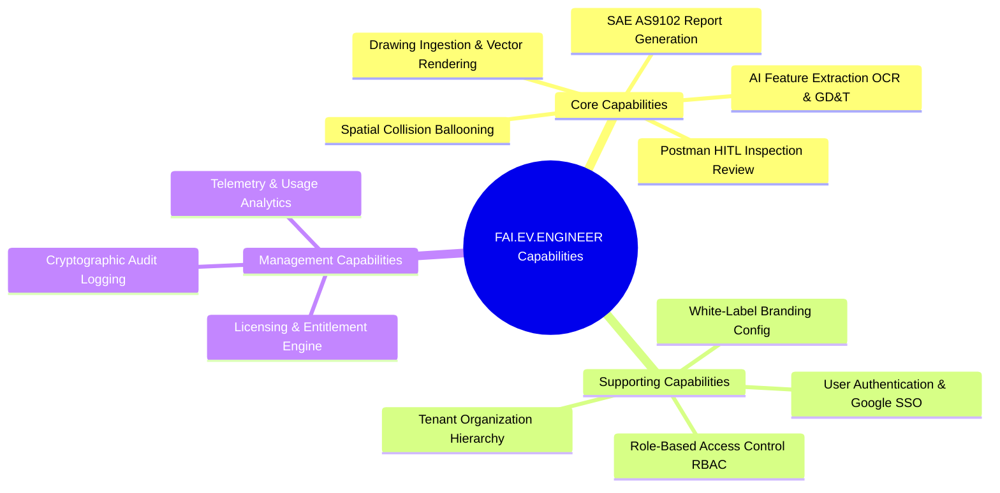
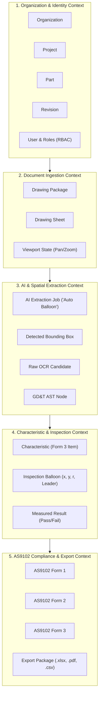
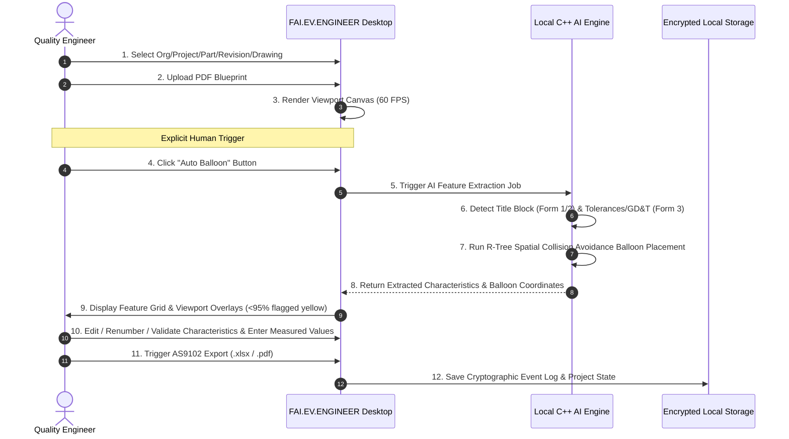
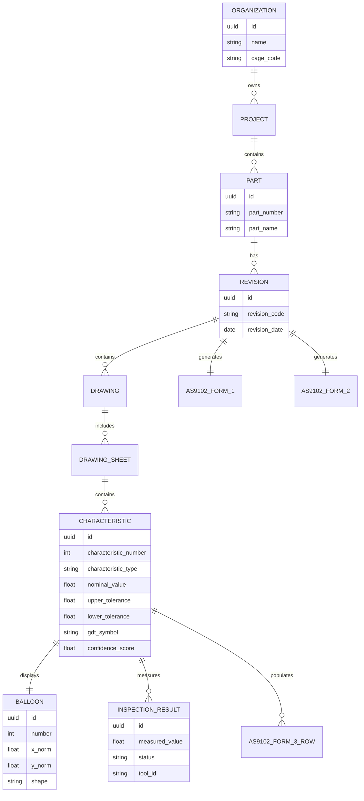
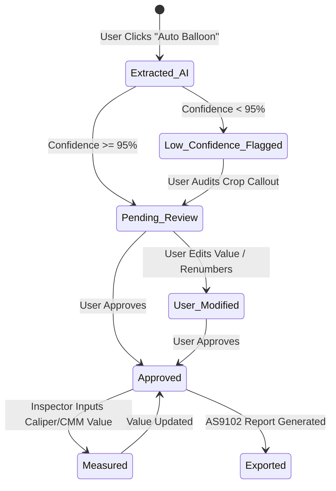
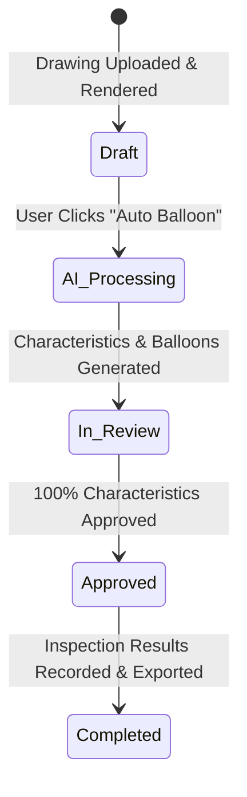

# PHASE 1: BUSINESS DOMAIN ANALYSIS
**Product Name:** `FAI.EV.ENGINEER`  
**Product Owner (POC):** Harsh Yadav  
**Domain:** Aerospace & High-Precision Manufacturing FAI (SAE AS9102 Rev B/C)  
**Author:** Enterprise Product Engineering Organization  
**Status:** Complete — Pending Phase 1 Sign-Off  

---

## 1. Business Capability Map

The business capabilities of `FAI.EV.ENGINEER` are structured into core, supporting, and management domains:



### Detailed Capability Matrix
| Capability Group | Business Capability | Description | Business Value |
| :--- | :--- | :--- | :--- |
| **Core** | **Drawing Ingestion** | Vector & scanned PDF blueprint processing (up to 200MB, 50 pages). | High-precision blueprint rendering without raster degradation. |
| **Core** | **AI Feature Extraction** | Automated OCR parsing of linear/angular dimensions, symmetric/bilateral tolerances, and ASME Y14.5 GD&T frames upon clicking "Auto Balloon". | Cuts manual feature extraction time by $>85\%$. |
| **Core** | **Spatial Ballooning** | Automated placement of numbered inspection balloons with spatial R-Tree collision avoidance. | Prevents balloons from obscuring blueprint dimensions or lines. |
| **Core** | **AS9102 Compliance** | Automated generation of Form 1 (Part Accountability), Form 2 (Product Accountability), and Form 3 (Characteristic Accountability). | Ensures 100% compliance for Boeing, Lockheed, and Airbus supplier audits. |
| **Supporting** | **Tenant Hierarchy** | 5-tier organizational tree (`Org -> Project -> Part -> Revision -> Drawing`). | Enables multi-project enterprise asset management. |
| **Security** | **Data Isolation** | Session-isolated processing & encrypted local storage (SQLCipher AES-256). | Meets strict ITAR/CMMC Level 2 defense compliance. |

---

## 2. Domain Model & Bounded Contexts

Using **Domain-Driven Design (DDD)** principles, `FAI.EV.ENGINEER` is partitioned into 5 explicit Bounded Contexts:



### Context Map Relationships
* **Organization Context $\rightarrow$ Document Context:** *Upstream/Downstream (Customer-Supplier)*. The Document Context consumes Organization/Part/Revision identifiers to maintain asset ownership.
* **Document Context $\rightarrow$ AI Extraction Context:** *Shared Kernel*. Viewport coordinates and sheet dimensions are shared between PDF rendering and computer vision models.
* **AI Extraction Context $\rightarrow$ Inspection Context:** *Conformist / Translator*. The Inspection Context transforms raw OCR bounding boxes into domain-validated `Characteristic` Entities and `Balloon` Value Objects.
* **Inspection Context $\rightarrow$ Reporting Context:** *Customer-Supplier*. The Reporting Context reads approved characteristics to construct SAE AS9102 Form 1, 2, and 3 reports.

---

## 3. Event Storming Summary



---

## 4. Ubiquitous Language Glossary

| Term | Domain Context | Definition |
| :--- | :--- | :--- |
| **First Article Inspection (FAI)** | Aerospace Domain | A formal inspection process validating that manufacturing processes produce parts conforming to engineering drawings under SAE AS9102. |
| **Form 1 (Part Accountability)** | AS9102 Standard | Identifies the part number, revision, drawing reference, serial/batch number, and manufacturing routing. |
| **Form 2 (Product Accountability)** | AS9102 Standard | Tracks raw materials (e.g. Al 7075-T6), special processes (e.g. Anodize Type II), and functional testing specs. |
| **Form 3 (Characteristic Accountability)** | AS9102 Standard | Records characteristic number, sheet/zone location, nominal dimension, upper/lower tolerances, GD&T symbols, measured results, and Pass/Fail status. |
| **Auto Balloon** | Application Feature | The explicit, user-triggered action button that executes local AI feature extraction and spatial balloon placement. |
| **Characteristic** | Domain Entity | An individual measurable engineering requirement (dimension, tolerance, GD&T, note, thread callout). |
| **Balloon (Bubble)** | Graphic Element | A numbered circular/pill graphic stamped on the drawing adjacent to a characteristic, linked by a leader arrow. |
| **Feature Control Frame** | GD&T Standard (ASME Y14.5) | A rectangular block containing geometric tolerance symbols, tolerance value, and datum references (e.g., $\bigoplus | 0.002 | A | B$). |
| **R-Tree Collision Avoidance** | AI / Spatial Algorithm | Spatial coordinate indexing used to orbit balloons clear of blueprint geometry, dimension lines, and text. |

---

## 5. Core Business Rules

```
+------------------+-----------------------------------------------------------------------------------+
| Rule ID          | Rule Definition                                                                   |
+------------------+-----------------------------------------------------------------------------------+
| BR-AUTO-BAL-01   | AI extraction MUST NOT execute upon file upload. It MUST execute ONLY when the    |
|                  | user explicitly clicks the "Auto Balloon" button.                                 |
| BR-AS9102-NUM-01 | Balloon numbers within a Drawing Package MUST be unique, sequential positive      |
|                  | integers starting at 1 (1, 2, 3...).                                              |
| BR-AS9102-SEQ-01 | Multi-page drawings MUST maintain continuous balloon numbering across pages       |
|                  | (e.g. Page 1 ends at Balloon 45; Page 2 starts at Balloon 46).                    |
| BR-CONF-WARN-01  | Any AI characteristic extraction with confidence score < 0.95 MUST be highlighted  |
|                  | in warning yellow in the inspector grid for mandatory human verification.         |
| BR-TOL-LIMIT-01  | Upper Limit MUST satisfy: Limit_Upper = Nominal + Tol_Upper.                      |
|                  | Lower Limit MUST satisfy: Limit_Lower = Nominal + Tol_Lower.                      |
| BR-PASS-FAIL-01  | A characteristic Status is PASS iff: Limit_Lower <= Measured_Value <= Limit_Upper.|
| BR-ITAR-ISOL-01  | Drawings and extracted characteristics MUST NOT be transmitted to any third-party |
|                  | cloud API service. All AI inference MUST execute 100% locally.                    |
+------------------+-----------------------------------------------------------------------------------+
```

---

## 6. Entity Relationship Diagram (Domain Level)



---

## 7. State Machines

### 7.1 Characteristic Life Cycle State Machine


### 7.2 Drawing Life Cycle State Machine


---

## 8. Summary of Phase 1 Engineering Deliverables

### Completed Deliverables
- [x] Business Capability Map (Core, Supporting, Management Domains).
- [x] DDD Bounded Context Map (5 Contexts: Organization, Document, AI Extraction, Inspection, Reporting).
- [x] Event Storming Workflow & Sequence Diagram.
- [x] Ubiquitous Language Glossary (Aerospace & AS9102 Domain Terms).
- [x] Core Business Rules (`BR-AUTO-BAL-01` to `BR-ITAR-ISOL-01`).
- [x] Domain-Level Entity Relationship Diagram (ERD).
- [x] State Machines for Characteristic & Drawing Lifecycles.

### Open Questions
1. **Multi-User Role Mapping:** Should shop floor inspectors have permissions to edit drawing balloons, or should their role be restricted strictly to entering measured values into Form 3 rows?
2. **Custom Balloon Shapes:** Will initial aerospace clients require custom flag notes (triangles) alongside standard circular balloons for Form 3 indexing?

### Key Assumptions
* Quality engineers require human validation control; automated background processing on PDF upload causes user distrust, validating the explicit **"Auto Balloon"** trigger.
* All aerospace engineering drawings follow standard drafting norms (ANSI/ASME Y14.5 or ISO 1101).

### Critical Engineering Risks
* **`RISK-DOM-02` (High):** Multi-segment composite GD&T tolerance frames require an Abstract Syntax Tree (AST) parser to prevent misinterpretation of datum references.

### Engineering Recommendations
1. Enforce strict immutability on approved characteristics once an AS9102 report is exported.
2. Implement spatial R-Tree indexing in the C++ extraction sidecar to compute balloon collision-free orbit coordinates during the initial "Auto Balloon" run.
