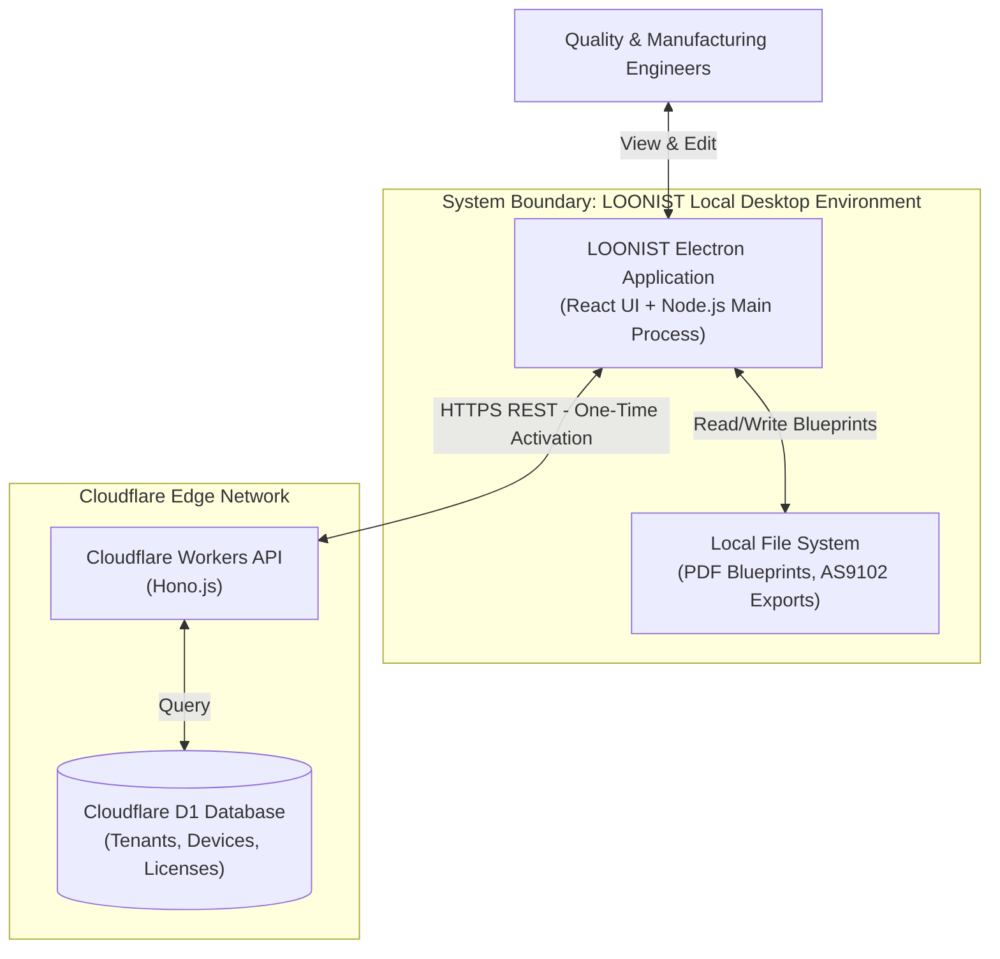
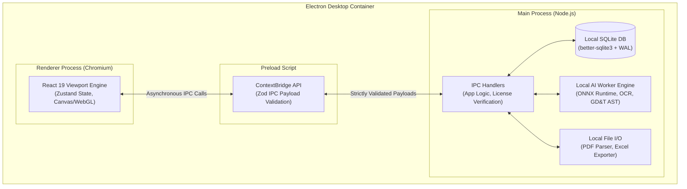

# Phase 2: High-Level System Architecture (HLD) — Desktop-First Enterprise Platform

**Product Name:** LOONIST  
**Product Owner:** Harsh Yadav  
**Document Version:** v2.0 (Production Desktop Architecture)  
**Domain:** Aerospace & High-Precision Manufacturing FAI (SAE AS9102 Rev B/C, ASME Y14.5 GD&T)  
**Target Infrastructure:** Electron Desktop App (Windows/macOS), Local SQLite, Cloudflare Workers API, Cloudflare D1  
**Security & Compliance:** ITAR/CMMC Level 2 Natively Compliant (100% Local Processing), Ed25519 Cryptographic Licensing  
**Document Status:** Approved Master Baseline HLD Architecture  

---

## 1. Executive Summary & Architectural Principles

### 1.1 Architectural Vision
`LOONIST` is an offline-first, desktop enterprise platform engineered to automate First Article Inspection (FAI) ballooning and SAE AS9102 Form 1, Form 2, and Form 3 report creation. 

Shifting away from insecure SaaS web models, LOONIST guarantees absolute IP protection by processing classified engineering drawings 100% locally on the user's hardware via embedded ONNX AI models, local SQLite storage, and a highly secure Electron container.

### 1.2 Core Architectural Principles
* **Offline-First Desktop App:** Engineering PDFs never leave the host machine. This guarantees compliance with strict defense regulations (ITAR) where uploading prints to AWS/S3 is prohibited.
* **Cryptographic Hardware Licensing:** A lightweight Cloudflare Workers API issues Ed25519 signed licenses bound to specific hardware IDs, permitting prolonged offline usage without "phoning home".
* **High-Performance UI:** React 19 + Vite inside the Electron Chromium renderer delivers a 60 FPS WebGL/Canvas viewport capable of handling massive vector PDFs without lag.
* **Strict IPC Security Boundary:** To prevent Remote Code Execution (RCE), the React frontend communicates with the Node.js backend exclusively through a `contextBridge` using strict `zod` payload validation.
* **Atomic Local Persistence:** `better-sqlite3` configured with PRAGMA WAL mode provides instantaneous local reads/writes and powers an atomic Undo/Redo transaction ledger.

---

## 2. Visual Architecture Diagram & C4 Views

### 2.1 C4 Context Diagram (Level 1)



---

### 2.2 C4 Container Diagram (Level 2)



---

## 3. Core System Components

### 3.1 Electron Security & IPC Architecture
To protect against malicious PDF injection attacks or XSS in the renderer:
* `nodeIntegration` is strictly `false`.
* `contextIsolation` is `true`.
* `sandbox` is enabled at the OS level.
* All `ipcMain.handle()` endpoints parse incoming parameters using strict Zod schemas before executing Node.js logic.

### 3.2 Local Database (SQLite) & Undo/Redo Engine
* **Engine:** `better-sqlite3` (Synchronous, ultra-fast C++ bindings).
* **WAL Mode:** Enables concurrent reads and writes.
* **Transaction History:** The database schema includes a `TransactionHistory` table storing `BEGIN/COMMIT` blocks and reverse-queries (`reverse_query`), providing native, instant Undo/Redo capability across the entire app.

### 3.3 Cloudflare Licensing Control Plane
* **Edge API:** Cloudflare Workers built with Hono.js.
* **Database:** Cloudflare D1 (Serverless SQLite) mapping `Tenants -> Devices -> Licenses`.
* **Cryptography:** The Cloudflare API uses `@noble/curves` to generate an Ed25519 signature. The local Electron app carries the public key to verify the license signature mathematically, ensuring it cannot be spoofed locally.

### 3.4 Local AI Extraction (Sprint 2)
* **Execution:** ONNX Runtime executed within a hidden Node.js worker thread.
* **Capabilities:** Extracts dimensions, tolerances, and parses ASME Y14.5 Geometric Dimensioning & Tolerancing (GD&T) Feature Control Frames into an Abstract Syntax Tree (AST).
* **Data Flow:** Extracted characteristics are written directly to the local SQLite database.

---

## 4. End-to-End Operational Workflow

```
1. Activation (One-Time)
   User enters License Token -> Electron pings Cloudflare API -> Receives Ed25519 signed license -> Saved locally.

2. Import Blueprint (Offline)
   User selects local PDF -> Node.js reads file -> React Viewport renders PDF (60 FPS Canvas).

3. "Auto Balloon" Triggered (Explicit HITL)
   User clicks Auto Balloon -> IPC passes request to Node.js Main Process.

4. Local AI Extraction
   Node.js spawns ONNX worker -> Extracts characteristics -> Places balloons avoiding collisions.

5. Data Persistence
   Main Process writes characteristics to local SQLite `characteristics` table.

6. Interactive Editing
   React UI queries SQLite via IPC -> User drags balloons or changes values -> Edits saved via Undo/Redo atomic transactions.

7. Export AS9102
   User clicks Export -> Main Process compiles SQLite data into AS9102 Form 1/2/3 Excel (.xlsx) -> Saves to user Desktop.
```

---

## 5. Deployment Strategy
* **Desktop App:** Distributed via electron-builder targeting Windows (`.exe` NSIS installer) and macOS (`.dmg`). Auto-updates provided via GitHub Releases or S3 bucket polling.
* **Cloud API:** Deployed globally to the Cloudflare Edge network via `wrangler publish` ensuring <50ms latency for global activations.
