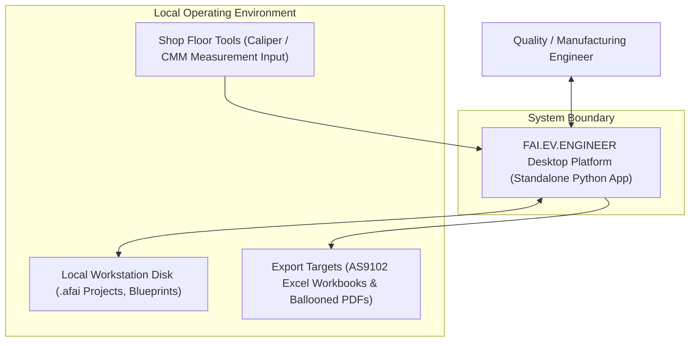
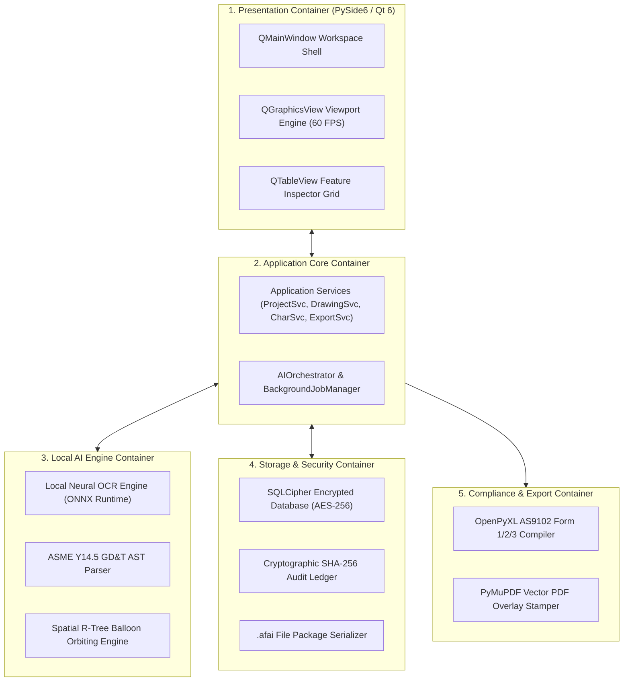
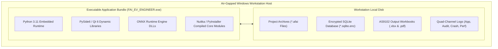
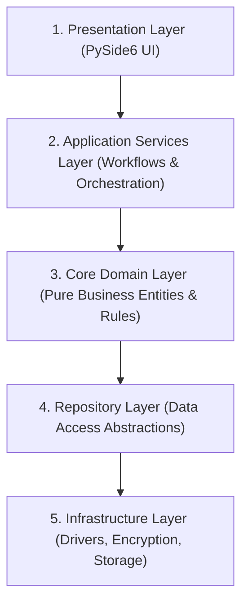
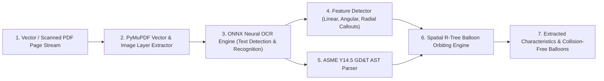
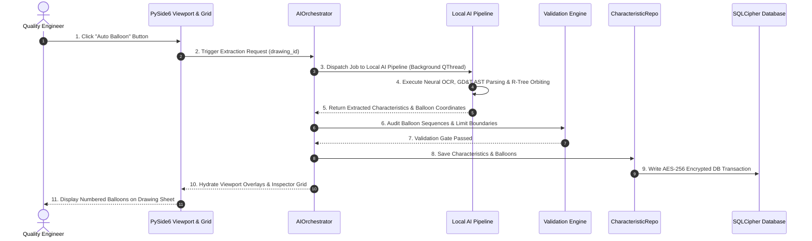
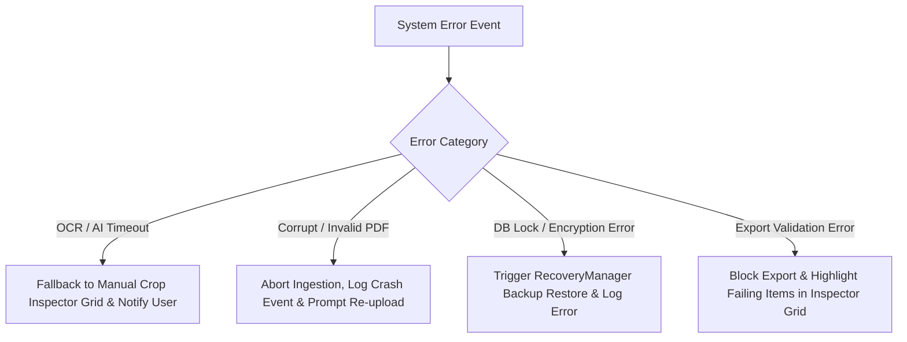

# Phase 2: High-Level System Architecture (HLD)

**Product Name:** FAI.EV.ENGINEER  
**Product Owner:** Harsh Yadav  
**Platform:** Standalone Desktop Python Application (PySide6 / Qt 6)  
**Domain:** Aerospace & High-Precision Manufacturing FAI (SAE AS9102 Rev B/C, ASME Y14.5 GD&T)  
**Security Standard:** ITAR / CMMC Level 2 Air-Gapped Deployment (Zero Cloud AI Leakage)  
**Document Status:** Baseline Approved HLD Architecture  

---

## 1. Business Problem, Functional Scope & Architectural Principles

### 1.1 Business Problem & Functional Scope
In aerospace and high-precision manufacturing, Quality Engineers spend between 4 to 12 hours manually ballooning engineering drawings and populating SAE AS9102 Form 1, Form 2, and Form 3 characteristic inspection sheets.

FAI.EV.ENGINEER automates drawing ballooning, feature extraction, and report compilation through local AI processing, reducing setup time by over 85% (under 20 minutes per drawing package).

### 1.2 Core Architectural Principles
- **Local-First & Air-Gapped Architecture:** All AI inference, neural OCR, drawing rendering, and database storage execute locally on the user's host machine. Zero data is transmitted over external networks, maintaining strict compliance with defense ITAR and CMMC Level 2 security regulations.
- **Explicit Human Control:** Automated feature extraction does not auto-run upon file upload. AI execution requires an explicit user trigger by clicking the "Auto Balloon" button.
- **Responsive Viewport Rendering:** Delivers interactive 60 FPS panning, zooming, and vector layer manipulation on large engineering drawing blueprints via PySide6 hardware acceleration.
- **Tamper-Proof Audit Traceability:** All inspection activities, manual overrides, and balloon edits are recorded in a cryptographic SHA-256 hash-chained audit ledger.

---

## 2. Architectural Views & C4 Diagrams

### 2.1 C4 Context Diagram (Level 1)

The Context Diagram defines the system boundary of FAI.EV.ENGINEER within its operating environment.

---

### 2.2 C4 Container Diagram (Level 2)

The Container Diagram details the high-level technical containers that make up the desktop application.

---

### 2.3 Deployment Diagram

The Deployment Diagram illustrates how the executable application runs on an air-gapped Windows workstation.

---

## 3. Subsystem Architecture & 5-Layer Clean Model

### 3.1 5-Layer Clean Architecture

### 3.2 Architectural Dependency Rules
- **Unidirectional Downward Dependency:** Presentation Layer -> Application Services Layer -> Domain Layer -> Repository Layer -> Infrastructure Layer.
- **Domain Layer Independence:** The Domain Layer contains zero dependencies on PySide6 UI, SQLCipher databases, or third-party drivers.
- **UI Isolation:** The Presentation Layer accesses system logic exclusively through Application Services.
- **Infrastructure Decoupling:** Third-party libraries (PyMuPDF, ONNX Runtime, SQLCipher) are encapsulated behind abstract interfaces.

---

## 4. Data Architecture, Security & Storage Strategy

### 4.1 Encrypted Local Storage (SQLCipher)
- **Encryption Standard:** AES-256 database encryption at rest (`PRAGMA key`).
- **Cryptographic Audit Ledger:** Append-only `audit_log` table protected by a SHA-256 hash chain: `Hash_n = SHA256(Hash_{n-1} + Timestamp + UserID + Payload)`.

### 4.2 Single-File Package Format (`.afai`)
Projects are saved as single, self-contained `.afai` (Automated First Article Inspection) containers containing:
- `metadata.json` — Project information and header metadata.
- `database.sqlite.enc` — Encrypted SQLCipher database payload.
- `raw_drawing.pdf` — Original vector PDF blueprint file.
- `audit_chain.sig` — Cryptographic signature verifying file integrity.

---

## 5. Processing Pipelines & Cross-Component Interactions

### 5.1 AI Processing Pipeline Diagram

The AI Processing Pipeline transforms raw drawing pages into structured engineering characteristics and collision-free balloon coordinates.

---

### 5.2 Cross-Component Interaction Diagram (Auto-Balloon Sequence)

This key sequence diagram details how requests flow across layers during explicit "Auto Ballooning".

---

## 6. High-Level Error Handling & Recovery Strategy

### 6.1 Resilience & Error Fallback Flowchart

### 6.2 Error Handling & Recovery Strategy Matrix

| Error Condition | Subsystem Responsible | Detection & Fallback Strategy | User & System Impact |
| :--- | :--- | :--- | :--- |
| **OCR / AI Extraction Failure** | Local AI Engine | ONNX timeout handler catches failure; falls back to raw vector text extraction. | User receives toast alert; features highlighted for manual audit in Inspector Grid. |
| **Corrupt / Unsupported PDF** | Infrastructure Tier | PyMuPDF exception handler catches invalid stream; aborts job safely. | Drawing ingestion stops; user prompted to supply a valid PDF file. |
| **Database Encryption / Lock Error** | Storage & Security | SQLCipher lock handler catches exception; `RecoveryManager` restores auto-save snapshot. | Unsaved changes restored from local auto-save backup; zero data corruption. |
| **AS9102 Export Validation Gate Failure** | Validation Engine | `ValidationEngine` checks completeness; blocks export if mandatory fields or measurements are missing. | Export button disabled; incomplete items highlighted in yellow/red on the grid. |
| **Application Crash** | Infrastructure Tier | Crash handler captures stack trace to `crash.log`; saves emergency project recovery snapshot. | Upon restart, `RecoveryManager` prompts user to restore last session state. |

---

## 7. Core Technology Stack & Architecture Trade-Off Matrix

### 7.1 Core Technology Stack

| Architecture Layer | Selected Technology | Purpose & Role |
| :--- | :--- | :--- |
| **GUI Framework** | PySide6 (Qt 6.6+) | Postman-style desktop interface and 60 FPS viewport rendering. |
| **PDF Processing Engine** | PyMuPDF (`fitz`) | Sub-millisecond vector blueprint parsing and raster tile rendering. |
| **Local AI Engine** | ONNX Runtime | CPU-optimized local neural OCR and feature extraction. |
| **Encrypted Storage** | PySQLCipher | Encrypted local SQLite database (AES-256). |
| **Excel Exporter** | OpenPyXL / XlsxWriter | Multi-tab SAE AS9102 Form 1, Form 2, and Form 3 report generation. |
| **Packaging & Distribution** | Nuitka / PyInstaller | Standalone zero-dependency executable (`.exe`) bundling for air-gapped workstations. |

---

### 7.2 Architecture Trade-Off Matrix

| Design Area | Option Selected | Alternative Considered | Engineering Trade-off Rationale |
| :--- | :--- | :--- | :--- |
| **System Architecture** | **5-Layer Clean Architecture** | Monolithic Model-View | Enforces domain isolation, repository decoupling, and testability across independent layers. |
| **GUI Shell** | **PySide6 (Qt 6)** | Electron / Tauri | Native C++ graphics performance (`QGraphicsView`), lower memory footprint, direct native Python AI integration. |
| **AI Inference Engine** | **ONNX Runtime** | PyTorch / TensorFlow | Efficient CPU inference and reduced deployment footprint without CUDA GPU hardware requirements. |
| **PDF Engine** | **PyMuPDF (`fitz`)** | PDFMiner / pdfplumber | High-speed vector parsing and raster rendering speeds essential for responsive UI viewport performance. |
| **Deployment Packaging** | **Nuitka / PyInstaller** | Web App / Docker Container | Single standalone `.exe` zero-installer binary suitable for air-gapped defense machine shops without IT overhead. |

---

## 8. Non-Functional Requirements & Architecture Sign-Off

### 8.1 Performance & Reliability Targets
- **Viewport Rendering:** Responsive interactive rendering optimized for large engineering drawings on supported hardware.
- **AI Extraction Latency:** Performance target defined for reference hardware and representative drawing sets.
- **UI Responsiveness:** Under 2 seconds user interaction response time across all editing workflows.
- **Data Security & Air-Gap:** 100% local processing with zero external network connectivity.

### 8.2 Architecture Sign-Off Checklist
- [x] C4 Context Diagram (Level 1) included.
- [x] C4 Container Diagram (Level 2) included.
- [x] Deployment Diagram included.
- [x] Cross-Component Interaction Diagram (Auto-Balloon Sequence) included.
- [x] AI Processing Pipeline Diagram included.
- [x] High-Level Error Handling & Recovery Strategy included.
- [x] Document approved for detailed Low-Level Design (LLD).
