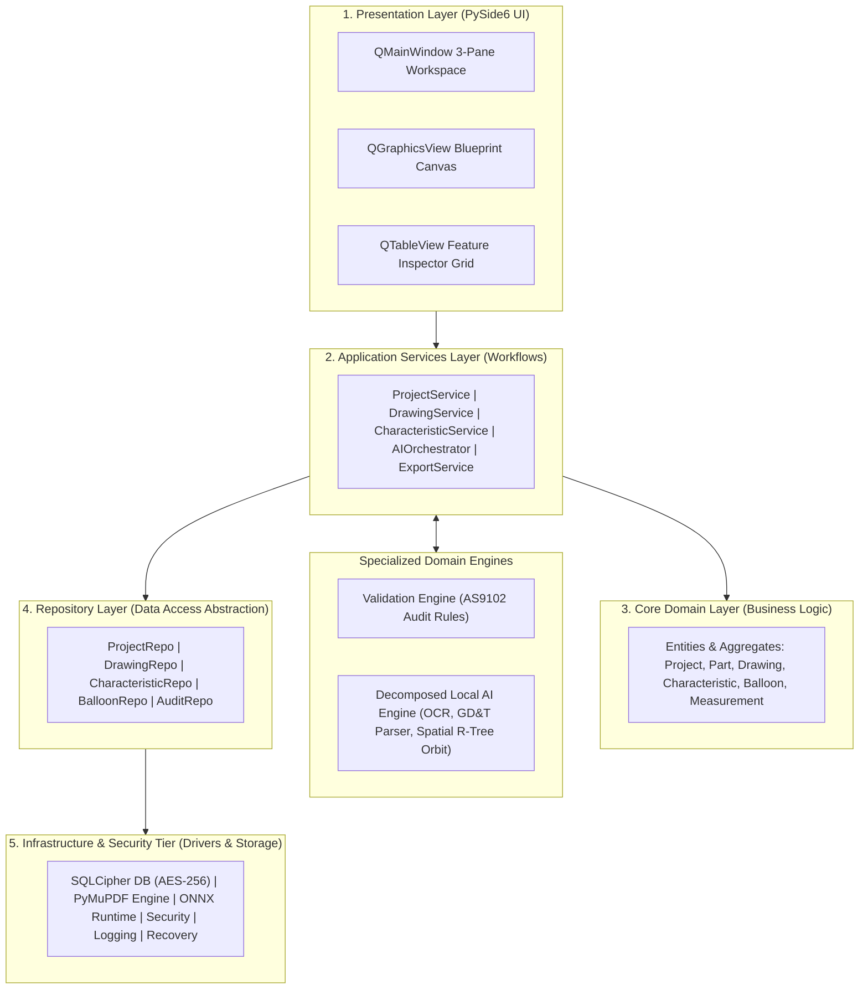
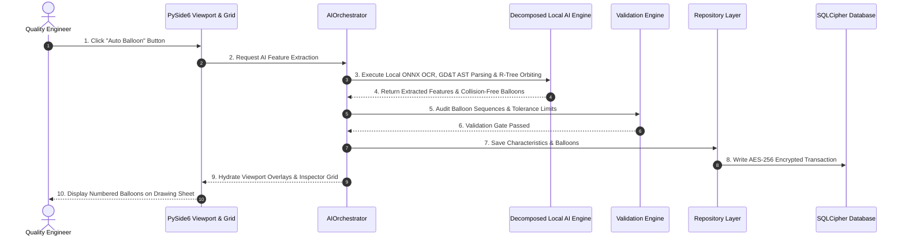

# Phase 2: High-Level System Architecture (HLD)

**Product Name:** FAI.EV.ENGINEER  
**Product Owner:** Harsh Yadav  
**Platform:** Standalone Desktop Python Application (PySide6 / Qt 6)  
**Domain:** Aerospace & High-Precision Manufacturing FAI (SAE AS9102 Rev B/C, ASME Y14.5 GD&T)  
**Security Standard:** ITAR / CMMC Level 2 Air-Gapped Deployment (Zero Cloud AI Leakage)  
**Document Status:** Baseline Approved HLD Architecture  

---

## 1. Business Problem, Functional Scope & Architectural Principles

### 1.1 Business Problem & Functional Scope
In aerospace and high-precision manufacturing, Quality Engineers spend between 4 to 12 hours manually ballooning engineering drawings and populating SAE AS9102 Form 1, Form 2, and Form 3 characteristic inspection sheets.

FAI.EV.ENGINEER automates drawing ballooning, feature extraction, and report compilation through local AI processing, reducing setup time by over 85% (under 20 minutes per drawing package).

### 1.2 Core Architectural Principles
- **Local-First & Air-Gapped Architecture:** All AI inference, neural OCR, drawing rendering, and database storage execute locally on the user's host machine. Zero data is transmitted over external networks, maintaining strict compliance with defense ITAR and CMMC Level 2 security regulations.
- **Explicit Human Control:** Automated feature extraction does not auto-run upon file upload. AI execution requires an explicit user trigger by clicking the "Auto Balloon" button.
- **Responsive Viewport Rendering:** Delivers interactive 60 FPS panning, zooming, and vector layer manipulation on large engineering drawing blueprints via PySide6 hardware acceleration.
- **Tamper-Proof Audit Traceability:** All inspection activities, manual overrides, and balloon edits are recorded in a cryptographic SHA-256 hash-chained audit ledger.

---

## 2. System Architecture Topology & 5-Layer Clean Architecture

To ensure strict separation of concerns, testability, and long-term maintainability, FAI.EV.ENGINEER enforces a 5-tier Clean Layered Architecture:

### 2.1 Architectural Dependency Rules
- **Unidirectional Downward Dependency:** Presentation Layer -> Application Services Layer -> Domain Layer -> Repository Layer -> Infrastructure Layer.
- **Domain Layer Independence:** The Domain Layer contains zero dependencies on PySide6 UI, SQLCipher databases, or third-party drivers.
- **UI Isolation:** The Presentation Layer accesses system logic exclusively through Application Services.
- **Infrastructure Decoupling:** Third-party libraries (PyMuPDF, ONNX Runtime, SQLCipher) are encapsulated behind abstract interfaces.

---

## 3. Subsystem & Component Decomposition

### 3.1 Presentation Layer (PySide6 GUI Framework)
- **Main Window (`QMainWindow`):** Manages Postman-style multi-pane workspace (`QDockWidget`, `QSplitter`), global navigation, menus, and application styling.
- **Blueprint Canvas (`QGraphicsView`):** Hardware-accelerated viewport providing 60 FPS interactive panning, zooming, and vector layer rendering.
- **Feature Inspector Grid (`QTableView`):** Interactive inspection table rendering nominal values, upper/lower tolerances, measured results, and visual confidence warning badges for extractions below 95% confidence.
- **Notification System:** Displays toast alerts, background job progress bars, and validation warning banners.

### 3.2 Application Services Layer
- **Project & Drawing Services:** Coordinates opening, saving, and managing project hierarchy (Organization -> Project -> Part -> Revision -> Drawing).
- **Characteristic & Balloon Services:** Manages feature creation, manual overrides, leader line positioning, and balloon sequence renumbering.
- **AI Orchestrator:** Manages background execution of neural OCR, GD&T AST parsing, and spatial balloon placement across non-blocking worker threads.
- **Export & Import Engines:** Compiles validated inspection data into SAE AS9102 Form 1, Form 2, and Form 3 Excel workbooks and ballooned vector PDFs, and manages file imports.
- **Background Job Manager:** Controls background worker threads (`QThread`), task queues, job cancellation, and progress signals.
- **Settings & Undo/Redo Services:** Manages application preferences, AI confidence thresholds, user action history stacks, and theme settings.

### 3.3 Decomposed Local AI Engine Subsystem
- **OCR Engine:** Local neural network text detection and recognition model executing via ONNX Runtime.
- **Geometry Analyzer:** Detects blueprint vector lines, title block regions, and dimension leader lines.
- **Feature Detector:** Classifies extracted text strings into linear, angular, radial, and bilateral engineering callouts.
- **GD&T Parser:** Parses ASME Y14.5 Feature Control Frames into structured Abstract Syntax Trees (AST).
- **Confidence Engine:** Evaluates extraction probability scores and flags items below 95% confidence for human review.
- **Balloon Placement Engine:** Calculates collision-free balloon coordinates using a 2D spatial R-Tree index (`rtree` & `shapely`).

### 3.4 Validation & Business Rules Subsystem
- **Sequence Auditor:** Ensures unique, continuous balloon numbering across single and multi-page engineering drawings.
- **Tolerance Inspector:** Calculates upper/lower limit boundaries and evaluates PASS/FAIL inspection status.
- **Export Readiness Gate:** Audits that 100% of Form 3 characteristics are approved and measured before allowing report export.

### 3.5 Repository Layer
- **Project Repository:** Data access interface and SQLCipher implementation for project structure persistence.
- **Drawing Repository:** CRUD operations for drawing package metadata and sheet records.
- **Characteristic & Balloon Repositories:** Persistence layer for extracted feature attributes, GD&T ASTs, and balloon vector coordinates.
- **Audit Repository:** Append-only persistence for cryptographic SHA-256 hash-chain audit entries.

### 3.6 Infrastructure & Security Layer
- **SQLCipher Storage Engine:** Encrypted SQLite database engine providing AES-256 encryption at rest.
- **PyMuPDF Driver Engine:** Sub-millisecond PDF vector extraction and high-DPI rasterization driver.
- **ONNX Runtime Driver:** Local CPU-optimized neural network inference engine.
- **Security Services:** AES-256 payload encryption, SHA-256 hashing, and digital signature validation.
- **Logging Framework:** Quad-channel logging system separating App, Audit, Crash, and Performance logs.
- **Cache & Recovery Managers:** Multi-level caching (render, OCR, thumbnail) and background auto-save crash recovery.
- **File Manager:** `.afai` package serialization, project backups, and safe atomic file writes.

---

## 4. Data Architecture, Security & Storage Strategy

### 4.1 Encrypted Local Storage (SQLCipher)
- **Encryption Standard:** AES-256 database encryption at rest (`PRAGMA key`).
- **Cryptographic Audit Ledger:** Append-only `audit_log` table protected by a SHA-256 hash chain: `Hash_n = SHA256(Hash_{n-1} + Timestamp + UserID + Payload)`.

### 4.2 Single-File Package Format (`.afai`)
Projects are saved as single, self-contained `.afai` (Automated First Article Inspection) containers containing:
- `metadata.json` — Project information and header metadata.
- `database.sqlite.enc` — Encrypted SQLCipher database payload.
- `raw_drawing.pdf` — Original vector PDF blueprint file.
- `audit_chain.sig` — Cryptographic signature verifying file integrity.

---

## 5. Integration Protocols, Events & Workflow Sequences

### 5.1 End-to-End Processing & AI Sequence

---

## 6. Core Technology Stack & Architecture Trade-Off Matrix

### 6.1 Core Technology Stack

| Architecture Layer | Selected Technology | Purpose & Role |
| :--- | :--- | :--- |
| **GUI Framework** | PySide6 (Qt 6.6+) | Postman-style desktop interface and 60 FPS viewport rendering. |
| **PDF Processing Engine** | PyMuPDF (`fitz`) | Sub-millisecond vector blueprint parsing and raster tile rendering. |
| **Local AI Engine** | ONNX Runtime | CPU-optimized local neural OCR and feature extraction. |
| **Encrypted Storage** | PySQLCipher | Encrypted local SQLite database (AES-256). |
| **Excel Exporter** | OpenPyXL / XlsxWriter | Multi-tab SAE AS9102 Form 1, Form 2, and Form 3 report generation. |
| **Packaging & Distribution** | Nuitka / PyInstaller | Standalone zero-dependency executable (`.exe`) bundling for air-gapped workstations. |

---

### 6.2 Architecture Trade-Off Matrix

| Design Area | Option Selected | Alternative Considered | Engineering Trade-off Rationale |
| :--- | :--- | :--- | :--- |
| **System Architecture** | **5-Layer Clean Architecture** | Monolithic Model-View | Enforces domain isolation, repository decoupling, and testability across independent layers. |
| **GUI Shell** | **PySide6 (Qt 6)** | Electron / Tauri | Native C++ graphics performance (`QGraphicsView`), lower memory footprint, direct native Python AI integration. |
| **AI Inference Engine** | **ONNX Runtime** | PyTorch / TensorFlow | Efficient CPU inference and reduced deployment footprint without CUDA GPU hardware requirements. |
| **PDF Engine** | **PyMuPDF (`fitz`)** | PDFMiner / pdfplumber | High-speed vector parsing and raster rendering speeds essential for responsive UI viewport performance. |
| **Deployment Packaging** | **Nuitka / PyInstaller** | Web App / Docker Container | Single standalone `.exe` zero-installer binary suitable for air-gapped defense machine shops without IT overhead. |

---

## 7. Non-Functional Requirements & Architecture Sign-Off

### 7.1 Performance & Reliability Targets
- **Viewport Rendering:** Responsive interactive rendering optimized for large engineering drawings on supported hardware.
- **AI Extraction Latency:** Performance target defined for reference hardware and representative drawing sets.
- **UI Responsiveness:** Under 2 seconds user interaction response time across all editing workflows.
- **Data Security & Air-Gap:** 100% local processing with zero external network connectivity.

### 7.2 Architecture Sign-Off Checklist
- [x] Section 1: Business Problem, Functional Scope & Architectural Principles baseline established.
- [x] Section 2: 5-Layer Clean Architecture topology and dependency rules established.
- [x] Section 3: Subsystem decomposition (UI, Services, Domain, Repositories, AI Engine, Validation) specified.
- [x] Section 4: Encrypted SQLCipher database, SHA-256 audit ledger, and `.afai` package spec defined.
- [x] Section 5: Domain Event catalog, system workflows, and error handling strategies specified.
- [x] Section 6: Core technology stack and architecture trade-off matrix documented.
- [x] Section 7: Non-functional requirements, performance targets, and sign-off baseline completed.
