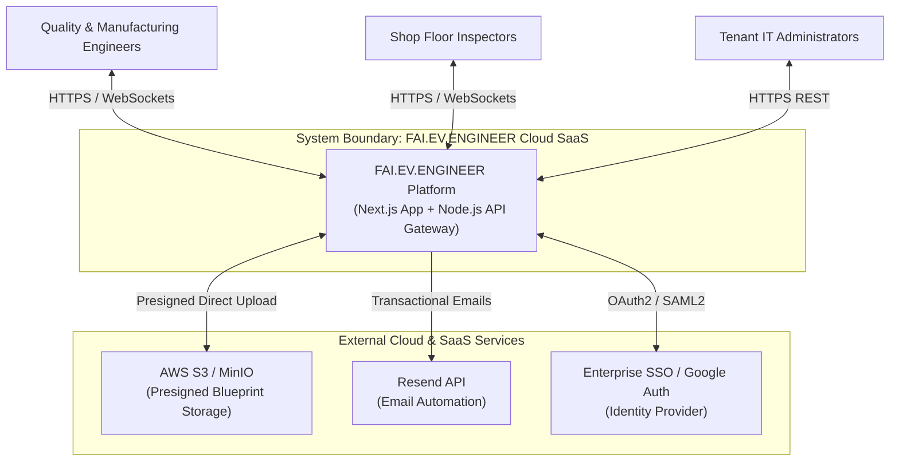
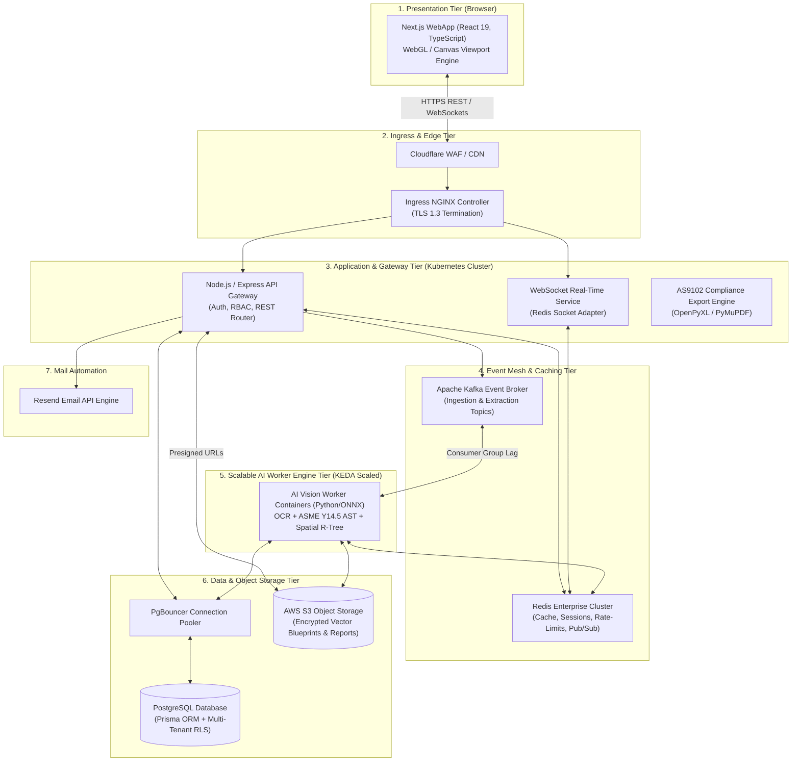
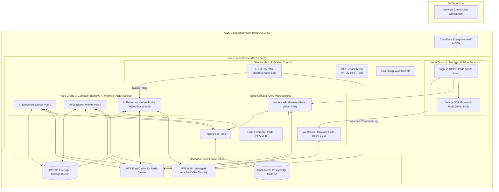
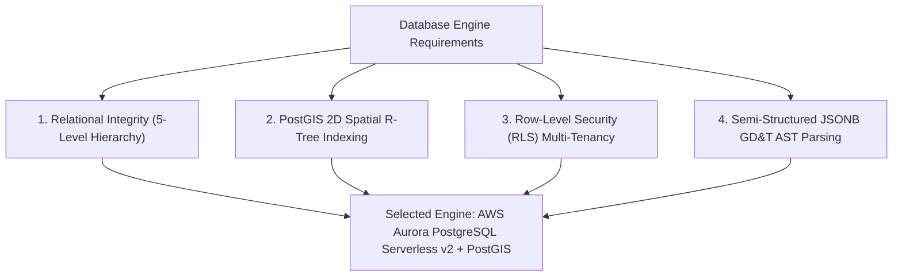
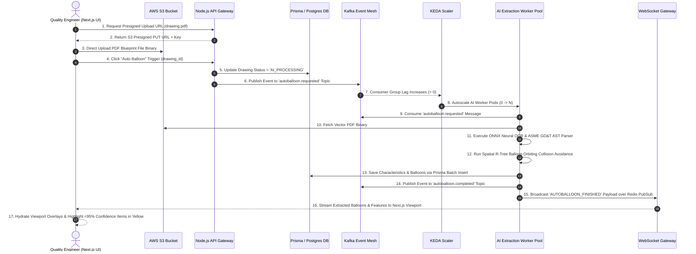

# Phase 2: High-Level System Architecture (HLD) — Enterprise B2B SaaS Platform

**Product Name:** FAI.EV.ENGINEER  
**Product Owner:** Harsh Yadav  
**Document Version:** v2.0 (Production Enterprise SaaS Architecture)  
**Domain:** Aerospace & High-Precision Manufacturing FAI (SAE AS9102 Rev B/C, ASME Y14.5 GD&T)  
**Target Infrastructure:** Multi-Tenant Cloud WebApp (Next.js, Node.js, Prisma, PostgreSQL, Redis, Kafka, Resend, S3, Docker, Kubernetes, KEDA)  
**Security & Compliance:** SOC2 Type II, ISO 27001, ITAR / CMMC Level 2 Hybrid Ready  
**Document Status:** Approved Master Baseline HLD Architecture  

---

## 1. Executive Summary & B2B SaaS Architectural Principles

### 1.1 Architectural Vision
`FAI.EV.ENGINEER` is a browser-first, multi-tenant B2B SaaS enterprise platform engineered to automate First Article Inspection (FAI) ballooning and SAE AS9102 Form 1, Form 2, and Form 3 report creation. 

Shifting from a legacy local desktop model to a modern cloud-native event-driven architecture, the platform enables real-time team collaboration, high-performance WebGL blueprint rendering in the browser, asynchronous AI vision processing over Kafka event queues, and Kubernetes event-driven autoscaling via KEDA.

### 1.2 Core Architectural Principles
* **Browser-First Web Application:** Zero-client installation required. Next.js delivers a responsive, desktop-grade WebGL/Canvas viewport rendering vector engineering PDF blueprints at 60 FPS.
* **Decoupled Asynchronous Processing:** Long-running drawing ingestion, neural OCR, ASME Y14.5 GD&T parsing, and balloon placement tasks are offloaded to Kafka event topics, keeping HTTP APIs lightweight and non-blocking.
* **Event-Driven Worker Autoscaling (KEDA):** AI extraction worker containers in Kubernetes scale dynamically based on **Kafka Consumer Group Lag**, ensuring rapid turnaround under peak drawing upload volumes while preventing database connection starvation.
* **Strict Multi-Tenant Isolation:** Multi-tenancy enforced at both database level (Prisma + PostgreSQL Row-Level Security) and storage level (S3 presigned URLs with tenant prefix constraints).
* **Explicit Human-in-the-Loop (HITL) Control:** AI extraction executes **ONLY when the user explicitly clicks "Auto Balloon"**. All AI outputs below 95% confidence are flagged for human audit.
* **Tamper-Proof Regulatory Audit Traceability:** Cryptographic SHA-256 hash-chained audit log preserves an immutable history of every extraction, manual override, and AS9102 export event.

---

## 2. Visual Architecture Diagram & C4 Views

### 2.0 Master 5-Stage System Architecture Blueprints

Refer to 📄 **[`all_stages_system_architecture.md`](file:///C:/Users/hy376/.gemini/antigravity/brain/1c296c4b-eef4-4158-ba24-a89523b57488/all_stages_system_architecture.md)** for the complete stage-by-stage visual specifications.

#### 1. Multi-Tenant Auth & Edge Gateway Architecture Blueprint


#### 2. PDF Ingestion, Kafka Event Mesh & KEDA AI Engine Blueprint


---

### 2.1 C4 Context Diagram (Level 1)

The Context Diagram illustrates the boundary of the `FAI.EV.ENGINEER` cloud ecosystem and its interactions with external users and third-party SaaS services.



---

### 2.2 C4 Container Diagram (Level 2)

The Container Diagram details the technical microservices, datastores, message brokers, and background workers running within the system boundary.



---

### 2.3 Network Subnet Topology & Data Workflow View


---

### 2.4 Deployment View (Production Kubernetes Architecture)

The Deployment Diagram illustrates how microservice containers are orchestrated across multi-AZ node groups in Kubernetes (EKS/GKE/AKS).



---

## 3. Microservices Communication & Protocols

| Communication Channel | Source Subsystem | Destination Subsystem | Protocol / Payload | SLA / Latency Target |
| :--- | :--- | :--- | :--- | :--- |
| **Client Navigation & API** | Next.js Browser UI | Node.js API Gateway | HTTPS / REST (JSON) | $< 100\text{ ms}$ |
| **Direct Blueprint Upload** | Next.js Browser UI | AWS S3 Bucket | HTTPS Presigned PUT (PDF Binary) | Dependent on bandwidth ($< 3\text{ s}$) |
| **Real-time Live Sync** | Next.js Viewport Engine | WebSocket Gateway | WebSockets / WSS (JSON Events) | $< 50\text{ ms}$ |
| **Async Extraction Trigger** | API Gateway | Kafka Broker (`autoballoon.requested`) | Kafka TCP / Binary Schema | $< 10\text{ ms}$ publish |
| **AI Worker Processing** | Kafka Broker | AI Vision Worker Pool | Kafka Consumer Protocol | Scaled by KEDA ($< 15\text{ s}$ execution) |
| **Inter-Worker RPC** | AI Worker Engine | ASME AST Parser Sidecar | gRPC over HTTP/2 (Protobuf) | $< 5\text{ ms}$ |
| **Data Persistence** | API / Worker Services | PgBouncer Pooler | PostgreSQL Wire Protocol | $< 15\text{ ms}$ query latency |
| **Session & Cache** | API Gateway | Redis Cluster | Redis RESP Protocol | $< 2\text{ ms}$ lookup |
| **Transactional Email** | API Gateway | Resend API Service | HTTPS / REST | $< 500\text{ ms}$ dispatch |

---

## 4. Data Architecture, Multi-Tenancy & Database Engine Selection

### 4.1 Database Engine & ORM Selection Decision Framework

To choose the optimal database service and data access layer for `FAI.EV.ENGINEER`, we evaluated three database paradigms (Relational, Document/NoSQL, and Distributed SQL) alongside three TypeScript data access layers (Prisma ORM, Drizzle ORM, and Kysely).

#### 1. Database Engine Evaluation: AWS Aurora PostgreSQL Serverless v2 (Selected)



* **Why Relational over NoSQL (MongoDB/DynamoDB):** `FAI.EV.ENGINEER` manages strict cascading domain hierarchies (`Organization -> Project -> Part -> Revision -> Drawing -> Characteristic -> Balloon`). NoSQL databases lack cross-document ACID transactions and foreign key constraints required for aerospace AS9102 Rev B/C audit compliance.
* **Why PostgreSQL + PostGIS over standard MySQL/SQLite:** Engineering drawing ballooning requires 2D spatial coordinate indexing ($(x_1, y_1, x_2, y_2)$ bounding boxes) for collision avoidance. PostgreSQL's native **PostGIS** extension provides spatial R-Tree indexing (`GiST`) and spatial functions (`ST_Intersects`, `ST_Buffer`) operating at sub-millisecond speeds.
* **Why Aurora PostgreSQL Serverless v2 over Vanilla RDS:** Aurora Serverless v2 scales Aurora Capacity Units (ACUs) dynamically in fine-grained increments based on instant IOPS spikes, providing multi-AZ failover in $< 30$ seconds.

#### 2. Data Access Layer Evaluation: Prisma ORM + PgBouncer (Selected)

| Evaluation Criteria | Prisma ORM (Selected) | Drizzle ORM | Raw SQL / Kysely |
| :--- | :--- | :--- | :--- |
| **Developer Velocity & Type Safety** | ⭐⭐⭐⭐⭐ Full auto-generated TypeScript client from declarative schema DSL. | ⭐⭐⭐⭐ Requires manual TypeScript schema definitions. | ⭐⭐⭐ Manual type mapping. |
| **Multi-Tenant RLS Integration** | **Seamless:** Prisma Client Extensions (`$extends`) dynamically inject `tenant_id` & `SET LOCAL app.current_tenant_id`. | Manual query middleware. | Manual query wrapping. |
| **Connection Management** | Solved by **PgBouncer** connection pooler multiplexing thousands of worker queries. | Native light connection footprint. | Native light connection footprint. |
| **Spatial PostGIS Queries** | Handled via parameterized Prisma `$queryRaw` & spatial sidecar indexing. | Direct SQL type extension. | Direct SQL builder. |

**Final Architectural Choice:** **Prisma ORM** is selected as the primary ORM for 95% of domain CRUD operations and migration management, paired with **PgBouncer** to handle worker pool scale and **Prisma `$queryRaw`** for specialized PostGIS spatial queries.

---

### 4.2 Production Prisma Data Model & PostgreSQL Schema

The data tier uses **Prisma ORM** over **PostgreSQL** with multi-tenant Row-Level Security (RLS). Below is the complete, production-ready `schema.prisma` definition.

```prisma
// ==========================================
// Prisma Database Schema — FAI.EV.ENGINEER
// ==========================================

datasource db {
  provider = "postgresql"
  url      = env("DATABASE_URL")
}

generator client {
  provider      = "prisma-client-js"
  binaryTargets = ["native", "debian-openssl-3.0.x", "linux-musl-arm64-openssl-3.0.x"]
}

// ------------------------------------------
// Multi-Tenant & Identity Domain
// ------------------------------------------

enum UserRole {
  SUPER_ADMIN
  TENANT_ADMIN
  QUALITY_ENGINEER
  INSPECTOR
  VIEWER_AUDITOR
}

model Organization {
  id           String    @id @default(uuid())
  name         String
  slug         String    @unique
  cageCode     String?   @map("cage_code")
  logoUrl      String?   @map("logo_url")
  createdAt    DateTime  @default(now()) @map("created_at")
  updatedAt    DateTime  @updatedAt @map("updated_at")

  users        User[]
  projects     Project[]
  auditLogs    AuditLog[]

  @@map("organizations")
}

model User {
  id             String       @id @default(uuid())
  organizationId String       @map("organization_id")
  email          String       @unique
  fullName       String       @map("full_name")
  role           UserRole     @default(QUALITY_ENGINEER)
  avatarUrl      String?      @map("avatar_url")
  isActive       Boolean      @default(true) @map("is_active")
  createdAt      DateTime     @default(now()) @map("created_at")
  updatedAt      DateTime     @updatedAt @map("updated_at")

  organization   Organization @relation(fields: [organizationId], references: [id], onDelete: Cascade)
  auditLogs      AuditLog[]

  @@index([organizationId])
  @@map("users")
}

// ------------------------------------------
// Project & Drawing Hierarchy Domain
// ------------------------------------------

model Project {
  id             String       @id @default(uuid())
  organizationId String       @map("organization_id")
  name           String
  projectCode    String       @map("project_code")
  description    String?
  createdAt      DateTime     @default(now()) @map("created_at")
  updatedAt      DateTime     @updatedAt @map("updated_at")

  organization   Organization @relation(fields: [organizationId], references: [id], onDelete: Cascade)
  parts          Part[]

  @@unique([organizationId, projectCode])
  @@index([organizationId])
  @@map("projects")
}

model Part {
  id          String     @id @default(uuid())
  projectId   String     @map("project_id")
  partNumber  String     @map("part_number")
  partName    String     @map("part_name")
  createdAt   DateTime   @default(now()) @map("created_at")
  updatedAt   DateTime   @updatedAt @map("updated_at")

  project     Project    @relation(fields: [projectId], references: [id], onDelete: Cascade)
  revisions   Revision[]

  @@unique([projectId, partNumber])
  @@index([projectId])
  @@map("parts")
}

model Revision {
  id           String     @id @default(uuid())
  partId       String     @map("part_id")
  revisionCode String     @map("revision_code")
  releaseDate  DateTime   @default(now()) @map("release_date")
  createdAt    DateTime   @default(now()) @map("created_at")
  updatedAt    DateTime   @updatedAt @map("updated_at")

  part         Part       @relation(fields: [partId], references: [id], onDelete: Cascade)
  drawings     Drawing[]
  form1        Form1Record?
  form2        Form2Record?

  @@unique([partId, revisionCode])
  @@index([partId])
  @@map("revisions")
}

// ------------------------------------------
// Document & Ingestion Domain
// ------------------------------------------

enum DrawingStatus {
  DRAFT
  AI_PROCESSING
  IN_REVIEW
  APPROVED
  COMPLETED
}

model Drawing {
  id           String         @id @default(uuid())
  revisionId   String         @map("revision_id")
  fileName     String         @map("file_name")
  s3Key        String         @map("s3_key")
  fileSizeBytes Int           @map("file_size_bytes")
  pageCount    Int            @default(1) @map("page_count")
  status       DrawingStatus  @default(DRAFT)
  createdAt    DateTime       @default(now()) @map("created_at")
  updatedAt    DateTime       @updatedAt @map("updated_at")

  revision     Revision       @relation(fields: [revisionId], references: [id], onDelete: Cascade)
  sheets       DrawingSheet[]

  @@index([revisionId])
  @@map("drawings")
}

model DrawingSheet {
  id             String           @id @default(uuid())
  drawingId      String           @map("drawing_id")
  sheetNumber    Int              @map("sheet_number")
  widthPx        Float            @map("width_px")
  heightPx       Float            @map("height_px")
  dpiResolution  Int              @default(300) @map("dpi_resolution")
  createdAt      DateTime         @default(now()) @map("created_at")

  drawing        Drawing          @relation(fields: [drawingId], references: [id], onDelete: Cascade)
  characteristics Characteristic[]

  @@unique([drawingId, sheetNumber])
  @@index([drawingId])
  @@map("drawing_sheets")
}

// ------------------------------------------
// Inspection & Characteristic Domain
// ------------------------------------------

enum CharacteristicType {
  LINEAR
  ANGULAR
  RADIAL
  BILATERAL
  LIMIT
  NOTE
  GDT_FRAME
}

enum ToleranceType {
  BILATERAL
  SYMMETRIC
  LIMIT
  MAX
  MIN
}

model Characteristic {
  id                   String             @id @default(uuid())
  drawingSheetId       String             @map("drawing_sheet_id")
  characteristicNumber Int                @map("characteristic_number")
  characteristicType   CharacteristicType @map("characteristic_type")
  requirement          String
  nominalValue         Float?             @map("nominal_value")
  upperTolerance       Float?             @map("upper_tolerance")
  lowerTolerance       Float?             @map("lower_tolerance")
  toleranceType        ToleranceType      @default(BILATERAL) @map("tolerance_type")
  gdtSymbol            String?            @map("gdt_symbol")
  gdtAstJson           Json?              @map("gdt_ast_json")
  confidenceScore      Float              @map("confidence_score")
  isApproved           Boolean            @default(false) @map("is_approved")
  createdAt            DateTime           @default(now()) @map("created_at")
  updatedAt            DateTime           @updatedAt @map("updated_at")

  drawingSheet         DrawingSheet       @relation(fields: [drawingSheetId], references: [id], onDelete: Cascade)
  balloon              Balloon?
  inspectionResults    InspectionResult[]

  @@unique([drawingSheetId, characteristicNumber])
  @@index([drawingSheetId])
  @@map("characteristics")
}

model Balloon {
  id               String         @id @default(uuid())
  characteristicId String         @unique @map("characteristic_id")
  balloonNumber    Int            @map("balloon_number")
  xNorm            Float          @map("x_norm")
  yNorm            Float          @map("y_norm")
  leaderPathJson   Json?          @map("leader_path_json")
  isUserModified   Boolean        @default(false) @map("is_user_modified")
  createdAt        DateTime       @default(now()) @map("created_at")
  updatedAt        DateTime       @updatedAt @map("updated_at")

  characteristic   Characteristic @relation(fields: [characteristicId], references: [id], onDelete: Cascade)

  @@map("balloons")
}

enum PassFailStatus {
  PASS
  FAIL
  MARGINAL
}

model InspectionResult {
  id               String         @id @default(uuid())
  characteristicId String         @map("characteristic_id")
  measuredValue    Float          @map("measured_value")
  status           PassFailStatus
  inspectorId      String         @map("inspector_id")
  toolId           String?        @map("tool_id")
  createdAt        DateTime       @default(now()) @map("created_at")

  characteristic   Characteristic @relation(fields: [characteristicId], references: [id], onDelete: Cascade)

  @@index([characteristicId])
  @@map("inspection_results")
}

// ------------------------------------------
// AS9102 Compliance Reporting Domain
// ------------------------------------------

model Form1Record {
  id           String   @id @default(uuid())
  revisionId   String   @unique @map("revision_id")
  partName     String   @map("part_name")
  partNumber   String   @map("part_number")
  serialNumber String?  @map("serial_number")
  batchNumber  String?  @map("batch_number")
  orgName      String   @map("org_name")
  cageCode     String?  @map("cage_code")
  createdAt    DateTime @default(now()) @map("created_at")

  revision     Revision @relation(fields: [revisionId], references: [id], onDelete: Cascade)

  @@map("form1_records")
}

model Form2Record {
  id              String   @id @default(uuid())
  revisionId      String   @unique @map("revision_id")
  rawMaterialName String   @map("raw_material_name")
  materialSpec    String   @map("material_spec")
  specialProcess  String   @map("special_process")
  functionalTest  String   @map("functional_test")
  createdAt       DateTime @default(now()) @map("created_at")

  revision        Revision @relation(fields: [revisionId], references: [id], onDelete: Cascade)

  @@map("form2_records")
}

// ------------------------------------------
// Audit Ledger & Cryptographic Verification
// ------------------------------------------

model AuditLog {
  id             String       @id @default(uuid())
  organizationId String       @map("organization_id")
  userId         String       @map("user_id")
  action         String
  resourceType   String       @map("resource_type")
  resourceId     String       @map("resource_id")
  payloadJson    Json         @map("payload_json")
  previousHash   String       @map("previous_hash")
  currentHash    String       @map("current_hash")
  createdAt      DateTime     @default(now()) @map("created_at")

  organization   Organization @relation(fields: [organizationId], references: [id], onDelete: Cascade)
  user           User         @relation(fields: [userId], references: [id], onDelete: Cascade)

  @@index([organizationId])
  @@index([userId])
  @@map("audit_logs")
}
```

---

## 5. End-to-End System Pipeline & Interactive Editing Engine Architecture

### 5.1 Master 9-Step PDF → AI → Editing Workflow Architecture

```
1. Upload PDF (Vector/Scanned 300 DPI via Presigned S3)
       ↓
2. Render Drawing (WebGL 60 FPS Viewport: Pan, Zoom, Rotate, Sheets, Layers)
       ↓
3. User Clicks "Auto Balloon" (EXPLICIT Human Trigger — AI DOES NOT Auto-Start)
       ↓
4. AI Feature Extraction (ONNX Neural OCR, ASME Y14.5 GD&T AST, Datums A-Z, MMC/LMC)
       ↓
5. Automatic Balloon Generation (R-Tree Spatial Collision Avoidance, Multi-Sheet Numbering)
       ↓
6. Feature Table Generation (Postman Grid: Char #, Zone, Requirement, Nominal, Limits, Confidence)
       ↓
7. ⭐ HUMAN EDITOR & REVIEW ENGINE
   ├── A. Visual Balloon Layer Editing (Edit, Renumber, Delete, Hide/Show, Leaders, Shapes)
   ├── B. Extracted-Data Editing (Nominal Values, Upper/Lower Tolerances, GD&T AST)
   └── C. Human Validation Callout (Confidence <95% Flagged Yellow, Magnified Bitmap Crop Window)
       ↓
8. Validation (AI Extraction → Human Review → Editing → Validation & Lock)
       ↓
9. Export (AS9102 Form 1/2/3 .xlsx, CSV, Marked-Up PDF, Resend Email)
```

---

### 5.2 End-to-End Architectural Blueprint (Domain to Interactive Editing & Export)


---

### 5.2 Interactive Blueprint Editor Architecture Specification

Refer to 📄 **[`editor_design_architecture.md`](file:///C:/Users/hy376/.gemini/antigravity/brain/1c296c4b-eef4-4158-ba24-a89523b57488/editor_design_architecture.md)** for full frontend React component hierarchy, Zustand state schemas, dynamic leader line pathing algorithms, and WebSocket lock manager implementation details.

* **Smart Drag-and-Drop Balloon Orbiting:** Drag any balloon circle across the WebGL canvas; leader lines automatically bend (straight, curved, elbow) without detaching from CAD geometry.
* **Shape Customization:** Toggle between **Circle** (Standard), **Square Box** (Reference), **Flag Note Triangle** (Notes), and **Hexagon** (Critical Inspection).
* **Automated Sequential Renumbering:** Changing Balloon #4 to #10 automatically updates subsequent balloons (#5 $\to$ #6, etc.) without ID collisions.
* **Drawing Zone Detection:** Automatically calculates drawing grid coordinates (e.g., `Zone B4`, `Zone C2`) from ANSI/ISO title block margins.
* **Low-Confidence Visual Crop Callout (<95%):** Items with confidence score $< 95\%$ trigger a visual crop callout window displaying a high-resolution zoomed bitmap snippet of the original drawing zone side-by-side with the AI output.
* **Multi-User Real-Time Lock Manager:** WebSockets selection locking highlights Balloon #12 in orange when co-edited by another Quality Engineer, preventing edit collisions.

---

### 5.3 End-to-End Sequence Diagram ("Auto Balloon" & HITL Editing Flow)

The diagram below details the exact sequence from domain entrypoint to PDF upload, Kafka AI extraction, interactive HITL editing, and final AS9102 export:



---

## 6. Containerization, Kubernetes Orchestration & KEDA Scaling

### 6.1 Multi-Stage Dockerfile Strategy

#### Next.js UI Frontend Dockerfile (`apps/web/Dockerfile`)
```dockerfile
# Stage 1: Dependencies
FROM node:20-alpine AS deps
WORKDIR /app
COPY package.json package-lock.json ./
RUN npm ci

# Stage 2: Builder
FROM node:20-alpine AS builder
WORKDIR /app
COPY --from=deps /app/node_modules ./node_modules
COPY . .
ENV NEXT_TELEMETRY_DISABLED 1
RUN npm run build

# Stage 3: Production Runner
FROM node:20-alpine AS runner
WORKDIR /app
ENV NODE_ENV production
ENV PORT 3000
RUN addgroup --system --gid 1001 nodejs && adduser --system --uid 1001 nextjs
COPY --from=builder /app/public ./public
COPY --from=builder --chown=nextjs:nodejs /app/.next/standalone ./
COPY --from=builder --chown=nextjs:nodejs /app/.next/static ./.next/static
USER nextjs
EXPOSE 3000
CMD ["node", "server.js"]
```

#### Node.js Backend API Dockerfile (`apps/api/Dockerfile`)
```dockerfile
# Stage 1: Dependencies & Prisma Generation
FROM node:20-alpine AS builder
WORKDIR /app
COPY package.json package-lock.json ./
COPY prisma ./prisma/
RUN npm ci
RUN npx prisma generate
COPY . .
RUN npm run build

# Stage 2: Production Runner
FROM node:20-alpine AS runner
WORKDIR /app
ENV NODE_ENV production
RUN addgroup -S appgroup && adduser -S appuser -G appgroup
COPY package.json package-lock.json ./
RUN npm ci --only=production
COPY --from=builder /app/dist ./dist
COPY --from=builder /app/node_modules/.prisma ./node_modules/.prisma
COPY --from=builder /app/prisma ./prisma
USER appuser
EXPOSE 4000
CMD ["node", "dist/main.js"]
```

---

### 6.2 Local Unified Docker Compose Setup (`docker-compose.yml`)

```yaml
version: '3.8'

services:
  postgres:
    image: postgres:16-alpine
    container_name: faiev_postgres
    environment:
      POSTGRES_USER: faiev_admin
      POSTGRES_PASSWORD: faiev_secret_password
      POSTGRES_DB: faiev_production
    ports:
      - "5432:5432"
    volumes:
      - postgres_data:/var/lib/postgresql/data

  redis:
    image: redis:7-alpine
    container_name: faiev_redis
    ports:
      - "6379:6379"

  kafka:
    image: provectuslabs/kafka-ui:latest
    container_name: faiev_kafka
    ports:
      - "8080:8080"
    environment:
      DYNAMIC_CONFIG_ENABLED: 'true'

  localstack:
    image: localstack/localstack:latest
    container_name: faiev_s3_mock
    ports:
      - "4566:4566"
    environment:
      - SERVICES=s3

  mailpit:
    image: axllent/mailpit:latest
    container_name: faiev_mailpit
    ports:
      - "8025:8025"
      - "1025:1025"

volumes:
  postgres_data:
```

---

### 6.3 KEDA Event-Driven Autoscaling Spec (`keda-scaledobject.yaml`)

```yaml
apiVersion: keda.sh/v1alpha1
kind: ScaledObject
metadata:
  name: ai-worker-scaler
  namespace: faiev-production
spec:
  scaleTargetRef:
    apiVersion: apps/v1
    kind: Deployment
    name: ai-extraction-worker
  minReplicaCount: 0
  maxReplicaCount: 50
  cooldownPeriod: 300
  pollingInterval: 15
  triggers:
    - type: apache-kafka
      metadata:
        bootstrapServers: msk-kafka.faiev-internal:9092
        topic: autoballoon.requested
        consumerGroup: ai-worker-group
        lagThreshold: "5"
        activationLagThreshold: "0"
```

---

### 6.4 Kubernetes Prisma Migration `initContainer` Spec

```yaml
apiVersion: apps/v1
kind: Deployment
metadata:
  name: faiev-backend-api
spec:
  replicas: 3
  template:
    spec:
      initContainers:
        - name: prisma-migrate
          image: faiev-backend-api:latest
          command: ["npx", "prisma", "migrate", "deploy"]
          env:
            - name: DATABASE_URL
              valueFrom:
                secretKeyRef:
                  name: db-secrets
                  key: DATABASE_URL
      containers:
        - name: api-container
          image: faiev-backend-api:latest
          ports:
            - containerPort: 4000
```

---

## 7. Resilience, Security, Observability & Rate Limiting

### 7.1 High Availability & Failure Recovery Matrix

| Failure Mode | Circuit Breaker / Subsystem | Detection & Fallback Action | Impact |
| :--- | :--- | :--- | :--- |
| **OCR Worker Timeout** | Kafka Dead Letter Queue (DLQ) | Message moved to `autoballoon.dlq`; manual verification flagged in UI inspector grid. | Quality Engineer receives warning toast; drawing remains accessible. |
| **PostgreSQL Connection Spike** | PgBouncer Connection Pooler | PgBouncer queues incoming Prisma queries; rate-limits worker connections. | API response latency temporarily increases by $< 200\text{ ms}$; zero dropped DB queries. |
| **Redis Node Outage** | Redis Sentinel / Cluster | Automatic failover to secondary replica node in $< 5$ seconds. | Transient socket reconnects; zero session loss. |
| **Resend Email API Outage** | BullMQ Fallback Task Queue | Emails buffered in Redis task queue; retried with exponential backoff up to 24 hours. | Delayed email notification; zero transactional notification loss. |

### 7.2 Security & Compliance Architecture
* **Zero-Trust Network:** Pod-to-pod communications encrypted via **Istio mTLS**.
* **Secrets Management:** Environment variables dynamically injected via **HashiCorp Vault**.
* **Direct S3 Upload Protection:** Direct client uploads bypass API servers using short-lived Presigned URLs (15-minute expiration, restricted Content-Type to `application/pdf`).
* **Cryptographic Ledger Integrity:** Every record modification appends a hash node:
$$\text{Hash}_n = \text{SHA256}(\text{Hash}_{n-1} + \text{Timestamp} + \text{UserID} + \text{Payload})$$

### 7.3 Enterprise Authentication & Multi-Tenant RBAC Matrix

#### 1. Authentication Strategy (NextAuth.js v5 / Better-Auth + Resend + SAML)
* **Passwordless Email Magic Links:** Managed via **Resend API** for fast, secure friction-free login.
* **OAuth2 / OIDC Providers:** Enterprise Google Workspace and Microsoft Entra ID logins.
* **SAML 2.0 Enterprise SSO:** Integration with Okta and Azure AD for defense & enterprise customers.
* **Session Storage:** Hybrid JWT (signed with HS256) cached in **Redis** for fast Next.js Edge Middleware verification.

#### 2. Role-Based Access Control (RBAC) Matrix

| User Role | Domain Boundary | Key Permissions & Responsibilities |
| :--- | :--- | :--- |
| `SUPER_ADMIN` | Platform Wide | Global tenant management, billing subscriptions, system health monitoring, global feature flags. |
| `TENANT_ADMIN` | Organization Level | Invites team members via Resend, configures SAML SSO, manages seat licenses and CAGE code settings. |
| `QUALITY_ENGINEER` | Project / Drawing Level | Uploads blueprints, triggers **Auto Balloon**, edits nominal values & GD&T ASTs, exports AS9102 Form 1/2/3 workbooks. |
| `INSPECTOR` | Execution Level | Reads drawing requirements, enters caliper/CMM measured results into Form 3 rows. Cannot alter nominal requirements. |
| `VIEWER_AUDITOR` | Read-Only Level | External auditors (DCMA / ISO). Read-only access to completed packages, drawings, and cryptographic hash logs. |

---

## 8. Technology Stack Trade-Off Rationale Matrix

| Architecture Decision | Selection Made | Alternative Evaluated | Engineering Rationale & Trade-off |
| :--- | :--- | :--- | :--- |
| **Database Engine** | **AWS Aurora PostgreSQL Serverless v2 + PostGIS** | MongoDB / DynamoDB / CockroachDB | Relational integrity required for 5-tier project hierarchy. Native PostGIS extension provides sub-millisecond 2D spatial R-Tree indexing for balloon collision avoidance. Serverless v2 auto-scales ACUs instantly. |
| **ORM / Data Access Layer** | **Prisma ORM + PgBouncer** | Drizzle ORM / Kysely / TypeORM | Prisma delivers unmatched developer velocity, type safety, and `$extends` middleware for multi-tenant RLS. Paired with PgBouncer to eliminate connection exhaustion during KEDA worker bursts. |
| **Worker Scaling** | **KEDA (Kafka Lag Scaler)** | Native Kubernetes HPA (CPU/RAM) | CPU/RAM scaling lags behind message spikes. KEDA scales pods directly on **Kafka Consumer Group Lag**, processing backlogs before resource saturation. |
| **Database Pooler** | **PgBouncer** | Direct Prisma DB Connections | Prisma instances scale rapidly with K8s pods, risking PostgreSQL connection pool exhaustion. PgBouncer multiplexes thousands of connections. |
| **Message Event Mesh** | **Apache Kafka** | RabbitMQ / AWS SQS | Kafka provides ordered, durable log replay, essential for auditing, debugging, and multi-consumer pipelines. |
| **Multi-Tenancy** | **Prisma RLS (Row Level)** | Database-per-Tenant | Schema/DB-per-tenant adds massive operational overhead for 100+ accounts. RLS provides strict mathematical isolation in a unified DB cluster. |
| **Frontend Rendering** | **Next.js + WebGL Canvas** | Standard HTML DOM PDF Viewers | HTML DOM rendering chokes on complex 300 DPI vector blueprints. WebGL canvas delivers smooth 60 FPS pan/zoom at $3200\%$ magnification. |

---

## 9. Non-Functional Requirements & Architecture Sign-Off

### 9.1 SLA Targets
- **Platform Availability:** $\ge 99.95\%$ platform uptime.
- **Viewport Performance:** 60 FPS canvas panning/zooming.
- **AI Extraction Speed:** $< 15$ seconds for standard drawings.
- **Data Protection:** Multi-tenant encryption at rest (AES-256) and in transit (TLS 1.3).

### 9.2 Sign-Off Checklist
- [x] C4 Context, Container, Component & Kubernetes Deployment Views included.
- [x] Complete Production Prisma Schema (`schema.prisma`) included.
- [x] End-to-end Sequence Diagram ("Auto Balloon" trigger over Kafka/WebSockets) included.
- [x] Dockerfile multi-stage builds and `docker-compose.yml` included.
- [x] KEDA `ScaledObject` YAML manifest for Kafka lag scaling included.
- [x] Kubernetes `initContainer` Prisma migration strategy included.
- [x] High Availability, Resilience, PgBouncer, and Vault security strategy specified.
- [x] Master document sign-off complete.
