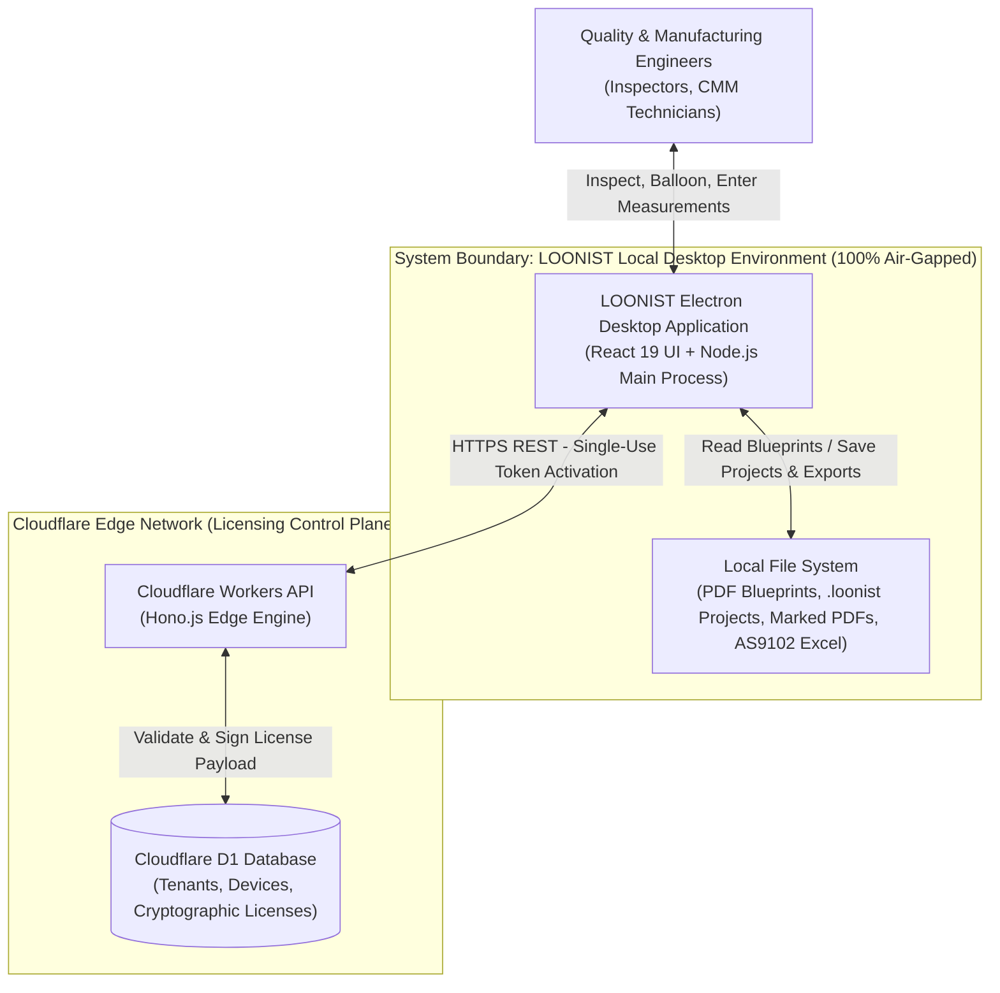
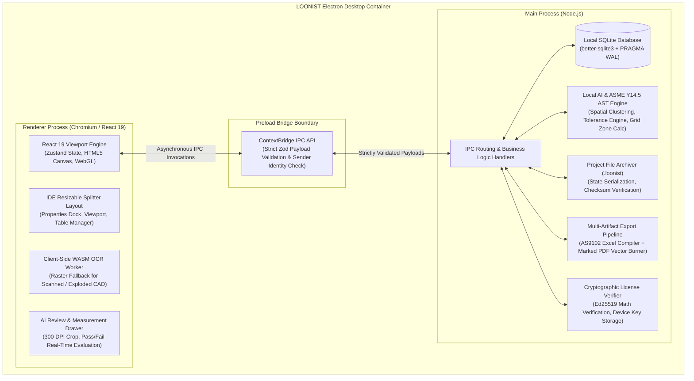

# Phase 2: High-Level System Architecture (HLD) — Desktop-First Enterprise Platform

**Product Name:** LOONIST  
**Product Owner:** Harsh Yadav  
**Document Version:** v2.1 (Competitive Disruption Baseline)  
**Domain:** Aerospace & High-Precision Manufacturing FAI (SAE AS9102 Rev B/C, ASME Y14.5 GD&T, AIAG PPAP)  
**Target Infrastructure:** Electron Desktop App (Windows/macOS), Local SQLite, Local ONNX/WASM AI, Cloudflare Workers API, Cloudflare D1  
**Security & Compliance:** ITAR/CMMC Level 2 Natively Compliant (100% Local Processing), Ed25519 Cryptographic Licensing  
**Document Status:** Approved Master Baseline HLD Architecture  

---

## 1. Executive Summary & Architectural Principles

### 1.1 Architectural Vision
`LOONIST` is an offline-first, desktop enterprise platform engineered to automate First Article Inspection (FAI) ballooning, physical measurement recording, and SAE AS9102 / AIAG PPAP report generation.

Unlike legacy incumbents (**InspectionXpert**, **DISCUS**, **High QA**) that either lock customers into clunky Windows-only .NET/Java tools or push insecure "Cloud OnDemand" SaaS, LOONIST guarantees absolute data protection. All blueprint parsing, geometric tolerance extraction, and inspection databases reside 100% locally on user hardware via embedded vector/ONNX AI engines, local SQLite storage, and a hardened Electron shell.

### 1.2 Core Architectural Principles & Competitive Moats
* **100% Air-Gapped Local-First Execution (ITAR Moat):** Customer engineering drawings and dimensional records NEVER cross external network boundaries. This natively satisfies strict defense data sovereignty (ITAR 22 CFR § 120-130 and CMMC Level 2).
* **Dual-Path Hybrid Vision & Vector Ingestion:** Combines a lightning-fast vector glyph and coordinate scanner ($<50\text{ms}$ for $>85\%$ of native CAD drawings) with an offline Canvas pre-processing (Otsu adaptive binarization, deskewing, blueprint inversion) and WebAssembly Deep Learning OCR pipeline with CAD symbol restoration (`Ø`, `±`, `°`, `↧`, `⌴`, `⌵`) for scanned blueprints and optical marquee crops.
* **Prose & Tutorial Sentence Exclusion Engine:** Multi-layer natural language and residual token validation eliminating false ballooning on tutorial cover sheets, book disclaimers, and narrative instructions while preserving genuine engineering notes.
* **Real-Time Measurement Compliance Engine:** Interactive data inspector allowing quality engineers to enter physical measurements with instantaneous (<5ms) Pass/Fail tolerance boundary calculation and visual indicators (Green = Within Limits, Red = Non-Conformance).
* **Self-Contained Project Archiving (`.loonist` format):** Complete state persistence bundling drawing hashes, SQLite records, balloon coordinates, and measurement history into a single portable archive for offline handoffs.
* **Dual-Artifact Export Pipeline:** One-click generation of certified multi-tab **SAE AS9102 Form 1, 2, and 3** Excel workbooks and high-resolution **Marked Blueprint PDFs** with vector balloon badges burned directly onto the drawing sheets.
* **Cryptographic Hardware Licensing:** A lightweight Cloudflare Workers edge API issues Ed25519 signed licenses bound to asymmetric device public keys, permitting prolonged offline operation without intrusive network polling.

---

## 2. Visual Architecture Diagram & C4 Views

### 2.1 C4 Context Diagram (Level 1)


*Key Invariant: Engineering drawings, GD&T characteristics, and measurement actuals NEVER cross the boundary to the cloud.*

---

### 2.2 C4 Container Diagram (Level 2)



---

## 3. Core System Components

### 3.1 Electron Security & IPC Architecture
To protect against malicious PDF injection attacks or XSS in the renderer:
* `nodeIntegration` is strictly `false`.
* `contextIsolation` is strictly `true`.
* `sandbox` is enabled at the OS level.
* All IPC communication passes through explicit allowlisted channels validated with runtime **Zod schemas**.
* Generic filesystem execution or arbitrary shell commands from the renderer are strictly forbidden.

### 3.2 Local Database (SQLite) & Undo/Redo Engine
* **Engine:** `better-sqlite3` (Synchronous, ultra-fast C/C++ native bindings).
* **Concurrency:** `PRAGMA journal_mode=WAL` (Write-Ahead Logging) enables non-blocking concurrent reads and instantaneous atomic writes.
* **Persistent Undo/Redo:** Backed by an atomic `TransactionHistory` table recording forward and reverse SQL operations (`reverse_query`), allowing inspectors to traverse edit history across application restarts.

### 3.3 Hybrid Dual-Path Vision & Characteristic Extraction Pipeline
1. **Primary Vector AST Engine (Path A - Native CAD):**
   * Reads raw vector glyph streams via PDF.js with instant $<50\text{ms}$ performance on native CAD drawings.
   * Clusters multi-line companion stacks via [`SpatialClusteringEngine`](file:///c:/Users/hy376/OneDrive/Desktop/Startup/fai-app/src/services/ai/spatialClusteringEngine.ts).
   * Parses all 14 geometric characteristics and dual-tier composite frames via [`GdtParser`](file:///c:/Users/hy376/OneDrive/Desktop/Startup/fai-app/src/services/ai/gdtParser.ts).
   * Automatically inherits Title Block general tolerances based on decimal precision (`.X`, `.XX`, `.XXX`, `.XXXX`) and ISO 2768-m via [`ToleranceEngine`](file:///c:/Users/hy376/OneDrive/Desktop/Startup/fai-app/src/services/ai/toleranceEngine.ts).
   * Maps blueprint coordinates to drawing margin zones (e.g. `Zone C-4`) via [`GridZoneCalculator`](file:///c:/Users/hy376/OneDrive/Desktop/Startup/fai-app/src/services/ai/gridZoneCalculator.ts).
   * Expands quantity multipliers (`4X`) into individual inspection sub-items (`1.1, 1.2, 1.3, 1.4`) via [`MultiplierParser`](file:///c:/Users/hy376/OneDrive/Desktop/Startup/fai-app/src/services/ai/multiplierParser.ts).
2. **Vision Pre-Processing & Deep Learning OCR Pipeline (Path B - Scans & Exploded Paths):**
   * **Canvas Pre-Processing ([`imagePreprocessingService.ts`](file:///c:/Users/hy376/OneDrive/Desktop/Startup/fai-app/src/services/ai/imagePreprocessingService.ts)):** Executes Otsu's adaptive binarization maximizing between-class variance into clean $0/255$ black-on-white text, applies horizontal projection profile deskewing ($-4^\circ$ to $+4^\circ$), detects and inverts dark ammonia blueprints, and applies aspect-preserving white margin padding.
   * **Offline WebAssembly OCR Engine ([`ocrEngineService.ts`](file:///c:/Users/hy376/OneDrive/Desktop/Startup/fai-app/src/services/ai/ocrEngineService.ts)):** Employs an air-gapped Tesseract.js WASM worker pool constrained to an engineering-whitelisted character dictionary with dual-orientation passes ($0^\circ$ and $90^\circ$ for vertical blueprint callouts).
   * **CAD Symbol Normalizer:** Reconstructs standard ASME Y14.5 drafting glyphs (`O` $\to$ `Ø`, `+-` $\to$ `±`, `c` $\to$ `°`, `DP` $\to$ `↧`, `CB` $\to$ `⌴`, `CS` $\to$ `⌵`) and records confidence telemetry.
3. **Prose & Tutorial Sentence Exclusion Engine:**
   * Prevents false ballooning on tutorial cover sheets, book disclaimers, and instructional text containing numbers.
   * Heuristic scanner evaluates 60+ tutorial/disclaimer keywords (`autodesk`, `inventor`, `tutorial`, `practice with`, `apologies in advance`, `luck in your pursuits`).
   * Evaluates narrative sentence syntax ($\ge 5$ words with conversational conjunctions) while preserving genuine engineering notes (`MATERIAL`, `ANODIZE`, `HEAT TREAT`).
   * Step 14 residual token validation strips standard CAD terms and strictly requires zero residual English words $\ge 3$ characters.
4. **Interactive Optical Marquee Snip-to-Capture Tool ([`ViewportCanvas.tsx`](file:///c:/Users/hy376/OneDrive/Desktop/Startup/fai-app/src/components/viewport/ViewportCanvas.tsx)):**
   * Allows inspectors to drag a marquee capture box over any blueprint region, running instant high-DPI canvas pre-processing and OCR extraction with `VECTOR` / `OCR` / `MANUAL` HUD provenance badges.

### 3.4 Project Persistence Engine (`.loonist` format)
* **Packaging:** A self-contained ZIP archive containing:
  - `manifest.json`: Project metadata, part numbers, CAD revisions, timestamp, and application version.
  - `drawing.pdf`: Original blueprint byte stream.
  - `state.db`: Embedded SQLite database containing characteristic records, balloon coordinates, leader line paths, and measurement actuals.
  - `checksum.sha256`: Cryptographic hash ensuring tamper detection on load.
* **Capabilities:** Enables seamless offline project saves, automated background recovery checkpoints, and instant multi-engineer project handoffs.

### 3.5 Real-Time Measurement & Pass/Fail Evaluation Engine
* Provides interactive measurement input directly in the characteristic grid or review drawer.
* Evaluates entered dimensions in real time against nominal, plus/minus tolerances, and limit bounds:
  $$\text{Status} = \begin{cases} \text{PASS (Green)}, & \text{if } \text{LowerLimit} \le \text{Actual} \le \text{UpperLimit} \\ \text{FAIL (Red)}, & \text{otherwise} \end{cases}$$
* Auto-populates Results and Non-Conformance designations into AS9102 Form 3 Column 9/10/11.

### 3.6 Multi-Artifact Export Engine
* **Marked Blueprint PDF:** Synthesizes an annotated engineering PDF by burning vector circular balloon badges, item numbers, and leader lines onto the base blueprint layers without raster blur.
* **SAE AS9102 Rev B/C Excel Package:** Programmatically compiles approved characteristics, title block data, and measurement results into a certified multi-tab `.xlsx` workbook (Form 1, Form 2, and Form 3).
* **Automotive AIAG PPAP Package (Phase 2):** Maps characteristics into standard automotive dimensional test results templates.

### 3.7 Cloudflare Licensing Control Plane
* **Edge API:** Cloudflare Workers built with Hono.js.
* **Database:** Cloudflare D1 serverless ledger mapping Tenants, Devices, and Licenses.
* **Cryptography:** Issues Ed25519 signed license certificates. The desktop app verifies the mathematical signature locally against an embedded public key. Supports 30-day offline grace periods and completely air-gapped USB activations.

### 3.8 Industrial CAD User Interface & Theme Architecture
* **Authentic CAD Monochromatic Palette:**
  - Eliminates generic web-template navy/blue slate dark modes.
  - Adopts true neutral dark charcoal (`#121212`, `#181818`, `#222222`), dark graphite (`#282828`, `#333333`), and true black ($0\%$ blue saturation), identical to Autodesk AutoCAD, SolidWorks, and Siemens NX dark themes.
* **High-Density Frozen Table Architecture ([`TableManager.tsx`](file:///c:/Users/hy376/OneDrive/Desktop/Startup/fai-app/src/components/layout/TableManager.tsx)):**
  - Pinning `#ID` (`left: 0`) and `#Cha` (`left: 40px`) with boundary elevation demarcation shadows ensures balloon numbers remain visible across horizontal scrolling over 18 characteristic columns.
  - Independent vertical scrolling on table body with sticky column headers locked to the top.
* **Dual-Axis Draggable IDE Splitters ([`Splitter.tsx`](file:///c:/Users/hy376/OneDrive/Desktop/Startup/fai-app/src/components/layout/Splitter.tsx)):**
  - Smooth mouse-capture horizontal and vertical splitters with boundary clamping and double-click toggle collapse.
* **Multi-Sheet Blueprint Caching ([`SheetTabs.tsx`](file:///c:/Users/hy376/OneDrive/Desktop/Startup/fai-app/src/components/viewport/SheetTabs.tsx)):**
  - Keeps active sheet rasterized in GPU memory while offloading inactive pages to maintain a strict $<1.5\text{GB}$ memory envelope.

### 3.9 Unified Verification & Test Harness
* **Master Test Suite:** 14 automated end-to-end feature test suites covering AI extraction, spatial placement, PDF rendering, audit ledger, theme persistence, Otsu adaptive binarization, deskewing, CAD OCR normalization, and prose sentence exclusion.
* **Execution:** Run via `npm test` (`scripts/run_all_feature_tests.ts`) with 100% pass rate requirement across all release branches.

---

## 4. End-to-End Operational Workflow

```
1. Activation (One-Time / Air-Gapped)
   User enters token -> Electron contacts Cloudflare Worker -> Receives Ed25519 signed license -> Saved locally.

2. Document Ingestion (Multi-Tab)
   User imports local PDF -> MultiDocumentSessionManager caches viewports -> React 60 FPS Canvas renders drawing.

3. "Smart Extract" Triggered (Explicit HITL)
   User clicks Smart Extract -> IPC dispatches extraction request to Main Process.

4. Dual-Path Hybrid Extraction & Prose Filtering
   Ingestion Router checks vector tokens:
   - Path A: Primary Vector AST Engine parses CAD callouts in <50ms with 100% mathematical precision.
   - Path B: Vision Pipeline triggers Canvas pre-processing (Otsu binarization, deskewing) + Offline WASM OCR + CAD glyph normalization.
   Prose & Tutorial Sentence Exclusion Engine discards book disclaimers and narrative instructions.
   Applies Title Block general tolerances & Grid Zones -> Emits unified characteristics.

5. Spatial Collision-Avoidance Ballooning (Sprint 4)
   Balloons placed dynamically using R-Tree spatial index -> Draggable canvas overlay with smart leader lines.

6. Inspector Review & HITL Verification
   Quality Engineer reviews items -> Magnified 300 DPI vector crop displayed in Left Dock for rapid confirmation.

7. Physical Measurement Entry (Sprint 5)
   Inspector enters actual physical measurements -> Instant Green (Pass), Amber (Marginal), or Red (Fail) calculation.
   Auto-updates Live Lot Telemetry (e.g. "8/23 Measured | 100% Pass").

8. Project File Save (.loonist)
   Single-click save packages PDF, characteristics, balloons, and measurements into a portable .loonist archive.

9. Multi-Artifact Compliance Export (Sprint 5)
   User clicks Export -> Generates certified AS9102 Form 1/2/3 Excel (.xlsx) + Vector Marked Blueprint PDF (.pdf).
```

---

## 5. Deployment Strategy
* **Desktop App:** Packaged via `electron-builder` targeting Windows (`.exe` NSIS installer) and macOS (`.dmg`). All Windows releases are signed with a Sectigo EV Code Signing Certificate and RFC 3161 timestamping.
* **Air-Gapped Delivery:** Distribution via verified SHA-256 binary checksums and offline USB cryptographic license certificates for classified defense facilities.
* **Cloud API:** Deployed globally to the Cloudflare Edge network via `wrangler publish` ensuring <50ms response times worldwide.
