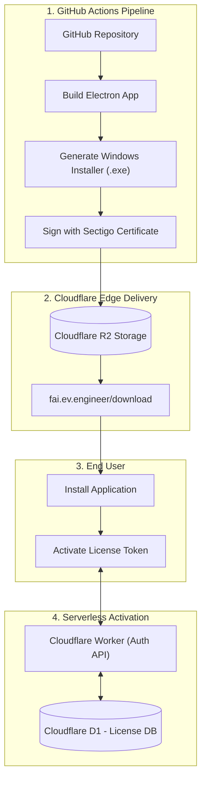
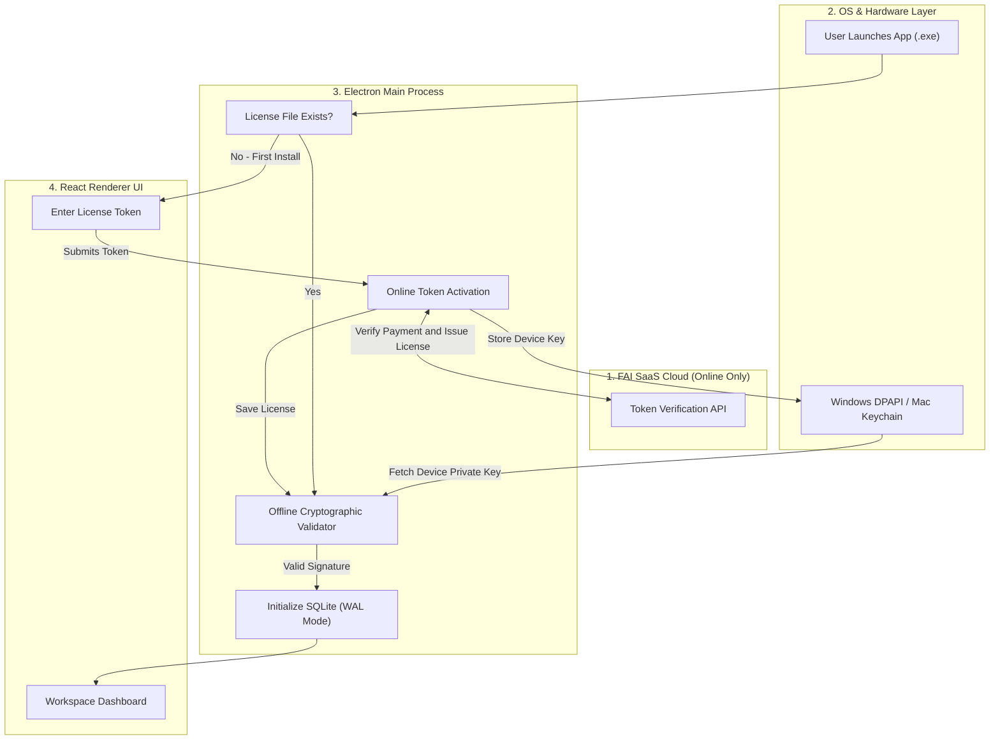
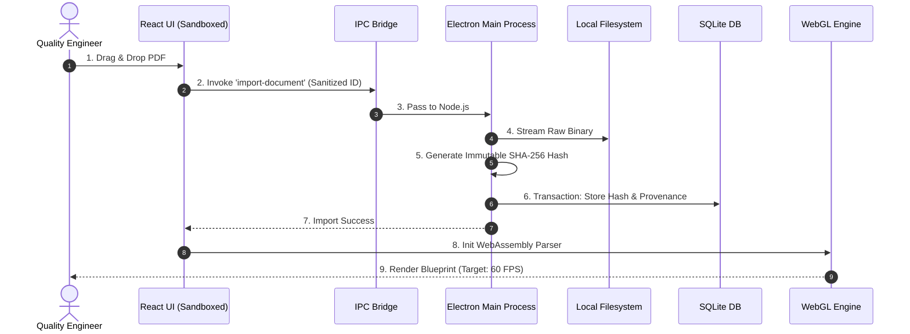
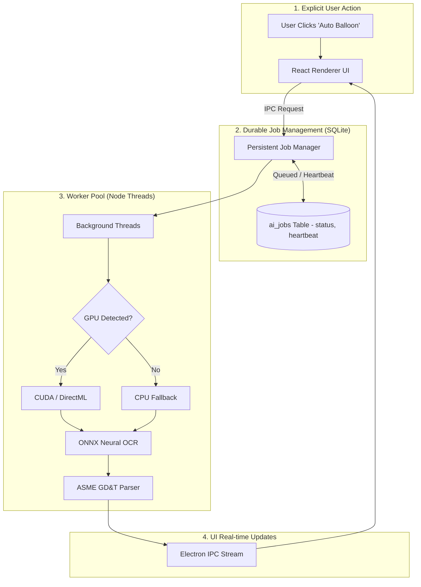
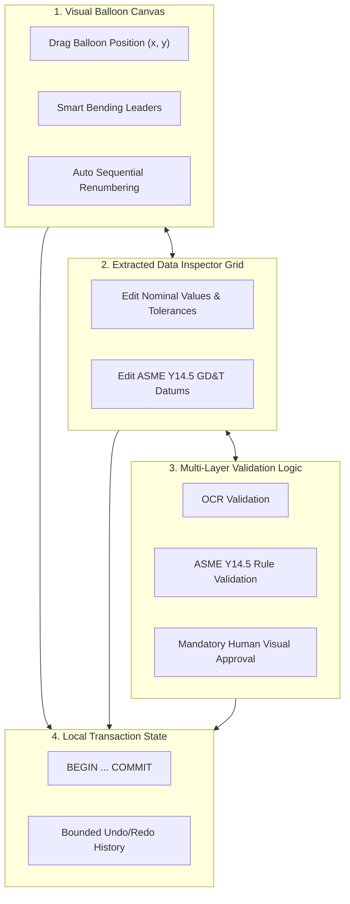
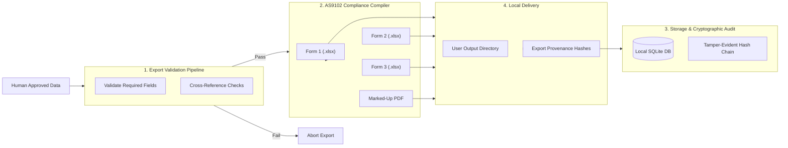

# Phase 3: FAI.EV.ENGINEER Desktop System Architecture Workflow

This document outlines the system architecture for the **FAI.EV.ENGINEER Desktop Application**. It maps out the core data flow across five operational stages. The stack relies on Electron, React, and SQLite (offline-first) while enforcing production standards like tamper-evident logging, cryptographic licensing, and durable job states.

---

## Stage 0: Secure CI/CD & Distribution

This stage handles the secure building, code-signing, and serverless delivery of the application to the customer.

### Technical Summary
The CI/CD pipeline runs on GitHub Actions to build the Electron app and output a Windows `.exe`. We sign the binary with a Sectigo EV Certificate to prevent Windows Defender SmartScreen blocks. 

For distribution, the installer is hosted on Cloudflare R2. When a user runs the app for the first time, a Cloudflare Worker intercepts the activation request and checks the token against a Cloudflare D1 database. This serverless approach eliminates fixed backend costs.

---

## Stage 1: Token Activation, Boot & Licensing Workflow

This stage handles the one-time online token verification for new employees and the subsequent secure offline initialization of the local application.

### Technical Summary
The app uses a hybrid activation model to verify users. On first launch, if no local license is found, the React UI prompts the user for a token. The Main Process sends this token to the Cloudflare Worker API to verify payment. 

If valid, the server returns a cryptographic license tied to the hardware. The device's private key is stored in Windows DPAPI or Mac Keychain. After this initial check, the app runs completely offline. The local validator checks the signature on boot. If it passes, it spins up SQLite in WAL mode to handle transactions.

---

## Stage 2: Direct File Ingestion & Provenance Workflow

This stage handles the secure local importing of aerospace blueprints and establishes an immutable cryptographic chain of custody.

### Technical Summary
File ingestion happens via direct OS file streams to avoid network overhead. The user drops a PDF, and the renderer sends an ID to the Main Process. The Node.js `fs` module reads the file and calculates a SHA-256 hash. This hash becomes the root of document provenance. Every future AI extraction or human edit links back to this exact file version. The UI then loads the document into a WebAssembly-based canvas for high-performance panning and zooming.

**Failure Handling:** If the disk is full, the file stream throws an `FS-001` error. The app catches the exception, rolls back the SQLite transaction, and alerts the user.

---

## Stage 3: Persistent AI Job Execution Workflow

This stage replaces fragile in-memory queues with a durable, restartable SQLite-backed AI pipeline.

### Technical Summary
Users manually trigger AI extraction. Jobs are logged in a durable SQLite `ai_jobs` table. Background Node.js Worker Threads pick up the jobs and emit a 5-second heartbeat. The app uses the ONNX Runtime for inference, checking for GPU support (CUDA/DirectML) and falling back to the CPU if it hits OOM errors. The worker runs neural OCR, parses GD&T syntax, and pipes the bounding boxes to the UI.

**Crash Recovery & Idempotency:** If the app crashes, the worker's heartbeat times out. On the next boot, the Job Manager sees the stale heartbeat, flags the job as `RECOVERABLE`, and restarts it. Database constraints prevent duplicate rows from being inserted.

---

## Stage 4: Interactive Validation & Bounded State Workflow

This stage enforces human oversight over AI extractions and manages local undo/redo states transactionally.

### Technical Summary
The editor features a visual canvas for balloons and an inspector grid for tabular data. The system requires humans to validate AI outputs. We run OCR confidence scores through a geometric schema checker to flag invalid syntax. The engineer must visually approve flagged items using a magnified crop of the source PDF. 

Every user action triggers an SQLite transaction (`BEGIN ... COMMIT`). This acts as an event log and provides a persistent undo/redo stack across application restarts.

---

## Stage 5: Tamper-Evident Export & Audit Workflow

This stage handles the secure compilation of compliance reports and cryptographic auditing.

### Technical Summary
Before export, a rule engine checks the data against AS9102 requirements. If required fields are missing, the export throws an `EXP-001` error. If the data is valid, the app builds Form 1, 2, and 3 Excel workbooks and a marked-up PDF.

All edits and the final file hashes are written to a **tamper-evident SHA-256 hash chain** in SQLite. Each audit event hashes the previous event's signature (`hash = SHA256(event + prev_hash)`). If someone manually alters the database file, the chain breaks, and the project is flagged as invalid during compliance audits.

---

## Production Traceability Matrix

To guarantee production readiness, all critical architecture workflows defined in the stages above map directly to verifiable test scenarios:

| Architecture Workflow | Implementation Mechanism | Acceptance Criteria / Verification |
| :--- | :--- | :--- |
| **Persistent AI Job Recovery** (Stage 3) | SQLite `ai_jobs` table + Heartbeat polling | Terminate app mid-job -> Restart -> Job marked `RECOVERABLE` and successfully retries without data duplication. |
| **Tamper-Evident Audit** (Stage 5) | Event hashing: `SHA256(data + prev_hash)` | Manually alter an SQLite record -> Hash verification tool flags the chain as broken. |
| **Database Corruption Protection** (Stage 1) | `PRAGMA integrity_check` on boot | Corrupt DB file -> App boots -> Fails check -> Auto-prompts to restore from local backup. |
| **Electron IPC Security** (Stage 1) | `contextIsolation: true` + Preload scripts | Attempt to run `fs.readFile` from UI devtools -> OS blocks action; security error logged. |
| **Idempotency** (Stage 3) | Unique constraints on `job_id` + `document_hash` | Re-run identical AI job twice -> No duplicate features or balloons are created in SQLite. |
| **Disk Full Handling** (Stage 2) | OS `SQLITE_FULL` exception catching | Fill disk -> Trigger export -> `fs.write` fails -> Emits `FS-001` -> Database state remains clean. |
