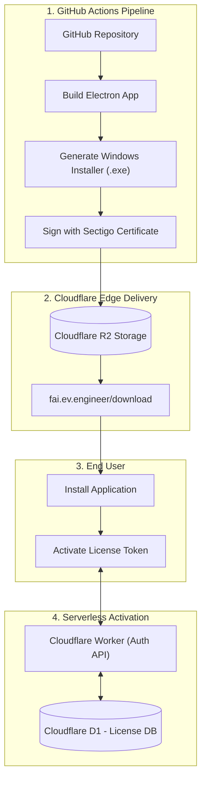
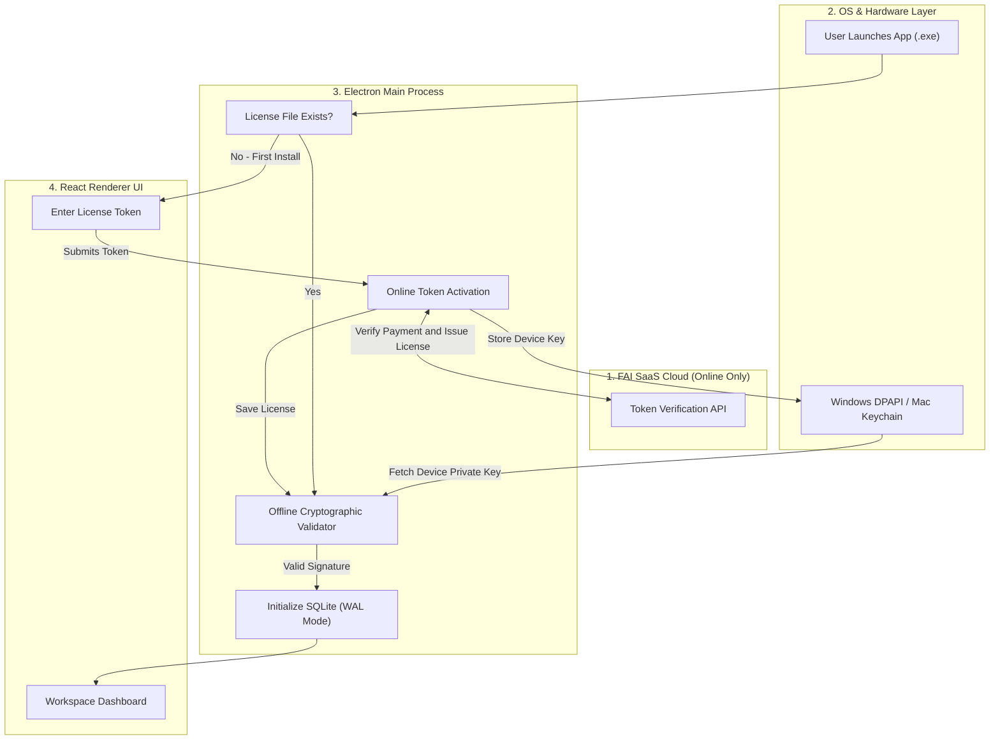
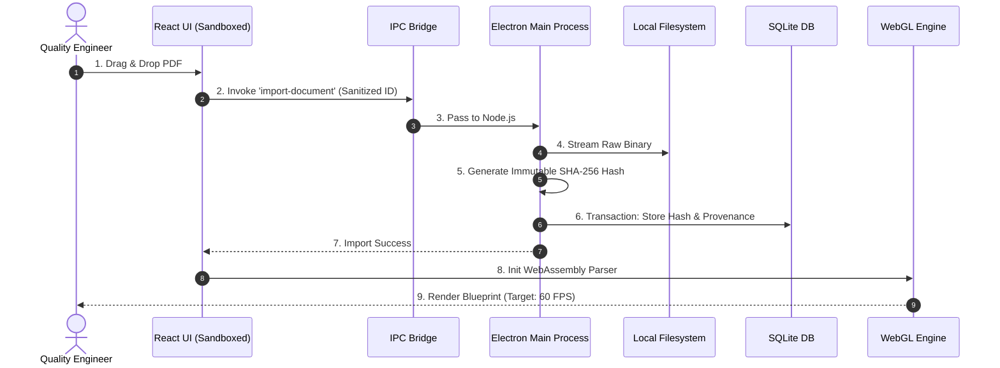
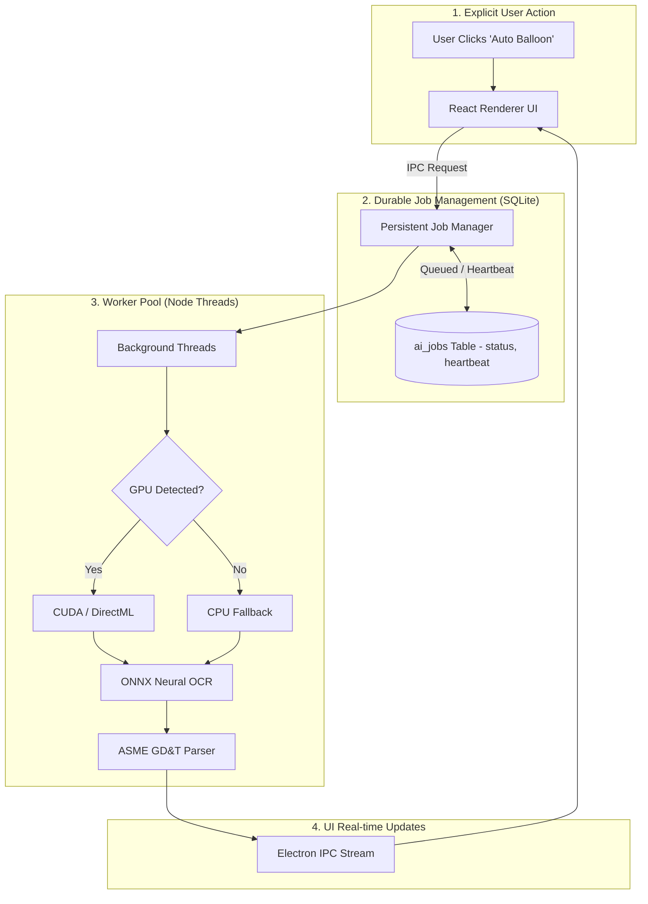
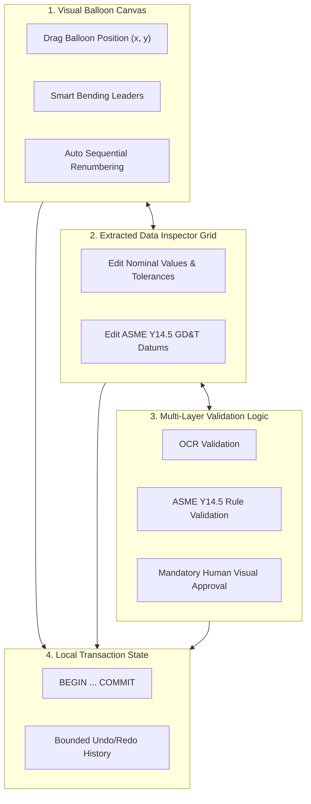
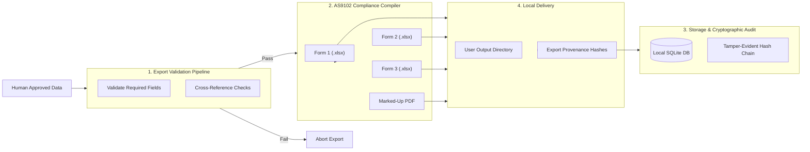

# Phase 3: FAI.EV.ENGINEER Desktop System Architecture Workflow

This document defines the production baseline architecture for the **FAI.EV.ENGINEER Desktop Application**. Rather than a disconnected checklist of technical constraints, this architecture is presented as a cohesive, visual workflow across five operational stages. It combines the offline-first Electron/React/SQLite stack with rigorous production hardening (tamper-evident audits, cryptographic licensing, and persistent job states).

---

## Stage 0: Secure CI/CD & Distribution

This stage handles the secure building, code-signing, and serverless delivery of the application to the customer.

### Technical Summary
By leveraging the Cloudflare ecosystem, the infrastructure operates at near-zero cost while maintaining enterprise-grade security. When code is pushed to GitHub, a CI/CD pipeline builds the Electron application and generates a Windows installer. Crucially, the `.exe` is digitally signed using a Sectigo Code Signing Certificate to bypass Windows Defender warnings. 

The signed binary is uploaded to Cloudflare R2 object storage and distributed globally via the Cloudflare Edge network. When a customer downloads and installs the application, their initial token activation is routed to a serverless Cloudflare Worker. This Worker queries a free Cloudflare D1 SQL database to verify the token, drastically reducing backend hosting costs to zero for the initial tier of usage.

---

## Stage 1: Token Activation, Boot & Licensing Workflow

This stage handles the one-time online token verification for new employees and the subsequent secure offline initialization of the local application.

### Technical Summary
To ensure only paid and authorized company employees can access the software, the initialization enforces a hybrid activation model. When an employee first installs the `.exe`, the application checks for a valid local license. If none exists, they are routed to a local React UI to enter their corporate verification token. The Electron Main Process securely transmits this token to the FAI SaaS Cloud for online payment and authorization verification. 

Once the SaaS confirms the token, it issues a cryptographic license file explicitly bound to that specific machine. The hardware-bound private key is safely stored in the OS secure storage (Windows DPAPI or Mac Keychain). For all subsequent boots, the system operates entirely offline using the local `Offline Cryptographic Validator`. Once the signature is verified, the system boots SQLite with Write-Ahead Logging (WAL) enabled to guarantee atomic transactions, all within a zero-trust local boundary.

---

## Stage 2: Direct File Ingestion & Provenance Workflow

This stage handles the secure local importing of aerospace blueprints and establishes an immutable cryptographic chain of custody.

### Technical Summary
Ingestion bypasses network latency by relying on direct OS-level file streams. When a user drags a blueprint into the application, the renderer passes a sanitized identifier to the Main Process. The Node.js `fs` module reads the binary stream and instantly calculates a SHA-256 hash. This hash serves as the absolute root of document provenance—all subsequent AI extractions and human edits are cryptographically linked to this exact version of the source document. The file is handed off to a WebAssembly optimized canvas, enabling fluid panning and zooming for massive aerospace schematics.

**Failure Handling:** If the local disk is critically full, the OS stream throws an `FS-001` error. The Main Process catches this, cleanly aborts the database transaction, and alerts the UI without corrupting any state.

---

## Stage 3: Persistent AI Job Execution Workflow

This stage replaces fragile in-memory queues with a durable, restartable SQLite-backed AI pipeline.

### Technical Summary
AI extraction is explicitly triggered by the user and managed through a durable SQLite `ai_jobs` table. Background Node.js Worker Threads claim jobs and maintain a 5-second heartbeat. The extraction stack leverages the ONNX Runtime, dynamically detecting local hardware acceleration (CUDA/DirectML) and gracefully falling back to CPU execution if the GPU is unsupported or throws an Out-of-Memory (OOM) error. The pipeline executes neural OCR, parses ASME Y14.5 GD&T syntax, and streams coordinates back to the UI.

**Crash Recovery & Idempotency:** If the application crashes mid-extraction, the worker's heartbeat goes stale. Upon application restart, the Job Manager detects the stale heartbeat, idempotently marks the job `RECOVERABLE`, and safely requeues it without duplicating features in the database.

---

## Stage 4: Interactive Validation & Bounded State Workflow

This stage enforces human oversight over AI extractions and manages local undo/redo states transactionally.

### Technical Summary
The dual-layer editor allows engineers to adjust visual balloon paths and modify data within a live inspector grid. Rather than trusting AI confidence blindly, the system enforces a strict validation pipeline: OCR string confidence is combined with a geometric schema checker (e.g., ensuring a position tolerance has proper datums), culminating in a mandatory human review via a magnified bitmap comparison tool. Every user edit triggers a discrete SQLite transaction (`BEGIN ... COMMIT`). This creates a bounded, persistent history log that provides highly reliable undo/redo capabilities, even if the application is restarted.

---

## Stage 5: Tamper-Evident Export & Audit Workflow

This stage handles the secure compilation of compliance reports and cryptographic auditing.

### Technical Summary
Aerospace compliance requires strict traceability. When a project is exported, the compiler first runs an AS9102 rule engine. If required fields are missing, the export aborts cleanly with an `EXP-001` error to prevent incomplete data generation. Once validated, the system generates Form 1, 2, and 3 Excel workbooks and the marked-up PDF. 

Crucially, every modification leading up to this export—and the final hashes of the exported files themselves—are logged into a **tamper-evident SHA-256 hash chain** stored within SQLite. Each audit event contains a cryptographic link to the previous event (`hash = SHA256(event + prev_hash)`), ensuring that unauthorized database modifications immediately break the chain and flag the project during an audit.

---

## Production Traceability Matrix

To guarantee production readiness, all critical architecture workflows defined in the stages above map directly to verifiable test scenarios:

| Architecture Workflow | Implementation Mechanism | Acceptance Criteria / Verification |
| :--- | :--- | :--- |
| **Persistent AI Job Recovery** (Stage 3) | SQLite `ai_jobs` table + Heartbeat polling | Terminate app mid-job -> Restart -> Job marked `RECOVERABLE` and successfully retries without data duplication. |
| **Tamper-Evident Audit** (Stage 5) | Event hashing: `SHA256(data + prev_hash)` | Manually alter an SQLite record -> Hash verification tool flags the chain as broken. |
| **Database Corruption Protection** (Stage 1) | `PRAGMA integrity_check` on boot | Corrupt DB file -> App boots -> Fails check -> Auto-prompts to restore from local backup. |
| **Electron IPC Security** (Stage 1) | `contextIsolation: true` + Preload scripts | Attempt to run `fs.readFile` from UI devtools -> OS blocks action; security error logged. |
| **Idempotency** (Stage 3) | Unique constraints on `job_id` + `document_hash` | Re-run identical AI job twice -> No duplicate features or balloons are created in SQLite. |
| **Disk Full Handling** (Stage 2) | OS `SQLITE_FULL` exception catching | Fill disk -> Trigger export -> `fs.write` fails -> Emits `FS-001` -> Database state remains clean. |
