# Desktop System Design

## 1. Executive Summary
This **Desktop Application** is a B2B, offline first engineering utility designed for aerospace and manufacturing environments. It facilitates First Article Inspection (FAI), automatic GD&T extraction via local AI, drawing ballooning, and AS9102 report generation. 

Built on Electron the system is engineered for highly restricted, security sensitive, and air gapped networks. Cloud connectivity is strictly limited to a control plane for licensing and activation via Cloudflare; **customer drawings and sensitive IP never cross the cloud boundary**. The application guarantees data provenance, idempotent processing, and tamper evident auditability to satisfy rigorous manufacturing compliance standards.

---

## 2. Architecture Principles
- **Offline First:** The application must function flawlessly without internet connectivity post activation.
- **Local First Data Processing:** All AI inference, parsing, and database transactions occur exclusively on the local machine.
- **Security by Design & Least Privilege:** Strict IPC boundaries, no raw filesystem access in the renderer, and enforced context isolation.
- **Deterministic & Idempotent Processing:** AI jobs and exports must produce identical results when repeated; retries must not duplicate data.
- **Fail Safe Behavior:** The system must gracefully handle GPU failures, disk exhaustion, and power loss without corrupting the database.
- **Auditability & Provenance:** Every human or AI action is cryptographically linked to the source file via a tamper evident ledger.
- **Human in the Loop Validation:** AI outputs are treated as suggestions requiring explicit visual confirmation by a Quality Engineer.

---

## 3. System Context

The architecture enforces a strict physical boundary between the local desktop environment and the external licensing control plane.

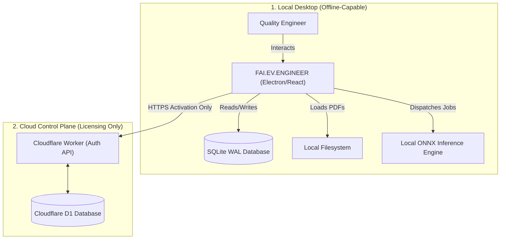
*Constraint: Customer drawings NEVER cross the cloud boundary during normal processing.*

---

## 4. Distribution & Release Architecture

The release pipeline guarantees binary integrity and publisher identity using automated CI/CD and EV Code Signing.

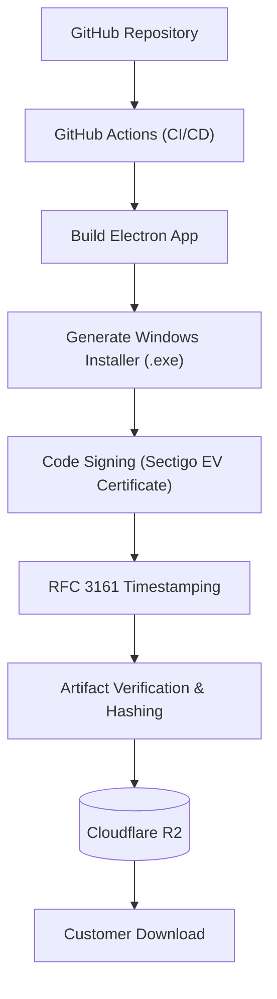
*Note: Code signing establishes publisher identity and binary integrity to prevent tampering in transit. It does not guarantee automatic Windows SmartScreen approval or imply the software is inherently "virus-free".*

---

## 5. Licensing Control Plane
The Cloudflare infrastructure acts strictly as a control plane for licensing state. Cloudflare D1 acts as the authoritative license state ledger. 
The Cloudflare Worker explicitly handles the following cryptographic operations:
- Verifying activation token entropy and hashes.
- Generating and signing Ed25519 offline license payloads.
- Validating device public keys and managing the key lifecycle.

**Control Plane Endpoints:**
- `/activate` - Validates a token and issues a signed offline license bound to the device's public key.
- `/validate` - Online heartbeat to verify ongoing subscription validity (if connected).
- `/renew` - Extends the expiration timestamp of an existing license.
- `/deactivate` - Releases a seat back to the organization pool.
- `/transfer` - Moves a license from one device identity to another.
- `/revoke` - Immediately invalidates a license (e.g., for compromised devices).
- `/device/register` - Registers a new asymmetric device public key.
- `/device/remove` - Removes a device from the tenant's allowed list.

---

## 6. License State Machine

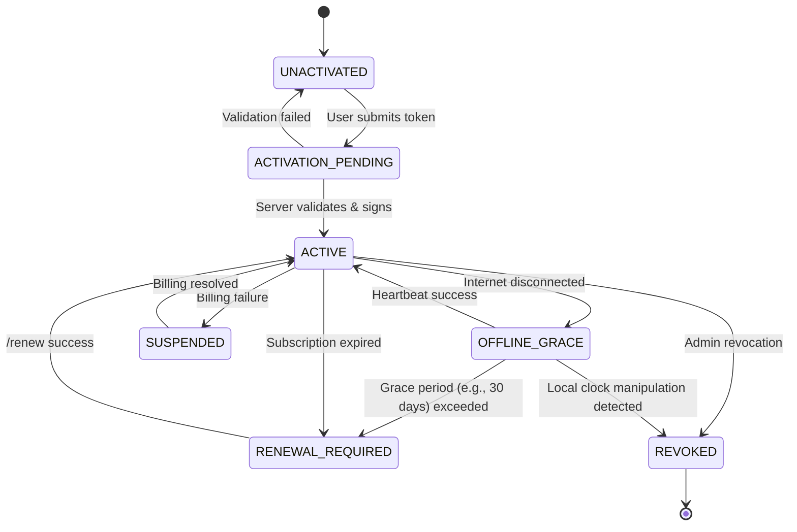

### License State Matrix
| State | Trigger | Resolution | Allowed Operations |
|---|---|---|---|
| `ACTIVE` | Valid local signature + unexpired | N/A | All features |
| `OFFLINE_GRACE` | No internet | Reconnect within 30 days | All features |
| `RENEWAL_REQUIRED`| Expiration date passed | Purchase renewal | View/Export only |
| `SUSPENDED` | Org billing issue | Pay invoice | View/Export only |
| `REVOKED` | Admin action / Clock Tampering | Contact support | Locked |

---

## 7. Activation Security
Activation tokens are high-entropy, limited-use strings (e.g., `FAI-xxxx-xxxx-xxxx`). 
- **Format:** Base62 encoded, 128-bit entropy minimum.
- **Expiration:** Tokens expire 7 days after generation.
- **Rate Limiting:** Cloudflare limits activation attempts to 5 per IP per hour to prevent brute forcing.
- **Replay Protection:** Activation tokens are single-use. Once exchanged for a device-bound license, the token is cryptographically burned in Cloudflare D1.
- **Audit:** All activation attempts (success and failure) are logged in the D1 audit table.

---

## 8. Device Identity
Device identity is cryptographically enforced using asymmetric keys rather than easily spoofed identifiers like MAC addresses.

1. **Generation:** On first boot, the desktop app generates an Ed25519 key pair.
2. **Storage:** The private key is stored securely using OS-level protection (Windows DPAPI / Credential Manager).
3. **Registration:** The public key is sent to the Cloudflare Worker during `/activate`.
4. **Binding:** The server signs a license payload that explicitly includes the device's public key.
5. **Replacement:** If a device is lost, an admin must issue a `/device/remove` command via the web dashboard to free the seat.

---

## 9. Offline Licensing
The application relies on a locally cached, digitally signed license file for offline operation and explicitly defines two modes:

### Connected-License Mode
- **Activation:** The user enters a token online.
- **Grace Period:** The license contains a `next_validation_required` timestamp. The app operates fully offline for a defined grace period (e.g., 30 days).
- **Periodic Validation:** The app automatically attempts to ping the server to extend the grace period before expiration.

### Air-Gapped License Mode
- **Activation:** The user transfers an offline activation request (via USB) to an admin portal.
- **Validity:** The server issues a signed license with a fixed, long-term validity period (e.g., 1 year).
- **Renewal:** Manual renewal is required before the hard expiration date.

**Verification (Both Modes):** On every boot, the Electron Main Process verifies the Ed25519 signature of the local license file. The app then signs a local challenge with its OS-protected private key to prove hardware binding.

---

## 10. Clock Rollback Protection
To prevent users from manually rewinding the OS clock to bypass license expiration, the application employs a 4-factor multi-clock model, as monotonic time cannot be perfectly persisted across restarts.
- **Factors:** Trusted server timestamp + Local wall clock + Monotonic elapsed time + Last successful validation.
- **Detection:** The system detects suspicious clock movement (e.g., wall clock moves backward relative to monotonic elapsed time).
- **Response:** To avoid false positives (e.g., VM snapshot restores, legitimate IT clock syncs), the license state degrades to `SUSPENDED_LOCAL`, not `REVOKED`. The system prompts for a mandatory online validation heartbeat. If valid, it returns to `ACTIVE`; if illegitimate, it moves to `REVOKED`.

---

## 11. Air-Gapped Licensing

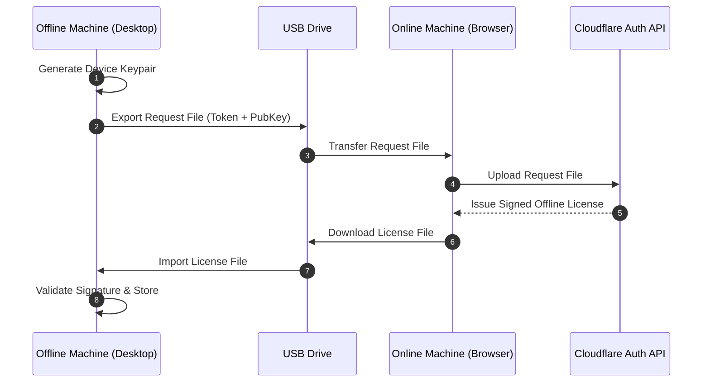
*Note: This architecture explicitly supports the Air-Gapped License Mode. The request file and license file contain no sensitive drawing data, only cryptographic identity payloads.*

---

## 12. Local Database Architecture
The application uses SQLite as the exclusive local data store, optimized for production reliability.

- **Configuration:** `PRAGMA journal_mode=WAL` (Write-Ahead Logging) is enforced to ensure atomic transactions and prevent reader/writer blocking.
- **Foreign Keys:** `PRAGMA foreign_keys=ON` is mandatory.
- **Integrity:** `PRAGMA integrity_check` runs on application boot. If corruption is detected, the app blocks execution and prompts for backup restoration.
- **Locking Policy:** `PRAGMA busy_timeout=5000`. If the database is locked for >5 seconds, transactions fail gracefully rather than freezing the UI.
- **Key Entities:** `Project`, `Drawing`, `Feature`, `Balloon`, `AIJob`, `ValidationResult`, `AuditEvent`.

---

## 13. AI Job State Machine

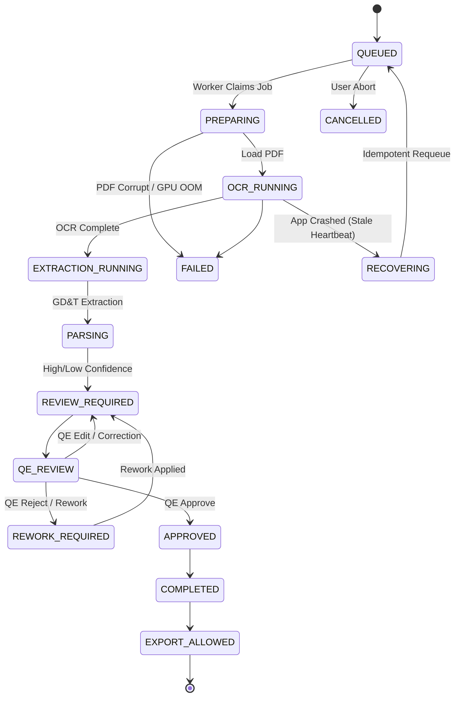

### AI Job State Matrix
| State | Definition | Retry Allowed? |
|---|---|---|
| `QUEUED` | Awaiting worker thread | Yes |
| `PREPARING` | Initializing ONNX models | No (In progress) |
| `OCR_RUNNING` | Executing neural vision | No (In progress) |
| `REVIEW_REQUIRED` | Awaiting QA engineer visual check | N/A |
| `FAILED` | Terminal error (e.g., OOM) | Yes (Manual trigger) |
| `RECOVERING` | Stale heartbeat detected on boot | Yes (Automatic) |

---

## 14. AI Idempotency
To prevent duplicate database writes and chaotic UI states, AI jobs are strictly idempotent.
- **Job Identity:** `job_id` is a composite SHA-256 hash of `(document_hash + pipeline_version + model_manifest_hash + preprocessing_version + extraction_config_hash + requested_pages)`. This guarantees two logically different processing configurations cannot collide.
- **Duplicate Prevention:** If an AI job is triggered for an existing `job_id`, the system returns the cached result.
- **Safe Retries:** If a worker crashes mid-extraction, the `RECOVERING` state clears any partial transactions associated with that `job_id` before requeuing, ensuring no duplicate balloons are generated.

---

## 15. AI Model Management
Models (e.g., ONNX files) are distributed within the application binary.

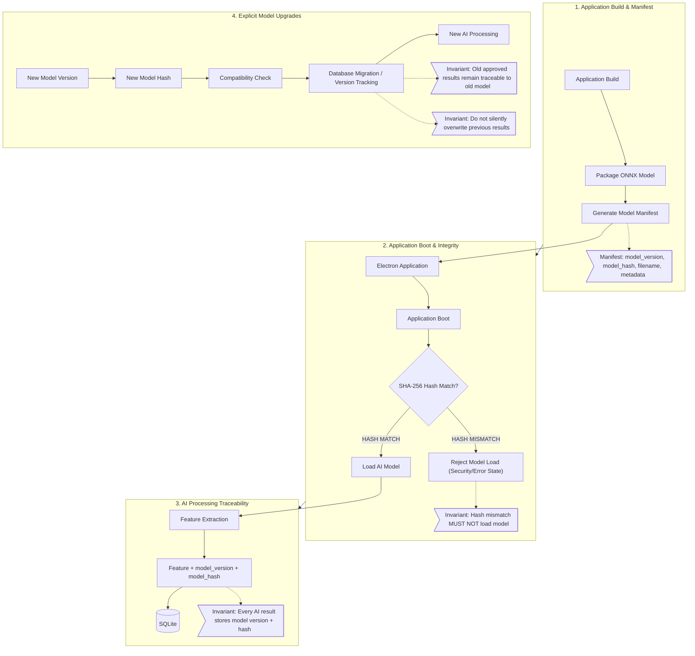

- **Integrity Verification:** At boot, the Main Process computes a SHA-256 hash of the `.onnx` files and compares them against a hardcoded manifest. If modified, the models refuse to load.
- **Traceability:** Every extracted feature in the database records the `model_version` and `model_hash` used to generate it.
- **Compatibility:** Models are strictly versioned. Database migrations track which model generated which data, allowing seamless upgrades without invalidating past human approvals.

---

## 16. GPU / CPU Execution
The ONNX Runtime dynamically selects the optimal execution provider.
- **Detection:** The system probes for CUDA (NVIDIA) or DirectML (Windows Generic).
- **Execution:** If a supported GPU is found, execution runs via hardware acceleration.
- **GPU Failure Policies:** The system gracefully handles the following hardware exceptions by falling back to deterministic CPU execution:
  - GPU unavailable or unsupported.
  - Driver incompatible.
  - GPU Out-Of-Memory (OOM).
  - GPU device lost (TDR).
  - Model initialization failure.
  - Inference timeout.
- **Terminal Failure:** If both GPU and CPU fail, the job state is marked `FAILED` with a specific error code, and memory is cleanly released.

---

## 17. Human Validation
AI is not treated as ground truth. The system enforces a strict multi-layer validation gate.
1. **AI Confidence:** OCR string generation yields a confidence score (0.0 - 1.0).
2. **Schema Validation:** The GD&T parser verifies geometric syntax (e.g., position tolerances must reference valid datums).
3. **Domain Validation:** Cross-references extracted dimensions against general drawing tolerances.
4. **Human Review:** Any feature with <95% confidence or failing schema validation is flagged. The user MUST visually approve the feature using a magnified bitmap crop before the document can be exported.

---

## 18. Provenance
Every exported data point maintains a strict, mathematically verifiable provenance chain.
- `Original PDF Hash` (SHA-256)
- `AI Job ID` (Deterministic hash of inputs)
- `Model Version & Hash`
- `Extracted Raw Bounding Box & String`
- `Human Modification Delta` (if altered)
- `Approval Timestamp & User`

---

## 19. Audit Trail

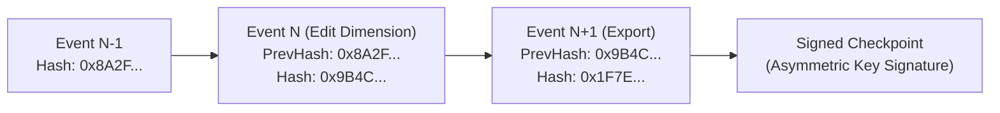
- **Tamper-Evident Ledger:** Every write action in the app generates an `AuditEvent`. Each event contains the SHA-256 hash of the *previous* event, creating a cryptographically linked, tamper-evident chain.
- **Signed Checkpoints (Trust Anchor):** Periodically, and on Export, the terminal hash is signed using a cryptographic key to establish a trust anchor. The signing key does NOT live in the SQLite database. The public verification key is distributed via the FAI.EV.ENGINEER compliance portal, allowing auditors to independently verify the signature.
- **Integrity Verification:** An internal verification script runs on export to ensure the chain is intact and signatures match.

---

## 20. Editing / Transaction History

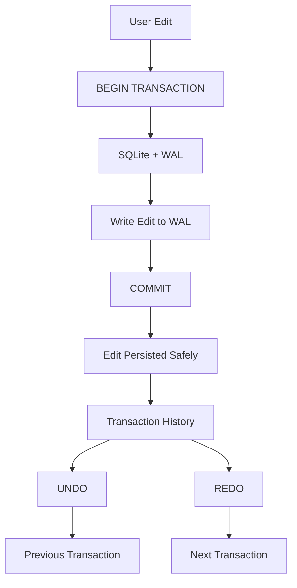

The application rejects the concept of "infinite in-memory undo" in favor of bounded, persistent transaction logs.
- **Atomic Edits:** Every canvas drag or grid edit is wrapped in an SQLite `BEGIN ... COMMIT` transaction.
- **Undo/Redo:** Transactions are assigned sequential IDs. Undo/Redo simply traverses the transaction history within the database.
- **Crash Consistency:** Because edits are committed to WAL immediately, a power failure mid-edit will not corrupt the drawing state.

---

## 21. Backup & Disaster Recovery

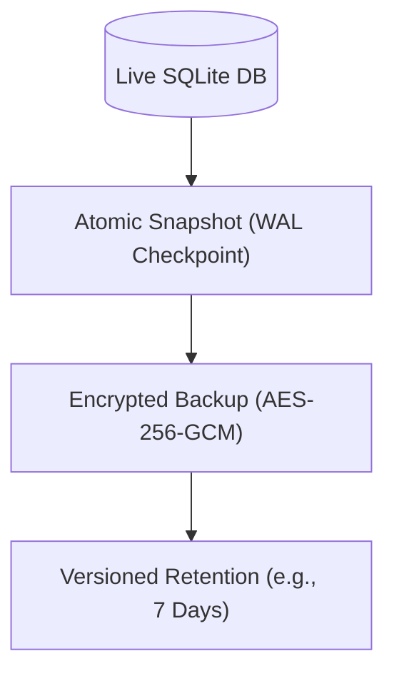

| Metric | Target | Description |
|---|---|---|
| **RPO** (Recovery Point Objective) | <= 5 Minutes | The app autosaves and checkpoints the WAL file every 5 minutes. |
| **RTO** (Recovery Time Objective) | <= 15 Minutes | Total time to restore a corrupted SQLite file from the automated local backup archive. |

- **Mechanism:** The system performs automated snapshots to a user-configured local directory. The backup must successfully complete the entire pipeline (Snapshot -> Write -> Integrity Verification -> Commit) before the RPO target is considered met.
- **Failure Handling:** If the mapped network drive is disconnected, the disk is full, or the backup fails integrity checks, an urgent UI alert is triggered to prevent silent backup failures.
- **Corruption Detection:** If `PRAGMA integrity_check` fails on boot, the UI immediately prompts the user to select the latest valid snapshot for automatic restoration.

---

## 22. Export Pipeline

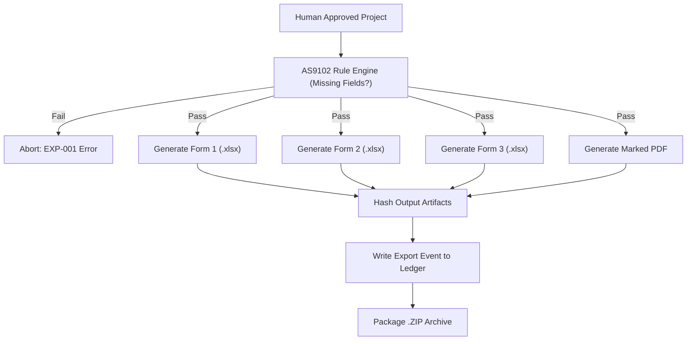
*Note: The pipeline is strictly atomic. If the marked PDF fails to generate due to disk space, the entire export is rolled back, preventing partially generated compliance packages from appearing valid.*

---

## 23. Electron Security

### FAI.EV.ENGINEER — Electron Security Visual Architecture

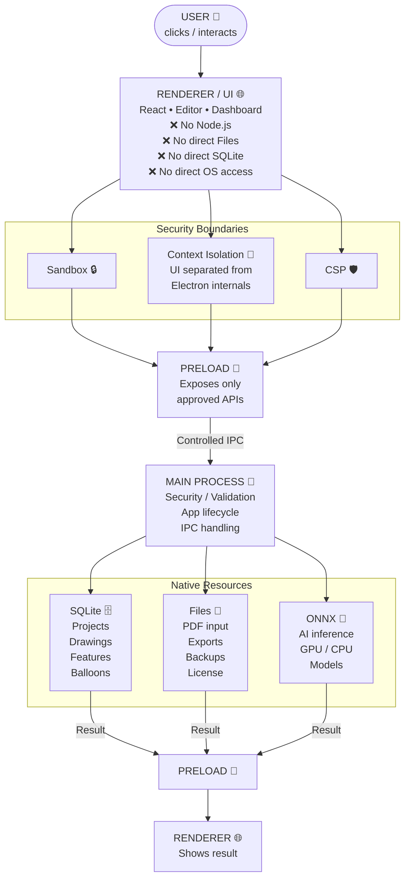

- `contextIsolation: true` is strictly enforced.
- `nodeIntegration: false` in all renderer processes.
- `sandbox: true` enabled for all renderers.
- **Navigation:** The app overrides `webContents.setWindowOpenHandler` to block arbitrary URL navigation. External links (e.g., Help docs) open exclusively in the OS default browser.
- **CSP:** A strict Content Security Policy blocks inline scripts and limits image/worker sources to `self`.

---

## 24. IPC Security

### FAI.EV.ENGINEER — IPC Security & Validation Flow

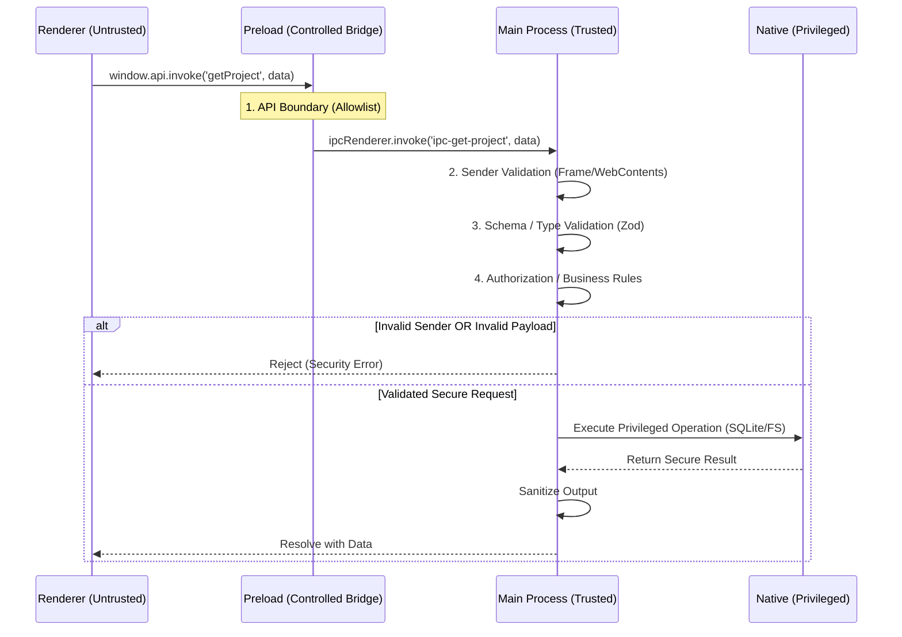

The Main and Renderer processes communicate exclusively through a strict, typed IPC contract defined in the Preload script.
- **Sender Validation:** Every IPC handler in the Main process explicitly validates the `sender.getFrame()` and `webContents` identity before executing any privileged operations.
- **Allowlist:** Only explicitly defined channels (e.g., `ipc-get-project`, `ipc-trigger-ai`) are permitted.
- **Input Validation:** The Main process validates the schema of all incoming IPC arguments using a strict validator (e.g., Zod).
- **Prohibited Patterns:** Generic commands like `execute(command)` or `readFile(path)` are strictly forbidden to prevent renderer-driven remote code execution.

---

## 25. Filesystem Security & End-to-End Data Flow

- **Path Canonicalization:** All user-provided paths (for import/export) are resolved and checked for directory traversal attempts (`../`).
- **Allowed Directories:** The application restricts filesystem write access to the OS Temp directory (for scratch processing) and the user-selected Export destination.
- **Data Minimization:** Temporary files containing sensitive data are minimized, stored in controlled OS locations, deleted promptly after use, and protected through native OS/filesystem access controls.

### End-to-End Data Flow (Import & Export)

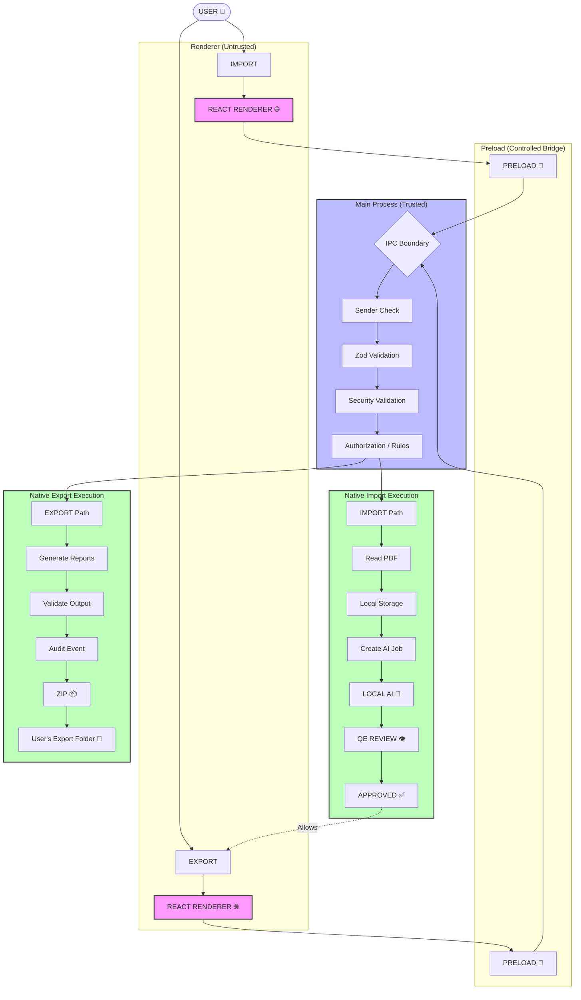

---

## 26. Update System

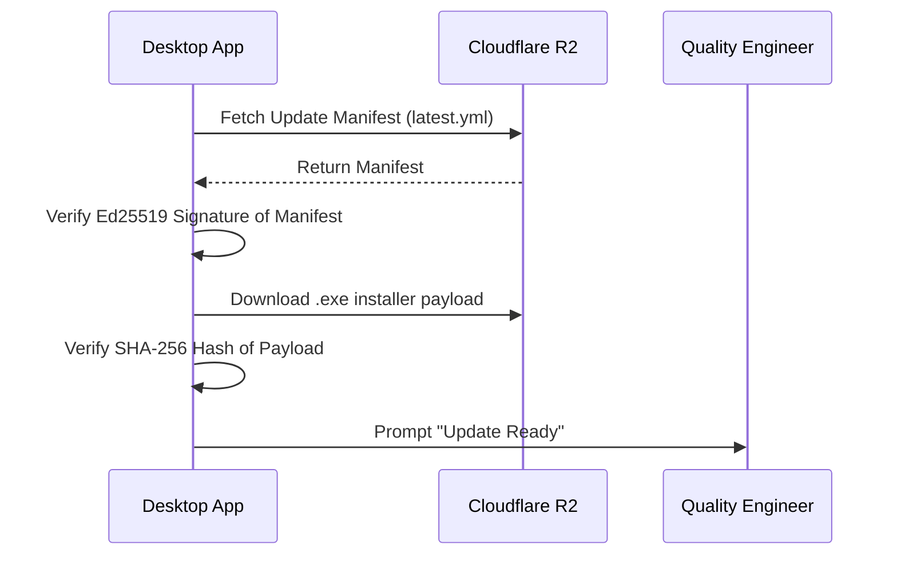
*Note: Air-gapped environments bypass this flow entirely and rely on manual, administrator-driven installation of signed `.exe` files.*

**Update Policies:**
- **Rollback:** After staging, a post-install health check runs. If it fails, the system automatically rolls back to the previous version.
- **Channels:** The system supports 'Stable' (Mandatory security patches) and 'Enterprise Approved' (Optional, admin-gated updates).

---

## 27. Observability
- **Structured Logging:** The application generates structured JSON logs stored locally.
- **Data Scrubbing:** Logs include `timestamp`, `severity`, `event_id`, and `error_code`. **Customer drawing contents, OCR strings, and dimensions are explicitly redacted from all logs.**
- **Telemetry:** If explicit telemetry is enabled by the user, non-sensitive metrics (e.g., UI load times, AI processing duration) are sent to the cloud.

---

## 28. Diagnostic Bundles
If a customer encounters a fatal error, they can generate a Diagnostic Bundle for support.
- **Contents:** OS version, App version, GPU metadata, sanitized error logs, and database schema version.
- **Exclusions:** The bundle explicitly excludes the SQLite database payload, customer PDFs, private keys, and activation tokens.

---

## 29. Performance Requirements

| Scenario | Target SLO | Hardware Reference |
|---|---|---|
| App Startup | < 2.5 seconds | NVMe SSD, i5/Ryzen 5 |
| PDF Ingestion (50MB) | < 3.0 seconds | NVMe SSD, i5/Ryzen 5 |
| Viewport Zoom/Pan | 60 FPS | Integrated Graphics (Intel UHD / AMD Vega) |
| AI Extraction (1 Page) | < 15 seconds | Dedicated GPU (GTX 1650 or higher) |

---

## 30. Resource Limits
- **GPU OOM:** If the user attempts to run AI on a massive E-size drawing that exceeds GPU VRAM, the app catches the OOM, alerts the user, and falls back to tiled CPU processing.
- **Disk Full:** File writes are wrapped in `try/catch`. `SQLITE_FULL` errors trigger a safe transaction rollback and UI alert.
- **Low RAM:** The WebGL viewport unloads off-screen PDF sheets from memory to maintain a ceiling of <1.5GB RAM usage.

---

## 31. Security Threat Model

| Threat | Asset | Attack | Mitigation | Residual Risk |
|---|---|---|---|---|
| Spoofed Installer | Installer `.exe` | Attacker distributes malware masquerading as the app | Sectigo EV Code Signing; user training | Low |
| Token Replay | Activation Token | User attempts to activate 2 devices with 1 token | Tokens are single-use; burned in D1 | None |
| DB Tampering | SQLite DB | User alters DB to forge compliance data | Hash-linked audit ledger verification | Low |
| IPC Escalation | Main Process | Renderer XSS allows attacker to spam IPC | Sender validation; strict IPC allowlist | Low |
| Clock Rollback | Local License | User winds back OS clock to avoid expiration | 4-Factor multi-clock tracking in SQLite | Low |
| Malicious PDF | Parser Engine | Crafted PDF attempts buffer overflow | Rust/WASM sandboxed parsing | Low |
| Backup Theft | DB Snapshots | Attacker steals local network drive backups | AES-256-GCM encryption on all backups | Low |
| Supply Chain | NPM Deps | Compromised dependency executes malicious code | Dependency scanning; zero nodeIntegration | Low |

---

## 32. Secrets & Key Management
- **Code Signing Key:** The CI runner NEVER holds the private key. The pipeline submits unsigned artifacts to a Controlled Signing Service (e.g., Azure Key Vault / AWS CloudHSM) which signs and returns the binary.
- **License Signing Key (Cloud):** Managed via Cloudflare Secrets; asymmetric private key never leaves the Worker environment.
- **Device Private Key (Local):** Stored in Windows DPAPI / Mac Keychain; never stored in plaintext in SQLite or logs.

---

## 33. Testing Strategy

| Test Domain | Coverage Strategy |
|---|---|
| **Unit Tests** | Jest coverage for parser logic, hash generation, and state machines. |
| **Integration Tests** | E2E Playwright tests targeting the React UI + Electron Main IPC boundaries. |
| **Database Tests** | Automated migration tests verifying a strict "backup before migration" policy with transaction rollbacks on failure (No automatic backward compatibility). |
| **Recovery Tests** | Hard-kill node workers, GPU OOM simulation, power loss, and backup restoration checks. |
| **Security Tests** | Clock rollback spoofing, malicious PDF ingestion, IPC abuse, and dependency scanning. |

---

## 34. Failure Mode & Recovery Matrix

| Failure | Detection | Automatic Recovery | Manual Recovery | Data Loss Risk |
|---|---|---|---|---|
| Process Crash | OS Level | WAL ensures DB integrity on reboot | Restart App | Minimal (Last uncommitted action) |
| Worker Crash | Stale Heartbeat | Job Manager requeues job | N/A | None (Idempotent) |
| Disk Full | OS `ENOSPC` / `SQLITE_FULL` | Abort write & rollback transaction | Free disk space | Minimal |
| License Expired | Local Validation | Graceful degradation to Read-Only | Purchase renewal | None |
| Corrupt DB | `integrity_check` | Prompt user for backup restoration | Select local backup archive | <= 5 Minutes |

---

## 35. Production Readiness Checklist

- `[x]` **Security:** IPC secured, context isolation enabled, nodeIntegration disabled.
- `[x]` **Licensing:** Asymmetric device identity and offline grace periods defined.
- `[x]` **Database:** WAL enabled, transactions atomic, corruption detection active.
- `[x]` **AI:** GPU fallback implemented, jobs idempotent, stale heartbeats handled.
- `[x]` **Audit:** Tamper-evident hash chain active on all write operations.
- `[x]` **Export:** AS9102 rule engine blocks incomplete compliance packages.
- `[x]` **Recovery:** SQLite snapshots mapped to 5-min RPO / 15-min RTO targets.

---

## Architecture Review Summary

### Strengths
- **Resilience:** The architecture heavily emphasizes offline capability and fail-safe recovery, critical for manufacturing floors with spotty networks.
- **Security:** Strict separation of the cloud control plane from local processing ensures customer IP is fundamentally protected from cloud breaches.
- **Compliance:** The tamper-evident audit ledger provides a mathematically verifiable chain of custody, deeply aligning with AS9102 requirements.

### Remaining Risks & Mitigation
- **Local DB Corruption:** If the user stores the SQLite file on a failing local HDD without mapping backups to a network drive, data loss is possible. *Mitigation: Onboarding must explicitly guide IT admins to configure the backup path to a redundant NAS.*
- **GPU Driver Instability:** Windows generic GPU drivers can cause unpredictable ONNX crashes. *Mitigation: The deterministic CPU fallback guarantees the job will eventually complete, albeit slower.*
