# Desktop System Design

## 1. Executive Summary
This **Desktop Application** is a B2B, offline first engineering utility designed for aerospace and manufacturing environments. It facilitates First Article Inspection (FAI), automatic GD&T extraction via local AI, drawing ballooning, and AS9102 report generation. 

Built on Electron the system is engineered for highly restricted, security sensitive, and air gapped networks. Cloud connectivity is strictly limited to a control plane for licensing and activation via Cloudflare; **customer drawings and sensitive IP never cross the cloud boundary**. The application guarantees data provenance, idempotent processing, and tamper evident auditability to satisfy rigorous manufacturing compliance standards.

---

## 2. Architecture Principles
- **Offline First:** The application must function flawlessly without internet connectivity post activation.
- **Local First Data Processing:** All AI inference, parsing, and database transactions occur exclusively on the local machine.
- **Security by Design & Least Privilege:** Strict IPC boundaries, no raw filesystem access in the renderer, and enforced context isolation.
- **Deterministic & Idempotent Processing:** AI jobs and exports must produce identical results when repeated; retries must not duplicate data.
- **Fail Safe Behavior:** The system must gracefully handle GPU failures, disk exhaustion, and power loss without corrupting the database.
- **Auditability & Provenance:** Every human or AI action is cryptographically linked to the source file via a tamper evident ledger.
- **Human in the Loop Validation:** AI outputs are treated as suggestions requiring explicit visual confirmation by a Quality Engineer.

---

## 3. System Context

The architecture enforces a strict physical boundary between the local desktop environment and the external licensing control plane.

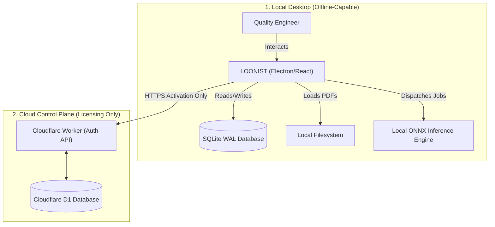
*Constraint: Customer drawings NEVER cross the cloud boundary during normal processing.*

---

## 4. Distribution & Release Architecture

The release pipeline guarantees binary integrity and publisher identity using automated CI/CD and EV Code Signing.

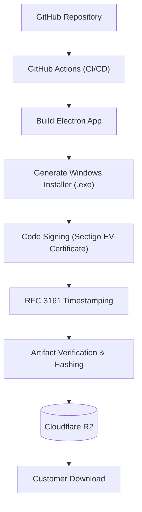
*Note: Code signing establishes publisher identity and binary integrity to prevent tampering in transit. It does not guarantee automatic Windows SmartScreen approval or imply the software is inherently "virus-free".*

---

## 5. Licensing Control Plane
The Cloudflare infrastructure acts strictly as a control plane for licensing state. Cloudflare D1 acts as the authoritative license state ledger. 
The Cloudflare Worker explicitly handles the following cryptographic operations:
- Verifying activation token entropy and hashes.
- Generating and signing Ed25519 offline license payloads.
- Validating device public keys and managing the key lifecycle.

**Control Plane Endpoints:**
- `/activate` - Validates a token and issues a signed offline license bound to the device's public key.
- `/validate` - Online heartbeat to verify ongoing subscription validity (if connected).
- `/renew` - Extends the expiration timestamp of an existing license.
- `/deactivate` - Releases a seat back to the organization pool.
- `/transfer` - Moves a license from one device identity to another.
- `/revoke` - Immediately invalidates a license (e.g., for compromised devices).
- `/device/register` - Registers a new asymmetric device public key.
- `/device/remove` - Removes a device from the tenant's allowed list.

---

## 6. License State Machine

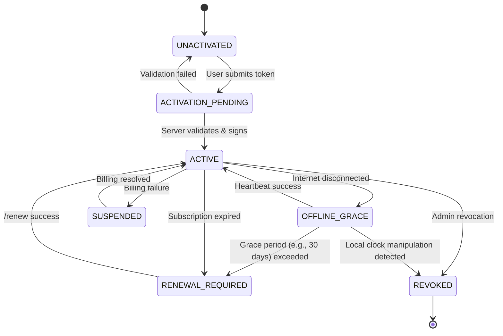

### License State Matrix
| State | Trigger | Resolution | Allowed Operations |
|---|---|---|---|
| `ACTIVE` | Valid local signature + unexpired | N/A | All features |
| `OFFLINE_GRACE` | No internet | Reconnect within 30 days | All features |
| `RENEWAL_REQUIRED`| Expiration date passed | Purchase renewal | View/Export only |
| `SUSPENDED` | Org billing issue | Pay invoice | View/Export only |
| `REVOKED` | Admin action / Clock Tampering | Contact support | Locked |

---

## 7. Activation Security
Activation tokens are high-entropy, limited-use strings (e.g., `FAI-xxxx-xxxx-xxxx`). 
- **Format:** Base62 encoded, 128-bit entropy minimum.
- **Expiration:** Tokens expire 7 days after generation.
- **Rate Limiting:** Cloudflare limits activation attempts to 5 per IP per hour to prevent brute forcing.
- **Replay Protection:** Activation tokens are single-use. Once exchanged for a device-bound license, the token is cryptographically burned in Cloudflare D1.
- **Audit:** All activation attempts (success and failure) are logged in the D1 audit table.

---

## 8. Device Identity
Device identity is cryptographically enforced using asymmetric keys rather than easily spoofed identifiers like MAC addresses.

1. **Generation:** On first boot, the desktop app generates an Ed25519 key pair.
2. **Storage:** The private key is stored securely using OS-level protection (Windows DPAPI / Credential Manager).
3. **Registration:** The public key is sent to the Cloudflare Worker during `/activate`.
4. **Binding:** The server signs a license payload that explicitly includes the device's public key.
5. **Replacement:** If a device is lost, an admin must issue a `/device/remove` command via the web dashboard to free the seat.

---

## 9. Offline Licensing
The application relies on a locally cached, digitally signed license file for offline operation and explicitly defines two modes:

### Connected-License Mode
- **Activation:** The user enters a token online.
- **Grace Period:** The license contains a `next_validation_required` timestamp. The app operates fully offline for a defined grace period (e.g., 30 days).
- **Periodic Validation:** The app automatically attempts to ping the server to extend the grace period before expiration.

### Air-Gapped License Mode
- **Activation:** The user transfers an offline activation request (via USB) to an admin portal.
- **Validity:** The server issues a signed license with a fixed, long-term validity period (e.g., 1 year).
- **Renewal:** Manual renewal is required before the hard expiration date.

**Verification (Both Modes):** On every boot, the Electron Main Process verifies the Ed25519 signature of the local license file. The app then signs a local challenge with its OS-protected private key to prove hardware binding.

---

## 10. Clock Rollback Protection
To prevent users from manually rewinding the OS clock to bypass license expiration, the application employs a 4-factor multi-clock model, as monotonic time cannot be perfectly persisted across restarts.
- **Factors:** Trusted server timestamp + Local wall clock + Monotonic elapsed time + Last successful validation.
- **Detection:** The system detects suspicious clock movement (e.g., wall clock moves backward relative to monotonic elapsed time).
- **Response:** To avoid false positives (e.g., VM snapshot restores, legitimate IT clock syncs), the license state degrades to `SUSPENDED_LOCAL`, not `REVOKED`. The system prompts for a mandatory online validation heartbeat. If valid, it returns to `ACTIVE`; if illegitimate, it moves to `REVOKED`.

---

## 11. Air-Gapped Licensing

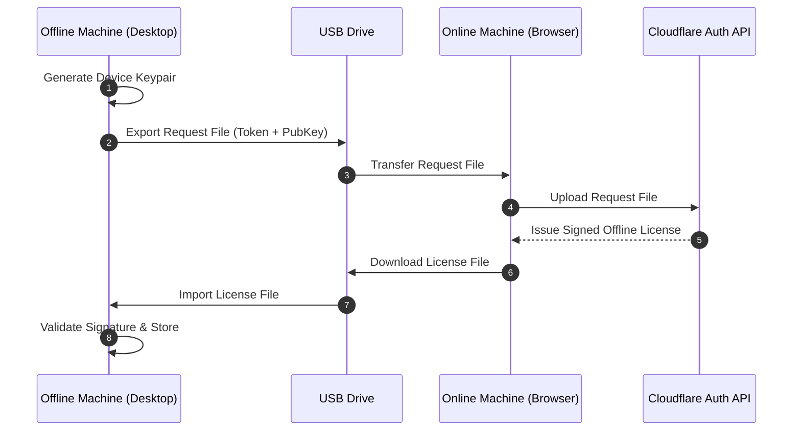
*Note: This architecture explicitly supports the Air-Gapped License Mode. The request file and license file contain no sensitive drawing data, only cryptographic identity payloads.*

---

## 12. Local Database Architecture
The application uses SQLite as the exclusive local data store, optimized for production reliability.

- **Configuration:** `PRAGMA journal_mode=WAL` (Write-Ahead Logging) is enforced to ensure atomic transactions and prevent reader/writer blocking.
- **Foreign Keys:** `PRAGMA foreign_keys=ON` is mandatory.
- **Integrity:** `PRAGMA integrity_check` runs on application boot. If corruption is detected, the app blocks execution and prompts for backup restoration.
- **Locking Policy:** `PRAGMA busy_timeout=5000`. If the database is locked for >5 seconds, transactions fail gracefully rather than freezing the UI.
- **Key Entities:** `Project`, `Drawing`, `Feature`, `Balloon`, `AIJob`, `ValidationResult`, `AuditEvent`.

---

## 13. AI Job State Machine

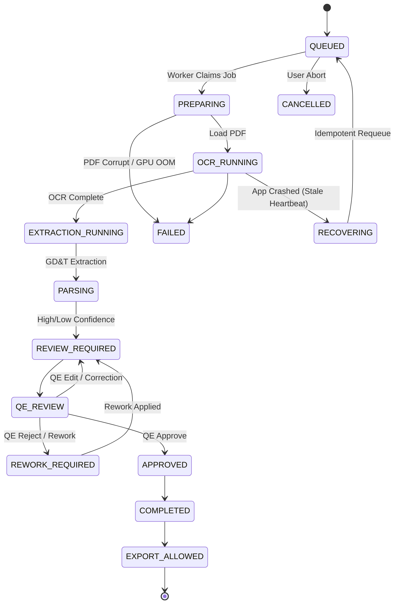

### AI Job State Matrix
| State | Definition | Retry Allowed? |
|---|---|---|
| `QUEUED` | Awaiting worker thread | Yes |
| `PREPARING` | Initializing ONNX models | No (In progress) |
| `OCR_RUNNING` | Executing neural vision | No (In progress) |
| `REVIEW_REQUIRED` | Awaiting QA engineer visual check | N/A |
| `FAILED` | Terminal error (e.g., OOM) | Yes (Manual trigger) |
| `RECOVERING` | Stale heartbeat detected on boot | Yes (Automatic) |

---

## 14. AI Idempotency
To prevent duplicate database writes and chaotic UI states, AI jobs are strictly idempotent.
- **Job Identity:** `job_id` is a composite SHA-256 hash of `(document_hash + pipeline_version + model_manifest_hash + preprocessing_version + extraction_config_hash + requested_pages)`. This guarantees two logically different processing configurations cannot collide.
- **Duplicate Prevention:** If an AI job is triggered for an existing `job_id`, the system returns the cached result.
- **Safe Retries:** If a worker crashes mid-extraction, the `RECOVERING` state clears any partial transactions associated with that `job_id` before requeuing, ensuring no duplicate balloons are generated.

---

## 15. AI Model Management
Models (e.g., ONNX files) are distributed within the application binary.

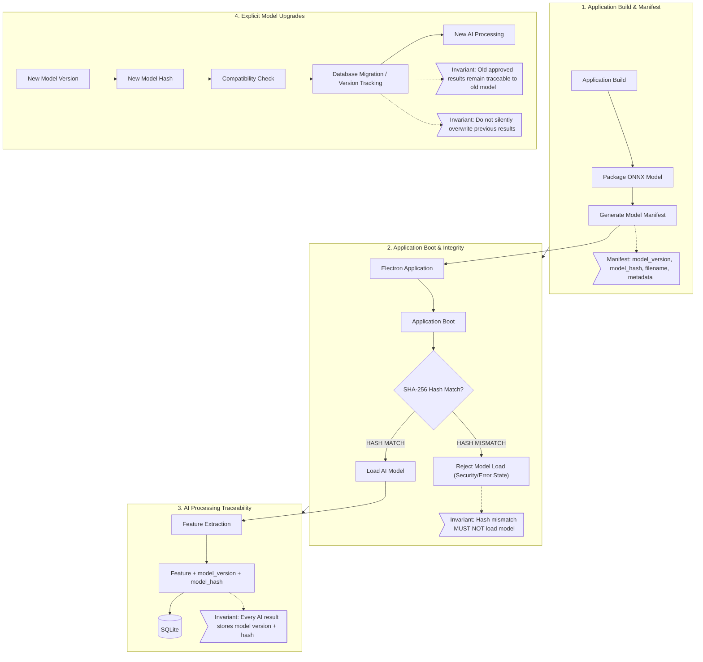

- **Integrity Verification:** At boot, the Main Process computes a SHA-256 hash of the `.onnx` files and compares them against a hardcoded manifest. If modified, the models refuse to load.
- **Traceability:** Every extracted feature in the database records the `model_version` and `model_hash` used to generate it.
- **Compatibility:** Models are strictly versioned. Database migrations track which model generated which data, allowing seamless upgrades without invalidating past human approvals.

---

## 16. GPU / CPU Execution
The ONNX Runtime dynamically selects the optimal execution provider.
- **Detection:** The system probes for CUDA (NVIDIA) or DirectML (Windows Generic).
- **Execution:** If a supported GPU is found, execution runs via hardware acceleration.
- **GPU Failure Policies:** The system gracefully handles the following hardware exceptions by falling back to deterministic CPU execution:
  - GPU unavailable or unsupported.
  - Driver incompatible.
  - GPU Out-Of-Memory (OOM).
  - GPU device lost (TDR).
  - Model initialization failure.
  - Inference timeout.
- **Terminal Failure:** If both GPU and CPU fail, the job state is marked `FAILED` with a specific error code, and memory is cleanly released.

---

## 17. Human-in-the-Loop Validation & Feature Extraction Engine
AI is not treated as ground truth. The system enforces a strict multi-layer validation gate and semantic parser designed to eliminate repetitive manual data entry.

### 17.1 Title Block General Tolerance Matrix
Over 60% of aerospace drawing dimensions do not print explicit tolerances and instead inherit tolerances from the drawing's Title Block based on decimal precision.
- **Precision Matching Rules:**
  - `X.X` (1 decimal place) $\rightarrow$ Default $\pm 0.030$ in ($\pm 0.8$ mm)
  - `X.XX` (2 decimal places) $\rightarrow$ Default $\pm 0.010$ in ($\pm 0.25$ mm)
  - `X.XXX` (3 decimal places) $\rightarrow$ Default $\pm 0.005$ in ($\pm 0.13$ mm)
  - `X.XXXX` (4 decimal places) $\rightarrow$ Default $\pm 0.0005$ in ($\pm 0.01$ mm)
  - `Angles` $\rightarrow$ Default $\pm 0.5^\circ$
- **Override Hierarchy:** Explicit dimension tolerances ($\pm .002$, limit tolerances) supersede title block defaults. The general tolerance block is fully editable per project.

### 17.2 ASME Y14.5 Dimension Enclosure Semantics
The parser classifies dimension types based on standard CAD drafting enclosures:
- **Basic Dimensions `[ 1.500 ]` (Boxed):** Identified by bounding rectangle. Assigned tolerance $= 0.000$; mathematically verified against the associated GD&T true position or profile frame.
- **Reference Dimensions `( 3.250 )` (Parentheses):** Identified by enclosing parens. Flagged as `Reference`; optional or non-mandatory on AS9102 Form 3 characteristic accountability.
- **Limit Dimensions `1.255 / 1.245`:** Auto-computed: $\text{Nominal} = \frac{\text{Max} + \text{Min}}{2} = 1.250$, $\text{Upper} = +0.005$, $\text{Lower} = -0.005$.
- **Bilateral / Unilateral:** `1.500 ± .005` or `1.500 +0.010 / -0.000` parsed into distinct nominal and limit bounds.

### 17.3 Drawing Grid Zone Mapping & Quantity Multipliers (`NX`)
- **Automated Grid Zone Calculation:** Blueprint coordinates $(x, y)$ are projected onto standard aerospace border grids (A–H vertically, 1–8 horizontally). Auto-populates AS9102 Form 3 Column 7 (e.g. `Zone C-4, Sheet 1`) with zero manual input.
- **Quantity Multipliers (`NX`):** Patterns like `4X`, `6 PLACES`, or `8X HOLES` are detected. The system sets `count = N` and enables 1-click sub-balloon expansion (`1.1, 1.2, 1.3, 1.4`) so inspectors can record individual physical measurements for each feature.

### 17.4 AI Confidence Scoring & HITL Review Pipeline
1. **Confidence Thresholding:** Every token and bounding box produces an AI confidence score ($0.0 - 1.0$).
   - $\ge 0.90$: Auto-accepted.
   - $< 0.90$: Flagged with amber `Needs Verification` badge.
2. **Schema & AST Validation:** Geometric syntax is verified (e.g., position tolerances must reference valid primary, secondary, and tertiary datums).
3. **Magnified HITL Crop:** When reviewing flagged features, the inspector is shown a 300 DPI magnified crop of the raw vector drawing alongside the parsed values for instant (<3 second) human verification.

### 17.5 Hybrid Dual-Path Vision OCR Pipeline, Canvas Pre-Processing & Prose Exclusion Engine
In modern manufacturing, blueprints arrive in two distinct representations: native vector PDFs (exported directly from 3D CAD platforms like SolidWorks, CATIA, NX, Inventor) and raster image drawings (scanned paper prints, legacy microfilms, or exploded vector font curves). LOONIST enforces a deterministic **Dual-Path Hybrid Architecture**:

#### 17.5.1 Ingestion Router: Path A (Vector Maths) vs. Path B (Vision & Deep Learning OCR)
- **Routing Decision Engine:** On drawing load, `AiExtractionService` inspects the initial text content stream via `pdfjsLib.getPage(n).getTextContent()`.
  - **Path A (Native Vector Maths):** If text token count $\ge 5$ (covering $>85\%$ of modern CAD drawings), dimensions and annotations are extracted in $<50\text{ms}$ with 100% mathematical precision and zero OCR hallucination.
  - **Path B (Vision Pipeline & Deep Learning OCR):** If token count $< 5$ (scanned blueprint, legacy microfilm) or when the quality engineer drags an optical marquee box (`box-capture`), LOONIST engages the multi-stage Vision Pipeline.

#### 17.5.2 Canvas Image Pre-Processing Engine (`ImagePreprocessingService`)
Scanned drawings suffer from scanner sensor noise, paper yellowing, uneven lighting, skew angles, and inverted blueprint backgrounds. LOONIST processes pixel buffers prior to character recognition:
- **Otsu's Adaptive Binarization:** Maximizes between-class variance across grayscale thresholds $t \in [0, 255]$:
  $$\sigma_B^2(t) = \omega_0(t)\omega_1(t)[\mu_0(t) - \mu_1(t)]^2$$
  Iterates over the 256-bin histogram to resolve plateau thresholds to their exact median, binarizing degraded gray paper into pure high-contrast binary ($0$ black text, $255$ white background) with zero gray fuzz.
- **Dark Blueprint Inversion:** Computes mean pixel brightness across sampled coordinates; automatically inverts pixels ($255 - p$) if the document is a white-on-blue ammonia blueprint or negative photocopy.
- **Deskew Angle Detection:** Evaluates horizontal projection profile variance across angles $\theta \in [-4.0^\circ, +4.0^\circ]$ at $0.5^\circ$ step increments:
  $$V(\theta) = \frac{1}{H}\sum_{y=0}^{H-1} [P_\theta(y) - \bar{P}_\theta]^2$$
  The angle maximizing profile variance corresponds to true horizontal text baselines, correcting physical scan rotation before tokenization.
- **Aspect-Preserving Margin Padding:** Injects an 8–16px clean white border around cropped regions to prevent bounding box clipping during OCR tokenization.

#### 17.5.3 100% Offline Deep Learning OCR Runtime (`OcrEngineService`)
- **Local WebAssembly Execution:** Manages a cached background Tesseract.js WebAssembly worker pool constrained to an engineering-whitelisted character dictionary: `0123456789.+-xX/°ØRrcCA-Za-z(),#:%|=`. Satisfies 100% ITAR and defense air-gap compliance with zero cloud calls.
- **Dual-Orientation Pass ($0^\circ$ & $90^\circ$):** Blueprint leader lines frequently orient callouts vertically along the Y-axis. If bounding box height exceeds width or horizontal confidence $< 70\%$, the crop is rotated $90^\circ$ counter-clockwise. The system evaluates both passes and selects the candidate with superior confidence.
- **Aerospace CAD Symbol Normalizer:** Reconstructs standard ASME Y14.5 drafting glyphs distorted by optical rasterization:
  - Diameter: `O` or `0` before decimal numbers $\to$ `Ø` (e.g. `O.750` $\to$ `Ø.750`, `dia 25` $\to$ `Ø25.0`).
  - Bilateral Tolerance: `+-` or `+ -` $\to$ `±`.
  - Degree Angle: `(\d+)c\b` $\to$ `$1°` (e.g. `45c` $\to$ `45°`).
  - Hole Depth: `DEPTH` / `DP` $\to$ `↧`.
  - Counterbore: `CBORE` / `CB` $\to$ `⌴`.
  - Countersink: `CSINK` / `CS` $\to$ `⌵`.
- **Confidence Telemetry:** Emits normalized extraction confidence ($0.00$ to $1.00$) recorded directly in the characteristic model and surfaced in the inspector HUD.

#### 17.5.4 Prose & Tutorial Sentence Exclusion Engine (`GdtParser` & `AiExtractionService`)
- **Problem Statement:** Untoleranced dimension fallback logic previously matched isolated digits within narrative prose (e.g. Autodesk Inventor tutorial cover sheets: *"This PDF contains 24 detailed drawings of miscellaneous parts..."* generated Balloon #1 with nominal 24, and *"practice with Autodesk Inventor (or any 3D CAD package...)"* generated Balloon #2 with nominal 3).
- **Multi-Layered Solution Architecture:**
  1. **Prose & Disclaimer Keyword Heuristics (`GdtParser.isProseOrInstructionalText`):** Scans for 60+ software, tutorial, and book disclaimer tokens (`autodesk`, `inventor`, `solidworks`, `catia`, `tutorial`, `workbook`, `handbook`, `practice with`, `apologies in advance`, `luck in your pursuits`, `miscellaneous parts`, `detailed drawings`, `copyright`, `rights reserved`).
  2. **Narrative Sentence Syntax & Grammar Analysis:** Flags text blocks with $\ge 5$ words containing conversational grammar and conjunctions (`and`, `or`, `in`, `to`, `for`, `with`, `you`, `your`, `we`, `our`, `can`, `will`, `should`, `may`).
  3. **Protection for Legitimate Drawing Notes & GD&T:** Explicitly preserves numbered engineering notes (e.g. `1. MATERIAL: 6061-T6 ALUMINUM`, `2. FINISH: ANODIZE PER MIL-A-8625`) and symbol-bearing callouts (`Ø`, `±`, `⌖`, `|`).
  4. **Step 14 Residual Word Validation:** In the untoleranced dimension fallback, strips numbers, decimals, fractions, drafting symbols, and whitelisted CAD keywords (`TYP`, `MAX`, `MIN`, `REF`, `THRU`, `DP`, `BORE`, `CBORE`, `CSINK`, `CHAMFER`, `PLCS`, `STOCK`, `WALL`, `FLAT`, `OD`, `ID`). If any residual English words $\ge 3$ characters remain, the text is classified as non-callout prose, immediately returning `nominal: null`.
  5. **Pre-Clustering & Post-Clustering Filters:** Filters candidate strings in `aiExtractionService.ts` before spatial clustering and skips prose clusters prior to characteristic generation.
  6. **Chamfer Priority Resolution:** Prioritizes chamfer classification (`CHAMFER` or `X` + angle) before raw angle checks in `inferType`.

#### 17.5.5 Interactive Optical Marquee Snip-to-Capture Tool (`ViewportCanvas`)
- Quality engineers can drag a precision marquee crop (`box-capture`) across complex or faint drawing callouts.
- Slices the viewport canvas at high-DPI resolution, executes `ImagePreprocessingService` (Otsu binarization and deskewing), runs `OcrEngineService`, normalizes CAD glyphs, and extracts the dimension into the inspection table with `extractionSource: 'ocr'`.
- Magnified HUD preview in `LeftPropertiesDock` displays the raw crop with `VECTOR` / `OCR` / `MANUAL` provenance and confidence badges.

### 17.6 Spatial R-Tree AABB Collision Engine & Dynamic Vector Leader Lines
To solve the industry-wide problem of auto-balloons overlapping dense blueprint geometry, feature text, or neighboring balloons, LOONIST integrates a 2D Axis-Aligned Bounding Box (AABB) spatial index with radial collision resolution:
- **Spatial Index Architecture (`RTreePlacementEngine`):**
  - Maintains bounding boxes of all extracted blueprint features (dimensions, GD&T frames, notes) and previously placed inspection balloons.
  - Balloon bounding box model: $B = [x - r - \delta, y - r - \delta, x + r + \delta, y + r + \delta]$, where $r = 14\text{px}$ is the badge radius and $\delta = 6\text{px}$ is the safety clearance margin.
- **Radial Offset Search Algorithm:**
  - When auto-placing a balloon for a feature centered at $(c_x, c_y)$ with dimensions $(w, h)$, the engine first evaluates 8 primary cardinal and ordinal candidate angles $\theta \in \{45^\circ, 135^\circ, 225^\circ, 315^\circ, 0^\circ, 90^\circ, 180^\circ, 270^\circ\}$.
  - Incremental radial distance step: $d_k = d_{\text{base}} + k \cdot \Delta d$, where $d_{\text{base}} = \max(w, h)/2 + r + \delta$ and $\Delta d = 10\text{px}$ up to $k_{\max} = 5$.
  - At each candidate point $(x_k, y_k) = (c_x + d_k \cos\theta, c_y + d_k \sin\theta)$, the spatial index tests intersection against existing obstacles.
  - The first candidate with 0 collisions is selected. If all radial steps collide, the position with minimal spatial overlap area is chosen.
- **Dynamic Leader Line Calculator (`LeaderLineCalculator`):**
  - Evaluates Euclidean distance between balloon center $(b_x, b_y)$ and feature bounding box anchor $(f_x, f_y)$.
  - **Direct Detached Boundary:** If distance $\le r + 4\text{px}$ (immediate proximity), leader line is suppressed to avoid visual clutter.
  - **Line Primitives:** If distance $> r + 4\text{px}$, the engine computes:
    1. Start point: Perimeter intersection of the circular balloon badge at angle $\phi = \text{atan2}(f_y - b_y, f_x - b_x)$: $(b_x + r \cos\phi, b_y + r \sin\phi)$.
    2. End point: Nearest edge or corner of the feature's AABB bounding box.
    3. Leader Arrowhead: Terminal triangular vector marker pointing outward at the feature target.

### 17.7 Multi-Document Project Session Manager & Dual-Axis Antigravity Splitters
Aerospace FAI inspection packages frequently encompass multiple drawing sheets, specifications, and revisions simultaneously. LOONIST provides a dedicated session state manager and workstation layout engine:
- **Multi-Document Project Session Manager (`MultiDocumentSessionManager`):**
  - Manages active document tabs, per-document viewport transforms (pan offsets $t_x, t_y$, zoom level $z \in [0.1, 32.0]$), and isolated characteristic sets.
  - Guarantees zero memory leakage across sheet switching: offscreen WebGL texture memory is released while DOM characteristic states remain cached in the session store.
  - Emits change events (`onSessionChange`) for instantaneous tab synchronization.
- **Antigravity Dual-Axis Draggable Splitters (`SplitterLayout`):**
  - Horizontal splitter separating the Drawing Viewport and Characteristics Panel.
  - Vertical splitter separating the Characteristics Table and the Live Telemetry / Terminal Inspector.
  - Real-time cursor state management (`col-resize` / `row-resize`), active drag visual highlights, and localStorage panel dimension persistence across application restarts.

---

## 18. Provenance
Every exported data point maintains a strict, mathematically verifiable provenance chain.
- `Original PDF Hash` (SHA-256)
- `AI Job ID` (Deterministic hash of inputs)
- `Model Version & Hash`
- `Extracted Raw Bounding Box & String`
- `Human Modification Delta` (if altered)
- `Approval Timestamp & User`

---

## 19. Audit Trail

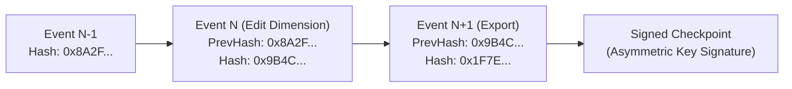
- **Tamper-Evident Ledger:** Every write action in the app generates an `AuditEvent`. Each event contains the SHA-256 hash of the *previous* event, creating a cryptographically linked, tamper-evident chain.
- **Signed Checkpoints (Trust Anchor):** Periodically, and on Export, the terminal hash is signed using a cryptographic key to establish a trust anchor. The signing key does NOT live in the SQLite database. The public verification key is distributed via the LOONIST compliance portal, allowing auditors to independently verify the signature.
- **Integrity Verification:** An internal verification script runs on export to ensure the chain is intact and signatures match.

---

## 20. Editing / Transaction History

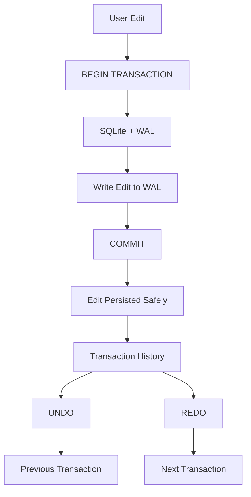

The application rejects the concept of "infinite in-memory undo" in favor of bounded, persistent transaction logs.
- **Atomic Edits:** Every canvas drag or grid edit is wrapped in an SQLite `BEGIN ... COMMIT` transaction.
- **Undo/Redo:** Transactions are assigned sequential IDs. Undo/Redo simply traverses the transaction history within the database.
- **Crash Consistency:** Because edits are committed to WAL immediately, a power failure mid-edit will not corrupt the drawing state.

### 20.2 Self-Contained Project Archiver (`.loonist` Package Specification)
To prevent inspectors from losing in-progress inspection state and to enable offline collaboration across quality departments, LOONIST defines the `.loonist` container format:
* **Container Structure:** A standardized, unencrypted ZIP archive containing:
  - `manifest.json`: Project identity (`projectId`, `partNumber`, `partName`, `drawingRevision`, `cageCode`, `createdAt`, `appVersion`).
  - `drawing.pdf`: Cryptographically verified original blueprint byte stream.
  - `state.db`: SQLite database snapshot storing all extracted `characteristics`, `balloons`, `transaction_history`, and inspector measurement actuals.
  - `checksum.sha256`: SHA-256 integrity hash of `drawing.pdf` and `state.db` to prevent silent corruption or tampering.
* **Auto-Save & Background Recovery:** Every 2 minutes, the Main Process flushes an atomic WAL checkpoint into a temporary `.loonist.tmp` snapshot. In the event of an OS reboot or hardware power failure, the application automatically recovers from the local checkpoint.

### 20.3 Real-Time Physical Measurement Ledger & Pass/Fail Evaluation Engine
An AS9102 Form 3 characteristic accountability report requires physical verification of manufactured parts. LOONIST provides a dedicated real-time measurement calculation engine (`MeasurementEngine`):
* **Data Model & Type Definitions:**
  ```typescript
  export type ConformanceStatus = 'PENDING' | 'PASS' | 'MARGINAL' | 'FAIL';

  export interface MeasurementRecord {
    id: string;
    characteristicId: string;
    nominal: number;
    upperTol: number;
    lowerTol: number;
    actualValue?: number;
    measurementTool?: string;
    inspector?: string;
    inspectionTimestamp?: string;
    conformanceStatus: ConformanceStatus;
    deviation?: number;
    discrepancyNumber?: string;
  }
  ```
* **Tolerance Boundary Calculation & Dimension Type Normalization:**
  1. **Standard Bilateral:** $\text{LowerLimit} = \text{Nominal} - \text{LowerTol}$, $\text{UpperLimit} = \text{Nominal} + \text{UpperTol}$.
  2. **Unilateral (e.g. $+0.010 / -0.000$):** $\text{LowerLimit} = \text{Nominal}$, $\text{UpperLimit} = \text{Nominal} + \text{UpperTol}$.
  3. **Limit Dimensions (e.g. $1.255 / 1.245$):**
     $$\text{Nominal} = \frac{\text{Max} + \text{Min}}{2} = 1.250, \quad \text{UpperTol} = \text{Max} - \text{Nominal}, \quad \text{LowerTol} = \text{Nominal} - \text{Min}$$
* **Four-Tier Evaluation Logic:**
  - If $\text{Actual}$ is undefined or null $\implies \text{PENDING}$.
  - Total Tolerance Band: $\Delta_{\text{tol}} = \text{UpperLimit} - \text{LowerLimit}$.
  - Marginal Guardband Threshold: $\tau = 0.10 \times \Delta_{\text{tol}}$.
  - Conformance Evaluation:
    $$\text{Status} = \begin{cases} 
      \text{FAIL (Red)}, & \text{if } \text{Actual} < \text{LowerLimit} \text{ or } \text{Actual} > \text{UpperLimit} \\ 
      \text{MARGINAL (Amber)}, & \text{if } (\text{Actual} - \text{LowerLimit} \le \tau) \text{ or } (\text{UpperLimit} - \text{Actual} \le \tau) \\ 
      \text{PASS (Green)}, & \text{otherwise} 
    \end{cases}$$
* **Non-Conformance Tracking:** Any characteristic evaluated as `FAIL` automatically provisions a unique Discrepancy Number (e.g. `NC-2026-001`) and populates AS9102 Form 3 Column 11 for aerospace MRB (Material Review Board) review.

### 20.4 Cryptographic SHA-256 Tamper-Evident Audit Ledger (`AuditLedgerService`)
To satisfy stringent AS9100 / FAA Part 21 data provenance requirements and eliminate unauthorized inspection tampering:
- **Ledger Block Architecture:**
  ```typescript
  export interface AuditBlock {
    index: number;
    timestamp: string;
    action: 'CREATE' | 'UPDATE_MEASUREMENT' | 'OVERRIDE_STATUS' | 'DELETE' | 'EXPORT_PACKAGE';
    actor: string;
    entityId: string;
    details: Record<string, unknown>;
    previousHash: string;
    currentHash: string;
  }
  ```
- **Cryptographic Invariants:**
  - Genesis block: $H_0 = \text{SHA256}(\text{"GENESIS_LOONIST_"} + \text{projectId})$.
  - Subsequent blocks:
    $$H_n = \text{SHA256}\left(H_{n-1} + \text{timestamp}_n + \text{action}_n + \text{actor}_n + \text{entityId}_n + \text{JSON.stringify}(\text{details}_n)\right)$$
- **Tamper-Evident Verification Algorithm:**
  - At any point (and mandatorily prior to AS9102 Excel / PDF export), `AuditLedgerService.verifyChain()` executes a sequential linear traversal:
  - Recomputes $H_k'$ from block contents and verifies $H_k' \equiv H_k$ and $H_k.\text{previousHash} \equiv H_{k-1}.\text{currentHash}$.
  - If any recorded entry, timestamp, or actual value has been modified out-of-band in SQLite, verification terminates immediately with `{ valid: false, errorIndex: k }`, blocking export compilation.
- **Export Package Inclusion:** The full ledger chain is packaged as `audit_trail.json` alongside marked PDFs and AS9102 workbooks for compliance auditors.

---

## 21. Backup & Disaster Recovery

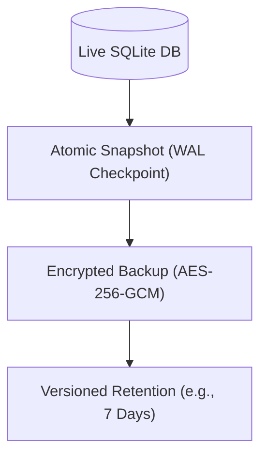

| Metric | Target | Description |
|---|---|---|
| **RPO** (Recovery Point Objective) | <= 5 Minutes | The app autosaves and checkpoints the WAL file every 5 minutes. |
| **RTO** (Recovery Time Objective) | <= 15 Minutes | Total time to restore a corrupted SQLite file from the automated local backup archive. |

- **Mechanism:** The system performs automated snapshots to a user-configured local directory. The backup must successfully complete the entire pipeline (Snapshot -> Write -> Integrity Verification -> Commit) before the RPO target is considered met.
- **Failure Handling:** If the mapped network drive is disconnected, the disk is full, or the backup fails integrity checks, an urgent UI alert is triggered to prevent silent backup failures.
- **Corruption Detection:** If `PRAGMA integrity_check` fails on boot, the UI immediately prompts the user to select the latest valid snapshot for automatic restoration.

---

## 22. Export Pipeline

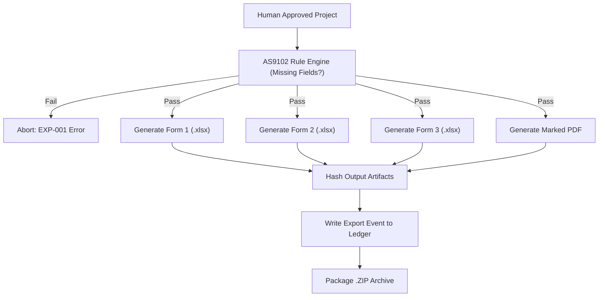
*Note: The pipeline is strictly atomic. If the marked PDF fails to generate due to disk space, the entire export is rolled back, preventing partially generated compliance packages from appearing valid.*

### 22.1 High-Resolution Marked Blueprint PDF Vector Synthesis (`MarkedPdfExporter`)
In addition to AS9102 Excel packages, aerospace machine shops require physical or digital marked drawings for machinists and deburr technicians.
- **Vector Synthesis Pipeline:** Rather than rasterizing and re-compressing the blueprint (which degrades fine linework), LOONIST utilizes native vector PDF stream manipulation via `pdf-lib`:
  1. Loads original drawing binary bytes into `PDFDocument.load(pdfBytes)`.
  2. Embeds standard vector fonts (`StandardFonts.HelveticaBold`).
  3. Iterates over drawing pages and maps inspection balloons to their respective sheet indices.
- **Coordinate Space Transformation & Inversion:**
  Canvas viewport coordinates $(x_{\text{canvas}}, y_{\text{canvas}})$ are transformed into standard 72 DPI PDF User Unit coordinates (points):
  $$x_{\text{pdf}} = x_{\text{canvas}} \times \left(\frac{W_{\text{media}}}{W_{\text{viewport}}}\right), \quad y_{\text{pdf}} = H_{\text{media}} - \left[y_{\text{canvas}} \times \left(\frac{H_{\text{media}}}{H_{\text{viewport}}}\right)\right]$$
- **Color-Coded Status Badges:**
  Every inspection balloon is rendered with status-coded stroke and semi-transparent fill:
  - **PASS:** Border `rgb(0.13, 0.77, 0.36)`, fill opacity $0.15$
  - **MARGINAL:** Border `rgb(0.96, 0.62, 0.04)`, fill opacity $0.18$
  - **FAIL:** Border `rgb(0.94, 0.27, 0.24)`, fill opacity $0.20$
  - **PENDING:** Border `rgb(0.14, 0.47, 0.88)`, fill opacity $0.15$
- **Leader Line Vector Primitives:**
  When a balloon is positioned offset from its feature bounding box, `pdfPage.drawLine()` paints a leader line and terminal triangular arrowhead pointing directly at the feature anchor.
- **Output:** Returns an immutable, vector-sharp marked blueprint byte stream (`Uint8Array`) saved atomically to disk.

### 22.2 Programmatic AS9102 Rev B / Rev C Multi-Sheet Excel Exporter (`As9102ExcelExporter`)
Aerospace Tier-1 primes (Boeing, Lockheed Martin, Northrop Grumman) require strict compliance with SAE AS9102 Form 1, Form 2, and Form 3 report formats. LOONIST implements a high-speed, zero-native-dependency OpenXML SpreadsheetML compiler:
- **Three-Sheet Structural Architecture:**
  1. **Sheet 1: `Form 1 - Part Accountability`:**
     - Organization name, supplier CAGE code, Part Number, Part Name, Drawing Number, Drawing Revision, PO Number, FAI Report Number, and Reason for FAI (e.g. New Part, Engineering Change, Process Change).
     - Digital sign-off blocks for Quality Engineer and FAA/Government Inspector approval.
  2. **Sheet 2: `Form 2 - Product Accountability`:**
     - Raw material specifications (AMS/ASTM material spec, heat lot number, certificate of conformance numbers).
     - Special processes (Heat Treat, Passivation, Anodize MIL-A-8625 Type II, NDT Penetrant Inspection) and certified supplier laboratory codes.
  3. **Sheet 3: `Form 3 - Characteristic Accountability`:**
     - Master dimensional table mapping all 14 standard AS9102 columns:
       - Col 1: Characteristic Designator Number (`#1`, `#2.1`)
       - Col 2: Drawing Sheet Reference
       - Col 3: Drawing Grid Zone (`C-4`, `E-2`)
       - Col 4: Dimension / Specification Requirement (Nominal, Units, Enclosure type)
       - Col 5: Upper / Lower Tolerance Limits
       - Col 6: Measured Results / Actual Physical Value
       - Col 7: Conformance Status (`ACCEPT` / `REJECT` / `MARGINAL`)
       - Col 8: Measurement Tooling Code (e.g. `CAL-004 CMM Zeiss Prismo`, `MIC-012 Mitutoyo 0-1"`)
       - Col 9: Non-Conformance Discrepancy Number (auto-generated for failed features)
- **Air-Gapped Native Generation:**
  Uses a pure TypeScript OpenXML builder. Avoids external Python/OLE/COM dependencies, guaranteeing 100% offline generation in <250ms for a 200-characteristic inspection package.

---

## 23. Electron Security

### LOONIST — Electron Security Visual Architecture

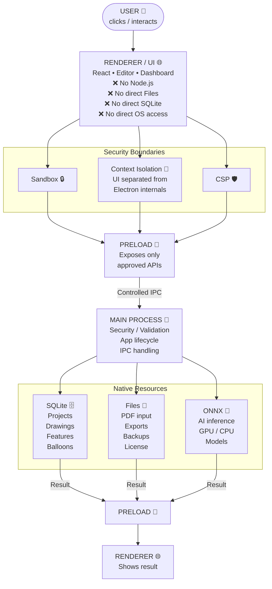

- `contextIsolation: true` is strictly enforced.
- `nodeIntegration: false` in all renderer processes.
- `sandbox: true` enabled for all renderers.
- **Navigation:** The app overrides `webContents.setWindowOpenHandler` to block arbitrary URL navigation. External links (e.g., Help docs) open exclusively in the OS default browser.
- **CSP:** A strict Content Security Policy blocks inline scripts and limits image/worker sources to `self`.

---

## 24. IPC Security

### LOONIST — IPC Security & Validation Flow

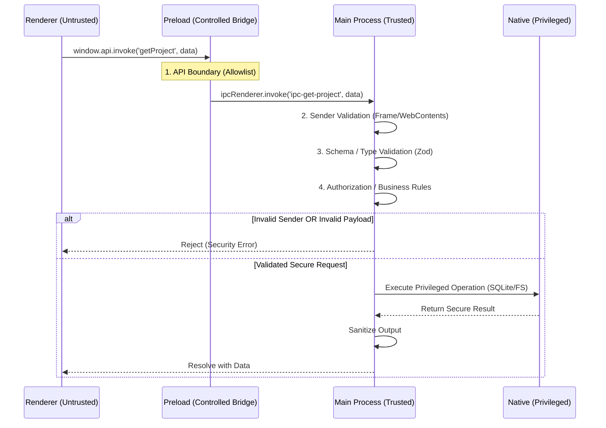

The Main and Renderer processes communicate exclusively through a strict, typed IPC contract defined in the Preload script.
- **Sender Validation:** Every IPC handler in the Main process explicitly validates the `sender.getFrame()` and `webContents` identity before executing any privileged operations.
- **Allowlist:** Only explicitly defined channels (e.g., `ipc-get-project`, `ipc-trigger-ai`) are permitted.
- **Input Validation:** The Main process validates the schema of all incoming IPC arguments using a strict validator (e.g., Zod).
- **Prohibited Patterns:** Generic commands like `execute(command)` or `readFile(path)` are strictly forbidden to prevent renderer-driven remote code execution.

---

## 25. Filesystem Security & End-to-End Data Flow

- **Path Canonicalization:** All user-provided paths (for import/export) are resolved and checked for directory traversal attempts (`../`).
- **Allowed Directories:** The application restricts filesystem write access to the OS Temp directory (for scratch processing) and the user-selected Export destination.
- **Data Minimization:** Temporary files containing sensitive data are minimized, stored in controlled OS locations, deleted promptly after use, and protected through native OS/filesystem access controls.

### End-to-End Data Flow (Import & Export)

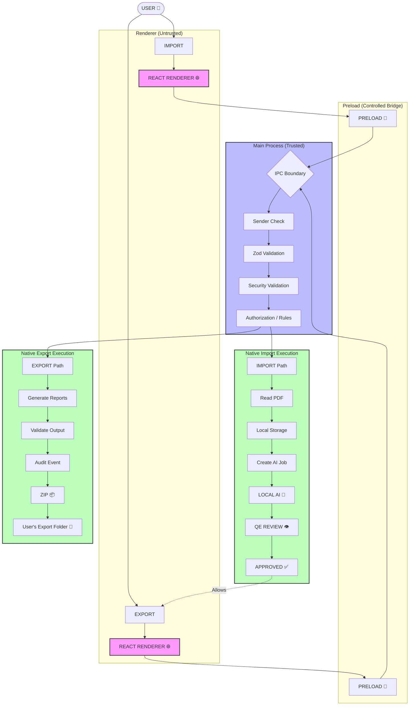

---

## 26. Update System

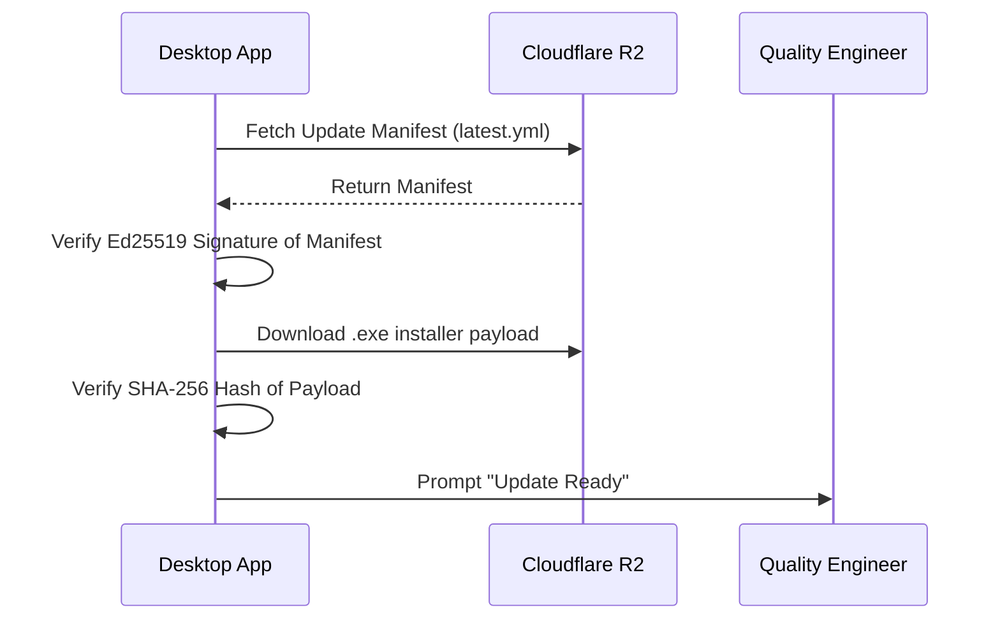
*Note: Air-gapped environments bypass this flow entirely and rely on manual, administrator-driven installation of signed `.exe` files.*

**Update Policies:**
- **Rollback:** After staging, a post-install health check runs. If it fails, the system automatically rolls back to the previous version.
- **Channels:** The system supports 'Stable' (Mandatory security patches) and 'Enterprise Approved' (Optional, admin-gated updates).

---

## 27. Observability
- **Structured Logging:** The application generates structured JSON logs stored locally.
- **Data Scrubbing:** Logs include `timestamp`, `severity`, `event_id`, and `error_code`. **Customer drawing contents, OCR strings, and dimensions are explicitly redacted from all logs.**
- **Telemetry:** If explicit telemetry is enabled by the user, non-sensitive metrics (e.g., UI load times, AI processing duration) are sent to the cloud.

---

## 28. Diagnostic Bundles
If a customer encounters a fatal error, they can generate a Diagnostic Bundle for support.
- **Contents:** OS version, App version, GPU metadata, sanitized error logs, and database schema version.
- **Exclusions:** The bundle explicitly excludes the SQLite database payload, customer PDFs, private keys, and activation tokens.

---

## 29. Performance Requirements

| Scenario | Target SLO | Hardware Reference |
|---|---|---|
| App Startup | < 2.5 seconds | NVMe SSD, i5/Ryzen 5 |
| PDF Ingestion (50MB) | < 3.0 seconds | NVMe SSD, i5/Ryzen 5 |
| Viewport Zoom/Pan | 60 FPS | Integrated Graphics (Intel UHD / AMD Vega) |
| AI Extraction (1 Page) | < 15 seconds | Dedicated GPU (GTX 1650 or higher) |

---

## 30. Resource Limits
- **GPU OOM:** If the user attempts to run AI on a massive E-size drawing that exceeds GPU VRAM, the app catches the OOM, alerts the user, and falls back to tiled CPU processing.
- **Disk Full:** File writes are wrapped in `try/catch`. `SQLITE_FULL` errors trigger a safe transaction rollback and UI alert.
- **Low RAM:** The WebGL viewport unloads off-screen PDF sheets from memory to maintain a ceiling of <1.5GB RAM usage.

---

## 31. Security Threat Model

| Threat | Asset | Attack | Mitigation | Residual Risk |
|---|---|---|---|---|
| Spoofed Installer | Installer `.exe` | Attacker distributes malware masquerading as the app | Sectigo EV Code Signing; user training | Low |
| Token Replay | Activation Token | User attempts to activate 2 devices with 1 token | Tokens are single-use; burned in D1 | None |
| DB Tampering | SQLite DB | User alters DB to forge compliance data | Hash-linked audit ledger verification | Low |
| IPC Escalation | Main Process | Renderer XSS allows attacker to spam IPC | Sender validation; strict IPC allowlist | Low |
| Clock Rollback | Local License | User winds back OS clock to avoid expiration | 4-Factor multi-clock tracking in SQLite | Low |
| Malicious PDF | Parser Engine | Crafted PDF attempts buffer overflow | Rust/WASM sandboxed parsing | Low |
| Backup Theft | DB Snapshots | Attacker steals local network drive backups | AES-256-GCM encryption on all backups | Low |
| Supply Chain | NPM Deps | Compromised dependency executes malicious code | Dependency scanning; zero nodeIntegration | Low |

---

## 32. Secrets & Key Management
- **Code Signing Key:** The CI runner NEVER holds the private key. The pipeline submits unsigned artifacts to a Controlled Signing Service (e.g., Azure Key Vault / AWS CloudHSM) which signs and returns the binary.
- **License Signing Key (Cloud):** Managed via Cloudflare Secrets; asymmetric private key never leaves the Worker environment.
- **Device Private Key (Local):** Stored in Windows DPAPI / Mac Keychain; never stored in plaintext in SQLite or logs.

---

## 33. Testing Strategy

| Test Domain | Coverage Strategy |
|---|---|
| **Unit Tests** | Jest coverage for parser logic, hash generation, and state machines. |
| **Integration Tests** | E2E Playwright tests targeting the React UI + Electron Main IPC boundaries. |
| **Database Tests** | Automated migration tests verifying a strict "backup before migration" policy with transaction rollbacks on failure (No automatic backward compatibility). |
| **Recovery Tests** | Hard-kill node workers, GPU OOM simulation, power loss, and backup restoration checks. |
| **Security Tests** | Clock rollback spoofing, malicious PDF ingestion, IPC abuse, and dependency scanning. |

---

## 34. Failure Mode & Recovery Matrix

| Failure | Detection | Automatic Recovery | Manual Recovery | Data Loss Risk |
|---|---|---|---|---|
| Process Crash | OS Level | WAL ensures DB integrity on reboot | Restart App | Minimal (Last uncommitted action) |
| Worker Crash | Stale Heartbeat | Job Manager requeues job | N/A | None (Idempotent) |
| Disk Full | OS `ENOSPC` / `SQLITE_FULL` | Abort write & rollback transaction | Free disk space | Minimal |
| License Expired | Local Validation | Graceful degradation to Read-Only | Purchase renewal | None |
| Corrupt DB | `integrity_check` | Prompt user for backup restoration | Select local backup archive | <= 5 Minutes |

---

## 35. Production Readiness Checklist

- `[x]` **Security:** IPC secured, context isolation enabled, nodeIntegration disabled.
- `[x]` **Licensing:** Asymmetric device identity and offline grace periods defined.
- `[x]` **Database:** WAL enabled, transactions atomic, corruption detection active.
- `[x]` **AI:** GPU fallback implemented, jobs idempotent, stale heartbeats handled.
- `[x]` **Audit:** Tamper-evident hash chain active on all write operations.
- `[x]` **Export:** AS9102 rule engine blocks incomplete compliance packages.
- `[x]` **Recovery:** SQLite snapshots mapped to 5-min RPO / 15-min RTO targets.

---

## 36. 8-Sprint Engineering Roadmap & LLD Section Mapping

The 35 Low-Level Design subsystems are organized into an 8-sprint iterative engineering execution plan (Sprint 7 was inserted for configuration, licensing client and drafting-standards work; release engineering moved to Sprint 8):

| Sprint | Engineering Focus | Primary LLD Sections Covered | Target Deliverables | Status |
| :---: | :--- | :--- | :--- | :---: |
| **Sprint 1** | **Core Infrastructure, Hardened Shell & Licensing Plane** | §5, §6, §7, §8, §9, §12, §20, §23, §24 | • Cloudflare D1 schema & Worker Auth API (`/activate`, `/renew`, `/revoke`)<br>• Ed25519 license signing & verification (`@noble/curves`)<br>• Hardened Electron shell (disabled `nodeIntegration`, enabled `contextIsolation`, strict CSP)<br>• Preload IPC bridge allowlist + Zod runtime schema validation<br>• Local SQLite (`better-sqlite3`) with `PRAGMA journal_mode=WAL`<br>• Atomic Undo/Redo transaction ledger (`TransactionHistory`) | ✅ **Complete** |
| **Sprint 2** | **High-Performance Blueprint Viewport** | §25, §29, §30 | • WebGL/Canvas vector PDF rendering engine<br>• 60 FPS sub-pixel pan & zoom (up to 3200%) on 300 DPI drawings<br>• Multi-sheet drawing tab navigation & memory offloading (<1.5GB ceiling)<br>• MultiDocumentSessionManager with viewport state and characteristic tab caching | ✅ **Complete** |
| **Sprint 3** | **Local AI Extraction Engine & ASME Y14.5 Parser** | §13, §14, §15, §16, §17 | • Local ASME Y14.5 GD&T AST parser supporting 14 characteristics & composite dual-tier frames<br>• Title Block general tolerance engine (`.X` to `.XXXX` + metric ISO 2768-m)<br>• Spatial proximity clustering merging broken multi-line callout stacks<br>• Automated Drawing Grid Zone calculator (`Zone C-4`) & 1-click multiplier expander (`4X`)<br>• Client-side WASM raster OCR fallback for scanned drawings and exploded CAD paths | ✅ **Complete** |
| **Sprint 4** | **Dual-Layer Blueprint Editor & Spatial Markup** | §17.6, §17.7, §20.2 | • Spatial R-Tree collision-avoidance auto-balloon placement (`RTreePlacementEngine`)<br>• Dynamic vector leader line calculation with perimeter anchoring & arrowheads (`LeaderLineCalculator`)<br>• MultiDocumentSessionManager supporting cross-sheet tab state and memory isolation<br>• Antigravity dual-axis draggable splitters with smooth horizontal/vertical panel resizing<br>• Self-contained `.loonist` package save, auto-save, and recovery pipeline | ✅ **Complete** |
| **Sprint 5** | **Measurement Compliance, High-Density CAD Table & Multi-Artifact Export** | §20.3, §20.4, §22.1, §22.2, §37 | • Real-time physical measurement calculation engine with bilateral/unilateral/limit tolerance bands (`MeasurementEngine`)<br>• High-density CAD Characteristics Table with frozen sticky `#ID` and `#Cha` columns (`TableManager`)<br>• Neutral dark mode palette (`#121212`, `#1e1e1e`, `#2a2a2a`) compliant with professional CAD workstations (`theme.css`)<br>• High-resolution marked blueprint vector PDF exporter burning vector badges & leader lines (`MarkedPdfExporter`)<br>• Zero-dependency programmatic AS9102 Rev B/C multi-sheet Excel exporter for Forms 1, 2, 3 (`As9102ExcelExporter`)<br>• Cryptographic SHA-256 tamper-evident audit ledger with sequential hash verification (`AuditLedgerService`)<br>• Master automated test suite (12 suites, 33 tests, 100% clean pass) | ✅ **Complete** |
| **Sprint 6** | **Hybrid Vision OCR Pipeline, Canvas Pre-Processing & Prose Exclusion** | §17.5, §38 | • 100% offline Tesseract.js WebAssembly OCR worker pool with engineering character whitelist<br>• Canvas image pre-processing engine with Otsu's adaptive binarization ($\sigma_B^2(t)$ variance maximization)<br>• Deskewing angle detection ($-4^\circ$ to $+4^\circ$) via projection profile variance and dark blueprint auto-inversion<br>• Dual-orientation passes ($0^\circ$ & $90^\circ$) for vertical blueprint leader dimensions<br>• Domain-specific CAD symbol normalizer (`Ø`, `±`, `°`, `↧`, `⌴`, `⌵`) with confidence telemetry<br>• Prose & Tutorial Sentence Exclusion Engine preventing book disclaimer and tutorial sentence ballooning<br>• Step 14 residual word validation and chamfer priority resolution<br>• Interactive optical marquee snip-to-capture tool (`box-capture`) and HUD provenance badges<br>• Unified master test suite expanded to 14 feature test suites with 100% pass rate | ✅ **Complete** |
| **Sprint 7** | **Settings, Help Center, Licensing Client & Industrial Inspection Standards** | §39 | • Per-project `ProjectSettings` (tolerance presets, units, skip rules, numbering, AS9102 revision, sampling, watermark) persisted in `.loonist`<br>• `ApplicationOptions` store (Workspace, Master Data, Templates, Net-Inspect, ITAR/Privacy, Licensing)<br>• In-app `CloudflareLicenseClient` (Ed25519 keypair, offline verification, activate/renew/revoke, offline certificate)<br>• Help Center (Quick Start, 14-symbol GD&T library, AS9102 guide, hotkeys, diagnostics)<br>• ASME Y14.5 § 1.8.16 chamfer parsing & compound callout deconstruction (Algorithm 13)<br>• Drawing-unit detection & ISO 2768-m size bands (Algorithm 14)<br>• Manual marquee boilerplate rejection, balloon action popover, sheet scope, double-click-to-pan, window-control IPC<br>• Custom Excel FAIR templates with `{{placeholder}}` filling (§39.7)<br>• Unified master test suite expanded to 24 feature test suites with 100% pass rate | ✅ **Complete** |
| **Sprint 8** | **Enterprise Release, Security & CI/CD** | §4, §10, §11, §26, §27, §28, §31, §32 | • Automated GitHub Actions build pipeline for Windows installer (`.exe`)<br>• Sectigo EV Code Signing with RFC 3161 timestamping<br>• 4-Factor multi-clock rollback detection and air-gapped USB licensing<br>• Staged auto-updater with Ed25519 manifest verification and rollback policy<br>• Licensing hardening: CSP `connect-src` for the licensing API, device private key in `safeStorage`, Zod validation on Sprint 7 IPC channels<br>• Diagnostic bundle packager and customer-data redacted structured logging | 📋 *Planned* |

---

## 37. High-Density CAD Characteristics Table & Industrial Theme Engine

### 37.1 Frozen Sticky Column Architecture (`TableManager.tsx`)
Aerospace FAI inspection tables contain up to 18 horizontal columns. Inspectors must cross-reference nominal requirements, tolerances, and measured actuals without losing track of the characteristic item number or description when scrolling horizontally:
- **Dual Frozen Column CSS Layout:**
  - Column 1 (`#ID`): Positioned with `position: sticky; left: 0; z-index: 20; min-width: 55px; max-width: 60px;`.
  - Column 2 (`#Cha` / Type Badge): Positioned with `position: sticky; left: 55px; z-index: 20; min-width: 65px; max-width: 70px;`.
  - Content Columns (3 through 14: Requirement, Nominal, Limits, Results, Conformance, Tool, Zone): Positioned with standard horizontal scroll flow.
- **Header vs. Body Z-Index Elevation:**
  - Sticky header cells: `z-index: 30` (elevated above sticky body cells and scrolling table headers).
  - Sticky body cells: `z-index: 20` (elevated above scrolling body cells).
  - Scrolling body cells: `z-index: 10`.
- **Background Opacity & Boundary Dividers:**
  - Opaque backgrounds (`var(--color-bg-primary)`) on sticky cells prevent text bleed-through when horizontal rows scroll underneath.
  - Crisp vertical border on the boundary column (`border-r: 1px solid var(--color-border)`) clearly delineates frozen context from scrolling data.

### 37.2 Industrial Neutral CAD Dark Theme Token Architecture (`theme.css`)
Traditional consumer "AI dark themes" rely on deep navy/blue-purple hues that create eye fatigue and chromatic distortion during 8-hour blueprint inspection shifts. LOONIST enforces an ASME/ANSI-standard neutral grayscale palette:
- **Token Color Matrix:**
  - Canvas Root Background: `--color-bg-primary: #121212` (pure neutral dark)
  - Surface Panels & Cards: `--color-bg-secondary: #1a1a1a`
  - Table Headers & Elevated Toolbars: `--color-bg-tertiary: #242424`
  - Structural Borders & Splitters: `--color-border: #333333` / `--color-border-subtle: #262626`
  - Primary Text: `--color-text-primary: #f0f0f0` (high contrast, non-glare)
  - Secondary / Units Text: `--color-text-secondary: #a0a0a0`
  - Accent / Focus Ring: `--color-accent: #3b82f6` (muted industrial cobalt blue)
  - Conformance Indicators:
    - Pass: `--color-status-pass: #22c55e` (Emerald Green)
    - Marginal: `--color-status-marginal: #f59e0b` (Industrial Amber)
    - Fail: `--color-status-fail: #ef4444` (Aviation Red)
    - Pending: `--color-status-pending: #6b7280` (Neutral Grey)

---

## 36.2 Phase 2 Strategic Expansion Roadmap (Post-MVP Incumbent Disruption)
Following commercial release of v1.0, LOONIST will execute Phase 2 enhancements to systematically capture enterprise market share:
1. **Visual Drawing Revision Comparison Engine (Rev A vs. Rev B):**
   - High-speed visual overlay diff highlighting added features in green, deleted features in red, and modified dimensions in amber.
   - Automatically preserves existing approved balloon numbers between drawing revisions and flags newly added dimensions for incremental auto-ballooning.
2. **Automotive AIAG PPAP Report Compiler:**
   - Pre-mapped Excel templates generating AIAG PPAP Form 18 Dimensional Results, Material Test Results, and Appearance Approvals from the same underlying characteristic database.
3. **Bluetooth Direct Gage Interface (WebHID / WebSerial):**
   - Direct wireless integration with Mitutoyo, Fowler, and Starrett digital calipers and micrometers for 1-click measurement entry into the inspection ledger.

---

## 38. Hybrid Vision OCR & Canvas Pre-Processing Subsystem Specification

### 38.1 Canvas Pre-Processing Pipeline (`ImagePreprocessingService`)
- **Mathematical Formulation of Otsu Thresholding:**
  Given pixel intensity histogram probabilities $p_i = \frac{n_i}{N}$ for $i \in [0, 255]$:
  $$\omega_0(t) = \sum_{i=0}^t p_i, \quad \omega_1(t) = \sum_{i=t+1}^{255} p_i$$
  $$\mu_0(t) = \sum_{i=0}^t \frac{i \cdot p_i}{\omega_0(t)}, \quad \mu_1(t) = \sum_{i=t+1}^{255} \frac{i \cdot p_i}{\omega_1(t)}$$
  $$\sigma_B^2(t) = \omega_0(t)\omega_1(t)[\mu_0(t) - \mu_1(t)]^2$$
  The optimal threshold $t^* = \arg\max_t \sigma_B^2(t)$. When multiple adjacent thresholds share the maximum variance (plateau), the midpoint threshold $t^*_{\text{mid}} = \frac{t_{\min} + t_{\max}}{2}$ is selected to prevent binary quantization flicker.
- **Projection Profile Skew Correction:**
  Horizontal projection profile $P_\theta(y)$ is sampled at discrete slice lines across candidate angles $\theta \in [-4.0^\circ, +4.0^\circ]$ in $0.5^\circ$ steps. The angle with maximum variance across row density represents true text alignment and is applied via 2D affine Canvas rotation.
- **Negative Blueprint Inversion:**
  Evaluates luminance $L = 0.299R + 0.587G + 0.114B$. If global background luminance $L_{\text{bg}} < 100$, pixels are inverted: $P' = 255 - P$.

### 38.2 Deep Learning OCR Worker Pool & Normalization (`OcrEngineService`)
- **WASM Worker Lifecycle:**
  - Instantiates a persistent WebAssembly worker thread pool via Tesseract.js.
  - Constrained character set: `tessedit_char_whitelist = "0123456789.+-xX/°ØRrcCA-Za-z(),#:%|="`.
  - Zero cloud calls, 100% offline ITAR compliance.
- **Dual-Orientation Evaluation:**
  - Evaluates bounding box aspect ratio $\text{AR} = \frac{W}{H}$. If $\text{AR} < 0.8$ or horizontal confidence $< 70\%$, executes a $90^\circ$ counter-clockwise rotated pass.
  - Emits the result maximizing OCR confidence.
- **CAD Symbol Restoration Rules:**
  - `/(?:^|\s)[O0]\.?(\d+)/g` $\to$ `Ø$1`
  - `/(?:^|\s)(?:dia|diameter)\s*([0-9.]+)/gi` $\to$ `Ø$1`
  - `/\+\s*-\s*|\+-\s*/g` $\to$ `±`
  - `/(\d+)\s*c\b/gi` $\to$ `$1°`
  - `/\b(?:DEPTH|DP)\s*([0-9.]+)/gi` $\to$ `↧ $1`
  - `/\b(?:CBORE|CB)\s*([0-9.]+)/gi` $\to$ `⌴ $1`
  - `/\b(?:CSINK|CS)\s*([0-9.]+)/gi` $\to$ `⌵ $1`

### 38.3 Prose & Tutorial Sentence Exclusion Subsystem (`GdtParser` & `AiExtractionService`)
- **Keyword Heuristic Dictionary (60+ tokens):**
  `autodesk`, `inventor`, `solidworks`, `catia`, `tutorial`, `workbook`, `handbook`, `practice with`, `apologies in advance`, `luck in your pursuits`, `miscellaneous parts`, `detailed drawings`, `simple sketches`, `designer's choice`, `answers here`, `copyright`, `rights reserved`.
- **Syntactic Sentence Grammar Analysis:**
  Identifies narrative prose containing $\ge 5$ words combined with conversational conjunctions (`and`, `or`, `in`, `to`, `for`, `with`, `you`, `your`, `we`, `can`, `will`, `should`).
- **Step 14 Residual Word Validation:**
  After stripping numbers, decimals, fractions, drafting symbols, and whitelisted CAD modifiers (`TYP`, `MAX`, `MIN`, `REF`, `THRU`, `DP`, `BORE`, `CBORE`, `CSINK`, `CHAMFER`, `PLCS`, `STOCK`, `WALL`, `FLAT`, `OD`, `ID`), any residual English words $\ge 3$ characters cause immediate rejection (`nominal: null`).
- **Pre/Post-Clustering Filter Integration:**
  Excludes prose in `candidateStrings` and skips prose clusters prior to characteristic generation.

---

## 39. Configuration, Licensing Client & Industrial Standards Subsystem Specification (Sprint 7)

### 39.1 Project Settings (`types/settings.ts`, `ProjectSettingsModal.tsx`)
- **Schema groups:** Blueprint & Tolerances (`units`, `tolerancePreset`, `tolerances`), Extraction Behaviour (`multiplierBehavior`, `autoBalloonNotes`, `autoDetectZones`, `skipReferenceDimensions`, `skipBasicDimensions`, `ocrConfidenceThreshold`), Numbering (`startingNumber`, `incrementStep`, `balloonPrefix`, `leadingZeros`, `subDelimiter`), Compliance & Export (`as9102Revision`, `exportFormat`, `watermark`, `highResPdfExport`, `samplingStandard`, `aqlLevel`, `inspectionLevel`).
- **Presets:** `asme-precision` (default), `asme-commercial`, `sheet-metal-inch`, `iso-fine`, `iso-medium`, `sheet-metal-metric`, `custom`.
- **Consumers:** `AiExtractionService.extractCharacteristics(doc, sheet, settings)` reads `units`, `tolerances`, `startingNumber`, `incrementStep`, `subDelimiter`, `skipReferenceDimensions`, `skipBasicDimensions`. `ViewportCanvas` and `MarkedPdfExporter` read `watermark`.
- **Persistence:** `ProjectArchiveService` serialises `settings?: ProjectSettings` inside the `.loonist` package.
- **Not yet consumed (Sprint 8):** `balloonPrefix`, `leadingZeros`, `multiplierBehavior`, `ocrConfidenceThreshold`, `autoBalloonNotes`, `autoDetectZones`, `as9102Revision`, `exportFormat = 'NET_INSPECT'`, `highResPdfExport`.

### 39.2 Application Options Store (`types/applicationOptions.ts`, `stores/useApplicationOptionsStore.ts`)
- Module-level reactive state exposed through `useApplicationOptions()`; persisted to `localStorage` key `loonist_app_options_v1`, falling back to `DEFAULT_APPLICATION_OPTIONS` when storage is empty or unreadable.
- **Sections:** `workspace` (wheel zoom inversion, middle-click pan, canvas background, decimal separator, table columns & preset views), `masterData` (inspection methods, manufacturing operations, classifications, custom fields), `templates`, `netInspect` (field mappings), `licensing`, `itarPrivacy`.
- **Consumers:** `App.tsx` (canvas background), `ViewportCanvas.tsx`, `TableManager.tsx` (columns), `LeftPropertiesDock.tsx` (inspection methods, decimal formatting via `utils/numberFormat.ts`).

### 39.3 Licensing Client (`services/license/licenseClient.ts`)
- **Keys:** `ed25519.utils.randomSecretKey()` → `getPublicKey()`; hex-encoded device keypair.
- **Offline verification:** `verifySignatureOffline()` with zero network access; drives `LicenseStatus` (`ACTIVE`, `OFFLINE_LEASE`, `UNLICENSED`, `REVOKED`, `EXPIRED`) and days remaining.
- **Online calls:** `POST {apiUrl}/activate`, `/renew`, `/revoke` — matching the Sprint 1 Hono Worker routes in `cloudflare-licensing-api/src/index.ts`. Default `apiUrl = https://licensing.loonist.com`.
- **Air-gapped:** `exportOfflineCertificate()` emits a portable certificate with an `exportedAt` timestamp.
- **Open defects (Sprint 8):** (1) the Electron CSP `connect-src` does not include the licensing origin, so renderer `fetch` is blocked in the packaged app; (2) `devicePrivateKeyHex` is persisted in plain text in `localStorage` and should move behind the main process using `safeStorage`.

### 39.4 Electron IPC Additions (`electron/main.ts`, `electron/preload.ts`)
| Channel | Payload | Returns | Guard |
| :--- | :--- | :--- | :--- |
| `ipc-show-message-box` | `{ message, title? }` | `{ success }` | `validateSender` |
| `ipc-exit-app` | — | `{ success }` | `validateSender` |
| `ipc-window-minimize` | — | `{ success }` | `validateSender` |
| `ipc-window-maximize` | — (toggles) | `{ isMaximized }` | `validateSender` |
| `ipc-window-restore` | — | `{ isMaximized: false }` | `validateSender` |
| `ipc-window-is-maximized` | — | `{ isMaximized }` | `validateSender` |
| `ipc-window-close` | — | `{ success }` | `validateSender` |

These channels are allowlisted but do not yet use Zod payload schemas as required by §24 IPC Security; `ipc-show-message-box` is the only one that takes a payload. Tracked for Sprint 8.

### 39.5 Parser & Tolerance Changes
- **Evaluation order in `GdtParser.parseCallout()`:** prose rejection → **chamfer (early)** → quantity multipliers → **compound deconstruction** → GD&T / hole / thread rules → chamfer fallback → untoleranced fallback + residual word check. Full specification: `Algorithms/13_Chamfer_And_Compound_Callout_Deconstruction.md`.
- **`isPrimaryNumberAngular()`** prevents trailing countersink angles from converting a primary diameter to degrees.
- **Sub-features:** `DeconstructedSubFeature[]` with `isSecondarySub`; secondaries get `skipBalloonRender = true` so only one balloon renders per leader while all rows remain in Form 3 and exports.
- **Units:** `ToleranceEngine.detectDrawingUnits()` now returns `'in' | 'mm' | null`; precedence notes → project units → settings → `'in'`. **ISO 2768-m** size bands apply to integer mm nominals via `resolveMetricIso2768Tolerance()` (bands above 1000 mm not yet implemented). Full specification: `Algorithms/14_Drawing_Unit_Detection_And_ISO_2768.md`.
- **Extraction:** `isCoverOrIntroductorySheet()` skips cover/prose-only sheets; fused standalone numbers (`65 35`) are split; single-sheet re-extraction preserves characteristics on other sheets and re-sorts by `(sheetNumber, itemNumber)`.
- **Manual capture:** `AiExtractionService.captureBox()` throws a descriptive ASME Y14.5 / AS9102 error when the captured text is prose or boilerplate; blank geometry captures remain allowed.

### 39.6 Placement, Rendering & Export
- **`SpatialPlacementService`:** orientation-aware candidate generation — horizontal dimensions prefer NW/N/NE/SW/S/SE; vertical dimensions prefer W/NW/SW/E/NE/SE; in-line positions heavily penalised; a second, extended pull-out ring (×1.6 margin) for crowded regions; all dimension boxes on the sheet act as obstacles.
- **Balloon appearance:** `EngineeringCharacteristic.customBalloonShape` / `customBalloonColor`; `BalloonShape` gains `'balloon'`.
- **`MarkedPdfExporter`:** optional diagonal `watermark` on every page; skips secondary sub-features and general notes (Clean Canvas).
- **`As9102ExcelExporter.exportToCsv()`:** flat Form 3 CSV, selectable in `ExportModal` alongside `.xlsx`.
- **Form 1:** `validateForm1Record()` (Sprint 6) drives live field flags in `FileBackstageModal`.

### 39.7 Custom Excel Templates (`excelTemplateFiller.ts`, `templateFileStore.ts`)
- **Storage:** Template bytes in IndexedDB database `loonist_templates`, object store `files`, key = `TemplateItem.id` (`tmpl-<timestamp>`). `templateFileStore.prune(ids)` runs after Options are saved. The built-in layout has id `BUILT_IN_TEMPLATE_ID` (`as9102-rev-c`); `sanitizeTemplates()` drops placeholder entries from older saved options.
- **Placeholders:** `PROJECT_TOKENS` (any cell) and `CHARACTERISTIC_TOKENS` (`char.*`, repeat row). Syntax `{{ name }}`; unknown names become blank and are reported at upload.
- **`inspectTemplate(bytes)`:** unzip → resolve sheets via `workbook.xml` + rels → read shared strings (rich-text runs concatenated) → collect tokens per row → `{ isValid, projectTokens, characteristicTokens, unknownTokens, repeatRowSheets, error? }`.
- **`fillExcelTemplate(bytes, projectValues, characteristicRows)`:** per sheet, first row containing `{{char.` is cloned once per characteristic (n = 0 removes it); cloned and following rows get new `r` attributes on `<row>` and `<c>`; token cells become `inlineStr` (style `s` kept) or a numeric `<v>` when the cell is a single numeric placeholder; `mergeCells` (row-local merges duplicated), `dimension`, `conditionalFormatting` and `dataValidation` ranges shifted; `.xltx` content type rewritten to workbook; `calcPr fullCalcOnLoad="1"` set and `calcChain.xml` removed.
- **Not handled:** formula text and defined names referencing rows below the repeat row; shared-formula masters inside the repeat row.

---

## Architecture Review Summary

### Strengths
- **Resilience:** The architecture heavily emphasizes offline capability and fail-safe recovery, critical for manufacturing floors with spotty networks.
- **Security:** Strict separation of the cloud control plane from local processing ensures customer IP is fundamentally protected from cloud breaches.
- **Compliance:** The tamper-evident audit ledger provides a mathematically verifiable chain of custody, deeply aligning with AS9102 requirements.

### Remaining Risks & Mitigation
- **Local DB Corruption:** If the user stores the SQLite file on a failing local HDD without mapping backups to a network drive, data loss is possible. *Mitigation: Onboarding must explicitly guide IT admins to configure the backup path to a redundant NAS.*
- **GPU Driver Instability:** Windows generic GPU drivers can cause unpredictable ONNX crashes. *Mitigation: The deterministic CPU fallback guarantees the job will eventually complete, albeit slower.*


