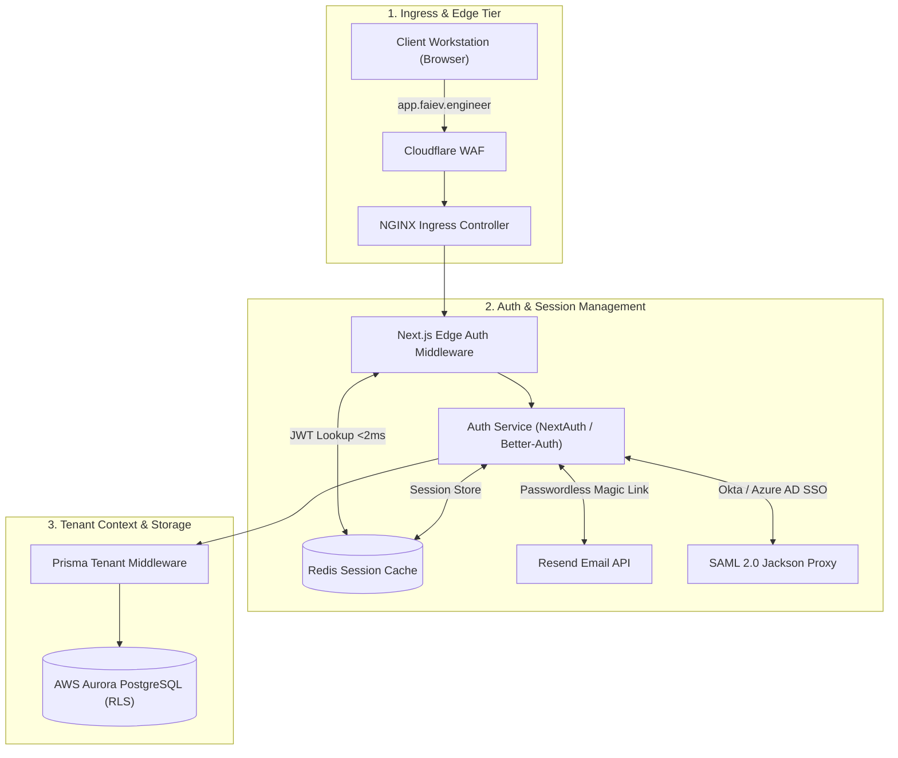
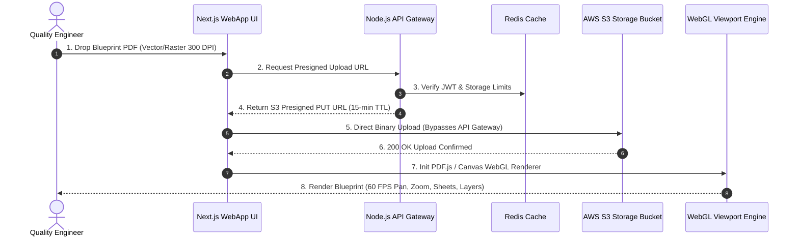
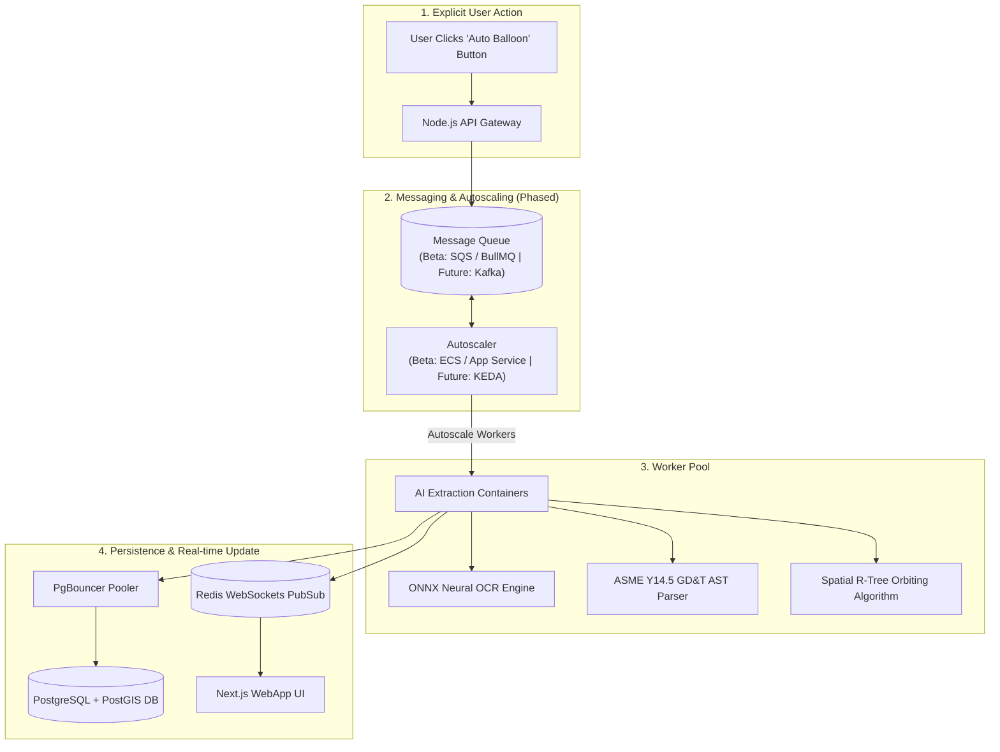
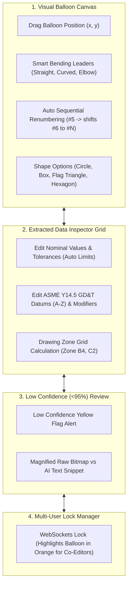
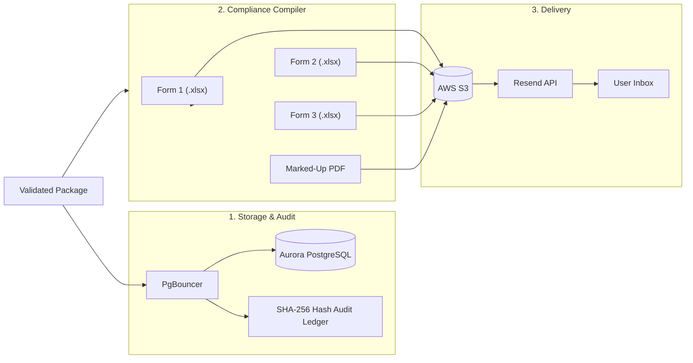

# Phase 3: FAI.EV.ENGINEER System Architecture Workflow

This document details the five operational stages of the FAI.EV.ENGINEER platform. It covers identity management, file ingestion, event-driven AI processing, dual-layer drawing editing, and compliance export.

## Stage 1: Identity, Auth & Multi-Tenant Edge Ingress

### Technical Summary

The ingress architecture relies on subdomain routing to accurately identify the target tenant. Edge middleware is employed to validate session JWTs against a Redis cache in under two milliseconds. We support a variety of authentication options including passwordless magic links via the Resend API, OAuth2 providers like Google and Microsoft, and SAML 2.0 integrations through Okta or Azure AD tailored for enterprise clients. Data isolation is strictly enforced at the database level. Our Prisma setup injects the organization ID directly into PostgreSQL session variables, which seamlessly activates Row-Level Security.

## Stage 2: Direct PDF Ingestion & Viewport Rendering

### Technical Summary

To handle large engineering blueprints efficiently, the system utilizes direct presigned S3 URLs. This allows users to upload PDF files up to 200MB directly to storage, completely bypassing the need to route heavy binary streams through our core API servers. Once the document is ingested, our custom Canvas rendering engine takes over. Built on WebGL, the viewport renders complex vector PDF layers at a smooth 60 frames per second. It supports extreme zooming capabilities up to 3200 percent and fluid multi-sheet tab navigation for dense schematics.

## Stage 3: Asynchronous AI Feature Extraction & Phased Autoscaling

### Technical Summary

We enforce a strict explicit execution rule where AI extraction runs exclusively when the user manually triggers the auto balloon process. This prevents unnecessary compute overhead during initial uploads. To handle variable workloads efficiently from day one while preparing for enterprise scale, we utilize a phased approach to messaging and scaling. The initial beta architecture employs a simpler queue and worker setup (such as AWS SQS or Redis BullMQ coupled with basic container autoscaling) to accelerate time-to-market. The system retains abstracted interfaces so that as workload demands increase, it can seamlessly transition to an enterprise-grade Apache Kafka and Kubernetes Event-driven Autoscaling (KEDA) architecture. The extraction stack itself is highly specialized. It combines an ONNX neural OCR engine for reading linear and angular dimensions with an Abstract Syntax Tree parser dedicated to ASME Y14.5 Feature Control Frames. Finally, spatial R-Tree algorithms calculate the optimal, collision-free placement for all generated balloons.

## Stage 4: Interactive Dual-Layer Blueprint Editor

### Technical Summary

The editor interface provides extensive visual controls over the blueprint. Users can intuitively drag and drop balloons, adjust bending leader paths, customize shapes, and rely on automatic cascade renumbering when items are inserted or removed. Alongside the visual canvas, a comprehensive data inspector grid allows for live property editing. Engineers can adjust nominal values, toggle symmetric or bilateral tolerances, and modify ASME Y14.5 GD&T datums, which instantly recalculates specification limits. To ensure accuracy, any AI extraction falling below a 95 percent confidence threshold triggers a prominent yellow flag alert. This prompts a human review mode that displays a magnified visual crop comparing the source PDF directly against the extracted text. Furthermore, real-time collaboration is protected by a WebSocket selection locking mechanism that prevents conflicting edits when multiple engineers are actively working on the same drawing sheet.

## Stage 5: Persistence, SHA-256 Audit Ledger & AS9102 Export

### Technical Summary

Regulatory compliance is built into the foundation of the persistence layer. Every single edit made to a blueprint appends an immutable SHA-256 hash node to our database, guaranteeing full traceability for aerospace audits. When a package is finalized, the compliance compiler automatically generates AS9102 Form 1, Form 2, and Form 3 Excel workbooks along with raw CSV files and the fully marked-up vector PDFs. These finalized artifacts are securely stored in AWS S3, and the system immediately dispatches email notifications containing secure download links directly to the user's inbox via the Resend API.
