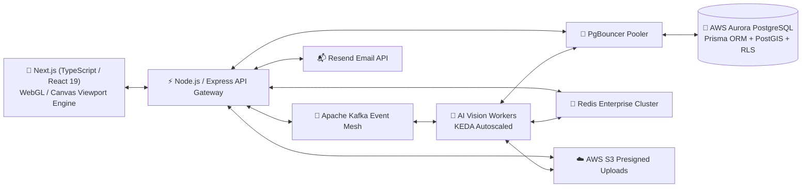
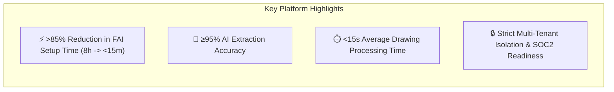
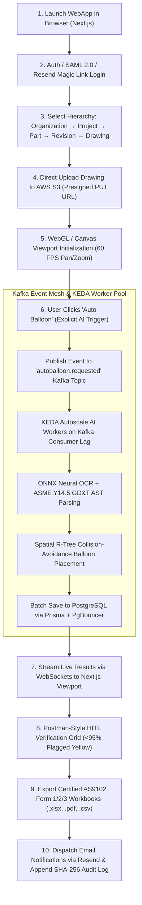

# ✈️ FAI.EV.ENGINEER
### *Enterprise AI-Powered First Article Inspection Platform*

  <b>Postman for Engineering Drawings</b> — Automating First Article Inspection (FAI) for Aerospace, Automotive, Medical Devices, and Precision Machine Shops.

---

> [!IMPORTANT]
> **SINGLE SOURCE OF TRUTH (SSOT)**  
> This repository contains the official Master System Architecture and PRD for **FAI.EV.ENGINEER** (Product Owner: **Harsh Yadav**).  
> Built strictly upon SAE AS9102 (Rev B/C) standards and ASME Y14.5 GD&T drafting specifications.

---

## 📌 Repository Documentation Index

| File | Purpose | Description |
| :--- | :--- | :--- |
| 📄 [`FAI.EV.ENGINEER_MASTER_PRD.md`](./FAI.EV.ENGINEER_MASTER_PRD.md) | **Master PRD (SSOT)** | Master Product Requirements Document in Harsh Yadav's 7-part executive format. |
| 🧠 [`Phase_1_Business_Domain_Analysis.md`](./Phase_1_Business_Domain_Analysis.md) | **Phase 1: Domain Analysis** | DDD Bounded Contexts, Event Storming, Business Rules, ERD, State Machines. |
| 🏗️ [`Phase_2_High_Level_Design.md`](./Phase_2_High_Level_Design.md) | **Phase 2: High-Level System Design** | Full System Architecture: C4 Diagrams, Prisma PostgreSQL Schema, Kafka Event Mesh, Docker, Kubernetes, KEDA Autoscaling, PgBouncer, and Resend Email Automation. |

---

## 🏛️ Master System Architecture Diagram

---

## 🛠️ Production Technology Stack

| Architecture Tier | Technology Selected | Rationale |
| :--- | :--- | :--- |
| **Frontend UI** | **Next.js (React 19, TypeScript)** | SSR, App Router, WebGL/Canvas 60 FPS vector blueprint viewport engine. |
| **API Gateway** | **Node.js + Express (TypeScript)** | Modular REST/GraphQL microservices, JWT/OAuth2 RBAC authentication. |
| **Database & ORM** | **Prisma ORM + AWS Aurora PostgreSQL** | Type-safe queries, PostGIS 2D spatial indexing, Row Level Security (RLS). |
| **DB Pooler** | **PgBouncer** | Connection multiplexing during KEDA AI worker scaling bursts. |
| **Caching & PubSub**| **Redis Enterprise Cluster** | Session management, API response cache, rate-limiting, socket connection state. |
| **Event Mesh** | **Apache Kafka (KRaft)** | Durable event backbone (`autoballoon.requested`, `autoballoon.completed`). |
| **Worker Scaling** | **KEDA (Kubernetes Event Autoscaler)** | Dynamic pod scaling driven by Kafka Consumer Group Lag. |
| **Mail Automation** | **Resend API** | Passwordless magic links, team invitations, export alerts. |
| **Object Storage** | **AWS S3 / MinIO** | Direct presigned client uploads for vector PDF blueprints (200MB limit). |

---

## 🎯 Executive Overview & Core KPIs

---

## 🔄 End-to-End Event-Driven Flow

---

> [!NOTE]
> **Repository Owner:** Harsh Yadav (Lead Product Owner)  
> **Repository Status:** Master System Architecture Approved Baseline
