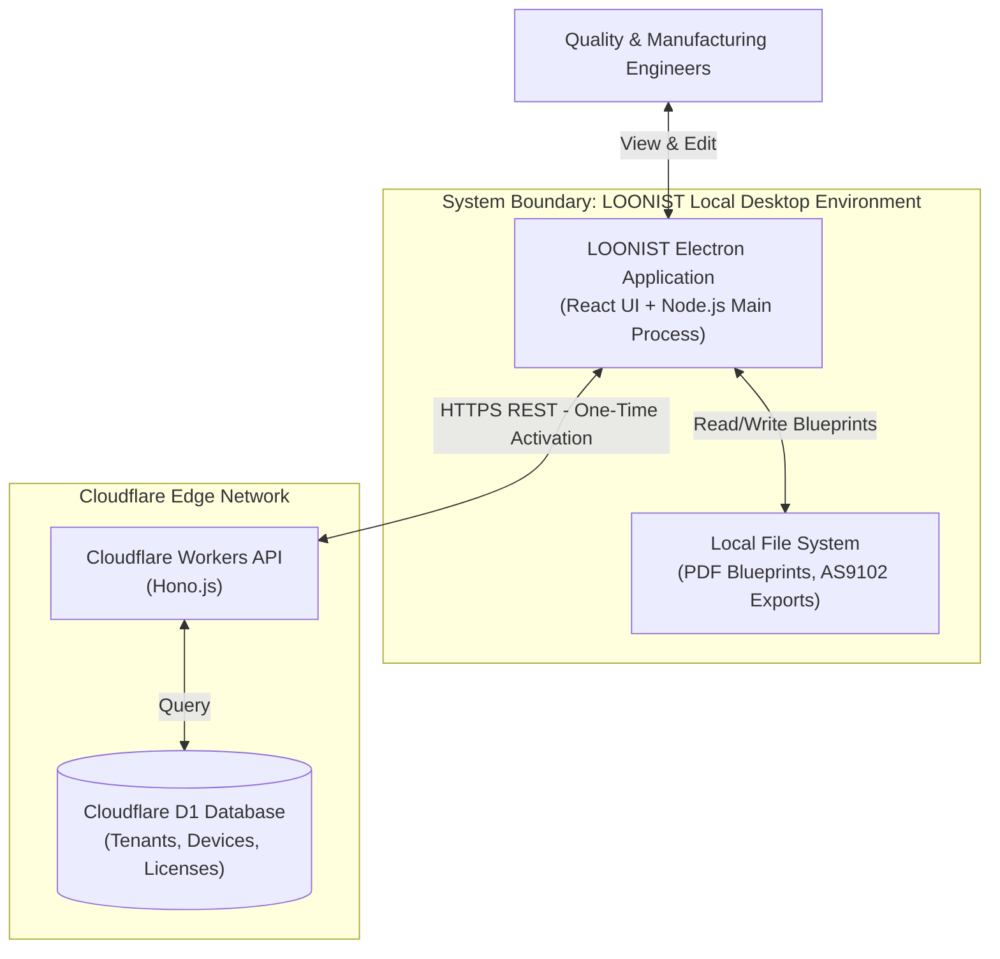
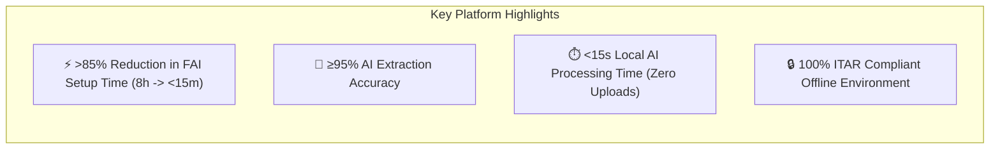
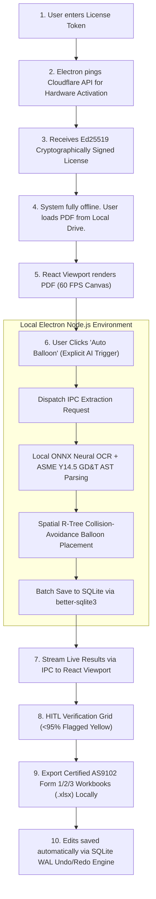

# Loonist
### *Enterprise AI Powered First Article Inspection Platform*

[-purple.svg?style=for-the-badge&logo=electron)](./LOONIST.PRD.md)

  Automating First Article Inspection (FAI) for Aerospace, Automotive, Medical Devices, and Precision Machine Shops.

---

> [!IMPORTANT]
> **SINGLE SOURCE OF TRUTH (SSOT)**  
> This repository contains the official Master System Architecture and PRD for **LOONIST** (Product Owner: **Harsh Yadav**).  
> Built strictly upon SAE AS9102 (Rev B/C) standards and ASME Y14.5 GD&T drafting specifications.

---

## 📌 Repository Documentation Index

### 🏛️ Core Architecture Specifications (SSOT)
| File | Purpose | Description |
| :--- | :--- | :--- |
| 📄 [`LOONIST.PRD.md`](./LOONIST.PRD.md) | **Master PRD (SSOT)** | Master Product Requirements Document defining the offline-first desktop architecture. |
| 🧠 [`Phase_1_Business_Domain_Analysis.md`](./Phase_1_Business_Domain_Analysis.md) | **Phase 1: Domain Analysis** | DDD Bounded Contexts, Event Storming, Business Rules, ERD, State Machines. |
| 🏗️ [`Phase_2_High_Level_Design.md`](./Phase_2_High_Level_Design.md) | **Phase 2: High-Level System Design** | Full System Architecture: C4 Context Diagrams, IPC Security Boundaries, SQLite Undo/Redo Engine, Cloudflare Licensing API, Industrial CAD UI. |
| 🛠️ [`Phase_3_Low_Level_Design.md`](./Phase_3_Low_Level_Design.md) | **Phase 3: Low-Level System Design** | Desktop Application internals, ONNX hardware execution, R-Tree collision, Measurement Engine, PDF/Excel exporters, SHA-256 audit ledger, 6-Sprint Roadmap. |

### 🚀 Sprint Technical Walkthroughs & Implementation Journals
| Sprint | Journal / Walkthrough | Status | Key Deliverables & Systems |
| :---: | :--- | :---: | :--- |
| **Sprint 1** | 📄 [`Sprint_1_Technical_Walkthrough.md`](./Sprint%20Journals/Sprint_1_Technical_Walkthrough.md) | ✅ Complete | Hardened Electron shell, Ed25519 offline licensing, Cloudflare D1/Worker API, SQLite WAL + Undo/Redo transaction ledger. |
| **Sprint 2** | 📄 [`Sprint_2_Technical_Walkthrough.md`](./Sprint%20Journals/Sprint_2_Technical_Walkthrough.md) | ✅ Complete | 60 FPS Canvas vector drawing viewport, sub-pixel pan & zoom (3200%), multi-sheet tab navigation (<1.5GB memory ceiling). |
| **Sprint 3** | 📄 [`Sprint_3_Technical_Walkthrough.md`](./Sprint%20Journals/Sprint_3_Technical_Walkthrough.md) | ✅ Complete | ASME Y14.5 GD&T AST parser (14 characteristics), Title Block tolerance engine (.X-.XXXX), spatial clustering, grid zones, WASM OCR fallback. |
| **Sprint 4** | 📄 [`Sprint_4_Technical_Walkthrough.md`](./Sprint%20Journals/Sprint_4_Technical_Walkthrough.md) | ✅ Complete | Spatial R-Tree AABB collision engine, dynamic vector leader lines, Multi-Document Session Manager, Antigravity dual-axis draggable splitters. |
| **Sprint 5** | 📄 [`Sprint_5_Technical_Walkthrough.md`](./Sprint%20Journals/Sprint_5_Technical_Walkthrough.md) | ✅ Complete | Physical measurement engine (Bilateral/Unilateral/Limit), high-density frozen sticky CAD table, Vector PDF exporter (`pdf-lib`), certified AS9102 Excel exporter, SHA-256 audit ledger, neutral dark theme. |
| **Sprint 6** | 📄 [`Sprint_6_Technical_Walkthrough.md`](./Sprint%20Journals/Sprint_6_Technical_Walkthrough.md) | ✅ Complete | Hybrid dual-path vision pipeline, Canvas pre-processing (Otsu adaptive binarization, deskewing, blueprint inversion), offline Tesseract WASM OCR, CAD symbol normalizer (`Ø`, `±`, `°`, `↧`, `⌴`, `⌵`), and Prose & Tutorial Sentence Exclusion Engine. |

---

## 📊 Codebase & Verification Metrics

- **Total Production Codebase:** **12,800+ Lines of Code** across 57 engine files in `src/` and `scripts/`.
- **Automated Verification Harness:** **14 Test Suites (45+ unit & integration tests)** running via `scripts/run_all_feature_tests.ts` with **100% clean pass rate** and zero TypeScript compilation errors (`tsc -b`).
- **Core Engine Modules:**
  - `src/services/ai/ocrEngineService.ts` (100% offline WebAssembly deep learning OCR & CAD symbol restoration)
  - `src/services/ai/imagePreprocessingService.ts` (Otsu adaptive binarization, deskewing, dark blueprint inversion)
  - `src/services/ai/gdtParser.ts` (ASME Y14.5 AST parser, Prose & Tutorial Sentence Exclusion, residual word check)
  - `src/services/ai/aiExtractionService.ts` (Dual-path vector + OCR ingestion router, candidate filtering)
  - `src/services/compliance/measurementEngine.ts` (Physical tolerance evaluation)
  - `src/services/ballooning/spatialPlacementService.ts` (R-Tree collision & leader line math)
  - `src/services/export/markedPdfExporter.ts` (Vector PDF badge & arrow burn-in)
  - `src/services/export/as9102ExcelExporter.ts` (SAE AS9102 Form 1, 2, 3 multi-sheet OpenXML generator)
  - `src/services/compliance/auditLedgerService.ts` (Cryptographic SHA-256 tamper-evident ledger)
  - `src/components/layout/TableManager.tsx` (High-density CAD table with dual sticky-frozen `#ID`/`#Cha` columns)
  - `src/index.css` (Neutral industrial monochromatic CAD dark theme tokens)

---

## 🏛️ Master System Architecture Diagram

---

## 🛠️ Production Technology Stack

| Architecture Tier | Technology Selected | Rationale |
| :--- | :--- | :--- |
| **Desktop Framework** | **Electron (Node.js)** | Cross-platform container providing high-privilege hardware/filesystem access. |
| **Frontend UI** | **React 19 + TypeScript + Vite** | Extremely fast UI rendering, componentized architecture, modern developer experience. |
| **Frontend Canvas** | **TailwindCSS + HTML5 Canvas** | High performance drawing interaction. |
| **IPC Bridge Security** | **ContextBridge + Zod** | Strict allowlist for frontend-to-backend communication. Blocks malicious XSS payloads. |
| **Local Database** | **SQLite (better-sqlite3)** | Lightning-fast synchronous local storage. PRAGMA WAL enabled for concurrent reads/writes and Undo/Redo logic. |
| **Cloud Licensing API** | **Cloudflare Workers (Hono)** | Global, serverless Edge API for handling activations instantly worldwide with zero server maintenance. |
| **Cloud Database** | **Cloudflare D1** | Serverless SQL ledger storing Tenants, Devices, Licenses, and AuditLogs. |
| **Cryptography** | **Ed25519 (@noble/curves)** | Highly-audited zero-dependency crypto used by Cloudflare to securely sign offline license payloads. |
| **Local AI Engine** | **ONNX Runtime**| Processes neural OCR and spatial recognition locally without uploading to the cloud (ITAR Compliant). |

---

## 🎯 Executive Overview & Core KPIs

---

## 🔄 End-to-End Operational Flow

---

> [!NOTE]
> **Repository Owner:** Harsh Yadav (Lead Product Owner)  
> **Repository Status:** Master System Architecture Approved Baseline
