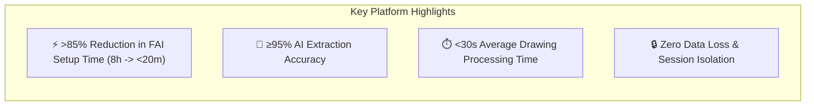
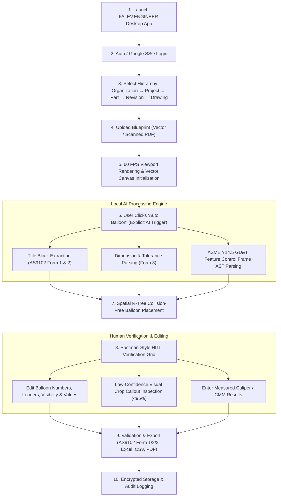

<div align="center">

# ✈️ FAI.EV.ENGINEER
### *Enterprise AI-Powered First Article Inspection Platform*

[](./FAI.EV.ENGINEER_MASTER_PRD.md)
[](./FAI.EV.ENGINEER_MASTER_PRD.md)
[](./FAI.EV.ENGINEER_MASTER_PRD.md)
[](./FAI.EV.ENGINEER_MASTER_PRD.md)
[](./FAI.EV.ENGINEER_MASTER_PRD.md)

<p align="center">
  <b>Postman for Engineering Drawings</b> — Automating First Article Inspection (FAI) for Aerospace, Automotive, Medical Devices, and Precision Machine Shops.
</p>

---

</div>

> [!IMPORTANT]
> **SINGLE SOURCE OF TRUTH (SSOT)**  
> This repository contains the official Master Product Requirements Document for **FAI.EV.ENGINEER** (Product Owner: **Harsh Yadav**).  
> All requirements build strictly upon the SAE AS9102 (Rev B/C) standard and ASME Y14.5 GD&T drafting specifications.

---

## 📌 Repository Documentation Index

| File | Purpose | Description |
| :--- | :--- | :--- |
| 📄 [`FAI.EV.ENGINEER_MASTER_PRD.md`](./FAI.EV.ENGINEER_MASTER_PRD.md) | **Master PRD (SSOT)** | Official Product Requirements Document in Harsh Yadav's 7-part executive format. |
| 🧠 [`Phase_1_Business_Domain_Analysis.md`](./Phase_1_Business_Domain_Analysis.md) | **Phase 1: Business Domain Analysis** | Domain Model, Bounded Contexts, Event Storming, Business Rules, ERD, State Machines. |

---

## 🎯 Executive Overview & Core KPIs



### Key Success Metrics
* 🚀 **Reduce Manual Ballooning Time:** By at least **85%** (cutting setup time from 4–12 hours down to $<20$ minutes per drawing sheet).
* 🎯 **AI Extraction Accuracy:** **$\ge 95\%$** across supported vector and scanned engineering blueprints.
* ⚡ **Processing Latency:** Average drawing processing time **$< 30$ seconds**; UI interaction response time **$< 2$ seconds**.
* 🛡️ **Guardrail Uptime:** System Uptime **$\ge 99.9\%$**, PDF Processing Failure Rate **$< 1\%$**, Zero data loss during processing or export.

---

## 🔄 End-to-End Product Flow



---

## 🖥️ Postman-Style Three-Pane Workspace

```
+-------------------------------------------------------------------------------------------------------+
|  FAI.EV.ENGINEER  [File]  [Edit]  [View]  [Auto Balloon]  [Tools]  [Export]     [Offline Active]      |
+-------------------------------------------------------------------------------------------------------+
|  [Tabs]:  [+] Drawing_Rev_C.afai  |  Turbine_Blade_Form1.afai                                         |
+-------------------+--------------------------------------------------+--------------------------------+
| NAVIGATOR         | DRAWING CANVAS (60 FPS WebGL / SVG Overlay)      | FEATURE INSPECTOR & GRID       |
| ----------------- | ------------------------------------------------ | ------------------------------ |
| > Org: Acme Aerospace                                                | Balloon #14  [Confidence: 99%] |
|  > Project: Turbine                                                 | ------------------------------ |
|   > Part: Blade-7728                                                 | Nominal: 1.500  Unit: INCH     |
|    > Rev: C (Active) |            +-----------------------+             | Tol: +0.005 / -0.005           |
|                     |            |  (14) 1.500 +/- .005  |             | Limits: 1.4950 - 1.5050        |
| LAYERS              |            +-----------------------+             | ------------------------------ |
| [x] Balloons        |                                                  | Measured Value: [ 1.5020 ]     |
| [x] AI Highlight    |                                                  | Status: [ PASS (GREEN) ]       |
| [ ] Geometry        |                                                  | ------------------------------ |
|                     |                                                  | [ Approve ] [ Edit ] [ Delete] |
+-------------------+--------------------------------------------------+--------------------------------+
| FEATURE TABLE GRID (Bottom Dockable)                                                                  |
| #  | Balloon | Zone | Type      | Requirement    | Min    | Max    | Measured | Status  | Confidence |
| ---|---------|------|-----------|----------------|--------|--------|----------|---------|------------|
| 1  | 14      | B4   | LINEAR    | 1.500 +/- .005 | 1.4950 | 1.5050 | 1.5020   | PASS    | 99.4%      |
| 2  | 15      | C2   | GD&T POS  | [Pos|0.002|A|B]| 0.0000 | 0.0020 | 0.0008   | PASS    | 97.1% (Warn|
+-------------------------------------------------------------------------------------------------------+
```

---

## 👥 Personas & Target Industries

* **Primary Daily Users:** Quality Engineers, Manufacturing Engineers, Inspection Engineers, Metrologists.
* **Primary Buyers:** Quality Department Heads, VPs of Manufacturing, Machine Shop Owners.
* **Target Industries:** Aerospace & Defense, Automotive, Medical Devices, Precision Manufacturing, Machine Shops.

---

> [!NOTE]
> **Repository Owner:** Harsh Yadav (Lead Product Owner)  
> **Repository Status:** Single PRD SSOT Baseline Established
