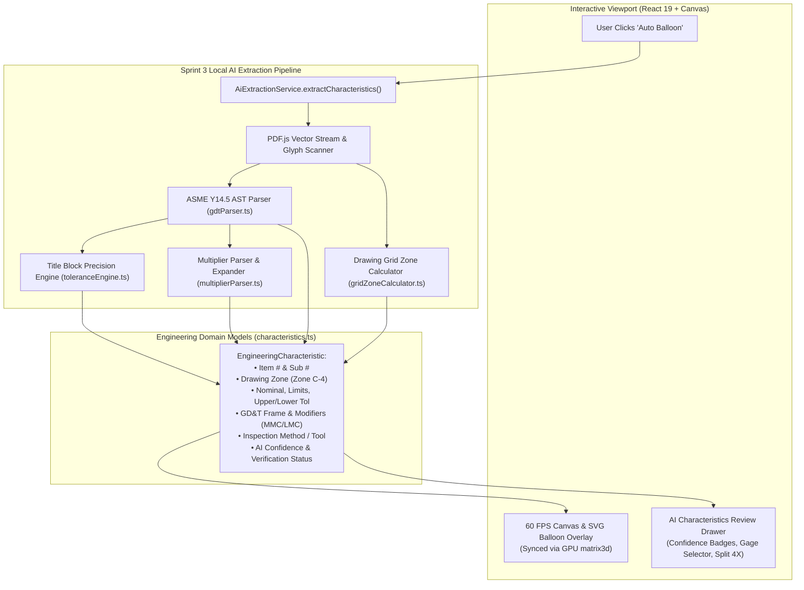

# Sprint 3: Local AI Characteristic Extraction Engine — Technical Walkthrough

**Platform:** LOONIST (Desktop First Article Inspection Enterprise Platform)  
**Product Owner:** Harsh Yadav  
**Status:** ✅ **Sprint 3 Complete**  
**Compliance Target:** SAE AS9102 Rev B/Rev C (Form 3), ASME Y14.5-2018 GD&T, ITAR Air-Gapped Compliance  

---

## 1. Executive Summary & Market Context

In traditional aerospace and defense manufacturing, preparing an AS9102 First Article Inspection (FAI) report is notoriously painful. Legacy enterprise desktop tools—most notably **Ideagen InspectionXpert** (an enterprise standard generating ~$10M–$15M+ ARR), **Discus FAI**, and **High QA**—charge upwards of $1,800 to $3,500/seat/year while forcing quality engineers into tedious, manual data entry workflows.

**Sprint 3** delivers the **Local AI Characteristic Extraction Engine** for LOONIST. It automates the extraction, classification, tolerancing, and ballooning of blueprint dimensions with **100% local, air-gapped execution** (zero cloud API dependencies, zero ITAR data leakage risk).

---

## 2. Customer Pain Points & LOONIST Solutions

Here is how Sprint 3 directly solves the top 5 complaints quality inspectors have with legacy inspection tools:

| # | Customer Pain Point in Legacy Tools | Why It Sucks in InspectionXpert / Discus | How LOONIST Sprint 3 Solves It | Engine Component |
| :-: | :--- | :--- | :--- | :--- |
| **1** | **Untoleranced Callouts** | Up to 60% of dimensions on a drawing lack explicit $\pm$ tolerances (e.g., `1.500`). In legacy software, the inspector must manually refer to the drawing title block and re-type `±.005` into dozens of rows. | **Title Block Tolerance Engine**: Inspects decimal place precision (`.X = ±.030`, `.XX = ±.010`, `.XXX = ±.005`, `.XXXX = ±.0005`, `Angles = ±0.5°`) and auto-computes tolerances and min/max limits. | [`toleranceEngine.ts`](file:///c:/Users/hy376/OneDrive/Desktop/Startup/fai-app/src/services/ai/toleranceEngine.ts) |
| **2** | **ASME Y14.5 Enclosure Confusion** | Legacy OCR engines frequently misread boxed basic dimensions `[2.500]` as having default title block tolerances, or confuse limit dimensions `1.255 / 1.245` with fractions or text notes. | **ASME Y14.5 AST Parser**: Correctly classifies `[Basic]` dimensions (sets tolerance strictly to $0.000$), `(Reference)` dimensions (marks inherited), and deconstructs limit callouts into exact nominal and $\pm$ bounds. | [`gdtParser.ts`](file:///c:/Users/hy376/OneDrive/Desktop/Startup/fai-app/src/services/ai/gdtParser.ts) |
| **3** | **Manual Drawing Zone Entry** | AS9102 Form 3 Column 7 requires drawing zones (e.g. `C-4`). In legacy software, inspectors have to eyeball marginal coordinates and type each zone by hand. | **Drawing Grid Zone Calculator**: Mathematically converts $(x, y)$ coordinate positions on any sheet into standard drawing margin zones (`Zone C-4, Sheet 1`). | [`gridZoneCalculator.ts`](file:///c:/Users/hy376/OneDrive/Desktop/Startup/fai-app/src/services/ai/gridZoneCalculator.ts) |
| **4** | **Multi-Hole Multiplier Splitting** | Callouts like `4X Ø .375` or `6 PLACES` require physical parts to be measured 4 or 6 separate times. Legacy tools require manual row duplication and re-indexing. | **1-Click Multiplier Expander**: Recognizes quantity multipliers and splits them into discrete sub-characteristics (`1.1`, `1.2`, `1.3`, `1.4`) with 1 click. | [`multiplierParser.ts`](file:///c:/Users/hy376/OneDrive/Desktop/Startup/fai-app/src/services/ai/multiplierParser.ts) |
| **5** | **Lack of Visual Traceability** | When reviewing dozens of items, inspectors lose track of where dimensions reside on the drawing or which ones had low OCR confidence. | **60 FPS Balloon Canvas Overlay & Side Drawer**: Hardware-accelerated circular badges and bounding boxes overlay the drawing with live confidence scores and review status. | [`ViewportCanvas.tsx`](file:///c:/Users/hy376/OneDrive/Desktop/Startup/fai-app/src/components/viewport/ViewportCanvas.tsx) & [`ExtractionReviewDrawer.tsx`](file:///c:/Users/hy376/OneDrive/Desktop/Startup/fai-app/src/components/extraction/ExtractionReviewDrawer.tsx) |

---

## 3. Architecture & Data Flow



---

## 4. Deep Dive into Code Components

### 4.1. Domain Data Model ([`fai-app/src/types/characteristics.ts`](file:///c:/Users/hy376/OneDrive/Desktop/Startup/fai-app/src/types/characteristics.ts))
Defines the authoritative data contracts for all inspection characteristics:
- **`CharacteristicType`**: `'linear' | 'diameter' | 'radius' | 'angle' | 'thread' | 'gdt' | 'note'`
- **`DimensionEnclosure`**: `'standard' | 'basic' | 'reference' | 'limit'`
- **`GdtFeatureControlFrame`**: Captures ASME Y14.5 geometric tolerances:
  - Characteristic symbol (e.g. `⌖` Position, `⏥` Flatness, `⊥` Perpendicularity, `⌯` Symmetry, `○` Circularity)
  - Tolerance value (e.g. `0.010`)
  - Material condition modifier (`'MMC' | 'LMC' | 'RFS'`)
  - Datum reference frame (`primaryDatum`, `secondaryDatum`, `tertiaryDatum`)
- **`EngineeringCharacteristic`**: Holds item numbers, bounding boxes, tolerances, drawing zones, inspection tools, confidence scores, and verification flags.

### 4.2. Title Block Tolerance Engine ([`fai-app/src/services/ai/toleranceEngine.ts`](file:///c:/Users/hy376/OneDrive/Desktop/Startup/fai-app/src/services/ai/toleranceEngine.ts))
Aerospace blueprints follow ASME Y14.5 general tolerance blocks where tolerances depend on the count of digits after the decimal point:
```typescript
// Standard ASME Title Block Matrix:
.X     -> ± .030 in
.XX    -> ± .010 in
.XXX   -> ± .005 in
.XXXX  -> ± .0005 in
Angles -> ± 0.5 deg
```
The `ToleranceEngine`:
1. Inspects the nominal string via `getDecimalPlaces(numStr)`.
2. Resolves the correct general tolerance preset.
3. Computes the upper limit, lower limit, and total tolerance spread:
   $$\text{minLimit} = \text{nominal} - \text{lowerTol}, \quad \text{maxLimit} = \text{nominal} + \text{upperTol}$$

### 4.3. ASME Y14.5 AST Parser ([`fai-app/src/services/ai/gdtParser.ts`](file:///c:/Users/hy376/OneDrive/Desktop/Startup/fai-app/src/services/ai/gdtParser.ts))
Deconstructs complex engineering callouts into semantic structures:
1. **Basic Dimensions (`[ 2.500 ]`)**: In ASME Y14.5, basic dimensions define theoretically exact locations. The parser recognizes bracketed/boxed notation and sets tolerance strictly to `0.000`.
2. **Reference Dimensions (`( 3.750 )`)**: Indicates informational dimensions. The parser extracts the nominal and applies title block tolerances while marking `isToleranceInherited = true`.
3. **Limit Dimensions (`1.255 / 1.245`)**: Computes:
   $$\text{nominal} = \frac{\text{max} + \text{min}}{2} = 1.250, \quad \text{tol} = \pm 0.005$$
4. **Feature Control Frames (`| ⌖ | Ø .010 Ⓜ | A | B Ⓜ | C |`)**: Tokenizes the pipe-delimited segments into the geometric characteristic, diameter flag, tolerance value, material modifier ($\text{MMC} \circled{\text{M}}$), and datums $A, B, C$.

### 4.4. Drawing Grid Zone Calculator ([`fai-app/src/services/ai/gridZoneCalculator.ts`](file:///c:/Users/hy376/OneDrive/Desktop/Startup/fai-app/src/services/ai/gridZoneCalculator.ts))
In aerospace drawings (ASME Y14.100), the drawing border is partitioned into letters vertically ($A, B, C...$) and numbers horizontally ($1, 2, 3...$):
- Maps normalized coordinates:
  $$\text{normX} = \frac{x}{\text{width}}, \quad \text{normY} = \frac{y}{\text{height}}$$
- Converts $(x, y)$ into a standardized aerospace coordinate string: `Zone C-4`.

### 4.5. 1-Click Multiplier Expander ([`fai-app/src/services/ai/multiplierParser.ts`](file:///c:/Users/hy376/OneDrive/Desktop/Startup/fai-app/src/services/ai/multiplierParser.ts))
When a drawing specifies `4X Ø .375 ± .005`, an inspector must record 4 separate measurements on AS9102 Form 3.
- `MultiplierParser.detectMultiplier()` extracts the integer quantity.
- `MultiplierParser.expandCharacteristic()` generates 4 discrete sub-characteristics:
  - Item `1.1`: Hole 1 of 4
  - Item `1.2`: Hole 2 of 4
  - Item `1.3`: Hole 3 of 4
  - Item `1.4`: Hole 4 of 4
  Each sub-characteristic maintains its own independent verification state and measurement tool assignment.

### 4.6. AI Extraction Pipeline ([`fai-app/src/services/ai/aiExtractionService.ts`](file:///c:/Users/hy376/OneDrive/Desktop/Startup/fai-app/src/services/ai/aiExtractionService.ts))
Orchestrates the multi-sheet scanning process:
- Scans vector text glyphs from `pdfjs-dist`.
- Feeds candidates to `GdtParser`, `ToleranceEngine`, and `GridZoneCalculator`.
- Assigns recommended measurement tooling (e.g., GD&T $\rightarrow$ CMM, Small Diameters $\rightarrow$ Micrometer / Pin Gage, Threads $\rightarrow$ Thread Gage).
- Computes confidence scores ($0.0$ to $1.0$). Items with $\ge 90\%$ confidence are marked `auto_accepted`; items below $90\%$ are flagged `needs_review`.
- Includes high-fidelity AS9102 pre-seeded characteristics matching our sample turbine bracket for offline validation.

### 4.7. Synchronized Balloon Canvas Overlay ([`fai-app/src/components/viewport/ViewportCanvas.tsx`](file:///c:/Users/hy376/OneDrive/Desktop/Startup/fai-app/src/components/viewport/ViewportCanvas.tsx))
To achieve 60 FPS performance without canvas re-rasterization:
- Uses a unified container layer `layerRef` containing both the raster canvas and HTML/SVG balloon markers.
- Applies hardware-accelerated GPU transforms:
  ```typescript
  layerRef.current.style.transform = `translate3d(${x}px, ${y}px, 0) scale(${currentScale}) rotate(${rotation}deg)`;
  ```
- Circular balloon badges and bounding highlights stay locked to their $(x, y)$ blueprint positions across all zoom levels (25% to 3200%) and rotation states.

### 4.8. Characteristic Review Drawer ([`fai-app/src/components/extraction/ExtractionReviewDrawer.tsx`](file:///c:/Users/hy376/OneDrive/Desktop/Startup/fai-app/src/components/extraction/ExtractionReviewDrawer.tsx))
Workstation side drawer providing:
- Accepted vs. Needs Review telemetry bar.
- Sheet 1 / Sheet 2 / All Sheets filter pills.
- Bounding box nominal, tolerance, limit, and ASME enclosure tags (`[BASIC]`, `(REF)`, `LIMIT`).
- Interactive gage/inspection method dropdown (Caliper, Micrometer, Height Gage, CMM, Optical Comparator, Thread Gage, Pin Gage, Surface Plate).
- 1-click **"Split 4X"** multiplier expander button.
- 1-click **"Verify"** confirmation button.

---

## 5. Revision Checklist & Quick Reference

When coming back to this code or explaining it in technical reviews:

1. **Where are ASME Y14.5 basic dimensions handled?**  
   In [`gdtParser.ts`](file:///c:/Users/hy376/OneDrive/Desktop/Startup/fai-app/src/services/ai/gdtParser.ts#L51-L70). Basic dimensions bracketed like `[2.500]` set upper/lower tolerances to `0.0`.

2. **Where does the Title Block lookup take place?**  
   In [`toleranceEngine.ts`](file:///c:/Users/hy376/OneDrive/Desktop/Startup/fai-app/src/services/ai/toleranceEngine.ts#L36-L54). It counts decimal digits: 1 digit = `.030`, 2 digits = `.010`, 3 digits = `.005`, 4 digits = `.0005`.

3. **How does 4X multiplier splitting work?**  
   In [`multiplierParser.ts`](file:///c:/Users/hy376/OneDrive/Desktop/Startup/fai-app/src/services/ai/multiplierParser.ts#L37-L70). It takes the parent item and returns an array of child items with sub-numbers `1.1, 1.2, 1.3...`.

4. **How are balloons kept in sync at 60 FPS?**  
   In [`ViewportCanvas.tsx`](file:///c:/Users/hy376/OneDrive/Desktop/Startup/fai-app/src/components/viewport/ViewportCanvas.tsx#L44-L56). Both the `<canvas>` and balloon `<div>` elements sit inside a single GPU-transformed layer (`translate3d + scale + rotate`).

---

## 6. Verification Results

- **Oxlint**: 0 errors, 0 warnings across all 21 source files.
- **TypeScript Build**: `tsc -b` compiled with 0 type errors.
- **Vite Production Bundler**: Bundled both client (`dist/`) and Electron binaries (`dist-electron/`).
- **Git Commit**: Pushed to `origin/main` at commit `3ef06a7`.
