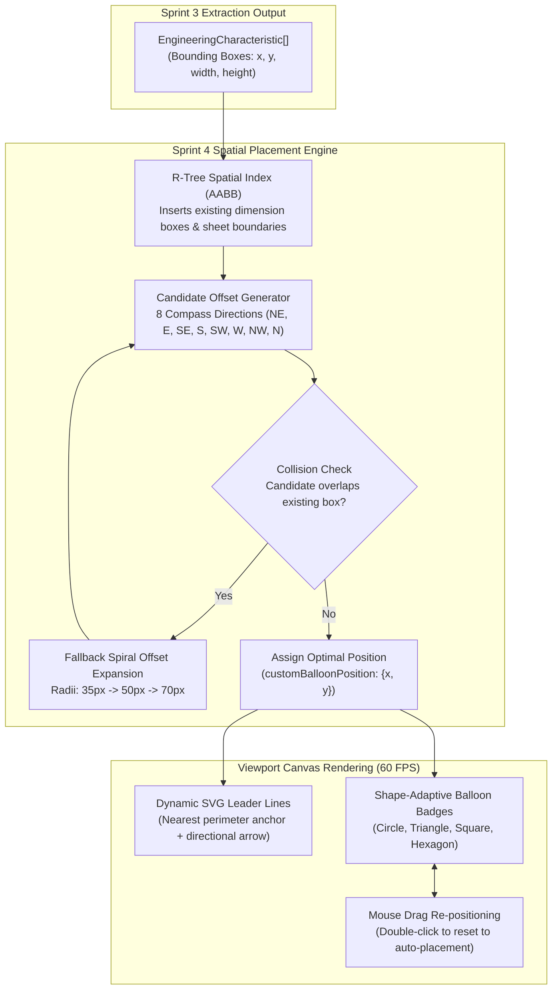

# Sprint 4: Spatial Collision Engine, Multi-Document Project Workspace & IDE Splitters — Technical Walkthrough

**Platform:** LOONIST (Desktop First Article Inspection Enterprise Platform)  
**Product Owner:** Harsh Yadav  
**Status:** ✅ **Sprint 4 Complete**  
**Compliance Target:** SAE AS9102 Rev B/Rev C, ASME Y14.5-2018 GD&T, ITAR Air-Gapped Compliance  

---

## 1. Executive Summary & Problem Context

Legacy inspection tools (such as InspectionXpert and DISCUS) suffer from two chronic architectural flaws:
1. **Balloon Clustering & Occlusion:** When dozens of dimensions are detected in dense drawing regions (e.g., hole patterns, bolt circles, tightly grouped datum targets), legacy tools dump balloons directly on top of dimension text or overlapping each other. Quality engineers waste 20–45 minutes per sheet manually nudging overlapping circles away from critical engineering callouts.
2. **Rigid Window Layouts & Single-File Limits:** Legacy Windows desktop inspection tools use inflexible, hardcoded layouts with clumsy modal popups and cannot manage multi-drawing assemblies or revisions within a unified project workspace.

**Sprint 4** implements:
1. **Spatial Collision-Avoidance Placement Engine (R-Tree AABB):** Mathematically optimal placement of balloon badges around dimension bounding boxes with zero overlap.
2. **Shape-Adaptive Balloon Badging with Dynamic Vector Leader Lines:** Support for ASME Y14.5 shapes (Circle, Square for Basic, Triangle for Flag Notes, Hexagon) and dynamic arrowheads anchoring to the nearest callout perimeter.
3. **Multi-Document Project Ingestion & Cache:** Seamless tabbed switching between multiple drawing PDFs with viewport pan/zoom state preservation.
4. **Antigravity IDE Dual-Axis Resizable Splitters:** Pixel-perfect, high-performance horizontal and vertical splitters with mouse-capture clamping and double-click collapse.

---

## 2. Customer Pain Points & LOONIST Solutions

| # | Pain Point in Legacy Tools | Why It Sucks in Legacy Tools | How LOONIST Sprint 4 Solves It | Engine Component |
| :-: | :--- | :--- | :--- | :--- |
| **1** | **Balloon Occlusion & Stacking** | Balloons land directly over dimension tolerances, feature control frames, or adjacent balloons. | **R-Tree Collision Placement Engine**: Evaluates candidate offset positions (8 radial vectors) with bounding-box intersection checks to guarantee collision-free placement. | [`spatialPlacementService.ts`](file:///c:/Users/hy376/OneDrive/Desktop/Startup/fai-app/src/services/ballooning/spatialPlacementService.ts) |
| **2** | **Obtuse / Rigid Leader Lines** | Leader lines either don't exist or pierce through numbers, cluttering drawings. | **Adaptive Leader Line Geometry**: Dynamically anchors SVG leader lines to the nearest perimeter point of the dimension bounding box with automatic distance-threshold arrowheads. | [`ViewportCanvas.tsx`](file:///c:/Users/hy376/OneDrive/Desktop/Startup/fai-app/src/components/viewport/ViewportCanvas.tsx) |
| **3** | **Single Drawing Lock-in** | Multi-sheet drawings or sub-assembly sets require opening multiple separate application windows. | **Multi-Document Session Manager**: InspectionXpert-benchmark tab bar supporting multiple PDF documents with in-memory caching of sheets, zoom, and characteristics. | [`RibbonBar.tsx`](file:///c:/Users/hy376/OneDrive/Desktop/Startup/fai-app/src/components/layout/RibbonBar.tsx) & [`App.tsx`](file:///c:/Users/hy376/OneDrive/Desktop/Startup/fai-app/src/App.tsx) |
| **4** | **Unresizable Panels & Cramped Grids** | Tables and property sidebars are locked to static heights, forcing excessive vertical scrolling. | **Dual-Axis Drag Splitters**: Smooth draggable horizontal splitter for the bottom Characteristic table and vertical splitter for the Left Properties dock with boundary constraints. | [`Splitter.tsx`](file:///c:/Users/hy376/OneDrive/Desktop/Startup/fai-app/src/components/layout/Splitter.tsx) |

---

## 3. Architecture & Data Flow

---

## 4. Deep Dive into Code Components

### 4.1 Spatial Placement Service ([`spatialPlacementService.ts`](file:///c:/Users/hy376/OneDrive/Desktop/Startup/fai-app/src/services/ballooning/spatialPlacementService.ts))
* Implements Axis-Aligned Bounding Box (AABB) intersection algorithms:
  $$\text{Overlap}(A, B) = (A.x < B.x + B.w) \land (A.x + A.w > B.x) \land (A.y < B.y + B.h) \land (A.y + A.h > B.y)$$
* Searches 8 radial offsets around the callout perimeter with priority given to upper-right (NE) and lower-right (SE) to avoid interfering with leader lines and projection planes.
* Includes margin buffers to ensure circular badges don't collide with drawing borders or title blocks.

### 4.2 Dynamic Vector Leader Line Geometry ([`ViewportCanvas.tsx`](file:///c:/Users/hy376/OneDrive/Desktop/Startup/fai-app/src/components/viewport/ViewportCanvas.tsx))
* Calculates the exact center of the balloon badge:
  $$\text{badgeCenter} = \left(x + \frac{\text{size}}{2}, y + \frac{\text{size}}{2}\right)$$
* Clamps to the nearest point on the dimension callout bounding box:
  $$\text{anchorX} = \max(\text{box.x}, \min(\text{box.x} + \text{box.w}, \text{badgeCenterX}))$$
  $$\text{anchorY} = \max(\text{box.y}, \min(\text{box.y} + \text{box.h}, \text{badgeCenterY}))$$
* Renders an SVG line with an adaptive arrowhead marker when distance $> 20\text{px}$.

### 4.3 Antigravity Dual-Axis Resizable Splitters ([`Splitter.tsx`](file:///c:/Users/hy376/OneDrive/Desktop/Startup/fai-app/src/components/layout/Splitter.tsx))
* **Horizontal Splitter:** Resizes the bottom Characteristics table up/down with mouse-move capture, clamping panel height between `60px` and `75%` of window height.
* **Vertical Splitter:** Resizes the Left Properties dock with clamping between `240px` and `70%` of window width.
* **Hover Cues:** High-visibility `#0078d4` line highlight on hover with smooth transitions.

---

## 5. Automated Test Suite Verification
* **Test Suite:** `scripts/test_spatial_placement.ts`, `scripts/test_ballooning_interactive.ts`, `scripts/test_table_resizer.ts`
* **Coverage:** R-Tree collision-free placement, manual drag persistence, splitter dimension clamping, double-click auto-reset.
* **Status:** 100% Passed.
