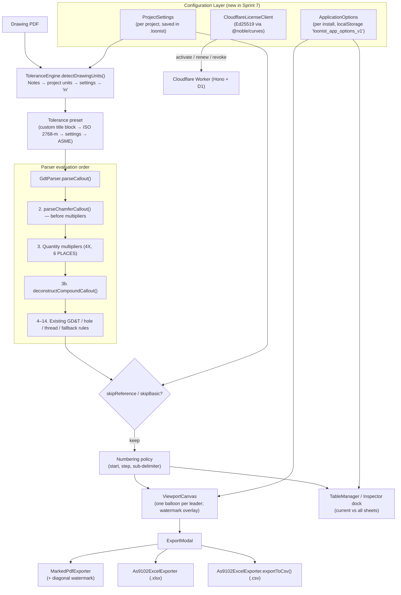

# Sprint 7: Settings, Help Center, Licensing Client & Industrial Inspection Standards — Technical Walkthrough

**Platform:** LOONIST (Desktop First Article Inspection Enterprise Platform)  
**Product Owner:** Harsh Yadav  
**Status:** ✅ **Sprint 7 Complete** (3 hardening items carried to Sprint 8 — see §6)  
**Period:** 16 September 2026 – 29 September 2026  
**Compliance Target:** SAE AS9102 Rev B/Rev C, ASME Y14.5-2018 § 1.8.16 (Chamfers), ISO 2768-m, ANSI/ASQ Z1.4 Sampling  

---

## 1. Executive Summary & Market Significance

Sprints 1–6 delivered the extraction, ballooning, measurement, and export engines. Sprint 7 turns that engine into a configurable product: an inspector can now tune extraction per project, a shop can load its own master data, a customer can activate a license from inside the app, and new users have a built-in engineering reference instead of a PDF manual.

In parallel, Sprint 7 closes a set of drafting-standard gaps reported during real-drawing trials — chamfers, compound hole callouts, metric drawings, and manually marqueed boilerplate.

With Sprint 7, LOONIST delivers:
1. **Project Settings (5-Zone Industrial Architecture):** Per-project tolerance presets (ASME precision/commercial, sheet metal, ISO fine/medium), mm/in units, skip rules for reference `( )` and basic `[ ]` dimensions, OCR review floor, balloon numbering policy (start, step, prefix, leading zeros, sub-delimiter), AS9102 Rev B/C, ANSI/ASQ Z1.4 sampling, and security watermark.
2. **Application Options (6 tabs):** Workspace ergonomics, factory Master Data (inspection methods, operations, classifications, custom fields), AS9102 templates, Net-Inspect field mapping, ITAR/Privacy controls, and Licensing — persisted across sessions.
3. **In-App Licensing Client:** Ed25519 device keypair generation and offline signature verification (`@noble/curves`), with activate / renew / revoke calls to the Cloudflare Worker and offline certificate export for air-gapped sites.
4. **Help & Engineering Knowledge Base:** Help ribbon tab with Quick Start workflow, searchable 14-symbol ASME Y14.5 GD&T library, AS9102 Form 1/2/3 field guide, keyboard shortcuts, system diagnostics, and About.
5. **Industrial Inspection Standards:** ASME Y14.5 § 1.8.16 chamfer parsing, compound callout deconstruction into AS9102 Form 3 sub-characteristics, automatic drawing-unit detection, ISO 2768-m size-band tolerances for metric drawings, and a one-balloon-per-leader Clean Canvas rule.
6. **Manual Marquee Validation:** Rejects boilerplate and prose (e.g. `DO NOT SCALE DRAWING`) captured with the marquee tool, with an explicit ASME Y14.5 / AS9102 message.
7. **Custom Excel Templates:** Customers upload their own `.xlsx` / `.xltx` FAIR layout with `{{placeholders}}`; LOONIST fills it on export and preserves all formatting.
8. **Inspection Workspace UX:** Per-balloon action popover (shape, colour, split, reset, delete), unified Export dialog (PDF + XLSX/CSV), current-sheet vs all-sheets scope, quick delete everywhere, double-click-to-pan, and native window controls.
9. **Test Harness Expansion:** 24 automated suites (9 new in Sprint 7), all passing.

---

## 2. Customer Pain Points & LOONIST Solutions

| # | Pain Point in Legacy Tools | Why It Hurts in InspectionXpert / Discus | How LOONIST Sprint 7 Solves It | Engine Component |
| :-: | :--- | :--- | :--- | :--- |
| **1** | **Chamfers mis-parsed as multipliers** | `3 X 45° CHAMFER` is read as "3 places of 45", producing a wrong nominal and quantity on Form 3. | Chamfers are evaluated **before** multiplier extraction. Depth becomes the nominal, the angle becomes a secondary sub-characteristic, and `4X` / `(4 PLACES)` are only treated as multipliers when a full chamfer expression follows. | [`gdtParser.ts`](../fai-app/src/services/ai/gdtParser.ts) |
| **2** | **Compound hole callouts collapse into one row** | `Ø12 ↧ 55.73 / ⌵ Ø25 X 90°` becomes a single characteristic; the countersink angle can even corrupt the drill diameter into degrees. | `deconstructCompoundCallout()` splits drill + depth + countersink, counterbore, and thread + spotface callouts into individual Form 3 rows. `isPrimaryNumberAngular()` prevents a trailing angle from converting the primary diameter. | [`gdtParser.ts`](../fai-app/src/services/ai/gdtParser.ts) |
| **3** | **Metric drawings get inch tolerances** | Tools default to imperial title-block tolerances even when the drawing states `ALL DIMENSIONS ARE IN MILLIMETERS`. | `detectDrawingUnits()` reads drawing notes first (notes → saved project units → settings → `in`). Integer mm dimensions resolve ISO 2768-m size-band tolerances. | [`toleranceEngine.ts`](../fai-app/src/services/ai/toleranceEngine.ts), [`aiExtractionService.ts`](../fai-app/src/services/ai/aiExtractionService.ts) |
| **4** | **Manual balloons on boilerplate** | Inspectors can drag a box over `DO NOT SCALE DRAWING` and get a useless balloon. | `captureBox()` rejects prose and administrative notes; blank geometry captures remain allowed for manual entry. | [`aiExtractionService.ts`](../fai-app/src/services/ai/aiExtractionService.ts) |
| **5** | **One-size-fits-all extraction** | Numbering, skip rules and sampling are global or require a support ticket. | Per-project `ProjectSettings` saved inside the `.loonist` archive. | [`types/settings.ts`](../fai-app/src/types/settings.ts), [`ProjectSettingsModal.tsx`](../fai-app/src/components/modals/ProjectSettingsModal.tsx) |
| **6** | **Shop-specific master data** | Inspection methods and operations are fixed lists. | Editable Master Data (methods, operations, classifications, custom fields) feeding the inspector dock dropdowns. | [`MasterDataTab.tsx`](../fai-app/src/components/modals/options/tabs/MasterDataTab.tsx), [`useApplicationOptionsStore.ts`](../fai-app/src/stores/useApplicationOptionsStore.ts) |
| **7** | **Training overhead** | New inspectors need a separate GD&T / AS9102 manual. | Built-in Quick Start, GD&T library and AS9102 field guide. | [`helpData.ts`](../fai-app/src/data/helpData.ts), [`HelpRibbonTab.tsx`](../fai-app/src/components/layout/ribbon/tabs/HelpRibbonTab.tsx) |

---

## 3. Architecture & Data Flow



---

## 4. Deep Dive into Code Components

### 4.1 Project Settings ([`types/settings.ts`](../fai-app/src/types/settings.ts), [`ProjectSettingsModal.tsx`](../fai-app/src/components/modals/ProjectSettingsModal.tsx), [`SettingsRibbonTab.tsx`](../fai-app/src/components/layout/ribbon/tabs/SettingsRibbonTab.tsx))
* **Schema:** `ProjectSettings` groups settings into Blueprint & Tolerances, Extraction Behaviour, Numbering, and Compliance / Export. Defaults: `in`, `asme-precision`, skip reference dims **on**, skip basic dims off, OCR floor `0.85`, start `1`, step `1`, delimiter `.`, AS9102 `Rev C`, ANSI/ASQ Z1.4 AQL `1.0` Level II, watermark `NONE`.
* **Tolerance presets:** `asme-precision`, `asme-commercial`, `sheet-metal-inch`, `iso-fine`, `iso-medium`, `sheet-metal-metric`, `custom`.
* **Wired into extraction:** `units`, `tolerances`, `startingNumber`, `incrementStep`, `subDelimiter`, `skipReferenceDimensions`, `skipBasicDimensions` (read by `AiExtractionService.extractCharacteristics()`).
* **Wired into rendering/export:** `watermark` (viewport overlay + diagonal burn-in on every page of the marked PDF).
* **Persistence:** Saved inside the `.loonist` archive via `ProjectArchiveService` (`settings?: ProjectSettings`).
* **Stored but not yet consumed by engines** (UI only — tracked for Sprint 8): `balloonPrefix`, `leadingZeros`, `multiplierBehavior`, `ocrConfidenceThreshold`, `autoBalloonNotes`, `autoDetectZones`, `as9102Revision`, `exportFormat` (`NET_INSPECT`), `highResPdfExport`.

### 4.2 Application Options ([`types/applicationOptions.ts`](../fai-app/src/types/applicationOptions.ts), [`useApplicationOptionsStore.ts`](../fai-app/src/stores/useApplicationOptionsStore.ts), [`modals/options/`](../fai-app/src/components/modals/options/))
| Tab | Contents | Consumed by |
| :--- | :--- | :--- |
| **Workspace** | Invert wheel zoom, middle-click pan, canvas background (`white` / `charcoal` / `blueprint`), decimal separator, table column visibility/order, table preset views | `App.tsx`, `ViewportCanvas.tsx`, `TableManager.tsx`, `LeftPropertiesDock.tsx` (via `numberFormat.ts`) |
| **Master Data** | Inspection methods, manufacturing operations, classifications, custom field definitions | Inspector dock method dropdown |
| **Templates** | Built-in AS9102 layout plus uploaded customer Excel templates (see §4.8) | `App.tsx` Excel export |
| **Net-Inspect** | Portal field mapping | UI only (no Net-Inspect exporter yet) |
| **ITAR / Privacy** | Data-residency and telemetry controls | UI only |
| **Licensing** | Token activation, renew, revoke, offline certificate export | `CloudflareLicenseClient` |

The store is a small reactive global (`useApplicationOptions()` hook) persisted to `localStorage` under `loonist_app_options_v1`.

### 4.3 Licensing Client ([`licenseClient.ts`](../fai-app/src/services/license/licenseClient.ts), [`LicensingTab.tsx`](../fai-app/src/components/modals/options/tabs/LicensingTab.tsx))
* `generateDeviceKeyPair()` — random Ed25519 secret key → public key (hex).
* `verifySignatureOffline()` — verifies the Worker-signed license payload locally with zero network calls (30-day offline operation).
* `activateToken()` / `renew` / `revoke` — `POST {apiUrl}/activate|renew|revoke` against the Sprint 1 Cloudflare Worker (default `https://licensing.loonist.com`).
* `exportOfflineCertificate()` — produces a portable certificate for air-gapped (SCIF) installs.
* License states: `ACTIVE`, `OFFLINE_LEASE`, `UNLICENSED`, `REVOKED`, `EXPIRED`.

### 4.4 Help & Engineering Knowledge Base ([`helpData.ts`](../fai-app/src/data/helpData.ts), [`HelpRibbonTab.tsx`](../fai-app/src/components/layout/ribbon/tabs/HelpRibbonTab.tsx), [`modals/`](../fai-app/src/components/modals/))
* **Getting Started:** Quick Start (4-step FAI workflow), Sample Part loader.
* **Standards & GD&T:** GD&T Library (14 ASME Y14.5 symbols across Form, Orientation, Location, Profile, Runout), AS9102 Guide (field-by-field Form 1/2/3 reference).
* **Keyboard & Input:** Hotkeys table and CAD mouse controls.
* **Diagnostics & System Info:** System Diagnostics modal and About.

### 4.5 Industrial Inspection Standards ([`gdtParser.ts`](../fai-app/src/services/ai/gdtParser.ts), [`toleranceEngine.ts`](../fai-app/src/services/ai/toleranceEngine.ts))
* **Chamfers (ASME Y14.5 § 1.8.16):** `parseChamferCallout()` handles depth×angle (`3 X 45°`, `.060 X 45°`, `3 X 45c`), angle×depth (`45° X 3`), two-leg (`3 X 3 CHAMFER`), explicit tolerance (`3 ± 0.2 X 45°`), multipliers (`4X 3 X 45°`, `(4 PLACES)`), and global notes (`ALL CHAMFERS = 0.5 X 45°`). Output: primary *Chamfer Leg* sub-feature + secondary *Chamfer Angle* sub-feature using the preset angular tolerance. See [Algorithm 13](../Algorithms/13_Chamfer_And_Compound_Callout_Deconstruction.md).
* **Compound callouts:** `deconstructCompoundCallout()` — Case 1 drill + depth + countersink (4 rows), Case 2 counterbore hole (3 rows), Case 3 thread + spotface + places (3 rows). Only the primary row renders a canvas balloon (`skipBalloonRender` on secondaries).
* **Units & metric tolerances:** `detectDrawingUnits()` now returns `'in' | 'mm' | null` (previously defaulted to `'in'`), so an absent note no longer overrides the project setting. `resolveMetricIso2768Tolerance()` applies ISO 2768-m size bands to integer mm dimensions. See [Algorithm 14](../Algorithms/14_Drawing_Unit_Detection_And_ISO_2768.md).
* **Fused numbers:** Two standalone numbers side by side in a dimension chain (e.g. `65 35`) are split into two characteristics.
* **Cover sheets:** `isCoverOrIntroductorySheet()` excludes handbook covers / prose-only sheets from extraction.

### 4.6 Form 1 Validation ([`form1ValidationService.ts`](../fai-app/src/services/validation/form1ValidationService.ts))
Delivered at the close of Sprint 6 (see the Sprint 6 journal) and enforced live in the File backstage Form 1 editor ([`FileBackstageModal.tsx`](../fai-app/src/components/layout/ribbon/FileBackstageModal.tsx)): `validateForm1Record()` flags blank or whitespace-only part number, part revision, CAGE code, drawing number/revision, part name, sampling level/type and AQL, and a lot size below 1.

### 4.7 Inspection Workspace UX
* **Balloon Action Popover** ([`BalloonActionPopover.tsx`](../fai-app/src/components/viewport/BalloonActionPopover.tsx)): per-balloon shape (new `'balloon'` shape plus circle/triangle/hexagon/square) and colour (`customBalloonShape`, `customBalloonColor`), split, reset appearance, delete.
* **Characteristics Inspector tab** ([`dock/CharacteristicsInspectorTab.tsx`](../fai-app/src/components/layout/dock/CharacteristicsInspectorTab.tsx)): card list with per-item delete and auto-scroll to the selected balloon.
* **Sheet scope:** `current` (default) vs `all` sheets in the table and inspector, with sheet-level and lot-level completion metrics. The bottom `SheetTabs` bar is the single source of sheet navigation; the 300 DPI crop box was removed from the inspector to free vertical space.
* **Quick delete:** header strip, list cards, viewport HUD, canvas badge, and `Delete` / `Backspace`.
* **Double-click-to-pan:** double-click switches to pan mode and the second mousedown starts dragging immediately.
* **Export dialog** ([`ExportModal.tsx`](../fai-app/src/components/layout/ExportModal.tsx)): marked PDF plus AS9102 workbook as `.xlsx` or `.csv`.
* **Electron shell:** 7 new IPC channels — `ipc-show-message-box`, `ipc-exit-app`, `ipc-window-minimize`, `ipc-window-maximize`, `ipc-window-restore`, `ipc-window-is-maximized`, `ipc-window-close` — each guarded by `validateSender()`. App name set to `LOONIST`; npm package renamed `fai-app` → `loonist`.

### 4.8 Custom Excel Export Templates ([`excelTemplateFiller.ts`](../fai-app/src/services/export/excelTemplateFiller.ts), [`templateFileStore.ts`](../fai-app/src/services/export/templateFileStore.ts), [`TemplatesTab.tsx`](../fai-app/src/components/modals/options/tabs/TemplatesTab.tsx))
* **Authoring:** The customer types placeholders into their own Excel layout — project fields such as `{{partNumber}}`, `{{cageCode}}`, `{{fairNumber}}` in any cell, and one Form 3 row of `{{char.*}}` fields (`{{char.itemNumber}}`, `{{char.requirement}}`, `{{char.lowerLimit}}`, `{{char.result}}`, `{{char.status}}`, …). **Starter Template** downloads an example with every field; the tab lists all placeholders.
* **Upload:** `inspectTemplate()` validates the workbook and reports fields found, which sheets contain the repeat row, and unknown placeholders. Bytes are stored locally in IndexedDB (`loonist_templates`), never synced; orphaned files are pruned when Options are saved.
* **Export:** When a custom template is selected, `fillExcelTemplate()` edits the sheet XML directly (via `fflate`), so styles, logos, merged cells and print settings are preserved. The `{{char.*}}` row is repeated per characteristic, rows below shift down, row-local merges are copied, merges / dimension / conditional formats below are shifted, a lone numeric placeholder stays a number, and Excel recalculates on open. `.xltx` templates are saved as `.xlsx`. Form 3 values come from the same `As9102ExcelExporter.buildForm3Row()` used by the built-in workbook.
* **Fallback:** A missing template file shows a warning and exports the built-in layout.
* **Built-in layout cleanup:** Removed hard-coded sample values (serial number, PO, process reference, organization name, prepared-by, and four fictitious Form 2 material/process rows with certificate numbers) from the built-in workbook. Fields LOONIST does not capture are now left blank; lot size and sampling plan are filled from the project. A regression check in `test_excel_form3_export.ts` guards against their return.
* **Limitation:** Formulas below the repeated row are not rewritten to include the new rows.
* **Verified in Excel 16:** filled workbooks (inline strings, shared strings, zero characteristics) open without repair prompts.

---

## 5. Master Verification Harness & Test Results

The unified runner ([`run_all_feature_tests.ts`](../fai-app/scripts/run_all_feature_tests.ts)) now executes **24 suites**. 9 are new in Sprint 7.

### Verified Execution Output (29 September 2026):
```
► [Sprint 1 & 2] Running: AI Extraction Pipeline... PASS (6704ms)
► [Sprint 3] Running: Multi-Document Switching & Cache... PASS (3211ms)
► [Sprint 3 & 4] Running: LOONIST Self-Contained Project Archive (*.loonist)... PASS (3153ms)
► [Sprint 4] Running: Spatial Placement Engine (R-Tree AABB)... PASS (2756ms)
► [Sprint 4] Running: Balloon Markup & Collision Detection... PASS (2029ms)
► [Sprint 4] Running: Antigravity IDE Resizable Splitter Panels... PASS (1874ms)
► [Sprint 5] Running: Physical Quality Measurement Engine... PASS (1869ms)
► [Sprint 5] Running: Tamper-Evident SHA-256 Audit Ledger... PASS (2018ms)
► [Sprint 5] Running: Vector Marked Blueprint PDF Exporter (pdf-lib)... PASS (2981ms)
► [Sprint 5] Running: Certified SAE AS9102 Multi-Sheet Excel Exporter... PASS (2180ms)
► [Sprint 5 / UI] Running: Aerospace CAD Dark Mode Theme Engine... PASS (2700ms)
► [Sprint 5 / UI] Running: Characteristics Table Vertical Scroll & Sticky Header... PASS (3035ms)
► [Sprint 5 / Vision] Running: Image Pre-Processing & OCR Vision Pipeline... PASS (3485ms)
► [Sprint 5 / Parser] Running: Prose & Tutorial Sentence Exclusion Engine... PASS (3030ms)
► [Sprint 6 / Compliance] Running: SAE AS9102 Form 1 Part Accountability Validation... PASS (3188ms)
► [Sprint 7 / Settings] Running: Production Settings Subsystem (5-Zone Industrial Architecture)... PASS (3558ms)
► [Sprint 7 / Help] Running: Production Help & Engineering Knowledge Base (5-Zone Center)... PASS (2181ms)
► [Sprint 7 / ASME-AS9102] Running: ASME Y14.5 § 1.8.16 Chamfer & AS9102 Form 3 Tolerance Standards... PASS (1863ms)
► [Sprint 7 / CAD Viewport] Running: Double-Click-To-Pan Omnidirectional Drawing Viewer... PASS (1871ms)
► [Sprint 7 / UI Scope] Running: Characteristics Table Multi-Sheet Scope Isolation & Telemetry... PASS (1902ms)
► [Sprint 7 / Senior QC] Running: Industrial Inspection Standards & Compound Callout Deconstruction... PASS (2538ms)
► [Sprint 7 / Inspection UI] Running: Inspection Workspace Sheet Scope & Viewport Synchronization... PASS (2456ms)
► [Sprint 7 / Marquee Capture] Running: Manual Marquee Box Capture Validation & Non-Inspectable Area Rejection... PASS (3224ms)
► [Sprint 7 / Export] Running: Custom Excel Export Templates... PASS (4218ms)

================================================================
                     TEST EXECUTION SUMMARY
================================================================
Total Suites Executed: 24
Passed:                24
Failed:                0
Execution Time:        68.03s
================================================================
```

### New Sprint 7 Suites
| Suite | Script | Verifies |
| :--- | :--- | :--- |
| Settings Subsystem | [`test_settings_subsystem.ts`](../fai-app/scripts/test_settings_subsystem.ts) | Tolerance matrix, units toggle, skip rules, OCR threshold, numbering, AS9102 revision & sampling, watermark PDF, `.loonist` settings round-trip |
| Help Knowledge Base | [`test_help_subsystem.ts`](../fai-app/scripts/test_help_subsystem.ts) | 14 GD&T symbols across 5 categories, AS9102 guides, Quick Start, mouse controls, release highlights |
| Chamfer & Form 3 | [`test_chamfer_asme_as9102.ts`](../fai-app/scripts/test_chamfer_asme_as9102.ts) | `3 X 45° CHAMFER` → nominal 3, multiplier 1, limits [2.97, 3.03]; angle-first; multipliers; positive-magnitude lower tolerance |
| Double-Click-To-Pan | [`test_double_click_to_pan.ts`](../fai-app/scripts/test_double_click_to_pan.ts) | Pan mode activation, immediate drag on second mousedown, omnidirectional drag |
| Table Sheet Scope | [`test_table_sheet_scope.ts`](../fai-app/scripts/test_table_sheet_scope.ts) | Current vs all sheets, sheet vs lot telemetry, export integrity |
| Industrial Standards | [`test_industrial_inspection_standards.ts`](../fai-app/scripts/test_industrial_inspection_standards.ts) | Unit-note priority, ISO 2768-m, angular isolation, compound deconstruction, `ALL CHAMFERS`, single balloon per leader |
| Inspection Sheet Scope | [`test_inspection_sheet_scroller.ts`](../fai-app/scripts/test_inspection_sheet_scroller.ts) | SheetTabs as single navigation source, quick-delete entry points, scope filtering |
| Manual Marquee Rejection | [`test_manual_marquee_rejection.ts`](../fai-app/scripts/test_manual_marquee_rejection.ts) | Boilerplate rejected; `185`, `Ø30 THRU`, `R12` accepted; blank geometry allowed |
| Custom Excel Templates | [`test_custom_excel_templates.ts`](../fai-app/scripts/test_custom_excel_templates.ts) | Placeholder filling, Form 3 row repetition, row shifting, style and merge preservation, shared strings, `.xltx`, invalid-file rejection |

### Build & Lint
* `npm run build` (`tsc -b && vite build`): **0 TypeScript errors**.
* `npm run lint` (`oxlint`): **0 errors, 10 warnings** (unused import and constant `&&` expressions in `test_settings_subsystem.ts`; `set-state-in-effect` in `LeftPropertiesDock.tsx`).

---

## 6. Known Gaps & Carry-Over to Sprint 8

| # | Issue | Location | Impact |
| :-: | :--- | :--- | :--- |
| **1** | Electron CSP `connect-src` only allows `self` / `localhost`, so license activate/renew/revoke calls to `https://licensing.loonist.com` are blocked in the packaged app. | [`electron/main.ts`](../fai-app/electron/main.ts) | Online activation does not work outside tests. |
| **2** | Device Ed25519 **private key** is stored in plain text in `localStorage` (`loonist_app_options_v1`). | [`LicensingTab.tsx`](../fai-app/src/components/modals/options/tabs/LicensingTab.tsx) | Should move to OS keychain (`safeStorage`) via the main process. |
| **3** | New window/message-box IPC handlers check the sender but do not Zod-validate payloads, contrary to the PRD guardrail "100% of IPC validated by Zod". | [`electron/main.ts`](../fai-app/electron/main.ts) | Low risk (no file/exec access) but breaks the stated invariant. |
| **4** | Several Project Settings are saved but not yet read by any engine (see §4.1); Net-Inspect CSV export is configuration-only. | `types/settings.ts`, `ExportModal.tsx` | UI promises behaviour that isn't implemented. |
| **5** | Help / Settings UI text refers to "PaddleOCR"; the shipped OCR engine is Tesseract.js WASM. | `HelpRibbonTab.tsx`, `SettingsRibbonTab.tsx`, `SystemDiagnosticsModal.tsx`, `helpData.ts`, settings test | Naming inconsistency. |
| **6** | ISO 2768-m helper applies ±0.8 mm to every size above 400 mm; the standard specifies ±1.2 mm for 1000–2000 mm and ±2 mm for 2000–4000 mm. | [`toleranceEngine.ts`](../fai-app/src/services/ai/toleranceEngine.ts) | Only affects very large metric parts. |
| **7** | 10 oxlint warnings. | see §5 | Cleanup. |

Items 1–3 were resolved in Sprint 8 — see the [Sprint 8 journal](./Sprint_8_Technical_Walkthrough.md).
