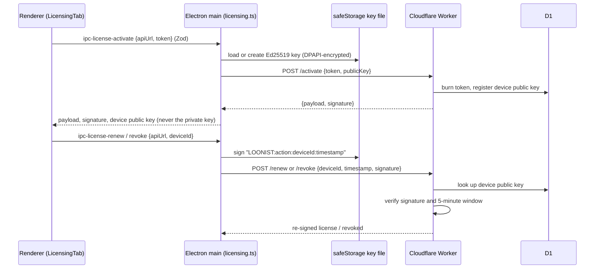

# Sprint 8: Licensing Security Hardening — Technical Walkthrough

**Platform:** LOONIST (Desktop First Article Inspection Enterprise Platform)  
**Product Owner:** Harsh Yadav  
**Status:** 🚧 **In Progress** — licensing hardening complete; signed installer CI/CD still open  
**Started:** 29 September 2026  

---

## 1. Summary

Sprint 7 left three licensing defects open (see the Sprint 7 journal, §6). Sprint 8 fixes them and closes further gaps found while doing so:

| # | Issue at end of Sprint 7 | Resolution |
| :-: | :--- | :--- |
| **1** | Renderer CSP blocked calls to the licensing server, so in-app activation could not work in the packaged app. | All licensing calls moved to the Electron main process (`electron/licensing.ts`). The renderer CSP stays closed to external hosts. |
| **2** | Device Ed25519 private key stored in plain text in `localStorage`. | Key generated and held only in the main process, encrypted with Electron `safeStorage` (Windows DPAPI) at `%APPDATA%/LOONIST/license/device-key.bin`. Existing plain-text keys are deleted from `localStorage` on first load. |
| **3** | Seven Sprint 7 IPC channels had no Zod payload validation. | Every IPC channel (16) now registers through one `handleIpc()` helper that checks the sender and validates the payload with a Zod schema. |
| **4** | Private key was generated but never used. | Renew and revoke requests are signed with the device key; the Worker verifies them against the public key registered at activation. |
| **5** | Worker `/renew` and `/revoke` accepted any `deviceId`, so anyone who knew a device ID could release its seat. | Requests require a valid device signature over `LOONIST:<action>:<deviceId>:<timestamp>` no older than 5 minutes. |
| **6** | Worker `/renew` returned "now + 30 days" without touching the database, which could shorten a longer subscription. | Renew returns a freshly signed license carrying the expiry stored in D1; administrators extend `Licenses.expires_at` to extend a subscription. The UI button is now **Refresh License**. |
| **7** | New installs showed a fake **ACTIVE** license with a placeholder signature. | New installs start **UNLICENSED**; the old demo license is cleared on load. |
| **8** | Activating and then pressing **Cancel** in Options discarded the result although the server had already consumed the token. | Activate / refresh / release results are saved immediately. |
| **9** | Exported configuration profiles carried the workstation's license binding, and importing one overwrote this workstation's license. | Profiles now carry only the licensing server URL. |

---

## 2. Architecture

---

## 3. Code Components

### 3.1 Main process
* [`electron/licensing.ts`](../fai-app/electron/licensing.ts) — `getOrCreateDeviceKey()` (refuses to run if `safeStorage` encryption is unavailable), `activateLicense()`, `renewLicense()`, `revokeLicense()`; 15-second request timeout; response shape checks.
* [`electron/licenseProtocol.ts`](../fai-app/electron/licenseProtocol.ts) — Electron-free shared pieces: `deviceRequestMessage()` and the Zod schemas. Licensing URLs must be `https://`, or `http://localhost` / `127.0.0.1` for a local `wrangler dev`.
* [`electron/main.ts`](../fai-app/electron/main.ts) — `handleIpc(channel, schema, handler)`; the only `ipcMain.handle` call. New channels: `ipc-license-activate`, `ipc-license-renew`, `ipc-license-revoke`. Previously unvalidated channels (`ipc-load-blueprint-path`, `ipc-save-project-file`, dialogs and window controls) now have schemas.

### 3.2 Renderer
* [`licenseClient.ts`](../fai-app/src/services/license/licenseClient.ts) — no `fetch` and no key generation; forwards to the IPC bridge and pre-checks the URL for a clear message. Outside the desktop app it reports that licensing needs the desktop app.
* [`LicensingTab.tsx`](../fai-app/src/components/modals/options/tabs/LicensingTab.tsx) — saves results immediately; placeholder tenant / feature labels replaced with "Not activated" / "—".
* [`useApplicationOptionsStore.ts`](../fai-app/src/stores/useApplicationOptionsStore.ts) — `sanitizeLicensing()` drops `devicePrivateKeyHex` and the demo license; profile import/export no longer carries license bindings.

### 3.3 Cloudflare Worker
* [`cloudflare-licensing-api/src/index.ts`](../cloudflare-licensing-api/src/index.ts) — `verifyDeviceRequest()` for `/renew` and `/revoke`; renew re-signs from D1 and writes a `RENEW` audit log entry; expired licenses are refused.
* [`cloudflare-licensing-api/src/crypto.ts`](../cloudflare-licensing-api/src/crypto.ts) — `verifyDeviceSignature()`.

> **Deployment note:** the desktop app and Worker must be deployed together; an older Worker ignores the signature fields, and an older desktop build cannot renew or release against the new Worker.

---

## 4. Verification

### Automated suite
New [`test_licensing_security.ts`](../fai-app/scripts/test_licensing_security.ts) (27 checks): desktop signatures verify with the Worker's function; replay to another device or action and foreign keys are rejected; URL rules; no private key in renderer code or defaults; legacy key and demo license migration; renderer makes no `fetch`; CSP `connect-src` has no external hosts; exactly one `ipcMain.handle`; every channel has a schema; every preload channel has a handler.

`npm test`: **25 / 25 suites passed**. `npm run build`: 0 TypeScript errors. `oxlint`: 0 errors, no new warnings.

### End-to-end against a local Worker
Run with `wrangler dev --local` and an isolated local D1 seeded from `schema.sql` / `seed.sql`:

| Check | Result |
| :--- | :--- |
| Activate with seeded token | 200, signed payload |
| Reuse the same token | 403 |
| Renew without signature | 400 |
| Revoke signed by another key | 401 "Device signature is invalid" |
| Request 10 minutes old | 401 |
| Renew signature replayed on revoke | 401 |
| Renew with device signature | 200, re-signed, expiry `2030-01-01` from D1 |
| Revoke with device signature | 200 |
| Renew after revoke | 403 |

### Not yet verified
* The Electron main-process path (`safeStorage` key file, IPC round trip) has been type-checked and built but not exercised in a running app.
* Offline signature verification against the Worker's **public** key is still not performed by the app: the server public key is not yet embedded in the build.

---

## 5. Remaining Sprint 8 Scope
* Embed the licensing server's Ed25519 public key and verify stored licenses offline on start-up.
* Decide what an UNLICENSED / EXPIRED workstation may do (the app does not currently restrict features by license state).
* Wire remaining Project Settings; Net-Inspect CSV exporter.
* Signed Windows installer pipeline (GitHub Actions, EV code signing, RFC 3161 timestamps).
