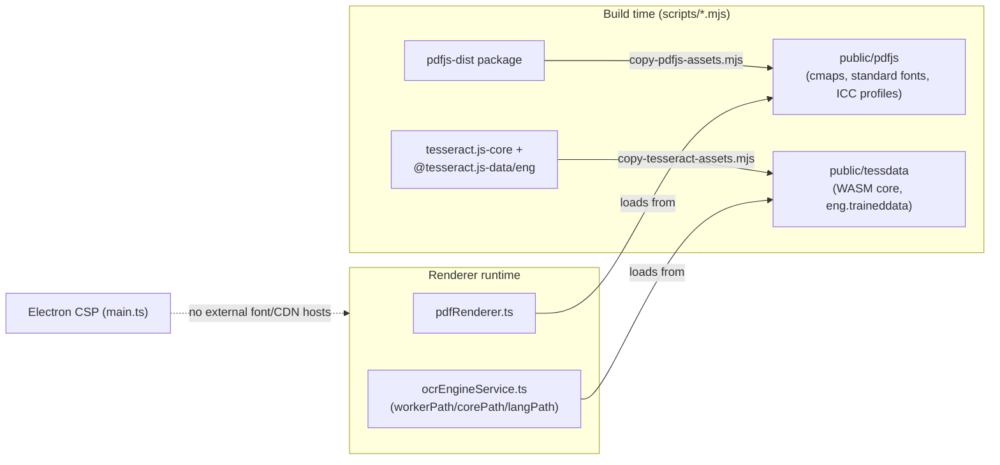
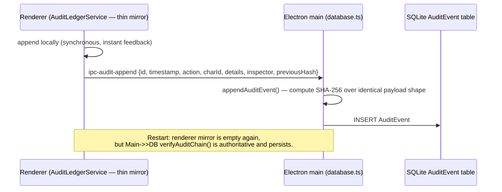
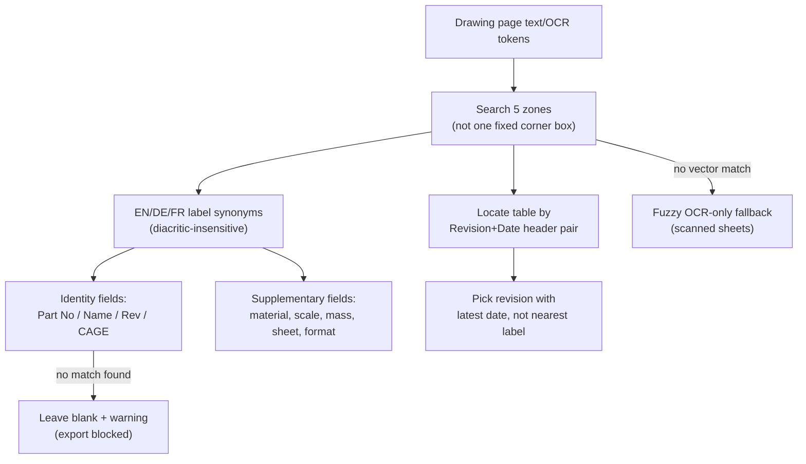

# Sprint 9: Offline Hardening, Extraction Correctness & Compliance Features — Technical Walkthrough

**Platform:** LOONIST (Desktop First Article Inspection Enterprise Platform)
**Product Owner:** Harsh Yadav
**Status:** ✅ **Complete** — 44 commits, 45/45 feature test suites passing
**Started:** 29 September 2026 (immediately after Sprint 8)
**Completed:** 6 October 2026

---

## 1. Summary

Sprint 9 followed a codebase audit and market-research pass against two real customer drawings (a Pentair/SolidWorks flange, a US-format aerospace FAIR), plus a true air-gap verification sweep of the packaged app. It is the largest sprint by commit count (44) since Sprint 1, spanning nine themes:

| # | Theme | What changed |
| :-: | :--- | :--- |
| **1** | True offline hardening | Fonts, PDF.js runtime assets, and Tesseract.js OCR assets (WASM core + trained-data model) bundled locally and loaded from explicit local paths; CSP tightened; Electron preload rebuilt as CommonJS after the ES-module build was found to silently fail to load in the packaged app. |
| **2** | Extraction-engine correctness | Rotation-safe coordinates, no fake-identity fallback, structural title-block matching (5 zones, EN/DE/FR synonyms, structural revision parsing), drawing-grid zone mapping now prefers the drawing's own printed ruler, and removal of several fabricated-value / silent-wrong-answer paths. |
| **3** | AIAG PPAP export (new) | 3-sheet workbook (Part Submission Warrant, Dimensional Results, Submission Status checklist); cross-sheet renumbering collision fixed; balloon number formatting centralized. |
| **4** | N/A conformance status (new) | Form 3 Status gains `N/A` alongside Comply/Reject, with required written justification enforced at the export gate. |
| **5** | Audit ledger persistence | Moved from an in-memory renderer array to a main-process-authoritative, SQLite-persisted hash chain; survives app restart. |
| **6** | Settings & tolerance correctness | `localStorage` found not to survive restart for this renderer's `file://` origin — theme/defaults moved to a file-backed store; three dead Settings toggles wired in; ISO 2768 presets corrected to resolve by true size bracket. |
| **7** | Export-pipeline fabrication fixes | Fabricated Lot Size/Sampling Plan defaults removed; balloon shape now actually burned into the marked PDF; GD&T Unicode symbols made Excel-font-safe. |
| **8** | Viewport/UI stabilization | Rotation pivots on center, Fit Page/Width re-centers, Space-to-pan restores the prior tool, touch double-tap-zoom fixed, broad dark-mode/style-token pass, dead UI (Net-Inspect tab, Help entry point, Air-Gapped badge) disabled rather than left non-functional. |
| **9** | Branding & workflow polish | Real favicon/icon, meaningful Auto Extract icon, confirmation toasts/dialogs for destructive or redundant actions. |

---

## 2. Architecture

### 2.1 True offline asset pipeline

*Before Sprint 9, both PDF.js and Tesseract.js fell back to their documented CDN defaults (`cdn.jsdelivr.net`) when no local path was given — meaning OCR on a genuinely air-gapped machine would hang indefinitely waiting on a network that doesn't exist. A packaged-app sweep now confirms zero outbound requests during startup, rendering, or OCR.*

### 2.2 Audit ledger: main-process authority

### 2.3 Title-block matching (rebuilt)

*Replaces a single hardcoded-format matcher that silently backfilled a missing match with the bundled demo part's identity.*

---

## 3. Code Components

### 3.1 Offline hardening
* [`scripts/copy-pdfjs-assets.mjs`](../fai-app/scripts/copy-pdfjs-assets.mjs) / [`scripts/copy-tesseract-assets.mjs`](../fai-app/scripts/copy-tesseract-assets.mjs) — build-time asset bundlers into `public/pdfjs` and `public/tessdata`.
* [`ocrEngineService.ts`](../fai-app/src/services/ai/ocrEngineService.ts) — explicit `workerPath` / `corePath` / `langPath`; widened char whitelist (accented Latin).
* [`electron/main.ts`](../fai-app/electron/main.ts) — preload now built as CommonJS (`preload.cjs`) via a dedicated Vite sub-build; `ipc-settings-get` / `ipc-settings-set` / `ipc-app-info` channels; `getSettingsFilePath()` resolves `userData/settings/renderer-settings.json`.
* CSP in `main.ts` / `index.html` tightened to drop remaining font/CDN hosts.

### 3.2 Extraction engine
* [`drawingExtractionService.ts`](../fai-app/src/services/ai/drawingExtractionService.ts) — renamed from `aiExtractionService.ts`; rotation-aware coordinate transform via PDF.js's own viewport; fake-identity fallback removed.
* [`gdtParser.ts`](../fai-app/src/services/ai/gdtParser.ts) — title-block field matching rebuilt around 5 search zones, language synonyms, structural revision-table parsing, fuzzy OCR fallback; chamfer-leg/sign/metric-thread-misrouting fixes; legend-table and NOTES-list-marker fabrication guards.
* [`gridZoneCalculator.ts`](../fai-app/src/services/ai/gridZoneCalculator.ts) — `findBorderGridLabels()` + nearest-label interpolation against the drawing's own printed zone ruler; normalized-grid guess demoted to fallback-only.
* [`toleranceEngine.ts`](../fai-app/src/services/ai/toleranceEngine.ts) — `ISO_2768_TABLE` (f/m/c/v classes, 8 brackets through 4000mm); `resolveMetricIso2768Tolerance()` now bracket-based regardless of decimal precision.

### 3.3 Compliance & export
* [`types/characteristics.ts`](../fai-app/src/types/characteristics.ts) — `ConformanceStatus` gains `'N/A'`.
* [`measurementEngine.ts`](../fai-app/src/services/compliance/measurementEngine.ts) — `computeLotStatistics()` tracks `notApplicableCount` separately from measured/unmeasured.
* [`characteristicExportGate.ts`](../fai-app/src/services/validation/characteristicExportGate.ts) — blocks export on an unjustified N/A exactly like an unresolved UNMEASURED item; blocks on remaining `needs_review` / unmeasured items generally, with an audit-logged override.
* [`electron/database.ts`](../fai-app/electron/database.ts) — `DBManager.appendAuditEvent()` / `getAuditEvents()` / `verifyAuditChain()` against the `AuditEvent` table.
* [`auditLedgerService.ts`](../fai-app/src/services/compliance/auditLedgerService.ts) — thin renderer mirror; identical hash payload shape to the main process.
* [`ppapExporter.ts`](../fai-app/src/services/export/ppapExporter.ts) + [`types/ppap.ts`](../fai-app/src/types/ppap.ts) — Part Submission Warrant / Dimensional Results / Submission Status checklist.
* [`utils/balloonFormat.ts`](../fai-app/src/utils/balloonFormat.ts) — centralized balloon-number display formatting, threaded through `as9102ExcelExporter.ts`, `ppapExporter.ts`, `markedPdfExporter.ts`, and the UI.
* [`renumberingService.ts`](../fai-app/src/services/ballooning/renumberingService.ts) — `cascadeRenumber()` keys compound sub-item groups by `(sheet, item number)`, not item number alone.
* [`markedPdfExporter.ts`](../fai-app/src/services/export/markedPdfExporter.ts) — `drawBadgeShape()` mirrors `ViewportCanvas`'s on-screen shape precedence.
* [`gdtParser.ts`](../fai-app/src/services/ai/gdtParser.ts) — `getCharacteristicLabel()` for Excel-font-safe GD&T symbol labels.

### 3.4 UI / viewport / settings
* [`ViewportCanvas.tsx`](../fai-app/src/components/viewport/ViewportCanvas.tsx) — rotation around drawing center; Fit Page/Width re-measures and re-centers; Space-to-pan tool restoration; touch double-tap-zoom guards.
* [`useApplicationOptionsStore.ts`](../fai-app/src/stores/useApplicationOptionsStore.ts) — `netInspect` section removed; `itarPrivacy` rebuilt as `privacy`.
* Settings/project-defaults durability moved to the `ipc-settings-get/set`-backed file store described in §3.1.

---

## 4. Verification

### Automated suite
`npm test` (`scripts/run_all_feature_tests.ts`): **45 / 45 suites passed** (up from 25 at the end of Sprint 8), including new suites for the AIAG PPAP exporter, N/A conformance status enforcement, already-ballooned PDF detection, GD&T symbol font registry, organization-name detection, title-block trailing-period/date-fusion, two golden real-customer-drawing fixtures (Pentair/SolidWorks flange, US-format FAIR), rotation invariance (0°/90°/180°/270°), metric thread parsing, multi-page mixed-rotation/non-English documents, and audit-ledger SQLite restart-survival.

`npm run build`: 0 TypeScript errors.

### Manual / packaged-app verification
* Network sweep of the packaged app: zero outbound requests during startup, drawing rendering, or OCR — confirming the offline-hardening work actually closes the gap (fonts, PDF.js assets, Tesseract.js assets) rather than just asserting it.
* `window.api` availability confirmed in a built/packaged run after the preload CommonJS fix (previously silently `undefined`, undetectable by `npm run build` since that only type-checks).

### Not yet verified
* Production licensing key upload to the Worker (`wrangler secret put LICENSE_PRIVATE_KEY`) — carried over from Sprint 8, still open.
* Feature gating by license state — still not implemented.

---

## 5. Remaining Scope
* Net-Inspect Portal CSV exporter — the placeholder Options tab was removed rather than implemented; still not built.
* Help Center — content exists in code (`helpData.ts`) but the entry point stays disabled pending a real content pass.
* Balloon prefix, leading zeros, and AS9102 revision Project Settings remain unwired.
* Signed Windows installer pipeline (GitHub Actions, EV code signing, RFC 3161 timestamps) — carried over from Sprint 8.
* Importing offline (`.lic`) license certificates for air-gapped workstations — carried over from Sprint 8.
