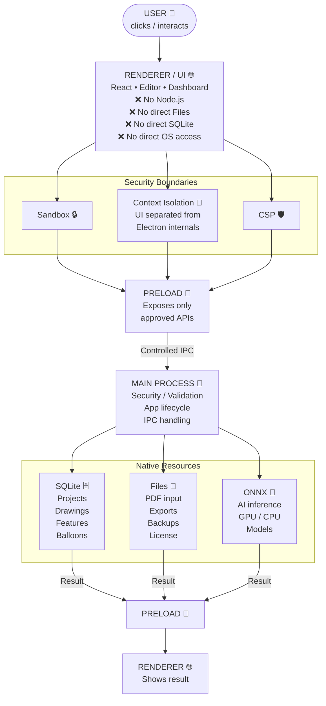

# FAI.EV.ENGINEER — Electron Security Visual Architecture

## Security Policies
- `contextIsolation: true` is strictly enforced.
- `nodeIntegration: false` in all renderer processes.
- `sandbox: true` enabled for all renderers.
- **Navigation:** The app overrides `webContents.setWindowOpenHandler` to block arbitrary URL navigation. External links (e.g., Help docs) open exclusively in the OS default browser.
- **CSP:** A strict Content Security Policy blocks inline scripts and limits image/worker sources to `self`.
